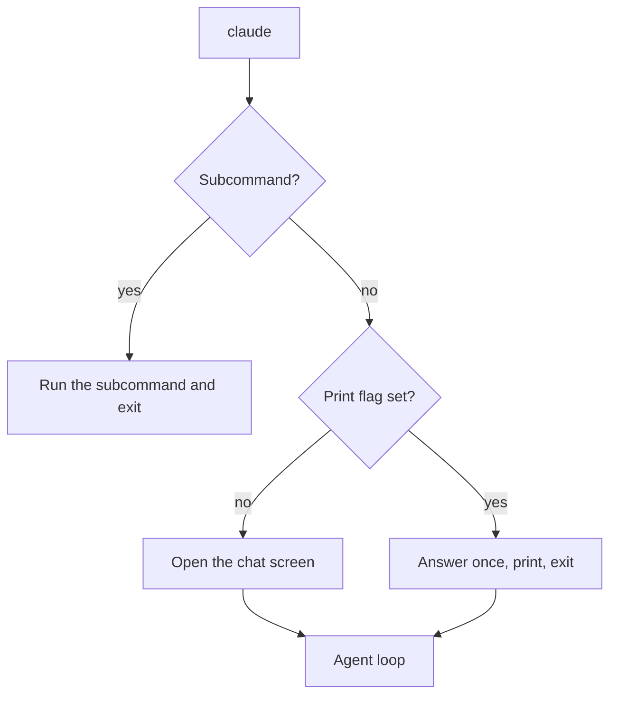

`claude` is the command that starts Claude Code.
Alone, it opens a chat in your terminal. With `-p`, it answers once and exits. Scripts and CI jobs use it this way.
Flags change one run. Subcommands do separate jobs, such as sign-in, plugins, and background sessions.

The `claude` program is on your `PATH`. Run it in a project folder. Run `claude --help` for the list.
Each flag is its own switch. A flag is on when you pass it. Some flags have a `--no-` twin, such as `--no-chrome`.
You can also set the same choice in a settings file or an environment variable. A subcommand runs only when you call it.

## Example

```bash
claude                                   # chat
claude "explain this project"            # chat with a first prompt
claude -p "list the TODOs" > todos.txt   # one answer, then exit
git diff | claude -p "review this diff"  # pipe in text
```

## Ways to Start

Official pages: [CLI Reference](https://code.claude.com/docs/en/cli-reference) and [Run Claude Code Programmatically](https://code.claude.com/docs/en/headless).

| Command | Status | What it does |
| --- | --- | --- |
| `claude` | <Documented /> | Starts an interactive session. |
| `claude "query"` | <Documented /> | Starts an interactive session with a first prompt. |
| `claude -p "query"` | <Documented /> | Prints one answer and exits. It skips the trust dialog. Use it only in folders you trust. |
| `cmd \| claude -p "query"` | <Documented /> | Prints one answer for the text that you pipe in. |
| `claude -c`, `claude -r "<session>"` | <Documented /> | Continues or resumes a session (see [Sessions and Storage](../../how-it-works/sessions-and-storage.md)). |
| `claude --bg "query"` | <Documented /> | Starts a background session. `claude agents` lists the sessions. |
| `claude --bare` | <Documented /> | Starts with no hooks, plugins, MCP servers, auto memory, or `CLAUDE.md` discovery. It sets `CLAUDE_CODE_SIMPLE=1`. |
| `claude --safe-mode` | <Documented /> | Starts with all customizations off to debug a broken setup. It sets `CLAUDE_CODE_SAFE_MODE=1`. |
| `claude --restricted` | <Documented /> | Removes the tools that run code. It also ignores user, project, and local settings. |
| `claude --cloud`, `--environment`, `--teleport` | <Documented /> | Work with cloud sessions. |

:::warning
Print mode (`-p`) skips the trust dialog for the folder. Use it only in folders you trust.
It also ignores settings files that fail validation, without any error.
:::

## Print Mode Flags

Print mode runs once and prints the result. These flags shape its input and output.
Some of them work only together, for example `--include-partial-messages` needs `--output-format stream-json`.

| Flag | Status | What it does |
| --- | --- | --- |
| `--output-format text\|json\|stream-json` | <Documented /> | `json` gives one result object. `stream-json` gives one JSON line for each event (see [Stream JSON](../../extend/headless/stream-json.md)). |
| `--input-format text\|stream-json` | <Documented /> | `stream-json` reads JSON lines from stdin. |
| `--include-partial-messages`, `--include-hook-events`, `--forward-subagent-text`, `--replay-user-messages` | <Documented /> | Add events to the stream, with `stream-json` only. |
| `--json-schema <schema>` | <Documented /> | Checks the final answer against a JSON Schema. |
| `--max-budget-usd <amount>` | <Documented /> | Stops at a spend limit. |
| `--max-turns <n>` | <Documented /> | Stops after `n` agent turns. `--help` hides the flag. |
| `--permission-prompts host\|none` | <Documented /> | `none` denies everything that would ask. |
| `--permission-prompt-tool <tool>` | <Documented /> | Lets an MCP tool answer permission prompts. `--help` hides the flag. |
| `--no-session-persistence` | <Documented /> | Writes no transcript. |
| `--init`, `--init-only`, `--maintenance` | <Documented /> | Run `Setup` hooks. `--help` hides the flags. |

The result of `--output-format json` has a `usage` field.
Its `cache_creation` part is split into `ephemeral_1h_input_tokens` and `ephemeral_5m_input_tokens`. See [How Claude Code Uses Prompt Caching](https://code.claude.com/docs/en/prompt-caching#choose-the-ttl-yourself).

## Background Sessions and API Keys

A background session that is not `--bare` cannot use an `ANTHROPIC_API_KEY` that nobody approved. Claude Code refuses it and tells you to run the session in this terminal.[^bg-key] A session that you start with `claude --bare --bg` gets the key only if the background service has it or is not running yet. If the service lacks the key, token, or workload identity, Claude Code refuses and tells you to run the session in this terminal. Since `2.1.326`, `claude --bare --bg` exits with an error in that case.[^bg-key]

## How It Works

Claude Code reads your flags first. A flag wins over the same choice in an environment variable or a settings file, with a few exceptions. [Environment Variables](../env-vars/index.md#which-value-wins) lists them.



The flow matches the `claude --help` output.[^help]

## Related Pages

- [All Flags](flags.md) lists every flag, including the hidden ones.
- [Subcommands](subcommands.md) lists every `claude <command>`.
- [Environment Variables](../env-vars/index.md) holds the variables that match many flags.
- [Permissions](../permissions/index.md) explains `--permission-mode` and the tool allow lists.
- [Sessions and Storage](../../how-it-works/sessions-and-storage.md) explains `-c` and `-r`.
- [The Agent Loop](../../how-it-works/agent-loop.md) shows what runs after startup.

## Sources

[^help]: The program, `chunk-gywceass.js:59585`, `claude --help`, `2.1.327`.
[^bg-key]: The program, `chunk-avyyrx5p.js:28209` (the check), `chunk-avyyrx5p.js:28495` (the service lacks the credential), and `chunk-2kcf7y79.js:1240` and `chunk-2kcf7y79.js:1797` (the two messages). Release notes: [`2.1.325`](https://github.com/anthropics/claude-code/releases/tag/v2.1.325) for the refusal and the messages, and [`2.1.326`](https://github.com/anthropics/claude-code/releases/tag/v2.1.326) for the exit with an error of `claude --bare --bg`.
