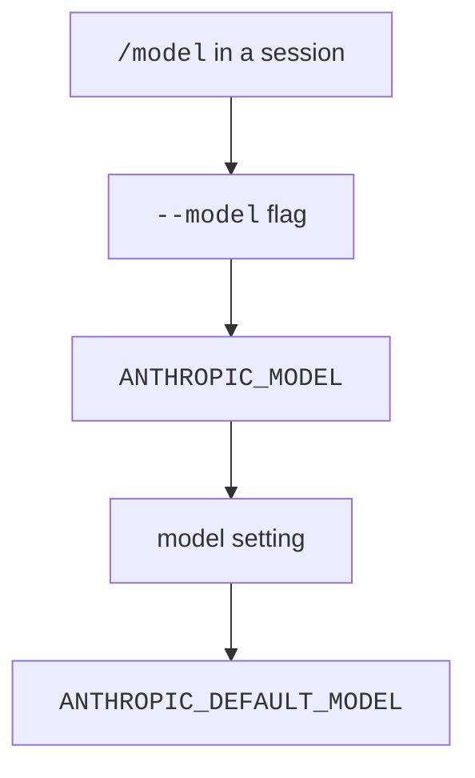

Claude Code picks a model from a short list of sources. This page shows the order of those sources, the aliases, the built-in catalog, the prices, and the capability flags. Change the model to match your task, your cost, or your provider. Use `/model`, the `--model` flag, or the `model` setting.

## Example

```bash
claude --model opus[1m]
```

This session uses the `opus` alias with a 1M window. See [Aliases](#aliases) for what `opus` resolves to.

## Choose a Model



The list runs from highest to lowest priority. See [Model Configuration: Setting Your Model](https://code.claude.com/docs/en/model-config#setting-your-model).

| Item | Status | What it does |
| --- | --- | --- |
| `/model <alias\|name>` | <Documented /> | Switches now. With no argument it opens the picker. `Enter` saves your choice as the default. `s` switches for this session only. |
| `--model <model>` | <Documented /> | Sets the model for one session. |
| `ANTHROPIC_MODEL` | <Documented /> | Sets the model with the same values as `--model`. |
| `model` | <Documented /> | The settings key that stores the default. |
| `ANTHROPIC_DEFAULT_MODEL` | <Documented /> | Sets the default for new sessions. |
| `availableModels` | <Documented /> | An allowlist in managed settings. It limits `/model`, `--model`, the env vars, and alias resolution. Entries can be a family (`sonnet`), a version prefix (`claude-sonnet-4-5`), or a full ID. |
| `modelOverrides` | <Documented /> | Maps an Anthropic model ID to the provider string Claude Code sends, such as a Bedrock inference profile ARN. Claude Code matches a model name to a `modelOverrides` value without regard to letter case or a `[1m]` tag.[^overrides] |
| `modelPicker` | <Documented /> | Lists your own rows for the `/model` picker, in your order and labels. |
| `ANTHROPIC_CUSTOM_MODEL_OPTION` | <Documented /> | Adds one custom entry to the picker. Claude Code does not validate the ID. Add `_NAME` and `_DESCRIPTION` for a label. |
| `CLAUDE_CODE_ENABLE_GATEWAY_MODEL_DISCOVERY` | <Documented /> | Fills the picker from the gateway `/v1/models` endpoint. Off by default. |
| `CLAUDE_CODE_GATEWAY_MODEL_DISCOVERY_TIMEOUT_MS` | <Documented /> | The timeout of that request. The default is `3000`. |
| `CLAUDE_CODE_SUBAGENT_MODEL` | <Documented /> | The default model for subagents, teammates, and workflow agents with no model set. |
| `--include-unsupported-models` | <Undocumented /> | Offers models your account can use that this version does not know. |
| `PreModelSwitch`, `PostModelSwitch` hooks | <Documented /> | They run around a switch. `PreModelSwitch` can block it. |

## Aliases

An alias is a short name for the newest model of a family.
The catalog holds `opus`, `sonnet`, `haiku`, and `fable`. The help text of `--model` names `fable`, `opus`, and `sonnet`.

| Alias | Status | Resolves to | Exceptions |
| --- | --- | --- | --- |
| `default` | <Documented /> | Clears the override. The model is then the runtime default for your account. The default is Opus 5.5 on the Anthropic API, on the paid plans, and on AWS and Google Cloud. | It is not an alias in the strict sense. |
| `opus` | <Documented /> | `claude-opus-5-5` | Foundry uses `claude-opus-4-6`. Gateways use `claude-opus-4-7`. |
| `sonnet` | <Documented /> | `claude-sonnet-5-5` | Bedrock, Vertex, Foundry, and Mantle use `claude-sonnet-4-5`. Claude Platform on AWS and gateways use `claude-sonnet-4-6`. |
| `haiku` | <Documented /> | `claude-haiku-5-5` | Every other provider uses `claude-haiku-4-5`. |
| `fable` | <Documented /> | `claude-fable-5-2` | Gateways use `claude-fable-5`, which the catalog names Fable 5. A session counts as a gateway session when gateway sign-in is active, the gateway server process runs, or host policy requires a gateway.[^fable-alias] |
| `best` | <Documented /> | The same model as `opus`. | The alias table sets `best` to `opus`.[^best] |
| `opusplan` | <Documented /> | `opus` in plan mode, then `sonnet` to run the plan. [^opusplan] | |
| `sonnet[1m]`, `opus[1m]`, `fable[1m]` | <Documented /> | The alias with a 1M window. | No effect when the alias already has a native 1M window. Claude Code shows the `(1M context)` label only for a model that supports the suffix. It still accepts the suffix on other models.[^suffix] |

See [Model Configuration](https://code.claude.com/docs/en/model-config) for the aliases.[^aliases] Claude Code removes the `[1m]` tag when the name without it has a known window on its own. It adds the `(1M context)` label only when the tag remains and the model allows the suffix.[^suffix]

### Pin the Models Behind an Alias

| Environment variable | Status | Effect |
| --- | --- | --- |
| `ANTHROPIC_DEFAULT_OPUS_MODEL` | <Documented /> | The model for `opus`, and for `opusplan` in plan mode. |
| `ANTHROPIC_DEFAULT_SONNET_MODEL` | <Documented /> | The model for `sonnet`, and for `opusplan` outside plan mode. |
| `ANTHROPIC_DEFAULT_HAIKU_MODEL` | <Documented /> | The model for `haiku` and for background work. |
| `ANTHROPIC_DEFAULT_FABLE_MODEL` | <Documented /> | The model for `fable`. It also marks the ID as a Fable model for fallback. |
| `ANTHROPIC_SMALL_FAST_MODEL` | <Documented /> <Deprecated note="Use ANTHROPIC_DEFAULT_HAIKU_MODEL" /> | Deprecated. Use `ANTHROPIC_DEFAULT_HAIKU_MODEL`. |
| `ANTHROPIC_DEFAULT_<FAMILY>_MODEL_NAME` | <Documented /> | The name of the pinned model that the picker shows. It works on third-party providers and gateways. |
| `ANTHROPIC_DEFAULT_<FAMILY>_MODEL_DESCRIPTION` | <Documented /> | The description in the picker. |
| `ANTHROPIC_DEFAULT_<FAMILY>_MODEL_SUPPORTED_CAPABILITIES` | <Documented /> | A comma list that tells Claude Code what the pinned model supports. Values: `effort`, `xhigh_effort`, `max_effort`, `thinking`, `adaptive_thinking`, `interleaved_thinking`. |

`<FAMILY>` is `OPUS`, `SONNET`, `HAIKU`, or `FABLE`. The `_NAME`, `_DESCRIPTION`, and `_SUPPORTED_CAPABILITIES` suffixes also work with `ANTHROPIC_CUSTOM_MODEL_OPTION`.
Pin versions before you deploy Claude Code on a third-party provider, because the alias default can lag the newest model.
A native 1M model runs with 1M with no suffix when the pinned ID contains its Anthropic API ID. For a model that reaches 1M through `[1m]` (Opus 4.6, Sonnet 4.6), add `[1m]` to the variable.

## Catalog

The catalog is a built-in list of models.[^catalog] It holds the provider names, the window, the output limits, the price, the default effort, and the capability flags of each model.
A row is <Documented /> when an official docs page names the model. It is <Undocumented /> when no page names it.
The docs do not list the catalog fields, so the window, the limits, and the prices come from the program for all rows.

"Larger window" says how to get a bigger one. `native 1M` means the model has 1M already. `context-1m` is the beta that asks the API for it. `[1m]` is the suffix for `--model`.
"Output" shows the default and the highest output limit in tokens. Prices are in [Pricing](#pricing) and default efforts are in [Effort](effort-thinking-and-fallback.md#effort).

| `id` | Status | Name | Knowledge cutoff | Window | Larger window | Output |
| --- | --- | --- | --- | --- | --- | --- |
| `claude-3-5-haiku` | <Undocumented /> | Haiku 3.5 | - | not set | - | 8,192 / 8,192 |
| `claude-haiku-4-5` | <Documented /> | Haiku 4.5 | February 2025 | 200,000 | `[1m]` suffix | 32,000 / 64,000 |
| `claude-haiku-5-5` | <Documented /> | Haiku 5.5 | June 2026 | 1,000,000 | native 1M, `context-1m` | 128,000 / 128,000 |
| `claude-3-5-sonnet` | <Undocumented /> | Sonnet 3.5 | - | not set | - | 8,192 / 8,192 |
| `claude-3-7-sonnet` | <Undocumented /> | Sonnet 3.7 | - | not set | - | 32,000 / 64,000 |
| `claude-sonnet-4-0` | <Undocumented /> | Sonnet 4 | January 2025 | 200,000 | `context-1m`, `[1m]` | 32,000 / 64,000 |
| `claude-sonnet-4-5` | <Documented /> | Sonnet 4.5 | January 2025 | 200,000 | `context-1m`, `[1m]` | 32,000 / 64,000 |
| `claude-sonnet-4-6` | <Documented /> | Sonnet 4.6 | August 2025 | 200,000 | `context-1m`, `[1m]` | 32,000 / 128,000 |
| `claude-sonnet-5` | <Documented /> | Sonnet 5 | January 2026 | 1,000,000 | native 1M, `context-1m` | 64,000 / 128,000 |
| `claude-sonnet-5-5` | <Documented /> | Sonnet 5.5 | June 2026 | 1,000,000 | native 1M, `context-1m` | 128,000 / 128,000 |
| `claude-opus-4-0` | <Undocumented /> | Opus 4 | January 2025 | 200,000 | `[1m]` suffix | 32,000 / 32,000 |
| `claude-opus-4-1` | <Documented /> | Opus 4.1 | January 2025 | 200,000 | `[1m]` suffix | 32,000 / 32,000 |
| `claude-opus-4-5` | <Documented /> | Opus 4.5 | May 2025 | 200,000 | `[1m]` suffix | 32,000 / 64,000 |
| `claude-opus-4-6` | <Documented /> | Opus 4.6 | May 2025 | 200,000 | `context-1m`, `[1m]` | 64,000 / 128,000 |
| `claude-opus-4-7` | <Documented /> | Opus 4.7 | January 2026 | 1,000,000 | native 1M, `context-1m`, `[1m]` | 64,000 / 128,000 |
| `claude-opus-4-8` | <Documented /> | Opus 4.8 | January 2026 | 1,000,000 | native 1M, `context-1m`, `[1m]` | 64,000 / 128,000 |
| `claude-opus-5` | <Documented /> | Opus 5 | May 2026 | 1,000,000 | native 1M, `context-1m`, `[1m]` | 64,000 / 128,000 |
| `claude-opus-5-5` | <Documented /> | Opus 5.5 | June 2026 | 1,000,000 | native 1M, `context-1m`, `[1m]` | 128,000 / 128,000 |
| `claude-fable-5` | <Documented /> | Fable 5 | January 2026 | 1,000,000 | native 1M, `context-1m` | 64,000 / 128,000 |
| `claude-fable-5-1` | <Documented /> | Fable 5.1 | June 2026 | 1,000,000 | native 1M, `context-1m` | 64,000 / 128,000 |
| `claude-fable-5-2` | <Documented /> | Fable 5.2 | June 2026 | 1,000,000 | native 1M, `context-1m` | 128,000 / 128,000 |
| `claude-mythos-5` | <Documented /> | Mythos 5 | January 2026 | 1,000,000 | native 1M, `context-1m` | 64,000 / 128,000 |
| `claude-mythos-5-1` | <Undocumented /> | Mythos 5.1 | June 2026 | 1,000,000 | native 1M, `context-1m` | 64,000 / 128,000 |
| `claude-mythos-5-2` | <Undocumented /> | Mythos 5.2 | June 2026 | 1,000,000 | native 1M, `context-1m` | 128,000 / 128,000 |

Notes:

- A model with no window in the table has no `context` entry in the catalog.
- The catalog keeps a rank for each model for the advisor tool (`--advisor`). The ranks run from `1` for `claude-haiku-4-5` to `10` for `claude-fable-5-2` and `claude-mythos-5-2`. `claude-fable-5-1` and `claude-mythos-5-1` have `9`.
- A model can name a model to use instead on a third-party provider. For example, `claude-opus-5-5` falls back to `claude-opus-5`, `claude-fable-5-1` falls back to `claude-fable-5`, and `claude-fable-5-2` falls back to `claude-fable-5-1`.[^fallback-3p] The catalog row of `claude-fable-5-2` has the Vertex region variable `VERTEX_REGION_CLAUDE_FABLE_5_2`; see [Providers](providers.md#vertex-region-variables).
- The Mythos models have a name on the Anthropic API only, and none on the cloud providers.
- For an ID that is not in the catalog, Claude Code assumes a 1M window. The function that picks the window returns 1,000,000 for this case.[^window-default] With `CLAUDE_CODE_DISABLE_1M_CONTEXT=1`, Claude Code keeps 200K. Claude Code adds a hint to the notice when the window is 1M: "set a smaller auto-compact window with /autocompact". [^window-hint] Use `/autocompact` to compact earlier.
- `/model <id>` warns about an ID that is not in the catalog. For example, `/model claude-zeta-9` replies "Set model to `claude-zeta-9` for this session only", then "Claude Code doesn't recognize the model "claude-zeta-9", so it assumes a context window of 200k tokens" (the number is the assumed window), with a link to [Model Configuration: Correct the Window for a Gateway or Custom Model ID](https://code.claude.com/docs/en/model-config#correct-the-window-for-a-gateway-or-custom-model-id).[^zeta] A known ID, such as `claude-opus-5-5`, gives no warning. At startup, a status notice says the same thing ("Model "…" isn't recognized").

## Other Model IDs in the Program

These IDs are not catalog rows. Claude Code names them for one task each. All rows are <Undocumented />.

| `id` | Status | Where Claude Code uses it |
| --- | --- | --- |
| `claude-3-opus`, `claude-3-sonnet`, `claude-3-haiku` | <Undocumented /> | The `Read` tool refuses a whole-PDF read on these models. Use the `pages` parameter instead. |
| `claude-haiku-3-5`, `claude-sonnet-3-7` | <Undocumented /> | Short names in a table that shortens a model name for the commit and pull request attribution line. A name that contains `haiku-3-5` or `sonnet-3-7` maps to the ID. |
| `claude-mythos-preview` | <Undocumented /> | The model-name validation accepts it as a known name, next to the aliases. It has no catalog row. |
| `claude-sonnet-4-5-20250929[1m]` | <Undocumented /> | On the Anthropic API, a startup migration changes a user-settings `model` of this value to `sonnet[1m]`.[^sonnet-migration] |
| `claude-fable-5-1[1m]` | <Undocumented /> | A startup migration changes a user-settings `model` of this value, or of `claude-fable-5-1`, to `fable[1m]` (or `fable`).[^fable-migration] Team and Enterprise plans also get a deferred move: it waits until the organization allows `fable`, and it stops at 15 December 2026.[^fable-deadline] `/model claude-fable-5-1` switches back. |
| `claude-sonnet-4-6[1m]`, `claude-opus-4-6[1m]` | <Undocumented /> | The value of the "1M context" entries in the `/model` picker on the Anthropic API. |
| `claude-opus-5[1m]`, `claude-opus-5-5[1m]`, `claude-sonnet-5-5[1m]` | <Undocumented /> | The refusal fallback table treats each like the ID without `[1m]`. |
| `claude-sonnet-5[1m]`, `claude-opus-4-8[1m]` | <Undocumented /> | Keys of a built-in per-model threshold table (`severityByModel`), next to the same IDs without `[1m]`. |

## Pricing

Prices are in US dollars for each million tokens. A search request costs `0.01` in every group.
Haiku 5.5 costs `0.5` for input and `2.5` for output above 100,000 prompt tokens.
All rows are <Undocumented />.

| Models | Input | Output | Cache write 5m | Cache write 1h | Cache read |
| --- | --- | --- | --- | --- | --- |
| `claude-sonnet-5` | 2 | 10 | 2.5 | 4 | 0.2 |
| `claude-sonnet-5-5` | 2 | 10 | 2.5 | 4 | 0.1 |
| `claude-3-5-sonnet`, `claude-3-7-sonnet`, `claude-sonnet-4-0`, `claude-sonnet-4-5`, `claude-sonnet-4-6` | 3 | 15 | 3.75 | 6 | 0.3 |
| `claude-opus-4-5`, `claude-opus-4-6`, `claude-opus-4-7`, `claude-opus-4-8`, `claude-opus-5` | 5 | 25 | 6.25 | 10 | 0.5 |
| `claude-opus-4-0`, `claude-opus-4-1` | 15 | 75 | 18.75 | 30 | 1.5 |
| `claude-fable-5`, `claude-mythos-5` | 10 | 50 | 12.5 | 20 | 1 |
| `claude-fable-5-1`, `claude-mythos-5-1` | 10 | 50 | 12.5 | 20 | 0.25 |
| `claude-fable-5-2`, `claude-mythos-5-2` | 8 | 40 | 10 | 16 | 0.2 |
| `claude-opus-5-5` | 4 | 20 | 5 | 8 | 0.2 |
| `claude-3-5-haiku` | 0.8 | 4 | 1 | 1.6 | 0.08 |
| `claude-haiku-4-5` | 1 | 5 | 1.25 | 2 | 0.1 |
| `claude-haiku-5-5` | 0.1 | 0.5 | 0.125 | 0.2 | 0.01 |

## Capabilities

The model catalog gives each model a list of capability flags.
The code tests a flag to switch a feature on for that model.
The docs do not list these flags, so every row is <Undocumented />.
This page gives the meaning only where the docs or a string in the program make it clear.
The column "Models" counts the models that have the flag.
For pinned models on third-party providers, you can state the capabilities yourself with `_SUPPORTED_CAPABILITIES` (see above).

| Flag | Status | What it does | Models |
| --- | --- | --- | --- |
| `context_management` | <Undocumented /> | The model works with the `context-management-2025-06-27` beta. | 20 |
| `effort` | <Undocumented /> | The model accepts the `effort` setting. | 14 |
| `max_effort` | <Undocumented /> | The model accepts the level `max`. | 14 |
| `xhigh_effort` | <Undocumented /> | The model accepts the level `xhigh`. | 12 |
| `adaptive_thinking` | <Undocumented /> | The model accepts adaptive thinking. | 14 |
| `mid_conv_tool_change` | <Undocumented /> | The tool list can change in the middle of a conversation. | 10 |
| `rejects_disabled_thinking` | <Undocumented /> | Thinking cannot be turned off, as the docs say for `MAX_THINKING_TOKENS`. | 8 |
| `per_turn_effort` | <Undocumented /> | The model can take the effort with each message. | 6 |
| `per_turn_timing` | <Undocumented /> | The model can take the current time with each message. | 6 |
| `lean_prompt` | <Undocumented /> | The model-side input for the short system prompt. See [The System Prompt](../../how-it-works/system-prompt.md#short-or-full-prompt). | 10 |
| `org_locked_thinking` | <Undocumented /> | The organization locks the thinking setting. | 4 |
| `haiku_5_5_early_stopping_guidance` | <Undocumented /> | Claude Code adds guidance against early stopping. | 1 |
| `refusal_fallback` | <Undocumented /> | A refused request can run again on a fallback model. | 6 |
| `silent_turn_reminder` | <Undocumented /> | Claude Code adds a reminder after a turn with no text. | 1 |
| `fast_mode` | <Undocumented /> | The model supports `/fast` on the Anthropic API. See [Fast Mode](fast-mode.md#models). | 5 |
| `vertex_fast_mode` | <Undocumented /> | The model supports `/fast` on Vertex. `claude-fable-5-2` and `claude-mythos-5-2` have it. | 2 |
| `thinking_disabled_effort_cap` | <Undocumented /> | The purpose is not stated. | 1 |
| `opus_5_prompt_bundle` | <Undocumented /> | The model gets the prompt sections for Opus 5. | 1 |
| `opus_5_5_prompt_bundle` | <Undocumented /> | The model gets the prompt sections for Opus 5.5. | 1 |
| `fable_5_mitigations` | <Undocumented /> | The model gets extra safety text for Fable 5. | 3 |
| `fable_5_1_prompt_bundle` | <Undocumented /> | The model gets the prompt sections for Fable 5.1. | 2 |
| `fable_5_2_prompt_bundle` | <Undocumented /> | The model gets the prompt sections for Fable 5.2. | 2 |
| `total_tokens_reminder` | <Undocumented /> | Claude Code adds the `total_tokens` reminder of the tokens left. See [`totalTokensReminder`](../settings/model.md). Fable 5.2 and Mythos 5.2 do not have it. | 20 |
| `tool_loaded_text` | <Undocumented /> | The purpose is not stated. Fable 5.2 and Mythos 5.2 are the only models without it. | 22 |

The flags `effort`, `max_effort`, `xhigh_effort`, and `adaptive_thinking` say which effort levels and which thinking mode a model accepts.
The betas `per-turn-control-2026-07-01` and `timing-2026-09-09` match the flags `per_turn_effort` and `per_turn_timing`.

## Related Pages

- [Models and Providers](index.md) lists the pages of this section and shows an example.

## Sources

[^overrides]: The program, `chunk-xethrx83.js:280365` (the lookup from a model name to a `modelOverrides` key) and `chunk-699j6sfp.js:1206` (the comparison that ignores letter case and a trailing `[1m]`).
[^best]: The program, `chunk-b60sxmve.js:22702`.
[^fable-alias]: The program, `chunk-b60sxmve.js:22614` for the alias entry, `chunk-b60sxmve.js:28163` for the lookup that takes `per_provider` first and `default` second, `chunk-b60sxmve.js:34347` for the provider choice, and `chunk-b60sxmve.js:16653` for the `claude-fable-5` entry with display name `Fable 5`.
[^opusplan]: The program, `chunk-xethrx83.js:479843` (the plan-mode model for `opusplan` and `haiku`) and `chunk-xethrx83.js:480769` (the plan-mode switch).
[^aliases]: The aliases are from the official page, and the exceptions are from the program, `chunk-b60sxmve.js:21915-22702`.
[^suffix]: The program, `chunk-xethrx83.js:503403` (the `(1M context)` label needs a model with `supports_1m_suffix`) and `chunk-699j6sfp.js:933` (the alias list with `[1m]`).
[^catalog]: The program holds a JavaScript object with the comment `Hand-maintained baked-in model catalog`, `chunk-b60sxmve.js:674`.
[^fallback-3p]: The program, field `fallback_3p`, `chunk-b60sxmve.js:16023`, `chunk-b60sxmve.js:18134`, and `chunk-b60sxmve.js:19244`.
[^window-default]: The program, `chunk-xethrx83.js:516700`, `return TN()?Ryt:g1`; `g1` is `1e6`, `Ryt` is `200000` (`chunk-xethrx83.js:513426`, `chunk-xethrx83.js:513458`). `CLAUDE_CODE_MAX_CONTEXT_TOKENS` is checked first, and a model the catalog does not know reaches this line.
[^window-hint]: The program, `chunk-zv7qt1se.js:2828`.
[^zeta]: The program, `chunk-6949vc40.js:11091` (the `/model` reply), `chunk-zv7qt1se.js:3089` (the warning text), and `chunk-4d4nzary.js:77255` (the startup notice).
[^sonnet-migration]: The program, `chunk-gywceass.js:21483`.
[^fable-migration]: The program, `chunk-2v0j7fr6.js:97857`.
[^fable-deadline]: The program, `chunk-2v0j7fr6.js:98560` (the date) and `chunk-2v0j7fr6.js:98584` (the deferred move).
