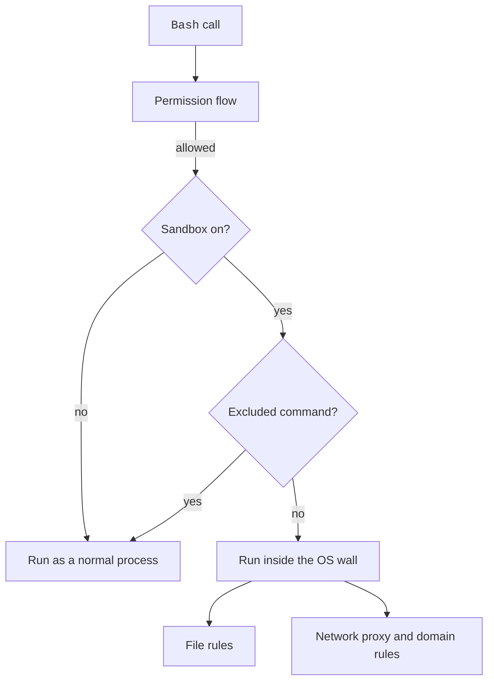

The sandbox runs `Bash` commands inside a wall that the operating system enforces. It limits which files a command can write and which hosts it can reach.

Permission rules and the sandbox do different jobs. A permission rule decides whether a call runs. The sandbox limits what the call can touch after it starts. Use the sandbox when you want commands to run with fewer prompts but still keep them away from your secrets and the network.

The sandbox works on macOS, Linux, and WSL2. On native Windows, the official page says commands run unsandboxed; see `sandbox.windows.backend` for the Windows backend in the program. The sandbox is off by default. Set `sandbox.enabled` to `true` to turn it on. If its dependencies are missing, Claude Code shows a warning and runs commands outside the sandbox. Set `sandbox.failIfUnavailable` to make Claude Code exit instead. You can put the `sandbox` key in any settings scope, but some keys work only in managed or user settings. The Scope column of each table tells you where a key works.

## Example

```json title="~/.claude/settings.json"
{
  "$schema": "https://clawdipedia.cc/schemas/claude-code-settings.json",
  "sandbox": {
    "enabled": true,
    "failIfUnavailable": true,
    "network": {
      "allowedDomains": ["github.com", "*.npmjs.org"]
    },
    "filesystem": {
      "allowWrite": ["~/.cache/build"],
      "denyRead": ["~/.ssh"]
    }
  }
}
```

With this file, `Bash` commands run in the sandbox. They can reach only the two hosts, write to the cache folder, and not read `~/.ssh`. If the sandbox cannot start, Claude Code exits at startup.

## Core Keys

Official pages: [Configure the Sandboxed Bash Tool](https://code.claude.com/docs/en/sandboxing) and [Settings Reference](https://code.claude.com/docs/en/settings-reference).

| Key | Status | What it does | How it works | Scope |
| --- | --- | --- | --- | --- |
| `sandbox.enabled` | <Documented /> | Runs `Bash` in the sandbox | Default `false`. If dependencies are missing, a warning shows and commands run unsandboxed | Each scope |
| `sandbox.failIfUnavailable` | <Documented /> | Exits at startup if the sandbox cannot start | Default `false`. Use it in managed settings when the sandbox must always be on | Each scope |
| `sandbox.autoAllowBashIfSandboxed` | <Documented /> | Runs sandboxed commands without a prompt | The schema documents the default as `false`, so sandboxed commands go through the normal permission flow. With the key unset, auto-allow turns off only when a server-side flag is on. Set `true` to skip the prompt; the permission reason then reads `Auto-allowed with sandbox`. A deny rule, a command-specific ask rule, or a safety check still stops the call. No effect on native Windows.[^auto-allow] If managed settings turn the sandbox on, set this key in your highest-ranking managed source | Each scope |
| `sandbox.allowUnsandboxedCommands` | <Documented /> <Caution /> | Lets a call use `dangerouslyDisableSandbox` | Default `true`. When `false`, Claude Code ignores the parameter. A `false` from managed, `--settings`, or user settings holds | Each scope |
| `sandbox.excludedCommands` | <Documented /> | Command patterns that run outside the sandbox | Uses `Bash` rule syntax. A call leaves the sandbox only when every command in it matches an entry, so each part of a pipe or a chain such as `a && b` needs a match. A call with `cd`, a command substitution, or a redirect other than a file-descriptor copy such as `2>&1` stays sandboxed. This key is a convenience, not a security boundary: the permission flow still applies. Only managed, `--settings`, and user entries count. | Merged |
| `sandbox.ignoreViolations` | <Documented /> | Hides violation reports | A map from command patterns (`*` for all) to paths whose violations are not reported. Merged across scopes | Each scope |
| `sandbox.enableWeakerNestedSandbox` | <Documented /> | Linux: skips the fresh `/proc` mount | For unprivileged containers, where bubblewrap cannot mount a fresh `/proc`.[^proc] It reduces security. Default `false` | Each scope |
| `sandbox.enableWeakerNetworkIsolation` | <Documented /> | macOS: allows `com.apple.trustd.agent` | For Go-based CLIs such as `gh` when you use `httpProxyPort` with a MITM proxy and a custom CA.[^go-tls] It reduces security. Default `false` | Each scope |
| `sandbox.allowAppleEvents` | <Documented /> | macOS: allows Apple Events | `open` and `osascript` need it. It removes code-execution isolation, because sandboxed commands can then start other apps unsandboxed with no prompt.[^apple] Default `false` | User, managed, `--settings` |
| `sandbox.allowNestedUserNamespaces` | <Documented /> <Caution note="Removes code-execution isolation" /> | Linux and WSL: lets sandboxed commands create their own user namespaces | Tools that sandbox themselves need it, such as Chromium, Electron, a nested `bwrap`, and `unshare`. Default `false`. In a folder that a hostile command can write, the command can then get around `filesystem.denyWrite`, `filesystem.denyRead`, `credentials.files`, and the paths the sandbox always protects, such as `.claude/settings.json`, git hooks, and git config[^v305] | User, managed, `--settings`. A `true` from project settings is ignored |
| `sandbox.windows.backend` | <Undocumented /> | Windows: picks how sandboxed commands are confined | `sandboxuser` runs commands as the sandbox account that set-up creates. `mxc` runs them in a Microsoft eXecution Container and is experimental. There is no default on a build that has the MXC SDK: until you set the key, sandboxed commands are refused with the text `sandbox.windows.backend is not set`.[^windows-backend-unset] A build without the MXC SDK uses `sandboxuser` when the key is empty. It also uses `sandboxuser` when the key asks for `mxc`, and shows a note in `/sandbox`. With `mxc`, sandboxed commands are refused while `network.tlsTerminate` is set, and while managed settings lock reads with `filesystem.allowManagedReadPathsOnly` unless they picked `mxc` themselves. With `mxc`, only the PowerShell tool works and `Bash` commands are refused[^windows-backend] | User, managed, `--settings` |
| `sandbox.ripgrep.command`, `sandbox.ripgrep.args` | <Undocumented /> | Sets a custom `rg` for search inside the sandbox | Strings | User, managed, `--settings` |
| `sandbox.bwrapPath` | <Documented /> | Linux and WSL: path to `bwrap` | An absolute path. It overrides the `PATH` search | Managed only |
| `sandbox.socatPath` | <Documented /> | Linux and WSL: path to `socat` | An absolute path | Managed only |

## Network Keys

The sandbox sends network traffic through a local proxy. The proxy lets a request through only when its host is allowed.

| Key | Status | What it does | How it works | Scope |
| --- | --- | --- | --- | --- |
| `sandbox.network.allowedDomains` | <Documented /> | Domains reachable without a prompt | Wildcards such as `*.example.com` work. Claude Code merges them with `WebFetch(domain:...)` allow rules | Merged |
| `sandbox.network.deniedDomains` | <Documented /> | Domains always blocked | Wins over `allowedDomains`. Merged from all scopes | Merged |
| `sandbox.network.allowManagedDomainsOnly` | <Documented /> | Uses only managed allowed domains | Denied domains still come from all scopes | Managed only |
| `sandbox.network.strictAllowlist` | <Documented /> | Denies hosts outside `allowedDomains` with no prompt | Does not apply to in-process tools such as `WebFetch`. `WebFetch` rules do not add to the allowlist | User, managed, `--settings` |
| `sandbox.network.allowUnixSockets` | <Documented /> | macOS: socket paths to allow | Linux ignores it, and `/sandbox` on Linux lists the entries with the warning "allowUnixSockets has no effect in the Linux sandbox".[^sandbox-unix-linux] | Merged |
| `sandbox.network.allowAllUnixSockets` | <Documented /> | Allows all Unix sockets | Works on macOS and Linux | Each scope |
| `sandbox.network.allowLocalBinding` | <Documented /> | macOS: lets commands listen on ports and reach any localhost port | Boolean. This includes every other service on localhost. Linux and WSL2 ignore it[^localhost] | Each scope |
| `sandbox.network.allowMachLookup` | <Documented /> | macOS: extra XPC or Mach service names | A trailing `*` matches a prefix. For tools such as iOS Simulator or Playwright. Each entry lets a sandboxed command reach a service outside the sandbox, and the sandbox does not limit what that service does | Merged |
| `sandbox.network.httpProxyPort`, `sandbox.network.socksProxyPort` | <Documented /> | Uses your own proxy | A local TCP port | Each scope |
| `sandbox.network.tlsTerminate.caCertPath`, `sandbox.network.tlsTerminate.caKeyPath` | <Gated note="Marked EXPERIMENTAL in the settings schema" /> <Experimental /> | Turns on TLS termination | Lets the filter see HTTPS bodies. Omit both to use a temporary CA | User, managed, `--settings` |

## Filesystem Keys

| Key | Status | What it does | How it works | Scope |
| --- | --- | --- | --- | --- |
| `sandbox.filesystem.allowWrite` | <Documented /> | Extra paths commands can write | Merged with the paths of `Edit(...)` allow rules. Entries from a committed project file count only from trusted scopes | Merged |
| `sandbox.filesystem.denyWrite` | <Documented /> | Paths commands cannot write | Merged with the paths of `Edit(...)` deny rules | Merged |
| `sandbox.filesystem.denyRead` | <Documented /> | Paths commands cannot read | Merged with the paths of `Read(...)` deny rules. `allowRead` can open a part of a denied region again | Merged |
| `sandbox.filesystem.allowRead` | <Documented /> | Paths readable inside a `denyRead` region | Wins over `denyRead`. Deny a broad region, then allow the subfolders you need | Merged |
| `sandbox.filesystem.allowManagedReadPathsOnly` | <Documented /> | Uses only managed `allowRead` paths | Boolean | Managed |
| `sandbox.filesystem.disabled` | <Documented /> | Turns off file isolation | macOS, Linux, and WSL only; native Windows ignores it. Network rules and seccomp stay on. If managed settings set file rules, only the managed value counts | User, managed, `--settings` |

## Credential Keys

These keys hide secrets from commands. A command sees a placeholder. The proxy puts the real value back only in requests to the hosts you name, so a command can use a token but cannot read or leak it.

| Key | Status | What it does | How it works | Scope |
| --- | --- | --- | --- | --- |
| `sandbox.credentials.files` | <Documented /> | Protects credential files or folders | Fields `path`, `mode` (`deny` or `mask`), `extract`, `onExtractNoMatch` (`warn`, `deny`, or `error`), `decode` (`jwt`), `maskClaims`, `maskDuplicates`, and `injectHosts` | Merged |
| `sandbox.credentials.envVars` | <Documented /> | Protects environment variables | Fields `name`, `mode`, `extract`, `onExtractNoMatch`, `decode`, `maskClaims`, and `injectHosts`. You cannot use `extract` and `decode` together | Merged |
| `sandbox.credentials.allowPlaintextInject` | <Documented /> | Puts real values into plain HTTP requests too | Default `false`, because plain HTTP can be read on the network | User, managed, `--settings` |
| `sandbox.credentials.awsPairs` | <Documented /> | Groups masked variables into AWS key pairs | The proxy needs the pair to sign requests again (SigV4). The standard AWS trio pairs by itself | User, managed, `--settings` |
| `sandbox.credentials.sigv4` | <Documented /> | Policy for SigV4 requests the proxy cannot sign again | `deny` (default) or `passthrough` | User, managed, `--settings` |
| `sandbox.credentials.sigv4.streaming` | <Documented /> | Policy for aws-chunked streaming uploads (`x-amz-content-sha256: STREAMING-*`) | `deny` (default) blocks the request. `passthrough` sends it without a new signature. See [Settings Reference](https://code.claude.com/docs/en/settings-reference#sandbox-credentials-sigv4) | User, managed, `--settings` |
| `sandbox.credentials.sigv4.presigned` | <Documented /> | Policy for presigned URLs | `deny` (default) or `passthrough`. See [Settings Reference](https://code.claude.com/docs/en/settings-reference#sandbox-credentials-sigv4) | User, managed, `--settings` |
| `sandbox.credentials.sigv4.sigv4a` | <Documented /> | Policy for SigV4A asymmetric signatures | `deny` (default) or `passthrough`. See [Settings Reference](https://code.claude.com/docs/en/settings-reference#sandbox-credentials-sigv4) | User, managed, `--settings` |

## Environment Variables

See also [Environment Variables](../env-vars/index.md).

| Variable | Status | What it does | How it works | Scope |
| --- | --- | --- | --- | --- |
| `CLAUDE_CODE_BASH_SANDBOX_SHOW_INDICATOR` | <Undocumented /> | Shows `SandboxedBash` as the tool name | A truthy value. Applies to sandboxed calls only | Env |
| `IS_SANDBOX` | <Undocumented /> | Marks a host that is already a sandbox | A truthy value skips the sandbox check | Env |
| `CLAUDE_CODE_SANDBOXED` | <Undocumented /> | Treats the folder as trusted | Skips the trust dialog | Env |
| `CLAUDE_CODE_SANDBOX_LEAVE_PARENT_FOLDERS_ALONE` | <Undocumented /> | Windows: skips the access grants on parent folders | Boolean | Env |
| `CLAUDE_CODE_SANDBOX_LEAVE_DENIES_TO_SRT_WIN` | <Undocumented /> | Windows: leaves the deny lists to `sandbox-runtime` | Boolean | Env |

## Other Behavior

- The `Bash` tool takes `dangerouslyDisableSandbox: true`. The tool prompt tells the model to use it only after a sandbox violation blocks the task. `sandbox.allowUnsandboxedCommands: false` makes Claude Code ignore it.
- A call with `allowed_domains` goes to the [auto mode](auto-mode.md) classifier. Allow rules do not approve those hosts.
- The sandbox creates empty placeholder files, such as `.mcp.json`, where none exists. On Linux and WSL2, a 0-byte read-only placeholder holds a write denial on a file that does not exist yet, and the sandbox removes it after the command. `claude doctor` lists placeholders that a stopped session left behind.[^placeholder]
- <Documented /> The repository's `.git/worktrees` is read-only in the sandbox, except for the session's own worktrees. `git worktree add`, `move`, and `remove` fail there, so the model gives you the command to run yourself, or runs it outside the sandbox if `dangerouslyDisableSandbox` is allowed. The rule applies when the sandbox is not in relaxed mode and not on Windows.[^worktrees]
- <Documented /> On macOS, a sandboxed command can see and signal only the processes it started. `lsof` leaves out the others and prints no error, so an empty `lsof -i :3000` does not prove that the port is free.[^lsof]
- <Gated /> When a server-side flag is on, the sandbox refuses writes to `.claude/skills`, `.claude/commands`, `.claude/agents`, `.claude/hooks`, `.claude/settings.json`, and `.claude/settings.local.json` in each folder you add with `--add-dir`, as it does in the launch folder. On Linux and WSL, a second flag also covers added folders that do not exist yet. With both flags on, the sandbox creates a missing added folder before each sandboxed command. If it cannot make the folder, Claude Code logs a warning: sandboxed commands cannot write there, unless the folder name has glob characters, and then its `.claude` files are not protected.[^add-dir]
- <Gated note="Server-side flag, off on native Windows." /> On macOS, Linux, and WSL, `sandbox.filesystem.allowWrite` entries in project and local settings open nothing under `~/.ssh` or `~/.claude/remote`. Claude Code warns `project and local settings open nothing in ~/.ssh or ~/.claude/remote; name ~/.ssh in user or managed settings`. Name `~/.ssh` in user or managed settings to allow it.[^login-folders]
- <Gated note="Server-side flag." /> After a sandboxed command, Claude Code sets aside each new symlink, and each new ref file that points outside `refs/`, in a repository's `.git` folder. Git outside the sandbox then does not follow them. Claude Code shows `[Sandbox] Set aside N new link(s), or ref file(s) that point outside refs/, in a git folder, so that git outside the sandbox does not follow them`. If it cannot move an entry, it shows `[Sandbox] N new link(s), or ref file(s) that point outside refs/, could not be set aside and are still in the git folder's ...`. Delete each such link.[^git-scrub]
- <Gated note="Server-side flag." /> When a session moves to another folder by entering or leaving a worktree, the sandbox keeps the state it had, even if the settings in the new folder do not turn it on. Bash commands may then ask first. Claude Code adds a note that says so, and a new session started there does not have the sandbox on. The state stays until you run `/cd`, or turn the sandbox off with `/sandbox`. If policy settings lock the sandbox, the note does not say that `/sandbox` turns it off.[^root-move]
- When a command that is exempt from the sandbox stays in it because its permission check relied on the sandbox, Claude sees a note. The note says that sandbox limits may explain a failure, and that running the command again repeats the permission check, which may keep it in the sandbox again.[^kept-in-sandbox]
- The `/sandbox` menu lists show no option numbers. Use the arrow keys and Enter.[^sandbox-lists]
- Ripgrep and the read-only local git commands run without the mTLS client key passphrase and the session access token in their environment. The helper programs of the sandbox runtime start with the same environment.[^helper-env]
- Linux ignores glob patterns in `Edit` and `Read` rules for the sandbox and shows a warning.
- On Linux, `/sandbox` and the startup warning name Ubuntu's AppArmor limit on user namespaces when it stops bubblewrap. To fix it, add the AppArmor profile for bubblewrap, or run `sudo sysctl -w kernel.apparmor_restrict_unprivileged_userns=0`, which holds until reboot.[^v310]
- If a deny path names another computer, such as a path on a network drive, a warning says the sandbox does not enforce it. A `Read` or `Edit` rule for such a path still applies to the file tools. `claude doctor` lists every such entry.[^other-computer]

## How It Works



Each `Bash` call first goes through the permission flow. With `sandbox.autoAllowBashIfSandboxed` on, a sandboxed command skips the prompt. The schema documents the default as off. With the key unset, auto-allow turns off only when a server-side flag is on. See [Permission Flow](../../how-it-works/permission-flow.md).

## Sandbox Section in the `Bash` Prompt

When the sandbox is on, the `Bash` tool prompt has a sandbox section, so the model knows the limits before it runs a command.[^prompt] The section lists these paths and hosts:

| Part | List |
| --- | --- |
| `Filesystem` read | Paths denied for reads, and paths allowed again inside a denied region |
| `Filesystem` write | Paths allowed for writes, and paths denied inside an allowed region |
| `Network` | Denied hosts and allowed Unix sockets |
| `Ignored violations` | The `sandbox.ignoreViolations` map |

- Each list stops after 50 entries and ends with `... and N more (truncated for prompt size)`. The model does not see the entries after 50, but the sandbox still enforces the whole list.
- When `sandbox.allowUnsandboxedCommands` is `true`, the prompt tells the model to retry with `dangerouslyDisableSandbox: true` after a failure that the sandbox caused. When it is `false`, the prompt says the parameter is off and tells the model to report the limit it hit.

## Errors

Each row is a family of messages. The backticked text is the start that each message in the family shares. `Various` gathers the messages of one feature that do not share a start.

| Start of Message | Status | What It Means | Cases |
| --- | --- | --- | --- |
| Various | <Undocumented /> | The sandbox could not start or run a command. | A dependency is missing. A bridge process did not start or stopped. The platform does not support the configuration. Windows needs a sandbox user (`npx sandbox-runtime windows-install`). A path is not allowed. A command-specific network list is not valid. |
| `Cannot search` | <Undocumented /> | The `Grep` tool refused a search path. | The path is a folder without execute permission, so Claude Code cannot open it. The text is `Cannot search <path>: the directory is not traversable (no execute permission).`[^grep] |

## Related Pages

- [Permission Rules](rules.md)
- [Permission Modes](modes.md)
- [Auto Mode](auto-mode.md)

## Sources

[^auto-allow]: The program's settings schema says "Default: false, so sandboxed commands go through the same permission flow as any other command.", `chunk-xcgcdx61.js:5068`. With the key unset, the program reads a server-side gate (`bot_protected_tengu_compiled_pudding`) and turns auto-allow off when the gate is on, `chunk-ha393e1n.js:39616`.
[^v305]: The program's settings schema, `chunk-xcgcdx61.js:5104` (`filesystem.denyWrite`, `filesystem.denyRead`, `credentials.files`).
[^windows-backend]: The program, `chunk-xcgcdx61.js:5079` (`sandboxuser` and `mxc`, and the description of the key), `chunk-ha393e1n.js:29079` (no value: `mxc` with `unset` on a build that has the MXC SDK, else `sandboxuser`), `chunk-ha393e1n.js:29081` (`setAside`: the build lacks the MXC SDK), `chunk-ha393e1n.js:31273` (`tlsTerminate` and `allowManagedReadPathsOnly`), and `chunk-bzyb60p0.js:67892` (`Bash` refused on `mxc`).
[^worktrees]: The program, `chunk-bzyb60p0.js:256580`.
[^lsof]: The program, `chunk-bzyb60p0.js:256607-256608` (`lsof -i :3000`, in the sandbox section of the `Bash` tool prompt).
[^add-dir]: The program, `chunk-ha393e1n.js:30968-30973` (the flags `bot_protected_tengu_elegant_gosling` and `bot_protected_tengu_gleaming_bonbon`), the six protected paths at `chunk-ha393e1n.js:33800-33807` (`.claude/skills`, `.claude/commands`, `.claude/agents`, `.claude/hooks`, `.claude/settings.json`, `.claude/settings.local.json`), and where the program uses each flag, `chunk-ha393e1n.js:34679` (`$e0ec69`, the first flag) and `chunk-ha393e1n.js:34697-34702` (`$7c4a60`, the second flag, with the Linux and WSL check). The program makes the missing folders in `chunk-ha393e1n.js:42557-42561`, before each sandboxed command at `chunk-ha393e1n.js:41115` (`$3215bb`). The warning for a folder it cannot make is at `chunk-ha393e1n.js:42565`.
[^v310]: The program warning text, `chunk-ha393e1n.js:30481-30491` (`kernel.apparmor_restrict_unprivileged_userns`), returned as a dependency error at `chunk-ha393e1n.js:39445-39447` (`$6dc311`).
[^prompt]: The program, `chunk-bzyb60p0.js:256374-256390` (the `Filesystem`, `Network`, and `Ignored violations` entries of the sandbox section in the `Bash` tool prompt). Settings schema in `chunk-xcgcdx61.js:5079` (`sandbox`).
[^proc]: [Bubblewrap Fails to Start Inside a Container](https://code.claude.com/docs/en/sandboxing#bubblewrap-fails-to-start-inside-a-container).
[^go-tls]: [Go-Based CLIs Fail TLS Verification on macOS](https://code.claude.com/docs/en/sandboxing#go-based-clis-fail-tls-verification-on-macos).
[^apple]: [Configure the Sandboxed Bash Tool](https://code.claude.com/docs/en/sandboxing), Apple Events.
[^localhost]: [A Command Fails to Reach a Server on Localhost](https://code.claude.com/docs/en/sandboxing#a-command-fails-to-reach-a-server-on-localhost).
[^placeholder]: [Configure the Sandboxed Bash Tool](https://code.claude.com/docs/en/sandboxing), placeholder files.
[^grep]: The program, `chunk-g03qj0bk.js:604`.
[^login-folders]: The program, `chunk-ha393e1n.js:31010` (flag `tengu_placid_lantern`; the check also skips Windows) and the warning text at `chunk-ha393e1n.js:35231`.
[^root-move]: The program, `chunk-sjqze7qg.js:17431-17436` (the note, and the `/sandbox` sentence that the policy lock leaves out), `chunk-ha393e1n.js:39500-39531` (`$d614c4`, the hold, which also needs the server-side flag `bot_protected_tengu_partitioned_river`), `chunk-bqf1zbmm.js:331` (`/cd` releases the hold, `cd_command`), `chunk-bqf1zbmm.js:383` (`via /cd`), and `chunk-ha393e1n.js:40909` (`rootMoveHold`: `/sandbox` clears the hold when it turns the sandbox off).
[^kept-in-sandbox]: The program, `chunk-bzyb60p0.js:282036-282037` (the note text: "Sandbox limits may explain a failure here.").
[^sandbox-lists]: The program, `chunk-2qdcthct.js:1435` and `chunk-2qdcthct.js:1785`, which set `hideIndexes` on the lists.
[^helper-env]: The program, `chunk-9zdrdv25.js:1835-1850` (`CLAUDE_CODE_SESSION_ACCESS_TOKEN` and `CLAUDE_CODE_CLIENT_KEY_PASSPHRASE` are dropped when `startsNoHelper` is set) and `chunk-9zdrdv25.js:1895-1899` (the environment for programs that start no helper). `chunk-ha393e1n.js:28970` (`$90e3e5`) passes that environment to the sandbox runtime, and `chunk-ha393e1n.js:20247-20252` (`$90e3e5`) uses it for the helper programs of the runtime. Git commands that start no helper get `startsNoHelper` at `chunk-7fsmgfxx.js:479`, with the read-only check `$3c47f5` at `chunk-7fsmgfxx.js:512`. Ripgrep starts with that environment, `chunk-g03qj0bk.js:915-933` (`rgPath`).
[^git-scrub]: The program, `chunk-ha393e1n.js:31061-31063` (flag `bot_protected_tengu_robust_island`) and `chunk-ha393e1n.js:37906` and `chunk-ha393e1n.js:37931` (the `[Sandbox]` messages). The scrub runs after a command, unless the command wrote only its own scratch files, `chunk-ha393e1n.js:42250` (`wroteOnlyItsOwnScratch`).
[^other-computer]: The program, `chunk-07asyfb3.js:21-23` (the `claude doctor` text, which says that a `Read` or `Edit` rule still applies to the file tools) and `chunk-3pqaw3hv.js:125592` (the notice "sandbox deny path on another computer is not enforced").
[^sandbox-unix-linux]: The program, `chunk-2qdcthct.js:844` (the warning text).
[^windows-backend-unset]: The program, `chunk-ha393e1n.js:29067` (the text "sandbox.windows.backend is not set", which offers "mxc" and "sandboxuser") and `chunk-ha393e1n.js:40625` (the status text "sandbox is enabled but" followed by that message).
