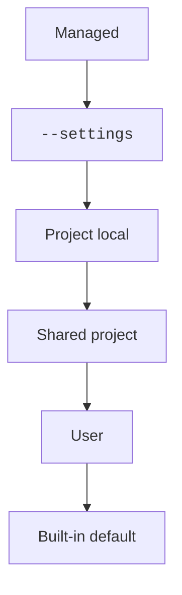

Settings are JSON files that change how Claude Code behaves. Use them to pick a model, add permission rules, turn off a feature, or share the same rules with a whole team. Create or edit a settings file, pass `--settings`, or use `/config` and `/model` for some keys. An administrator can deploy managed settings. Each key is its own switch. `disableAllHooks` turns off hooks, the status line, and file suggestions at once.

The managed schema lists 203 top-level keys. The user schema lists 178, and the other 25 are managed-only.[^schemas]

## Example

A project can share one small file with the whole team.

```json title=".claude/settings.json"
{
  "$schema": "https://clawdipedia.cc/schemas/claude-code-settings.json",
  "model": "opus",
  "permissions": {
    "allow": ["Bash(bun test)"]
  }
}
```

Every session in that folder starts on Opus and may run `bun test` without asking. A teammate can still override `model` in `.claude/settings.local.json`.

## Pages for Each Group of Keys

Each key has a row on one of these pages.

| Page | Keys |
| --- | --- |
| [Core Settings](core.md) | Compaction, memory, cleanup, shell, files, `env`, `sandbox`, updates |
| [Model Settings](model.md) | Model, effort, thinking, fast mode, cache lifetime, token reminders |
| [Auth Settings](auth.md) | Credential helpers, login rules, API provider limits |
| [Agents and Remote Settings](agents-and-remote.md) | `agent`, workflows, background work, Remote Control, peer sessions |
| [Hooks, Plugins, and Skills Settings](hooks-and-plugins.md) | Hooks, plugins, marketplaces, skills, `permissions`, `statusLine`, `outputStyle` |
| [MCP and Channels Settings](mcp-and-channels.md) | MCP servers, claude.ai connectors, channels |
| [Interface Settings](ui.md) | Theme, spinner, `tui`, voice, notices, feedback |
| [Enterprise Settings](enterprise.md) | How managed policy arrives, version limits |
| [Extra Keys and Global Config](extra-keys.md) | Keys the schema omits, and the keys of `~/.claude.json` |

## How to Read the Key Tables

- The `Status` column uses the badges from [How to Read These Docs](../../start/how-to-read.md).
- `Type` shows Unknown when neither the official docs nor the schema give a type. `Default` shows `-` when no default is known.
- `Where to Set It` says which files may set the key. `Any settings file` means the user, project, local, and managed files.
  `Settings files` means the settings files without a narrower scope in the source.
- Many boolean keys are written as the thing to switch off, such as `spinnerTipsEnabled`. Read the row before you pick a value.
- Keys that have no effect are left out. See the end of this page.

## Where Settings Live

| Scope | File | Who it affects |
| --- | --- | --- |
| User | `~/.claude/settings.json` | You, in every project. `CLAUDE_CONFIG_DIR` moves `~/.claude`. |
| Shared project | `.claude/settings.json` | Everyone who works in the folder. Commit it so teammates get it. |
| Project local | `.claude/settings.local.json` | You, in this project only. Claude Code keeps the file out of git. |
| Command line | `--settings <file-or-json>` | One session. It cannot set managed or global config keys. |
| Managed | `managed-settings.json` and the other managed sources | Everyone your organization deploys it to. |
| Global config | `~/.claude.json` | You. Claude Code writes it. It holds sign-in data, MCP servers, per-project state, and a few keys. |

Official pages: [Settings Files and Precedence](https://code.claude.com/docs/en/settings) and [Explore the .claude Directory](https://code.claude.com/docs/en/claude-directory).

- Settings files are strict JSON. A comment or a trailing comma is a syntax error.
- When a settings file is not valid JSON, the error gives the line and the column of the first syntax error, for example `Invalid or malformed JSON (line 3, column 5)`. Both numbers start at 1.[^json-position]
- Claude Code reads the shared project file from the primary working directory.
- In a git repository, the local file lives at the repository root. In a worktree, it lives at the main checkout root.
- Claude Code adds `**/.claude/settings.local.json` to your global git excludes file when it writes the local file. It does this also when the folder is not a git repository yet.[^gitignore]
- A write to a settings file reads the file from disk first, so a hand edit made moments before is kept. A file that was deleted starts again as a new file that holds only that change. A write seeds from the last parse only when the file is empty, broken, or locked, or when a `ConfigChange` hook blocked the latest change.[^seed]
- Claude Code watches the files and reloads them. It runs the `ConfigChange` hook for each change in a settings file.
- Managed settings from MDM or the console reach a running session on a schedule, not on save.
- A cloud session reads only the shared project file and server-managed settings.
- Run `/status` to see the `Setting sources` line. Run `claude doctor` to see the entries that Claude Code dropped.
- The flag `--setting-sources <sources>` loads only the sources you name (`user`, `project`, `local`).
  A source you leave out does not supply auto mode rules or saved permission consents.[^left-out]

Claude Code names the five sources `userSettings`, `projectSettings`, `localSettings`, `flagSettings`, and `policySettings`.[^sources]

## Which Value Wins

The highest level that sets a key wins. `/config` shows a note on a row when settings from another source override what you save there.[^config-note]

A settings change from `/config` or a similar command that fails to save shows a message that says so. The message starts with `Couldn't save`.[^save-fail]

1. Managed settings.
2. Command line (`--settings`).
3. Project local settings.
4. Shared project settings.
5. User settings.



Read the chart from the top. The first level that sets the key decides its value.
Environment variables are not a level.
Each pair of key and variable decides alone, such as `ANTHROPIC_MODEL` over `model`.
See [Models and Effort Variables](../env-vars/models-and-effort.md) for examples. Official page: [Settings Files and Precedence](https://code.claude.com/docs/en/settings).

## How Lists and Model Keys Merge

- List keys such as `permissions.allow` merge across scopes.
- `allowManagedPermissionRulesOnly` stops that merge for permission rules.
- `fallbackModel` is an ordered chain. The whole value comes from the highest scope that sets it.
- `modelPicker` never merges. The whole value comes from managed settings, `--settings`, or user settings.
  Claude Code ignores project and local values.
- For `availableModels`, a managed list applies as it is. Across the other scopes, the arrays merge.
- `modelSettings` resolves one model at a time, together with `effortLevel`.
- Managed `env` blocks merge per key across admin sources. `CLAUDE_CODE_DISABLE_ADMIN_ENV_UNION=1` turns that off.

Official pages: [Settings Files and Precedence](https://code.claude.com/docs/en/settings) and [Environment Variables](https://code.claude.com/docs/en/env-vars).

## Managed Settings

An administrator puts managed settings on a machine in one of these ways. Official page: [Deploy Managed Settings](https://code.claude.com/docs/en/managed-settings).

| Platform | Where Claude Code looks |
| --- | --- |
| macOS | `/Library/Application Support/ClaudeCode/managed-settings.json`, and the `com.anthropic.claudecode` managed preferences domain |
| Linux and WSL | `/etc/claude-code/managed-settings.json` |
| Windows | `C:\Program Files\ClaudeCode\managed-settings.json`, and the registry keys `HKLM\SOFTWARE\Policies\ClaudeCode` and `HKCU\SOFTWARE\Policies\ClaudeCode` |
| WSL on Windows | The Windows sources, only when `wslInheritsWindowsSettings` is on |
| All | The `managed-settings.d/` folder next to the file, server-managed settings (cached in `~/.claude/remote-settings.json`), and the SDK `managedSettings` option or `--managed-settings` flag |

- Claude Code merges `managed-settings.json` first, then each `*.json` file of `managed-settings.d/` in alphabetical order.
  Number the files to set the order, such as `10-telemetry.json`.
- Start-up reads a managed file again when the first read found it absent, empty, or not loadable, so a program that rewrites the file at that moment does not hide it. The re-read covers `managed-settings.json` and the files of `managed-settings.d/`. It has a limit of 5 seconds. When the limit passes, Claude Code keeps the managed settings it already read.[^managed-reread]
- `managedSourcesBehavior` decides how sources combine. `first-wins` uses the highest source alone. `merge` deep-merges them.
- `parentSettingsBehavior` does the same for the SDK parent tier.
- `policyHelper` and `policyHelpers` compute managed settings at startup.
- A file tool asks before it writes to the local copy of server-managed settings, `remote-settings.json` in the configuration folder, as it does for a Claude Code settings file.[^managed-edit-ask]

The keys are in [Enterprise Settings](enterprise.md).

## Exceptions to Managed Precedence

For a few keys, a lower scope may set a stricter value, and Claude Code honors it over the managed value. Official page: [Settings Files and Precedence](https://code.claude.com/docs/en/settings).

| Keys | Status | Value Claude Code honors | Where it can come from |
| --- | --- | --- | --- |
| `disableClaudeAiConnectors`, `isolatePeerMachines`, `permissions.blockReadsOutsideWorkingDirectories` | <Documented /> | `true` | Any scope |
| `enableArtifact`, `disableArtifact` | <Documented /> | `enableArtifact: false` or `disableArtifact: true` | Any scope |
| `autoMode.classifyAllShell` | <Documented /> | `true` | `~/.claude/settings.json` or `--settings`. Any `true` wins. `false` never turns it off |
| `remoteControlAtStartup` | <Documented /> | `false` | `.claude/settings.json` or `.claude/settings.local.json` |
| `crossSessionInbound` | <Documented /> | A stricter value on the ladder `accept`, `hold`, `refuse` | `.claude/settings.json` or `.claude/settings.local.json` |
| `useAutoModeDuringPlan`, `syncClaudeAiSkills`, `syncClaudeAiPlugins` | <Documented /> | `false` | Managed, `--settings`, `~/.claude/settings.json`, or `.claude/settings.local.json` |
| `maxEffortLevel` | <Documented /> | The lowest cap | Any scope |
| `modelProposedGoals`, `feedbackDrafts`, `availableModelsMatch`, `askUserQuestionTimeout`, `dialogExpiry` | <Undocumented /> | A strict value | The docs do not list them here.[^strict] |

An app that runs Claude Code inside itself and sets `CLAUDE_CODE_PROVIDER_MANAGED_BY_HOST` is also an exception.
Claude Code then takes the model keys of that app over the managed values.

## Left Out on Purpose

These keys have no effect, so the pages do not list them.

- `taskOutputMaxChars`: The schema marks it as deprecated. The `TaskOutput` tool does not exist.[^left-out-keys]
- `keybindingFlavor`: The schema marks it as deprecated. Word-editing keys follow Bash (readline) rules.[^left-out-keys]

## Deep Nesting

A settings file with values nested more than 64 levels deep loads without them. Claude Code drops those values and shows a warning: "A value under "key" is nested more than 64 levels deep, so Claude Code ignores it. Reduce the nesting under "key"." For a file that Claude Code writes, the warning also says it leaves the value out when it saves a setting to that file. A `hooks` entry written as nested arrays is different: that case is a fatal error, and the text asks you to write `hooks` as an object of event names.[^nesting]

## Errors

Each row is a family of messages. The backticked text is the start that every message in the family shares.

| Start of Message | Status | What It Means | Cases |
| --- | --- | --- | --- |
| `These settings files are not used: they are in a connector-downloads folder` | <Undocumented /> | Claude Code skipped the settings files in the project folder. | The folder is a `connector-downloads` folder that has a `.gitignore`. Claude Code saves files from claude.ai connectors there.[^connector] |
| `<file> has an error and didn't load` | <Undocumented /> | A settings file that you save with an error during a session gets a warning that names the file. It ends with `run claude doctor`. | The warning stays pinned. It covers a file that had no error when the session started or when the last change was read. Claude Code does not warn again for a file that already had an error, or for a file it cannot read.[^file-error] |

## Related Pages

- [Environment Variable Groups](../env-vars/features-and-toggles.md) list the variables that pair with some keys.
- [How to Read These Docs](../../start/how-to-read.md) explains the badges.
- [Undocumented Items](../../reference/undocumented.md) indexes every undocumented item.
- [Permissions](../permissions/index.md) covers `permissions`, `sandbox`, and `autoMode`.
- [Settings Reference](https://code.claude.com/docs/en/settings-reference) lists each key in the official docs.

## Sources

[^schemas]: The published schema files `schemas/claude-code-managed-settings.json` (203 keys under `properties`) and `schemas/claude-code-settings.json` (178 keys). The 25 managed-only keys are the ones in the first file and not in the second.
[^config-note]: The program, `chunk-1yfzbet8.js:474` (the notice "override what you save here").
[^save-fail]: The program, `chunk-zs9k1w9q.js:14025` (the `/tui` command shows `Couldn't save this setting`), `chunk-1yfzbet8.js:2306` (`/config` with `key=value` shows `Couldn't save <name>: <reason>`), and `chunk-1yfzbet8.js:2927` (the same text, "Couldn't save", for a panel row). The program does not show where the message sits on screen.
[^gitignore]: The program, `chunk-pxy9yt8m.js:1829` (the line `**/${b2}`, built from the path of the local settings file), called from `chunk-pxy9yt8m.js:6422` with `localSettings` and the flag that also writes outside a git repository.
[^seed]: The program, `chunk-pxy9yt8m.js:6560` (the write reads the file first and falls back to the last parse when it is "still empty, broken or locked") and `chunk-pxy9yt8m.js:6560-6596` (a `ConfigChange` hook that blocked the latest change, or is still deciding).
[^sources]: The program, `chunk-kgzzwvwc.js:4743`.
[^managed-reread]: The program, `chunk-aq3ms068.js:25274` (the limit `5000` ms), `chunk-aq3ms068.js:25320` (the `managed-settings.d` folder), and `chunk-aq3ms068.js:25423` (the timeout message "the managed settings already read are kept").
[^left-out-keys]: The program, `chunk-t39fw2cy.js:8672` and `chunk-t39fw2cy.js:9495`.
[^strict]: The program lists them as keys with a strict value, `chunk-wb0pe3gv.js:98-103` (`modelProposedGoals`, `feedbackDrafts`, `availableModelsMatch`, `askUserQuestionTimeout`, and `dialogExpiry`).
[^nesting]: The program, `chunk-zryj96fm.js:1698` (the limit `$e275e0 = 64`) and `chunk-zryj96fm.js:2909-2923` (the warning and the fatal `hooks` case).
[^file-error]: The program, `chunk-zs9k1w9q.js:123378`..
[^connector]: The program, `chunk-614w915w.js:28172` (the message), `chunk-zryj96fm.js:1061` (the folder name `connector-downloads`), and `chunk-zryj96fm.js:1194` (the `.gitignore` check).
[^json-position]: The program, `chunk-pwxp2pn6.js:867` (`line` and `column` are the zero-based position plus 1), `chunk-zryj96fm.js:2087` (the suffix "(line …, column …)"), and `chunk-zryj96fm.js:2160` ("Invalid or malformed JSON").
[^left-out]: The program, `chunk-pxy9yt8m.js:5365` (reading a source that is not enabled returns `null`), with its use for the `autoMode` rules at `chunk-pxy9yt8m.js:7039` and for the saved bypass-permissions consent `skipDangerousModePermissionPrompt` at `chunk-pxy9yt8m.js:6944`.
[^managed-edit-ask]: The program. The file name is `remote-settings.json` (`chunk-t39fw2cy.js:12358`), placed in the configuration folder by `$b326fe` at `chunk-t39fw2cy.js:13351`. `$953404` at `chunk-32gs4rex.js:10661` builds the protected set from those paths (the configuration folder and `~/.claude`, with `remote-settings.json` added at `chunk-32gs4rex.js:6393`, where `$2e067a` is the file name), `$36ab4a` at `chunk-32gs4rex.js:10658` tests a path against it, and `chunk-32gs4rex.js:10694` turns the test into the result `certain`, `possible`, or `none`. The write check `chunk-32gs4rex.js:11788` returns an unsafe result with the message "but you haven't granted it yet" and the breaker `claudeSettingsFile` when the result is not `none` (`chunk-32gs4rex.js:11808-11810`).
