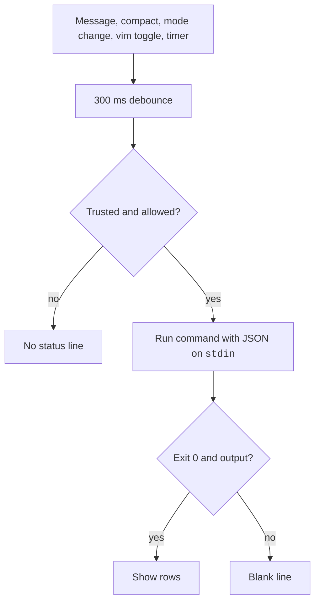

The status line is a bar at the bottom of Claude Code that shows the output of a script you write. Use it to keep the model, the cost, or the context use in view. It does not use API tokens.

Your script gets session data as JSON on `stdin`, such as the model and the cost. It prints what to show on `stdout`. To turn it on, set the `statusLine` key in a user, project, local, or managed settings file, or run `/statusline`. To remove it, delete `statusLine`, or run `/statusline delete`.

## Example

```bash title="~/.claude/statusline.sh"
#!/bin/sh
input=$(cat)
model=$(echo "$input" | jq -r '.model.display_name')
used=$(echo "$input" | jq -r '.context_window.used_percentage // 0')
echo "$model | context ${used}%"
```

```json title="~/.claude/settings.json"
{
  "$schema": "https://clawdipedia.cc/schemas/claude-code-settings.json",
  "statusLine": {
    "type": "command",
    "command": "~/.claude/statusline.sh",
    "padding": 1,
    "refreshInterval": 30
  }
}
```

The bar shows the model name and how full the context window is. The script runs again every 30 seconds.

## Settings

Official page: [Customize Your Status Line](https://code.claude.com/docs/en/statusline).

| Item | Status | What it does | How it works | Where to set it |
| --- | --- | --- | --- | --- |
| `statusLine.type` | <Documented /> | Kind of status line | Must be `"command"`. Required | User, project, local, managed |
| `statusLine.command` | <Documented /> | Script path or inline shell command | Runs in a shell. A change to it runs the new command at once, without the debounce | Same |
| `statusLine.padding` | <Documented /> | Extra horizontal space in characters | The default is `0`. It adds to the built-in spacing | Same |
| `statusLine.refreshInterval` | <Documented /> | Re-runs the command every N seconds | The minimum is `1` second. Use it for clocks and idle sessions | Same |
| `statusLine.hideVimModeIndicator` | <Documented /> | Hides the built-in `-- INSERT --` text | Use it when the script prints `vim.mode` itself | Same |
| `subagentStatusLine` | <Documented /> <Deprecated note="Works; will stop in a future release" /> | Custom row for each subagent in the agent panel | The command runs. See [Subagent Status Line](#subagent-status-line) | Same |
| `/statusline` | <Documented /> | Writes a script in `~/.claude/` and the setting | It takes natural language. `/statusline delete` removes it | Interactive |
| Workspace trust | <Documented /> | The command waits for trust | `--debug` logs `Status line command skipped: workspace trust not accepted` | Project files |
| `CLAUDE_CODE_SAFE_MODE` | <Documented /> | Status line commands do not load | Managed policy still applies | Env |

Two hook settings also act on the status line. `disableAllHooks` set outside managed settings leaves only a managed `statusLine`. With no managed `statusLine`, the status line is off. `allowManagedHooksOnly` shows only a managed `statusLine`. A custom one then disappears without a warning. Their rows are on [Hooks, Plugins, and Skills Settings](settings/hooks-and-plugins.md#keys).

## When the Script Runs

| Item | Status | What it does | How it works | Where to set it |
| --- | --- | --- | --- | --- |
| Session start and resume | <Documented /> | First run | Runs once | Each session |
| New assistant message, `/compact` done, permission mode change, vim mode toggle | <Documented /> | Re-runs the command | Claude Code debounces it at 300ms. A new trigger cancels a running script | Each session |
| Rate-limit `resets_at` and cache `expires_at` | <Documented /> | Re-runs at the earliest time | The time comes from the data the script last received | Each session |
| Model, fast mode, effort, thinking, and PR status change | <Differs /> | Also re-run the command | The official list does not name these triggers.[^extra-triggers] | Each session |

## Output Rules

- Each printed line is a row. ANSI colors and OSC 8 links work.
- The output shows only after exit code `0`. A non-zero exit or empty output blanks the line.
- Claude Code sets `COLUMNS` and `LINES` before it runs the `statusLine` script. `tput cols` does not work.
- Claude Code sets the variables `CLAUDECODE` and `CLAUDE_CODE_CHILD_SESSION` in the script process. See [Environment Variables](env-vars/index.md).
- `claude --debug` logs `stderr` of each run and the exit code of the first run.
- The line hides during the help menu and permission prompts. The command does not run while a permission or MCP input dialog is open (checked). Outside fullscreen, notifications share the row.
- On Windows, use forward slashes in `command`. `CLAUDE_CODE_POWERSHELL_RESPECT_EXECUTION_POLICY` changes the PowerShell policy flag.

See the official [Customize Your Status Line](https://code.claude.com/docs/en/statusline) and [Environment Variables](https://code.claude.com/docs/en/env-vars) pages.

## Subagent Status Line

`subagentStatusLine` works. The settings schema marks it as deprecated: it still works, and will stop working in a future release.[^sub-schema]

- The key takes `type: "command"` and a `command`. Managed settings win. Otherwise the command comes from a settings file or a plugin.[^sub-source]
- The command waits for workspace trust. Without trust, `--debug` logs "Skipping subagentStatusLine execution - workspace trust not accepted".[^sub-trust]
- Claude Code sends one JSON object on stdin. Besides the base session fields it holds `columns` and a `tasks` list. Each task has `id`, `name`, `type`, `agentType`, `status`, `description`, `label`, `startTime`, `model`, `effort`, `contextWindowSize`, `tokenCount`, `tokenSamples`, and `cwd`.[^sub-input]
- The command prints one JSON object per line, such as `{"id": "...", "content": "..."}`. The row for that `id` shows `content`. A line that is not JSON, or has another shape, is logged and skipped. A non-zero exit code leaves every row at its default look. The run has a 5-second timeout.[^sub-output]
- Claude Code logs "subagentStatusLine is deprecated in favor of mods and will stop working in a future release" and queues a notice for the model. A plugin that sets `subagentStatusLine` in its own `settings.json` also gets a deprecation warning.[^sub-deprecation] See [Agents and Remote Settings](settings/agents-and-remote.md).

## JSON Fields

These fields arrive on `stdin`. A field marked "may be absent" is missing from the JSON when it has no value.
Always read optional fields with a default, for example `jq -r '.vim.mode // empty'`.

### Session and Model Fields

| Field | Status | What it holds | Notes | Where |
| --- | --- | --- | --- | --- |
| `session_id` | <Documented /> | Session id | String | Status line |
| `session_name` | <Documented /> | Custom name or AI title | May be absent. The default display name does not fill it | Status line |
| `prompt_id` | <Documented /> | UUID of the prompt in work | May be absent before the first input | Status line |
| `transcript_path` | <Documented /> | Transcript file path | String | Status line |
| `cwd` | <Documented /> | Working directory | Same value as `workspace.current_dir` | Status line |
| `version` | <Documented /> | Claude Code version | The version string of the running build, `2.1.328` in this release.[^version-field] | Status line |
| `model.id`, `model.display_name` | <Documented /> | Model id and name | Strings | Status line |
| `output_style.name` | <Documented /> | Active style name | `default` when none. See [Output Styles](output-styles.md) | Status line |
| `fast_mode` | <Documented /> | Fast mode on | Boolean | Status line |
| `effort.level` | <Documented /> | `low`, `medium`, `high`, `xhigh`, `max` | May be absent when the model has no effort | Status line |
| `thinking.enabled` | <Documented /> | Extended thinking on | Boolean | Status line |
| `vim.mode` | <Documented /> | `NORMAL`, `INSERT`, `VISUAL`, `VISUAL LINE` | May be absent. Present when vim mode is on | Status line |
| `agent.name` | <Documented /> | Agent name | Present with `--agent` or agent settings | Status line |
| `agent_type` | <Undocumented /> | Agent type of the main thread | Present with `--agent` or agent settings. The same value hooks get as `agent_type`. The built-in `statusline-setup` agent's prompt calls it `agent.type`. Read it at the top level as `agent_type` | Status line |
| `scratchpad_dir` | <Gated note="tengu_scratch, or the artifact tools" /> | The session scratchpad folder | Present when a server-side flag is on, or when the session may use the artifact tools | Status line |
| `remote.session_id` | <Undocumented /> | Id of a remote session | Present when the session is remote. The docs do not list `remote` | Status line |

### Workspace Fields

| Field | Status | What it holds | Notes | Where |
| --- | --- | --- | --- | --- |
| `workspace.current_dir` | <Documented /> | Current directory | Preferred over `cwd` | Status line |
| `workspace.project_dir` | <Documented /> | Launch directory | Claude Code fills it from the original working directory | Status line |
| `workspace.added_dirs` | <Documented /> | Directories from `/add-dir` or `--add-dir` | It is an empty array if there are none | Status line |
| `workspace.git_worktree` | <Documented /> | Linked worktree name | It is absent in the main tree | Status line |
| `workspace.repo.host`, `.owner`, `.name` | <Documented /> | Repository identity from `origin` | May be absent. GitLab subgroups give a slash path in `owner` | Status line |
| `worktree.name`, `.path`, `.branch`, `.original_cwd`, `.original_branch` | <Documented /> | Worktree session data | Only in a worktree session. `branch` and `original_branch` may be absent for hook-based worktrees | Status line |
| `pr.number`, `pr.url` | <Documented /> | Open PR or GitLab merge request | Claude Code removes it once the PR merges or closes | Status line |
| `pr.review_state` | <Documented /> | `approved`, `pending`, `changes_requested`, `draft` | May be absent alone | Status line |
| `pr.kind` | <Documented /> | `mr` for a GitLab merge request | Absent for GitHub | Status line |

### Cost, Context, and Limit Fields

| Field | Status | What it holds | Notes | Where |
| --- | --- | --- | --- | --- |
| `cost.total_cost_usd` | <Documented /> | Estimated cost | It is a client-side list price. It resets at `/clear` | Status line |
| `cost.total_duration_ms`, `cost.total_api_duration_ms` | <Documented /> | Wall time and API wait time | Milliseconds | Status line |
| `cost.total_lines_added`, `cost.total_lines_removed` | <Documented /> | Lines changed | Numbers | Status line |
| `context_window.total_input_tokens`, `.total_output_tokens` | <Documented /> | Tokens in the window | It comes from the last response. It is `0` before that | Status line |
| `context_window.context_window_size` | <Documented /> | Window size | `200000` or `1000000` | Status line |
| `context_window.used_percentage`, `.remaining_percentage` | <Documented /> | Percent used and left | It counts input tokens only. It may be `null` early | Status line |
| `context_window.current_usage` | <Documented /> | Per-category tokens | Keys `input_tokens`, `output_tokens`, `cache_creation_input_tokens`, `cache_read_input_tokens`. `null` before the first call and after `/compact` | Status line |
| `exceeds_200k_tokens` | <Documented /> | Last response is over 200k tokens | It is a fixed threshold | Status line |
| `rate_limits.five_hour`, `.seven_day` | <Documented /> | `used_percentage` and `resets_at` | Claude.ai Pro and Max only. A window drops after its reset time | Status line |
| `rate_limits.spend_limit.used_percentage`, `.resets_at` | <Documented /> | Gateway spend limit | - | Status line |
| `rate_limits.spend_limit.used_usd`, `.limit_usd`, `.period` | <Documented /> | Spend in dollars and period `daily`, `weekly`, `monthly` | Off with `CLAUDE_CODE_DISABLE_NONESSENTIAL_TRAFFIC` | Status line |

### Prompt Cache Fields

The object `prompt_cache` appears after the first main-conversation response. Subagent requests are not counted.

| Field | Status | What it holds | Notes | Where |
| --- | --- | --- | --- | --- |
| `prompt_cache.warm` | <Documented /> | Cache is within its TTL | Boolean | Status line |
| `prompt_cache.caching_observed` | <Documented /> | Any response reported cache tokens | `false` means caching is off or not reported | Status line |
| `prompt_cache.ttl` | <Documented /> | Cache lifetime | `"5m"` or `"1h"` | Status line |
| `prompt_cache.expires_at` | <Documented /> | When the cache goes cold | Epoch seconds. `null` if no cache tokens | Status line |
| `prompt_cache.requests`, `.misses`, `.expected_rebuilds` | <Documented /> | Request and miss counts | A miss is over 5% and at least 2,000 tokens re-processed | Status line |
| `prompt_cache.hit_ratio` | <Documented /> | Cache reads over all input tokens | The value is 0 to 1. It is `null` when counts are zero | Status line |
| `prompt_cache.cache_write_tokens`, `.miss_recache_tokens` | <Documented /> | Tokens written | Totals for the session and for misses | Status line |
| `prompt_cache.last_miss_at` | <Documented /> | Time of the last miss | Epoch seconds. `null` if none | Status line |
| `prompt_cache.last_miss_cause` | <Documented /> | The cause Claude Code gives for the last miss | `causes` array (such as `tools_changed`, `system_prompt_changed`, `ttl_expired_5m`, `likely_server_side`), plus `tools_added`, `tools_removed`, `system_char_delta`. | Status line |
| `prompt_cache.miss_causes` | <Documented /> | Count per cause | Map | Status line |
| `prompt_cache.recache_tokens_if_cold` | <Documented /> | Tokens a cold cache re-caches | `null` after a compaction until the next request | Status line |

## How It Works



## Exact Fields

The exact fields are in `https://clawdipedia.cc/schemas/claude-code-status-line.json`. It lists every field of this release. Look up a field there before you rely on it. A field marked `x-unverified` has a type that is not confirmed. `x-observed` marks a field that a probe saw.[^schema-origin]

## Related Pages

- [Output Styles](output-styles.md) for the style behind `output_style.name`.
- [Environment Variables](env-vars/index.md)
- [Context and Compaction](../how-it-works/context-and-compaction.md) for what `context_window` counts.
- [Request and Cache](../how-it-works/request-and-cache.md) for what `prompt_cache` measures.

## Sources

[^extra-triggers]: The program, `chunk-56bhcxay.js:4518321`, watches `mainLoopModel`, `fastMode`, `effortValue`, `thinkingEnabled`, and `prStatus`.
[^sub-schema]: The program, `chunk-jkpzhr7r.js:258217`. Schema text: "Deprecated: still works, and will stop working in a future release. Custom per-subagent status line shown in the agent panel; receives row context as JSON on stdin". The program runs the command in `chunk-j2wfp6sf.js:910626-911215`.
[^sub-source]: The program, `chunk-j2wfp6sf.js:910475-911215`.
[^sub-trust]: The program, `chunk-j2wfp6sf.js:910626`.
[^sub-input]: The program, `chunk-j2wfp6sf.js:911215-911844`.
[^sub-output]: The program, `chunk-j2wfp6sf.js:911844-912444`.
[^sub-deprecation]: The program, `chunk-a3rr42d2.js:4705`, `chunk-j2wfp6sf.js:1929057` (the log line and the notice), and `chunk-56bhcxay.js:5516016` (the plugin warning).
[^schema-origin]: The program, `chunk-56bhcxay.js:4515761`, builds this payload in code, not with a validator, so the schema comes from that code.
[^version-field]: The program, `chunk-56bhcxay.js:4516950`.
