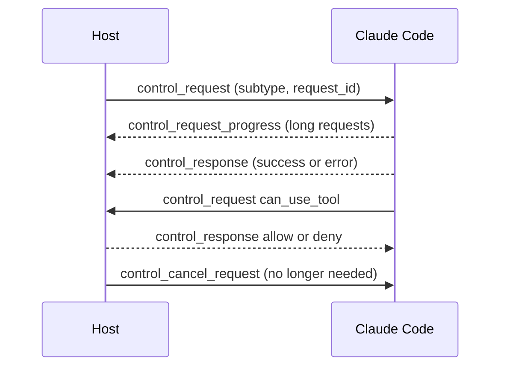

Control requests let a host program steer a running Claude Code process, for example to change the model or to answer a permission question. The Agent SDK uses them. They travel on the same JSON line channel as the [stream messages](stream-json.md).

The protocol is on whenever you start `claude -p --input-format stream-json --output-format stream-json`. You write requests to stdin and read answers on stdout. A host sends a line with `type` set to `control_request` and `request.subtype` set to a subtype, such as `set_model`. Claude Code answers with a `control_response` line. You choose which requests to send.

## Subtypes

The schema does not mark the direction of each request. Only the Agent SDK pages describe most of them, and no other docs page does, so every row has the status <Undocumented />.[^subtypes]

| `subtype` | Status | What It Does |
| --- | --- | --- |
| `initialize` | <Undocumented /> | Starts the SDK session with hooks, MCP servers, and agent settings. The reply can have two internal fields.[^initialize] `auth_conflict` is `{token_source, api_key_source}`, two source names (for example `ANTHROPIC_AUTH_TOKEN` and `/login managed key`), never credential values. It appears when both an auth token and an API key are configured, and the terminal then shows a start-up warning. It is absent when at most one is set, when one `apiKeyHelper` supplies both, and from older CLIs. `other_hook_ask_outranks_host` is `true` when the CLI ranks the `ask` of another `PreToolUse` hook above the `ask` of a hook that the host registered. The `can_use_tool` request then carries the reason of the other hook, whichever hook finished first. It is absent for a remote client, in a Cowork cloud session, in a Code cloud worker, and from older CLIs. Since `2.1.327` the request and the reply have more internal fields.[^v2327-init] `settings` and `disallowedTools` carry the settings and the deny rules of the host, so that the launch command line does not grow with them. A CLI reads them only when it was launched with `--await-initialize` and `--initialize-fields=settings` or `--initialize-fields=disallowedTools`. It applies them as it applies `--settings` or `--disallowedTools`, and exits with code 1 when it cannot. Without those flags, on a repeated `initialize`, or over a remote session transport, they set nothing. The reply then has `settings_applied` and `disallowed_tools_applied`. Each is `true` when the value in the request is the one that the process took at launch, and `false` when this CLI does not confirm it. Each is absent when the request had no such field and on older CLIs. A host that sent `settings` must send no prompt until `settings_applied` is `true`. `cloudStatusBeforeInit` asks the client of a cloud-hosted session to write `system` / `cloud_session_delta` lines as soon as it opened the session, so that the host learns the session id while the container starts. A hook entry can have `contextOnly` (callbacks return `additionalContext` alone, so the next call may start without their answer) and `replacedByFrame` (`shell_cwd`, for a `PostToolUse` matcher on `Bash` and `PowerShell` only: the CLI does not call the callbacks and sends the [`shell_cwd` line](stream-json.md#undocumented-types) instead). A plugin entry of the `initialize` and `reload_plugins` replies has `requiredByOrganization`, which now means that the organization requires or auto-installs the plugin. |
| `interrupt` | <Undocumented /> | Stops the turn that runs now. The request can have `spare_background_tasks` (boolean, internal)[^interrupt]. `true` ends the turn and leaves running background agents and workflows alone. A running observer still stops. The value holds for this request only. A CLI that does not read it stops those tasks as for any other `interrupt`. |
| `can_use_tool` | <Undocumented /> | Asks for permission to use a tool with the given input. Since `2.1.327` the request can have `rule_usually_offered` (boolean, internal). It is sent only beside `suppress_always_allow_rule`, when this kind of ask usually offers the "don't ask again" row. It is for display only. It never permits a persistent rule, and a host can ignore it.[^v2327-rules] |
| `set_permission_mode` | <Undocumented /> | Sets the permission mode. |
| `set_model` | <Undocumented /> | Sets the model for the next turns. |
| `set_max_thinking_tokens` | <Undocumented /> | No description in the program schema. |
| `rename_session` | <Undocumented /> | Sets the title of the session. |
| `set_color` | <Undocumented /> | No description in the program schema. |
| `mcp_status` | <Undocumented /> | Asks for the state of all MCP server connections. Since `2.1.309`, `liveReply: true` sends a success reply only to the clients attached at that moment, when the CLI writes through a cloud session or Remote Control worker. The reply is not stored, and a reply sent while the stream is down is lost. In `2.1.316` an entry of `mcpServers` can have `cloudServiceProvided`. It is `true` for an `http` or `sse` server that the cloud service added to the session, and it is set only when `sessionProxied` is `true`. The session judges it by the address of the server and can miss one. `reload_plugins` entries have the same field. |
| `file_suggestions` | <Undocumented /> | Asks for `@` file suggestions for a partial path. |
| `get_context_usage` | <Undocumented /> | Asks for the use of the context window by category. Since `2.1.327` the reply can have `loadRaise` (`{fromWindow, toWindow}`, internal). It is present while the auto-compact window of the conversation is raised from `fromWindow` to `toWindow`, which happens when what stays in each request after a summary fills more than half of the size at which it would compact. The other fields measure against `toWindow`.[^v2327-rules] |
| `get_session_cost` | <Undocumented /> | Asks for the cost summary that `/usage` prints in print mode. |
| `list_models` | <Undocumented /> | Asks for the models that the worker lets you choose. |
| `get_usage` | <Undocumented /> | Asks for the data of `/usage`, with plan limits when they are known. Since `2.1.311`, each entry of `session.model_usage` in the reply also has `cacheCreationEphemeral5mInputTokens` and `cacheCreationEphemeral1hInputTokens` (integers, see [Stream JSON Messages](stream-json.md#fields-new-in-21311)). |
| `get_status` | <Undocumented /> | Asks for the rows of the `/status` screen as text. |
| `export_conversation` | <Undocumented /> | Asks for the conversation as the text that `/export` writes. |
| `list_cloud_sessions` | <Undocumented /> | Asks for the cloud sessions of the signed-in account. The CLI reads them with its own sign-in. Refused in a cloud-hosted session. New in `2.1.307`. Since `2.1.327` the request can have `only_runs` (`true` lists only the sessions that routines of the account started, which the plain list leaves out), `only_archived` (`true` lists archived sessions only), and `cursor` (the `next_cursor` of the page before, asked the same way). The reply has `next_cursor`. An older CLI answers the plain list, and the reply has no `only_runs` or `only_archived`.[^v2327-cloud] |
| `get_cloud_session` | <Undocumented /> | Asks for the details of one cloud session. Refused in a cloud-hosted session. New in `2.1.307`. Since `2.1.327` the description says "details" (it said title, branch, and environment kind), and a success reply also has `runner_wait`, `waiting_connectors`, and a `session` object.[^v2327-cloud] |
| `get_cloud_session_transcript` | <Undocumented /> | Asks for one page of the stored transcript of a cloud session that the account owns. Refused in a cloud-hosted session. New in `2.1.307`. Since `2.1.311` the schema warns that a page is not always the whole transcript: for a compacted session the service sends the rows its last compaction kept, then the `compact_boundary` entry and what followed, so the messages that the compaction summarized can be on no page. Since `2.1.326` the request has `limit`: the most entries that a page may hold, a whole number from 1 to 1000. The default is 200. A page of large entries holds fewer. An older CLI ignores it.[^v2326] Since `2.1.327` the request has `agent_id`: one subagent whose entries are read in place of the main transcript, the id that they carry as `agentId` (for the `Agent` tool, its `task_id`). An id that the session does not have answers no entries. A cursor is good only with the `agent_id` that it came with. An older CLI ignores it and answers the main transcript, with no `agent_id` in the answer.[^v2327-cloud] |
| `update_cloud_session` | <Undocumented /> | New in `2.1.327`, internal. Changes one cloud session at the service, with the sign-in of the CLI. The request has `session_id`, `action`, and for some actions `title` (`rename`, 1 to 500 characters), `at` (`mark_completed`), and `cause` (`ping`, required). `archive` and `delete` also stop the work of the session. `delete` cannot be undone, and it also acts on routines and chats bound to the session. The CLI asks nobody, so the host confirms. `detach` moves the session to the top level of the list. `ping` asks the service to start the machine of the session, or keep it running, ahead of a message, and `ok` does not say that a machine starts. Every action but `ping` is safe to repeat. The reply is `ok`, an error with a `message` and a `service_reason`, or a request that was not carried out, with a `reason`. After `temporarily_unavailable` or `failed` the change may still have been made. Refused in a cloud-hosted session.[^v2327-cloud] |
| `get_memory_dialog` | <Undocumented /> | Asks for the rows and switches of the `/memory` dialog. |
| `get_skills_dialog` | <Undocumented /> | Asks for the rows of the `/skills` menu. |
| `get_chrome_dialog` | <Undocumented /> | Asks for the state of the `/chrome` dialog. |
| `get_chrome_browsers` | <Undocumented /> | Asks for the browsers that have a connection to Claude in Chrome. |
| `select_chrome_browser` | <Undocumented /> | Switches Claude in Chrome to the browser that you name. |
| `get_sandbox_dialog` | <Undocumented /> | Asks for the state of the `/sandbox` dialog. |
| `get_binary_version` | <Undocumented /> | Asks for the version of the binary. Since `2.1.326` the reply also has `oldestDesktopSdk`, the oldest Agent SDK version (a plain x.y.z) that a Claude Desktop can bundle and still run this CLI.[^v2326] |
| `mcp_call` | <Undocumented /> | Calls an MCP tool without a model turn. |
| `rewind_files` | <Undocumented /> | Undoes the file changes made since a user message. |
| `cancel_async_message` | <Undocumented /> | Removes a waiting async user message from the queue. |
| `read_file` | <Undocumented /> | Reads a file of the session, for a remote sidebar viewer. Since `2.1.327` the anchor in the request can have `rootId`.[^v2327-rules] |
| `list_directory` | <Undocumented /> | No description in the program schema. |
| `get_workspace_diff` | <Undocumented /> | Asks for the git diff of the workspace. Since `2.1.327` the request can have `rootId`.[^v2327-rules] |
| `get_plan` | <Undocumented /> | Reads the current plan of plan mode. |
| `seed_read_state` | <Undocumented /> | Seeds the cache of read files with a path and a time. |
| `hook_callback` | <Undocumented /> | Delivers a hook callback with its input. |
| `register_device_hooks` | <Undocumented /> | Registers the hooks of a device with the worker. |
| `upload_device_hook_template` | <Undocumented /> | Sends a hook template before the device hooks register. |
| `remote_tools_announce` | <Undocumented /> | A cloud client says which tools it serves. |
| `remote_tool_call` | <Undocumented /> | Forwards one step of a tool call to the attached machine. |
| `remote_plumbing_call` | <Undocumented /> | Calls a plumbing tool on the attached machine. |
| `remote_tools_probe` | <Undocumented /> | Checks that an announced machine is still alive. |
| `remote_tools_reannounce` | <Undocumented /> | A new worker asks the client to announce its tools again. |
| `comparison_fork` | <Undocumented /> | New in `2.1.327`, internal. The server of claude.ai asks a worker that has `comparison_fork: true` in `turn_handoff_available`. The request has `comparison_id`, `turn_event_uuid` (the client uuid of the user event that opened the turn), and `fork_mode` (not `mode`, which Claude Code Remote reads as its own). The worker builds, from the inputs of the first model request of that turn, the first request that a second run of the turn would send, never sends it, and answers how it compares with the request that the turn did send. The answer holds counts, flags, and names, never text. The reply has `end_reason`, `parts`, `shape`, and `timings_ms` (`waited`, `built`, `compared`, in ms).[^v2327-fork] |
| `turn_handoff` | <Undocumented /> | Hands a turn to a cloud worker. Since `2.1.311` it can have `requires_rewind_request_id` (string): the `request_id` of a `rewind_conversation` request that the client sent first. A worker that reads it appends the turn only if that rewind was its last one, the last user or assistant message is still the one the rewind left at the end, and nothing waits to be appended ahead of the turn. Otherwise it appends nothing and answers an error that starts with `invalid_handoff: required_rewind_` and then `unknown`, `other`, `moved_on`, or `lines_waiting`. A worker announces that it reads the member with `requires_rewind_request_id: true` in `turn_handoff_available`. A worker without that key ignores the member, so send it only once every worker that could read it has the key. |
| `mcp_message` | <Undocumented /> | Carries one MCP message for an MCP server that the SDK hosts. |
| `mcp_set_servers` | <Undocumented /> | Replaces the set of MCP servers that the host manages. The request can have `denied_tools` (array of strings, internal)[^denied-tools]. Each entry is a deny rule on one MCP tool, written `mcp__<server>__<tool>`. The rules hold for any kind of server that lists the tool, also one that `servers` leaves out. The list replaces the one the session holds. A request without the list keeps the held one. A list of more than 2,048 names, or an entry in another form, is ignored and the session keeps its list. Claude Code then logs the warning `mcp_set_servers: denied_tools ignored, so the session keeps its list. denied_tools must be an array of at most 2,048 single MCP tool names`. |
| `reload_plugins` | <Undocumented /> | Reloads plugins from disk. |
| `reload_skills` | <Undocumented /> | Reloads skills from disk. |
| `reload_output_styles` | <Undocumented /> | Reads the output style folders again. |
| `register_repo_root` | <Undocumented /> | Adds a folder as a working folder root, and can reload `CLAUDE.md`, skills, and plugins. |
| `set_cwd` | <Undocumented /> | Moves the session to a new working folder, like `/cd`. |
| `claim_session` | <Undocumented /> | No description in the program schema. |
| `reload_connectors` | <Undocumented /> | New in `2.1.327`, internal. Reads the claude.ai connectors of the account again: new ones connect, removed ones close, and changed and unconnected ones connect again. Read `mcp_status` after the reply. It is only for the program that started this process, after something a person did.[^v2327-cloud] |
| `mcp_reconnect` | <Undocumented /> | Reconnects an MCP server that failed. |
| `mcp_toggle` | <Undocumented /> | Turns an MCP server on or off. |
| `mcp_read_resource` | <Undocumented /> | No description in the program schema. |
| `set_mcp_permission_mode_override` | <Undocumented /> | Sets or clears the permission mode of one MCP server. |
| `set_chrome_browser_hints` | <Undocumented /> | Tells the session which Claude in Chrome browser to prefer. |
| `set_prompt_suggestions_paused` | <Undocumented /> | Pauses or resumes prompt suggestions. |
| `stop_task` | <Undocumented /> | Stops a running task. |
| `background_tasks` | <Undocumented /> | No description in the program schema. |
| `get_task_output` | <Undocumented /> | Reads the last 8 KiB of the output of a background task. |
| `apply_flag_settings` | <Undocumented /> | Merges settings into the flag settings layer. Since `2.1.326`, Claude Code refuses a request that holds an invalid setting: it applies nothing, keeps the earlier settings, and answers `apply_flag_settings: nothing in this request was applied and earlier settings stay in force` with the invalid paths.[^apply-flag] |
| `get_settings` | <Undocumented /> | Returns the merged settings and the settings of each source. In `2.1.316` the `applied` object can have `ultrathinkAvailable`, a boolean. It is `true` when typing `ultrathink` runs the turn at `xhigh` effort, and when the session is already at `xhigh` or `max`. If it is absent, the Claude Code is too old to report it. |
| `update_settings` | <Undocumented /> | Writes settings through the writer of Claude Code. |
| `get_hooks_listing` | <Undocumented /> | Returns the hooks that the read-only `/hooks` menu shows. |
| `list_permission_rules` | <Undocumented /> | Returns the permission rules and workspace folders that `/permissions` lists. Since `2.1.311` the `source` of a rule can be `mcpMount` (string). Since `2.1.326` the reply `state` has `withheld`: `true` when the connection stores its answers (a cloud or self-hosted session) and the CLI cut the answer. Then `rules` holds only rows from settings sources and `mcpServerPolicy`, `workspaceDirectories` holds only folders from settings sources, and each `errors` entry has a fixed `message` and an empty `path`. A rule other than a bare tool name goes as `Tool(withheld)`. `withheld` is absent from an answer that was not cut.[^v2326] |
| `elicitation` | <Undocumented /> | Asks the SDK consumer to handle an MCP elicitation. |
| `request_user_dialog` | <Undocumented /> | Asks the SDK consumer to show a dialog and return the choice. |
| `submit_feedback` | <Undocumented /> | Sends a `/feedback` report with the transcript and a cleaned error log. |
| `remote_control_work_secret` | <Undocumented /> | Asks the host for a fresh work secret for Remote Control. |
| `oauth_token_refresh` | <Undocumented /> | Asks the host for a fresh OAuth token after a `401` error. Since `2.1.311` the request can also have `kind: "sessions"`, and then the CLI asks for the second token that authorizes the cloud-sessions API. A host that set `CLAUDE_CODE_SDK_HAS_SESSIONS_OAUTH_REFRESH` answers it, and the token must belong to the same account and organization as the sign-in token. Without `kind`, the request is for the claude.ai sign-in token. Since `2.1.326` a request of `kind: "sessions"` has `refused_bearer_sha256`: up to 16 lowercase-hex SHA-256 digests of the bearers that servers refused under the current sign-in token, the latest last. A host that reads them renews only when the bearer it would hand over is among them. A request with `token_state: "refused"` can have `refused_call`: `model`, `connector`, or `other`, the kind of call that the server refused. A host takes an unknown value as absent.[^v2326] |
| `host_auth_token_refresh` | <Undocumented /> | Asks the host for a fresh provider credential after a credential failure. Since `2.1.327` the request can have `token_state: "not_refused"`: no server refused anything and the CLI holds nothing under the variable that `CLAUDE_CODE_HOST_AUTH_ENV_VAR` names, so the host can answer with the credential that it handed over at the start. It is sent with no `status`, and only to a host that set `CLAUDE_CODE_HOST_AUTH_ASK_AT_START`. A host takes any other value as absent.[^v2327-rules] |
| `message_rated` | <Undocumented /> | Records a thumbs up or down for a message. |
| `ui_attach` | <Undocumented /> | A remote screen joins the session. Since `2.1.311` its `answers` list can name `ui_prompt_paint` too, and holds up to 6 names (5 before). |
| `ui_detach` | <Undocumented /> | A remote screen leaves the session. |
| `ui_render` | <Undocumented /> | No description in the program schema. |
| `ui_press` | <Undocumented /> | A press on a button or link that a plugin drew for a remote screen. |
| `ui_client_module` | <Undocumented /> | Asks for the screen modules of a plugin. |
| `ui_input` | <Undocumented /> | A change in an input that a plugin drew for a remote screen. |
| `ui_select` | <Undocumented /> | A pick in a select that a plugin drew for a remote screen. |
| `ui_panes` | <Undocumented /> | Asks for the list of open panes. Since `2.1.311` each pane in the reply can have `background_color` (string): what the surface paints under the body of the pane while it is shown. |
| `ui_pane_show` | <Undocumented /> | The person chose which open pane the screen shows. |
| `ui_pane_focus` | <Undocumented /> | The keyboard moved between the prompt box and a pane. |
| `ui_close` | <Undocumented /> | The person closed a pane on a remote screen. |
| `ui_scroll` | <Undocumented /> | The person scrolled a site that a remote screen draws. |
| `ui_focus` | <Undocumented /> | The keyboard moved in a site that a remote screen draws. |
| `ui_copy` | <Undocumented /> | No description in the program schema. |
| `ui_prompt_read` | <Undocumented /> | A plugin reads the draft and cursor of the prompt box. |
| `ui_prompt_fill` | <Undocumented /> | A plugin puts text in the prompt box as a draft. |
| `ui_prompt_paint` | <Undocumented /> | New in `2.1.311`. Sets one layer of styled runs over the draft in the prompt box and changes nothing else: not the draft, the caret, or its undo history. A change of the draft drops every layer. The request has `surface` (`desktop`, `mobile`, or `vscode`), `client_id`, `layer`, `text`, and `decorations`. Each decoration has `start`, `end`, and the optional `color`, `backgroundColor`, `dimColor`, `bold`, `italic`, `underline`, and `strikethrough`. Without `text`, the request clears the layer. The reply is `{painted: boolean}`. It goes only to a client whose `ui_attach` named `ui_prompt_paint`. If there is no answer in 5 seconds, the result is `isPainted: false`. |
| `ui_prompt_suggest` | <Undocumented /> | A plugin or the engine shows a suggestion in the prompt box. |
| `ui_read_selection` | <Undocumented /> | No description in the program schema. |
| `ui_prompt_edit` | <Undocumented /> | An edit in the prompt box of a remote screen. |
| `ui_prompt_autocomplete` | <Undocumented /> | A remote prompt box asks what the plugins add to its autocomplete list. |
| `success` | <Undocumented /> | The request was handled. |
| `error` | <Undocumented /> | The request failed or was refused. |

Some requests go from Claude Code to the host, such as `can_use_tool`, `elicitation`, `hook_callback`, `request_user_dialog`, and the token refresh requests.
The host must answer them or the turn waits.

A `control_response` can carry `pending_elicitation_requests` (new in `2.1.316`). It is an array of the `elicitation` requests that Claude Code sent and nobody answered or withdrew yet. A client that joins late can show the question. It is on a success `initialize` response when Claude Code lists them, which not every session does. If it is absent, nothing is known about what is pending. Show a `request_id` once, even if it also arrives as a live `control_request` line.[^elicitation]

## Example

```json skip-lint title="Change the model, then read the reply"
{"type":"control_request","request_id":"req-1","request":{"subtype":"set_model","model":"sonnet"}}
```

```json skip-lint title="Reply from Claude Code"
{"type":"control_response","response":{"subtype":"success","request_id":"req-1","response":{"model":"claude-sonnet-5-5"}}}
```

The `set_model` request has a `model` field. A success reply has `subtype: "success"` and the `request_id`. Since `2.1.307` a `set_model` success reply also has `response.model`, the model the session now uses. An alias comes back as the full model ID. An error reply has `subtype: "error"`, the `request_id`, an `error` text, and sometimes an `error_code`.[^builders] The fields of the other subtypes are not listed here.

Both examples ran on `2.1.309` with `claude -p --input-format stream-json --output-format stream-json --verbose`, and the reply matches (see [Probes](../../reference/probes.md#static-and-print-probes)). The `request_id` is any text you pick, and the reply repeats it. `set_model` takes an alias such as `sonnet` or a full model ID. It replies `success` even for a name the API does not know, and `response.model` repeats that name, so the error shows up on the next request. The Agent SDK's `setModel()` waits up to 15 seconds for this reply (5 seconds before `2.1.307`).[^set-model] A reply can come before the first `system` `init` line, because `init` appears only after the first user message.

```json skip-lint title="Ask for the version"
{"type":"control_request","request_id":"req-2","request":{"subtype":"get_binary_version"}}
```

```json skip-lint title="Reply"
{"type":"control_response","response":{"subtype":"success","request_id":"req-2","response":{"version":"2.1.305","buildTime":"2026-10-20T18:04:27Z"}}}
```

```json skip-lint title="A request that fails"
{"type":"control_request","request_id":"req-3","request":{"subtype":"set_permission_mode","mode":"nonsense"}}
```

```json skip-lint title="Error reply"
{"type":"control_response","response":{"subtype":"error","request_id":"req-3","error":"Cannot set permission mode: must be one of acceptEdits, auto, bypassPermissions, default, dontAsk, plan","error_code":"invalid_mode"}}
```

An unknown subtype gives `"error":"Unsupported control request subtype: <name>"` with no `error_code`.

## How It Works



Each reply is a single `control_response` that matches the `request_id`. A sender can cancel its own request with `control_cancel_request`. Long requests send `control_request_progress` lines first.

## Exact Fields

The exact fields are in `https://clawdipedia.cc/schemas/claude-code-control-protocol.json`. It has a `Request` and a `Response` definition for each subtype, and it lists every field of this release. Look up a field there before you rely on it.[^validators]

## Related Pages

- [Headless and Print Mode](index.md)
- [Stream JSON Messages](stream-json.md)
- [MCP Runtime](../mcp/runtime.md) for the MCP requests (`mcp_status`, `mcp_call`, `mcp_toggle`)

## Sources

[^subtypes]: The program, the bundled schema of `2.1.311`. For the `2.1.311` additions: `chunk-rj3e7agr.js:23376` for `ui_prompt_paint`, `chunk-rj3e7agr.js:23243` for the `ui_attach` list, `chunk-rj3e7agr.js:21120` for `turn_handoff`, `chunk-rj3e7agr.js:22188` for `oauth_token_refresh`, `chunk-rj3e7agr.js:21964` for `mcpMount`, `chunk-rj3e7agr.js:17188` for `background_color`, and `chunk-rj3e7agr.js:19499` for the transcript note.
[^initialize]: The program, `chunk-rj3e7agr.js:649864` and `chunk-rj3e7agr.js:18459-18466` for `auth_conflict` and `chunk-rj3e7agr.js:653238` for `other_hook_ask_outranks_host`.
[^interrupt]: The program, `chunk-rj3e7agr.js:673283`.
[^denied-tools]: The program, `chunk-rj3e7agr.js:819954`. The warning is at `chunk-rap1tzf6.js:861005`.
[^apply-flag]: The program, `chunk-vbykdcyz.js:73233`.
[^elicitation]: The program, `chunk-rj3e7agr.js:950084`.
[^builders]: The program, the strings of the request and response builders, `chunk-rj3e7agr.js:696525`, `chunk-rj3e7agr.js:699916`, and `chunk-rj3e7agr.js:960108`.
[^set-model]: [`2.1.307` release notes](https://github.com/anthropics/claude-code/releases/tag/v2.1.307).
[^validators]: The schema is made from the program's own validators, for example `chunk-rj3e7agr.js:696525`.
[^v2326]: The program, `chunk-rj3e7agr.js:738197` for `oldestDesktopSdk`, `chunk-rj3e7agr.js:19481-19490` for `limit`, `chunk-rj3e7agr.js:22012-22018` for `withheld`, `chunk-rj3e7agr.js:22193-22209` for `refused_bearer_sha256` and `refused_call`, and `chunk-s02134r0.js:3154` and `chunk-s02134r0.js:3166` for where the CLI sends them.
[^v2327-init]: The program, `chunk-rj3e7agr.js:641862` for `settings` and `disallowedTools`, `chunk-rj3e7agr.js:655830` for `settings_applied` and `disallowed_tools_applied`, `chunk-rj3e7agr.js:627348` for `contextOnly` and `replacedByFrame`, and `chunk-rj3e7agr.js:300280` for `requiredByOrganization`.
[^v2327-rules]: The program, `chunk-rj3e7agr.js:690617` for `rule_usually_offered`, `chunk-rj3e7agr.js:742196` for `loadRaise`, `chunk-rj3e7agr.js:757262` for `rootId`, and `chunk-rj3e7agr.js:875935` for `token_state`.
[^v2327-cloud]: The program, `chunk-rj3e7agr.js:712907` for `list_cloud_sessions`, `chunk-rj3e7agr.js:717983` and `chunk-rj3e7agr.js:719204` for `get_cloud_session`, `chunk-rj3e7agr.js:720472` for `agent_id`, `chunk-rj3e7agr.js:721734` for `update_cloud_session`, and `chunk-rj3e7agr.js:836268` for `reload_connectors`.
[^v2327-fork]: The program, `chunk-rj3e7agr.js:817543` for the request and `chunk-rj3e7agr.js:818581` for the reply.
