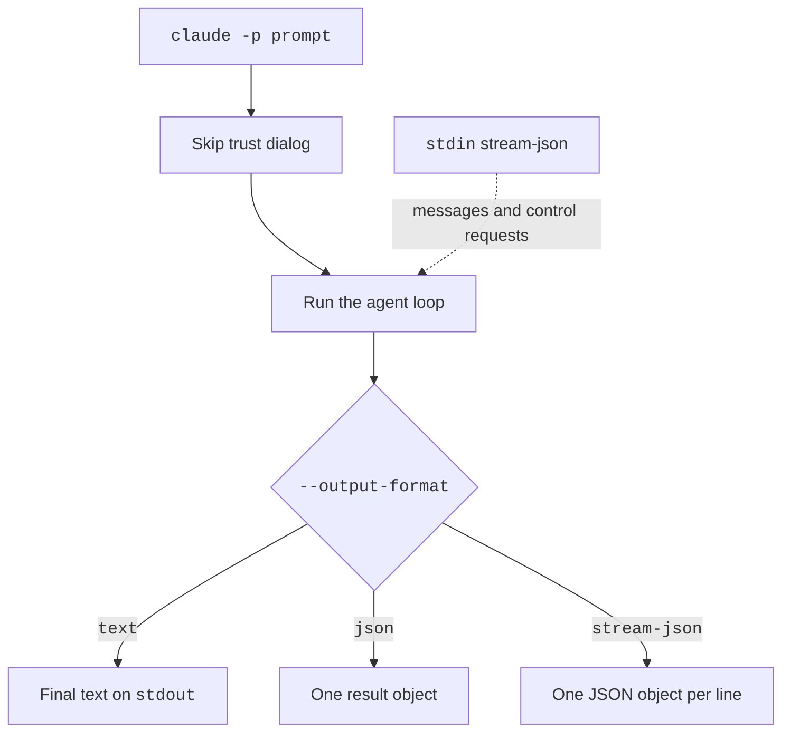

Print mode runs one prompt, prints the answer, and exits. Use it in scripts, pipes, and CI. It is also the base of the Agent SDK.

Add `-p` (or `--print`) to turn it on. For example, `claude -p "Summarize README.md" --output-format json` prints one JSON result. Send the prompt as an argument or on stdin.

Print mode saves the session to `~/.claude/projects/`. Add `--no-session-persistence` to save nothing.

:::warning
Print mode skips the workspace trust dialog. This also happens when stdout is not a terminal, such as when you pipe or redirect output. Use it only in folders you trust.
:::

## Print Mode Flags

See [Run Claude Code Programmatically](https://code.claude.com/docs/en/headless) and the [CLI Reference](https://code.claude.com/docs/en/cli-reference). Each flag has a row, with status and details, on [CLI Flags](../../configure/cli/flags.md).[^help]

- Output and input: `-p, --print`, `--output-format`, `--input-format`, `--include-partial-messages`, `--include-hook-events`, `--forward-subagent-text`, and `--replay-user-messages`.
- Checks and limits: `--json-schema` and `--max-budget-usd`.
- Prompts and permissions: `--prompt-suggestions` and `--permission-prompts`.
- Lean runs: `--no-session-persistence`, `--bare`, and `--restricted`.
- Tools, models, sessions, and MCP: `--allowedTools`, `--disallowedTools`, `--tools` (see [CLI Flags](../../configure/cli/flags.md)), `--fallback-model` (see [Models](../../how-it-works/models.md)), `--resume`, `--continue`, `--fork-session`, `--session-id` (see [Sessions and Storage](../../how-it-works/sessions-and-storage.md)), and `--mcp-config` with `--strict-mcp-config` (see [MCP Settings and Policy](../mcp/settings.md#files-and-flags)).

## Example

```bash title="One JSON answer, with a budget and a schema"
claude -p "List the three biggest files in this repo" \
  --output-format json \
  --max-budget-usd 1 \
  --json-schema '{"type":"object","properties":{"files":{"type":"array","items":{"type":"string"}}},"required":["files"]}'
```

```bash title="Watch the answer grow, line by line"
claude -p "Explain this repo" --output-format stream-json --verbose --include-partial-messages \
 | while read -r line; do echo "$line" | jq -r '.type'; done
```

The second command prints a `system` line for `init`, then `stream_event` lines, then one `result` line.

## How It Works



The loop is the same as in interactive mode. See [Agent Loop](../../how-it-works/agent-loop.md).

Since `2.1.326`, print mode writes a dim line to `stderr` while it waits to retry an API request, such as `... · retrying in 10s · attempt 2 of 10`, or `No response from the API after ...` when the API sent nothing. The line appears only when the retry wait reaches 5 seconds and `stderr` is a terminal. It does not appear with `--output-format stream-json`. With `json` it appears only when `stdout` is not a terminal.[^retry]

Three changes in `2.1.327` touch print and headless runs. A headless session no longer loses stored messages on resume when a message was sent again with the same UUID after the process was killed. `claude -p` no longer hangs before its first request when the fetch of the settings of a model stalls, such as at a proxy: it goes on without them after 10 seconds. The first subagent on a model waits up to 1.5 seconds (10 in `claude -p`) for those settings instead of starting without them. Print mode also runs fewer git commands before the first request.[^v2327]

Permission prompts have no screen to appear on, so a host program (or `--permission-prompts none`) must decide.

## Pages in This Section

| Page | What It Covers |
| --- | --- |
| [Stream JSON Messages](stream-json.md) | Every message type that print mode writes |
| [Control Protocol](control-protocol.md) | Every control request a host can send on the same stream |

## Errors

Each row is a family of messages. The backticked text is the start that every message in the family shares. A row marked `Various` gathers the messages of one feature that share no start.

| Start of Message | Status | What It Means | Cases |
| --- | --- | --- | --- |
| Various | <Undocumented /> | The Agent SDK or the control protocol refused an option or a request. | A skill name is not valid. The caller used `sessionStore` with an option that it cannot work with. With `persistSession: false` the error says that the storage adapter needs local writes to mirror from. It tells you to pass `env: { ...process.env, CLAUDE_CONFIG_DIR: dir }`, where `dir` is a new private directory such as one from `fs.mkdtempSync(path.join(os.tmpdir(), 'claude-'))`, and to delete `dir` when the query ends. Version `2.1.314` told you to use `CLAUDE_CONFIG_DIR=/tmp` instead. The caller did not provide a callback such as `canUseTool` or `getOAuthToken`. A control request subtype is not supported. A value has the wrong type. `pluginDelivery` or `managedSettingsDelivery` is neither `argv` nor `initialize`: the messages read `Invalid pluginDelivery. Expected 'argv' or 'initialize'.` and `Invalid managedSettingsDelivery. Expected 'argv' or 'initialize'.` Claude Code did not find the native CLI binary. |
| `Error: Claude Code could not save` | <Undocumented /> | Print mode could not write the transcript lines or the config changes of the run, because the disk is full or the disk quota is used up. | On Linux, Claude Code prints one line to `stderr` at the end of the run and sets the exit code to 1 in `text` and `json` output. The line reads `Error: Claude Code could not save all of this session's transcript under <folder> because the disk is full (ENOSPC).` It can name `changes this run made to <config file>` too. With a lost transcript it adds `If you resume this session, part of the conversation may be missing.` For `EDQUOT` it says `your disk quota is used up (EDQUOT)` and ends with `Free up space, or ask for a larger quota, before the next run.` With `stream-json` the exit code stays as it was, and the program also writes a `system` message with subtype `session_writes_lost`, `error_code` (`ENOSPC` or `EDQUOT`), and `lost` (`transcript`, `global_config`).[^lost-writes] |
| Various | <Undocumented /> | An OpenTelemetry exporter setting is not known. | The protocol or exporter type set in an `OTEL_*` variable is not known, or the Cloud gateway session that named the collector ended. |

## Related Pages

- [CLI Flags](../../configure/cli/flags.md)
- [Transcript Format](../../reference/transcript-format.md)
- [SDK and Automation Env Vars](../../configure/env-vars/sdk-and-automation.md)

## Sources

[^help]: `claude --help`.
[^retry]: The program, `chunk-rap1tzf6.js:553592` and `:553716`.
[^lost-writes]: [`2.1.321` release notes](https://github.com/anthropics/claude-code/releases/tag/v2.1.321). The program, `chunk-rap1tzf6.js:193675` and `chunk-rap1tzf6.js:10150-10228`. Schema text, `chunk-rj3e7agr.js:613280`.
[^v2327]: [`2.1.327` release notes](https://github.com/anthropics/claude-code/releases/tag/v2.1.327). The program, `chunk-m14bt1pz.js:203757-203790` for the 1.5 s and 10 s wait for the model settings (the wait is on unless the gate `tengu_deep_shore` is off; on timeout the run goes on without them).
