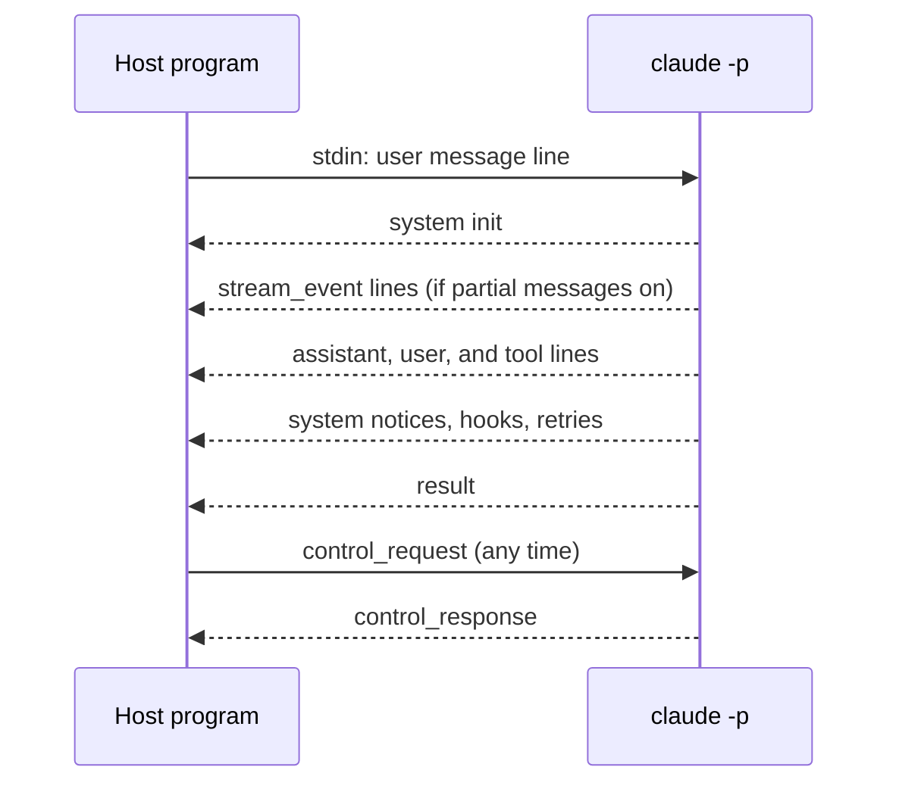

Stream JSON lets a host program read each step of a run as it happens, and send messages back while the run goes on. Use it to build a UI or a tool on top of print mode.

With `--output-format stream-json`, Claude Code writes one JSON object per line to stdout. With `--input-format stream-json`, you send JSON lines on stdin, and the same channel carries [control requests](control-protocol.md). For example, `claude -p "Explain this repo" --output-format stream-json --verbose --include-partial-messages` prints a `system` / `init` line, then `stream_event` lines while the answer grows, then a final `result` line.

These flags add more lines: `--include-partial-messages`, `--include-hook-events`, `--forward-subagent-text`, and `--replay-user-messages`.

## Message Types

The tables list the message types that the bundled schema defines.[^message-schema] Each row has a short form of the schema description. A row without a description says so. A type has the status <Documented /> when a docs page other than the [changelog](https://code.claude.com/docs/en/changelog) and the Agent SDK pages names it. See [Run Claude Code Programmatically](https://code.claude.com/docs/en/headless) and the [CLI Reference](https://code.claude.com/docs/en/cli-reference).

A type written as `system` / `init` means `type` is `system` and `subtype` is `init`.

### Documented Types

| `type` / `subtype` | Status | What It Does |
| --- | --- | --- |
| `user` | <Documented /> | A user message, such as a message of a subagent when `--forward-subagent-text` is on. |
| `result` | <Documented /> | The final result of the run. |
| `system` / `init` | <Documented /> | Session data at the start of each turn: session ID, model, working folder, tools, MCP servers, slash commands, and plugins. It can have `ultrathink_available`, a boolean. It is `true` when typing `ultrathink` runs the turn at `xhigh` effort on the `model` of this line, and when the session is already at `xhigh` or `max`. After a `system` / `per_turn_effort_changed` line, treat it as `false` until the next `init` line. If the field is absent, the answer is unknown, and a host colors nothing. The stream-json host sends it, and `get_settings` gives the same answer as `applied.ultrathinkAvailable`.[^ultrathink] |
| `stream_event` | <Documented /> | A step of the answer as it grows, only with `--include-partial-messages`. |
| `system` / `compact_boundary` | <Documented /> | Claude Code compacted the conversation here. |
| `system` / `api_retry` | <Documented /> | An API request failed with an error that can be retried, and Claude Code will try again after a wait. |
| `system` / `hook_started` | <Documented /> | A hook started to run. |
| `system` / `hook_progress` | <Documented /> | A hook reported progress. |
| `system` / `hook_response` | <Documented /> | A hook finished with a response. |
| `system` / `plugin_install` | <Documented /> | Progress of a plugin install in print mode, when you set `CLAUDE_CODE_SYNC_PLUGIN_INSTALL`. |
| `system` / `permission_denied` | <Documented /> | Claude Code denied a tool call. The final result lists the denials in `permission_denials`. |
| `prompt_suggestion` | <Documented /> | The predicted next prompt, sent after each turn when prompt suggestions are on. |

### Undocumented Types

No official page names these types. They can change without notice.

| `type` / `subtype` | Status | What It Does |
| --- | --- | --- |
| `rate_limit_event` | <Undocumented /> | Rate limit information changed. |
| `system` / `status` | <Undocumented /> | No description in the program schema. |
| `system` / `post_turn_summary` | <Undocumented /> | A summary made in the background after each assistant turn. |
| `system` / `task_summary` | <Undocumented /> | A progress line in the middle of a turn. |
| `system` / `session_metadata` | <Undocumented /> | A patch of session data for a local host, such as the list of published artifacts. |
| `system` / `informational` | <Undocumented /> | A text banner: a status line, hook feedback, or the output of a slash command. |
| `system` / `permission_retry` | <Undocumented /> | Tools run again after a change of permission mode allowed commands that Claude Code denied before. |
| `system` / `stop_hook_summary` | <Undocumented /> | Which `Stop` and `SubagentStop` hooks ran at the end of a turn, their output, and whether one stopped the continuation. |
| `system` / `memory_saved` | <Undocumented /> | The memory system wrote to the listed paths. |
| `system` / `agents_killed` | <Undocumented /> | Claude Code stopped background agents, for example on an interrupt. |
| `system` / `instruction_size_warning` | <Undocumented /> | The instruction files of the session are larger than the advised limit. |
| `system` / `away_summary` | <Undocumented /> | A summary of what happened while you were away. |
| `system` / `thinking` | <Undocumented /> | The thinking text itself. |
| `transcript_mirror` | <Undocumented /> | Sent after each successful write of the local transcript. |
| `system` / `mirror_error` | <Undocumented /> | A batch of the transcript mirror failed after 3 tries. |
| `system` / `control_request_progress` | <Undocumented /> | Progress of a long control request, matched by `request_id`. |
| `system` / `model_refusal_fallback` | <Undocumented /> | No description in the program schema. |
| `system` / `model_refusal_no_fallback` | <Undocumented /> | No description in the program schema. |
| `system` / `model_fallback` | <Undocumented /> | No description in the program schema. |
| `system` / `model_consent_fallback` | <Undocumented /> | A check before the request moved the session off the requested model. |
| `system` / `file_snapshot` | <Undocumented /> | A snapshot of the plan and todo files, made for rewind. |
| `system` / `scheduled_task_fire` | <Undocumented /> | A scheduled task (cron) started. |
| `system` / `peer_message_hold` | <Undocumented /> | Claude Code held a message from another session and did not queue it. The line says how the hold ended. |
| `system` / `turn_duration` | <Undocumented /> | The wall-clock time of a turn, with the budget and the number of background jobs. |
| `system` / `api_error` | <Undocumented /> | An API error that can be retried, with the error data and the retry counts. |
| `system` / `local_command_output` | <Undocumented /> | The output of a local slash command, such as `/usage`. |
| `tool_progress` | <Undocumented /> | No description in the program schema. A hook that runs long in a `UserPromptSubmit`, `PreToolUse`, `PostToolUse`, `PostToolUseFailure`, `Stop`, `PreCompact`, or `PostCompact` event sends this message every 30 s with `heartbeat: true`, so a client sees that the hook still runs. [^heartbeat] |
| `auth_status` | <Undocumented /> | No description in the program schema. |
| `system` / `files_persisted` | <Undocumented /> | No description in the program schema. |
| `system` / `task_notification` | <Undocumented /> | No description in the program schema. |
| `system` / `task_started` | <Undocumented /> | No description in the program schema. |
| `system` / `task_updated` | <Undocumented /> | No description in the program schema. |
| `system` / `background_tasks_changed` | <Undocumented /> | No description in the program schema. |
| `system` / `feedback_draft_queued` | <Undocumented /> | The `SendFeedback` tool wrote a draft to `~/.claude/feedback/drafts/`. |
| `system` / `session_state_changed` | <Undocumented /> | The state of the session changed. |
| `system` / `session_title_changed` | <Undocumented /> | No description in the program schema. |
| `system` / `worker_shutting_down` | <Undocumented /> | No description in the program schema. |
| `system` / `turn_handoff_available` | <Undocumented /> | Sent once by a cloud worker that accepts the `turn_handoff` control request. It carries what the worker wrote to `external_metadata.turn_handoff`. It can have `requires_rewind_request_id` (see [Usage, Error, and Process Fields](#usage-error-and-process-fields)) and `comparison_fork` (see [Handoff, Environment, and Error Code Fields](#handoff-environment-and-error-code-fields)). |
| `system` / `ui_invalidate` | <Undocumented /> | No description in the program schema. |
| `system` / `ui_log` | <Undocumented /> | A plugin called `$.ui.log(text)`, and the screen adds a dim notice under the name of the plugin. |
| `system` / `ui_notify` | <Undocumented /> | A plugin called `$.ui.notify(text)`, and the client raises a notification under the name of the plugin. The line has `plugin`, `source` (`name@marketplace`), `title`, `text`, and `rewritten`. It can have `key`, `delay_ms`, `at`, and `until_back`. [^ui-notify] |
| `system` / `late_allow_not_run` | <Undocumented /> | A cloud worker says that the call of a permission card will not run on a late Allow: the worker refused the Allow, a Deny came, or the worker cancels the card itself. It has `request_id`, `tool_use_id`, and `reason`: `turn_running`, `card_open`, `call_gone`, `invalid_answer`, `limited`, `stopped`, `declined`, `asked_again`, `withdrawn`, `expired`, or `not_run`. Treat any other value as "did not run".[^hook-fields] |
| `system` / `shell_cwd` | <Undocumented /> | The folder that a main-thread `Bash` or `PowerShell` call that did not fail left its shell in, whether or not it moved. The line has `cwd`. Claude Code sends it only to a host that marked a hook matcher `replacedByFrame: 'shell_cwd'`, before the result of the call and before its `PostToolUse` hooks. It does not wait for the host. It is not sent for a call of a subagent, or for a call served for the session of another machine. A call that overlapped another reports its own folder, and the `cd` of the model moves it, so treat it as data. The schema marks it `@internal`.[^handoff-fields] |
| `system` / `ui_notify_cancel` | <Undocumented /> | A plugin called `$.ui.cancelNotify(key)`, or the engine removed the plugin. The client removes the notification with this `source` and `key`. [^ui-notify-cancel] |
| `system` / `ui_toast` | <Undocumented /> | A plugin called `$.ui.toast(text)`, and the screen shows a short note under the prompt. |
| `system` / `ui_status` | <Undocumented /> | A plugin called `$.ui.status(text)`, and the screen pins a line under the prompt. |
| `system` / `ui_scroll` | <Undocumented /> | A plugin scrolled a site that a remote screen draws. |
| `system` / `ui_focus` | <Undocumented /> | A plugin moved the focus ring of a site that a remote screen draws. |
| `system` / `commands_changed` | <Undocumented /> | The full list of slash commands, sent after a change in the middle of a session. |
| `system` / `notification` | <Undocumented /> | A text notification from the loop. |
| `system` / `task_progress` | <Undocumented /> | No description in the program schema. |
| `system` / `thinking_tokens` | <Undocumented /> | A live estimate of the thinking tokens while the thinking text is hidden. |
| `tool_use_summary` | <Undocumented /> | No description in the program schema. |
| `system` / `memory_recall` | <Undocumented /> | No description in the program schema. |
| `system` / `elicitation_complete` | <Undocumented /> | An MCP server reported that a URL-mode elicitation is complete. |
| `system` / `permission_check_status` | <Undocumented /> | No description in the program schema. |
| `system` / `code_change_published` | <Undocumented /> | No description in the program schema. |
| `system` / `vcs_state_changed` | <Undocumented /> | No description in the program schema. |
| `system` / `dev_intent` | <Undocumented /> | No description in the program schema. |
| `system` / `turn_preempted` | <Undocumented /> | No description in the program schema. |
| `system` / `per_turn_effort_changed` | <Undocumented /> | The conversation stopped sending the effort with each turn, because the server refused it. |
| `system` / `file_attachments_missing` | <Undocumented /> | No description in the program schema. |
| `system` / `inherited_asks_settled` | <Undocumented /> | A cloud worker reports, before its first turn, which asks it inherited and keeps. Any ask stored before this event that it does not name is over. The line has `kept_request_ids`, an array of the request IDs (strings) of the earlier worker's asks that stay answerable. [^inherited-asks] |
| `system` / `cloud_session_delta` | <Undocumented /> | No description in the program schema. |
| `control_request` | <Undocumented /> | A request of the control protocol, which either side can send on the same stream. |
| `control_response` | <Undocumented /> | The single reply to a `control_request`. |
| `control_cancel_request` | <Undocumented /> | The sender no longer needs the answer to one of its own control requests. |
| `keep_alive` | <Undocumented /> | A heartbeat with no payload. |
| `update_environment_variables` | <Undocumented /> | Updates env vars while the process runs. |

## Capabilities of the `init` Line

The `system` / `init` line can carry a `capabilities` array of strings.[^capabilities]
A host reads it to detect features, so it does not need to read the version. The array is an open set, so ignore each value that you do not know. Check each capability for exactly the behavior that you use. An older CLI does not write the array, so treat a missing array as no capabilities. Read the newest `init` line, because the array can change between lines.

No official page names these values. They can change without notice.

| Capability | Status | When It Appears | What It Means |
| --- | --- | --- | --- |
| `interrupt_receipt_v1` | <Undocumented /> | Always. | The success payload of an `interrupt` control response carries `still_queued`. It lists the uuids of async user messages that survive the interrupt. |
| `interrupt_cancel_queued_v1` | <Undocumented /> | Always. | The `interrupt` request honors `cancel_queued: true`. It cancels queued and pending-dispatch commands with the abort, and the response lists them in `cancelled`. Then `still_queued` is empty. A client of a hosted session still lists what it can no longer recall: a send in flight, or the first prompt of the session. |
| `interrupt_send_now_v1` | <Undocumented /> | Always. | The `interrupt` request honors `send_now: true` and `message_uuid`. The response then has a `send_now` field with the value `stopped`, `delivering`, or `nothing_waiting`. A CLI without it handles the request as a plain interrupt. |
| `interrupt_requeue_taken_v1` | <Undocumented /> | Always, except in a cloud-hosted session (see below). | The interrupt response can carry `put_back`. It lists the uuids under `still_queued` that the interrupt returned to the queue after a turn took them. A CLI without it ignores the field. |
| `msg_lifecycle_v1` | <Undocumented /> | Always. | Only the name is known. |
| `request_marker_lists_v1` | <Undocumented /> | Always. | Only the name is known. |
| `ask_user_question_unanswered_v1` | <Undocumented /> | Always. | An `AskUserQuestion` answer can set `annotations[question].unanswered` to `skipped`, `replied_in_chat`, or `dismissed`. The tool result echoes it. Send it only to a session that has this value. An older CLI on a strict host refuses the whole answer. A strict host also refuses any other value. |
| `lifecycle_wakeup_source_v1` | <Undocumented /> | When the session installs its command lifecycle forwarder. | A `command_lifecycle` line in state `started` can carry `wakeup_source`. It is `loop_wakeup` for a `ScheduleWakeup` fire, or `schedule_wakeup` for any other scheduler fire. |
| `sdk_mcp_tools_list_changed` | <Undocumented /> <Gated note="tengu_sdk_mcp_manifests" /> | When a server-side flag is on. It is on by default. Except in a cloud-hosted session. | Only the name is known. |
| `sdk_mcp_manifests` | <Undocumented /> | Same flag as above, and on a remote transport also when the checks for remote manifests pass. Except in a cloud-hosted session. | The `initialize` request can carry `sdkMcpServerManifests`. The members are handshake results that the host already got from its in-process MCP servers. The CLI uses them to skip the handshake round trips. The response reports what became of each entry in `sdk_mcp_manifests_parked`. |
| `mcp_read_resource_v1` | <Undocumented /> | Unless the lane redacts what it persists. Except in a cloud-hosted session. | A control request reads one `ui://` resource from an MCP server that the CLI connected itself. A host that renders MCP Apps uses it. Treat the reply as untrusted HTML. Render it in a sandbox. |
| `mcp_tool_ui_meta_v1` | <Undocumented /> | Unless the lane redacts what it persists. | A tool entry can carry the MCP Apps members of its `_meta`: `ui` and the flat `ui/resourceUri`. The CLI checks them, limits their size, and withholds every other `_meta` key. |
| `ui_surface_v1` | <Undocumented /> | When the UI features are on and the lane does not redact what it persists. On a remote transport, only for a `remote_cowork` session. | Only the name is known. |
| `mcp_call_result_not_for_model_v1` | <Undocumented /> | Unless the lane redacts what it persists. Never on a remote transport. | An MCP tool call can say that a program, not a model, takes the result. The result then holds the server content blocks unchanged. A result over 10485760 characters fails. A CLI without it ignores the member. |
| `task_list_restore_v1` | <Undocumented /> | On a remote transport. | Only the name is known. Claude Code reads a session field `external.task_list_restore` with `count` and `highest_id`. |
| `task_list_restored_v1` | <Undocumented /> | After the CLI honored a task list restore request at the start of the session. | Only the name is known. |
| `read_file_as_written_v1` | <Undocumented /> | When the lane does not redact what it persists, no HIPAA policy applies, and a server flag that is off by default is on. | A file read request can take a path copied from a reply of Claude. The session looks for one matching file and answers with `absPath`. Send it only to a session that lists this value. |
| `start_shell_task_v1` | <Undocumented /> | Only on a cloud worker on Linux with a `Bash` tool, and when a server flag is on. Except in a cloud-hosted session. | A request starts a long-running command, such as a dev server, as a background shell task. It is one call of the `Bash` tool. The schema marks it `@internal`. |
| `prompts_screened_v1` | <Undocumented /> | While a hook or plugin can change what the transcript records of a typed line. | The CLI says it again when a plugin load or reload changes this. The schema marks it `@internal`. |
| `ui_hooked_v1` | <Undocumented /> | When the UI features are on and the session finished its hook registration. | The array can also hold `ui_hooked_v1:<component>` entries for components that hooks can change. Only the names are known. |
| `register_repo_root_v1` | <Undocumented /> | Not known. It appears only in the cloud-hosted list below. | Only the name is known. |
| `queued_notifications` | <Undocumented /> | When the session offers the notification tool, and either the environment has `CLAUDE_CODE_REMOTE` in non-interactive mode or a second check passes. The second check is not known. | The CLI accepts inbound `queued_notification` stream messages and removes them with `ReadNotifications`. The cloud session backend reads this value from the saved `init` event to decide whether it can send them. |
| `third_party_notification_caution` | <Undocumented /> | Added next to `queued_notifications` under a condition on tool descriptions. The condition is not known. | Only the name is known. |
| `session_notices` | <Undocumented /> | In `auto` mode, on a remote transport, when the environment has `CLAUDE_CODE_REMOTE` and a server flag is on. | Only the name is known. Claude Code accepts `session_notice` messages with `notice_class`, `from_session_id`, and `content`. |
| `reload_plugins_refuse_if_busy_v1` | <Undocumented /> | Unless the transport is remote or the lane redacts what it persists. | The `reload_plugins` control request honors `refuse_if_busy: true`. A busy session then reloads nothing and answers with the error code `reload_plugins_busy`. A CLI without it can ignore the field and serve the request in a turn too.[^hook-fields] |
| `silent_resend_files_v1` | <Undocumented /> | Always, except in a cloud-hosted session (see below). | Only the name is known.[^hook-fields] |
| `slash_words_join_v1` | <Undocumented /> | When `CLAUDE_CODE_SESSION_ORIGIN` is `claude_ai_chat` with an app or remote entrypoint, the model accepts mid-conversation system messages, and the sticky betas of the session lack `mid_conversation_system`. | Only the name is known.[^handoff-fields] |

When this process drives a cloud-hosted session, Claude Code removes nine names from the `init` line: `mcp_read_resource_v1`, `sdk_mcp_tools_list_changed`, `sdk_mcp_manifests`, `register_repo_root_v1`, `interrupt_requeue_taken_v1`, `start_shell_task_v1`, `voice_call_talk_line_v1`, `withdrawn_files_note_v2`, and `silent_resend_files_v1`. The same list sits next to the message "MCP server changes are not available in a cloud-hosted session yet".

## Usage, Error, and Process Fields

Each field below is in [`claude-code-stream-json.json`](../../reference/schemas.md). The schema marks the `system` and `result` fields as `@internal`, so they can change without notice.

| Field | Status | Where | Type | What It Means |
| --- | --- | --- | --- | --- |
| `cacheCreationEphemeral5mInputTokens` | <Undocumented /> | Each per-model usage entry: `modelUsage` and `model_usage_since_last_result` of a `result` line, and `usage_report.session.model_usage` of an `assistant` line | Integer | Cache writes with a 5-minute lifetime. `cacheCreationInputTokens` already includes them. This field and the 1-hour field can add up to less than `cacheCreationInputTokens`. A response that does not report how long its cache writes live adds to neither field. `costUSD` prices those writes at the 5-minute rate. It counts only turns that ran on versions that record it. The field is absent when no turn ran on such a version. The count is too low when part of the session ran on an older version. |
| `cacheCreationEphemeral1hInputTokens` | <Undocumented /> | Same entries as above | Integer | Cache writes with a 1-hour lifetime, already counted inside `cacheCreationInputTokens`. `costUSD` prices them at the 1-hour rate when the price table of the model has one. A `modelPricing` row of managed settings does not, so its one cache-write rate applies to both lifetimes. |
| `api_error` values `unattended_start_limit` and `unattended_start_unconfirmed` | <Undocumented /> | `assistant` and `result` lines | Two values of an existing string field | Both describe a cloud session process that starts where an earlier one died and would carry on its unfinished work. `unattended_start_limit`: the session record shows that the allowed number of such starts (a configured number) already happened within 24 hours. No message from a person came in between. So the process sent no request. It ends the turn, so a consumer must not send the same prompt again. `unattended_start_unconfirmed`: the process could not check whether the limit allowed it to start, so it sent no request. It does not end the turn, and a later process may carry it on. |
| `requires_rewind_request_id` | <Undocumented /> | `system` / `turn_handoff_available` | `true` | Present only on a worker that reads the `requires_rewind_request_id` member of a `turn_handoff` [control request](control-protocol.md). A worker without this key ignores the member. |
| `background_color` | <Undocumented /> | Each pane of a `system` / `ui_panes` line | String | What the surface paints under the body of the pane while it is the one shown: a theme key, a raw color, or `transparent` for nothing. When absent, the look of the surface stands. |
| `main_stream_count`, `main_stream_chunk_count`, `main_stream_event_count`, `process_wall_ms_streaming`, `process_cpu_ms_streaming` | <Undocumented /> | `result` line, success | Integer | Streaming counters and times of the process. Only the names and types are known. |
| `process_start_tuning`, `process_start_purge_delay_ms` | <Undocumented /> | `result` line, success and error | Integer | Start-up tuning data of the process. Only the names and types are known. |
| `process_garbage_collections` | <Undocumented /> | `result` line, success and error | Object | Has `to_first_message` and `to_first_result`. Each holds the integers `eden`, `full`, `wall_ms`, and `heap_after_mib`. Only the names and types are known. |

[^fields-311]

## Sign-In End Field

| Field | Status | Where | Type | What It Means |
| --- | --- | --- | --- | --- |
| `credential_expires_at` | <Undocumented /> | `result` line, and the `result` object of `--output-format json` | String, an ISO 8601 date | The end of the stored claude.ai sign-in: the end of its refresh token. The real end can fall up to 3 days earlier, so treat it as the latest day. The key is absent when the program has no such date. |

The key is missing, not `null`, when the program has no such date: the provider is not first party, no refresh token or valid refresh date is stored, or the access token ends more than 3 days after the refresh token.[^credential] In `claude auth status`, the same value prints as `loginExpiresAt`, and it is `null` when the date is missing. See [`claude auth status` Sign-In Date](../../configure/cli/subcommands.md#claude-auth-status-sign-in-date).

## Hook, Task, and Plugin Fields

No official page names these fields. They can change without notice.[^hook-fields]

| Field | Status | Where | Type | What It Means |
| --- | --- | --- | --- | --- |
| `hook_no_verdict` | <Undocumented /> | `system` / `informational` line | Object | Marks the warning that a `PreToolUse` hook gave no verdict on a call and that the failure did not refuse the call. Another hook, a rule, or the person can still stop the call. It has `hook_event`, `tool_use_id`, and `timed_out` (`true` for a hook that ended with no answer, usually at its timeout). It can have `plugin_id` and `plugin_root` for a plugin hook. The CLI sends it once per hook in a session, for the first such call. A host can word the notice itself instead of reading `content`. |
| `summary_is_report` | <Undocumented /> | `system` / `task_notification` line | Boolean | `true` when `summary` is the report of a subagent that nothing waits for, and no review of it is to come. Show it as the report. A later notification for the same `task_id` replaces it. Absent otherwise, and always absent for a subagent whose owner is in `auto` mode. |
| `origin` | <Undocumented /> | `system` / `hook_started` line | String | Who set up the hook, such as `user_settings`, `project_settings`, `policy_settings`, or `official_plugin`. Treat an unknown value as unknown. The CLI sets it only on `SessionStart` hooks, only for the Code tab of the Claude desktop app, and only while the records of the session stay on the machine. |
| `label` | <Undocumented /> | `system` / `hook_started` line | String | With `origin`: a short name to show the person. It is the `statusMessage` of the hook or, for a hook in user, project, or local settings, the file name of its program or script. One line, at most 80 characters. It is untrusted text, for display only. |
| `plugin_name` | <Undocumented /> | `system` / `hook_started` line | String | With `origin`: the name of the plugin that the hook comes from. One line, at most 80 characters. It is untrusted text, for display only. |
| `backgrounded` | <Undocumented /> | `system` / `hook_progress` line | `true` | The hook went to the background, so the session no longer waits for it. The CLI sends it once, with no output, for a hook whose `hook_started` line has `origin`. |
| `managed_lock` | <Undocumented /> | Each `plugin_errors` entry of the `system` / `init` line | Object | Present only when an `enabledPlugins` entry of the managed settings dropped a copy of a plugin (from `--plugin-dir`, the SDK `plugins` option, a skills folder, or a synced copy). It has `plugin_enabled`, `name`, and `marketplace`. With `plugin_enabled: true`, the entry turns the plugin on and Claude Code does not accept this copy as that plugin. With `false`, the entry turns it off and no folder copy of that name can load. `name` and `marketplace` are not cleaned, so clean and bound them before you show them. |

## Handoff, Environment, and Error Code Fields

No official page names these fields. The schema marks most of them `@internal`, so they can change without notice.[^handoff-fields]

| Field | Status | Where | Type | What It Means |
| --- | --- | --- | --- | --- |
| `comparison_fork` | <Undocumented /> | `system` / `turn_handoff_available` | `true` | Present only on a worker that answers the `comparison_fork` [control request](control-protocol.md). A client sends that request to no other worker. |
| `host_dropped_env` | <Undocumented /> | `system` / `init` line | Object | Appears only in a session that Claude Desktop itself started. It lists the variables by which managed settings choose a provider or a gateway, where this start dropped them and requests go straight to Anthropic. `source` is `policySettings`; ignore any other value. `names` are upper-case variable names, never values. It is worked out anew for each `init`. It is omitted when there is nothing to list, on any transport that stores its frames, in the `init` sent over the Remote Control bridge, and on older CLIs. |
| `handbackToolUseId` | <Undocumented /> | `origin` of a `user` or `result` line | String | On a hand-back: the id of the `tool_use` block of the subagent that sent it, the `toolUseId` of the `handback_report` of this report. The harness sets it, never the tool input. |
| `handback_report.toolUseId` | <Undocumented /> | `system` / `task_notification` line | String | The id of the own `SubagentHandback` `tool_use` block of the subagent that sent the report, not of the call that started the agent. Copies of one report repeat it. Show the report even when no such block is loaded. |
| `prompt` | <Undocumented /> | `system` / `task_started` line | String | The text of what this run was asked. It is absent on a subagent run that Claude Code resumed with text of its own, such as the notice of a background task. Keep the prompt that an earlier `task_started` gave. On a run that continues an interrupted turn, it is the description of the task. |
| `error_code` values `stale_root_id` and `stale_turn` | <Undocumented /> | Error `control_response` line | Two values of an existing string field | `stale_root_id`: a `read_file` with the anchor `diff_root` carried a `rootId` that this process did not make for the directory that `get_workspace_diff` would diff now. Ask for the diff again. `stale_turn`: a `comparison_fork` request, where no first model call of the worker named the turn within the wait.[^handoff-codes] A `rootId` also appears in the `read_file` anchor and in the `get_workspace_diff` reply (see [Control Protocol](control-protocol.md)). |
| `startup_failure_reason`, `memory_check_detail.wait`, and `memory_check_detail.boot_age_ms` | <Undocumented /> | `result` line | Existing fields | The schema lists values of `startup_failure_reason` and `memory_check_detail.wait`, and a minimum and a maximum for `boot_age_ms`. Only the names and types are known. |

## Example

```json skip-lint title="Lines from a short run (shortened)"
{"type":"system","subtype":"init","session_id":"...","model":"...","tools":["Read","Bash"]}
{"type":"stream_event","event":{"type":"content_block_delta"}}
{"type":"result","subtype":"success","is_error":false,"result":"..."}
```

```bash title="Pick out the final result"
claude -p "Say hi" --output-format stream-json --verbose | jq -c 'select(.type=="result")'
```

## How It Works



The `control_request`, `control_response`, `control_cancel_request`, `keep_alive`, and `update_environment_variables` lines share the stream with the messages above.
Mirror lines (`transcript_mirror`) follow each local transcript write. For the file format, see [Transcript Format](../../reference/transcript-format.md).

## Exact Fields

The exact fields are in `https://clawdipedia.cc/schemas/claude-code-stream-json.json`. It has a definition for each output and input message type, and it lists every field of this release. Look up a field there before you rely on it.[^validators]

## Related Pages

- [Headless and Print Mode](index.md)
- [Control Protocol](control-protocol.md)
- [CLI Flags](../../configure/cli/flags.md)

## Sources

[^message-schema]: The program, the message schema, for example `chunk-20bv8pca.js:466930`.
[^ultrathink]: The program, `chunk-20bv8pca.js:484644`, `chunk-hp1k7mph.js:7283`, and `chunk-b8ves7hr.js:95166`.
[^heartbeat]: The program, `chunk-56bhcxay.js:1259871` for the 30 s default (`CLAUDE_CODE_HOOK_HEARTBEAT_INTERVAL_MS` overrides it at `chunk-56bhcxay.js:1266275`), `chunk-56bhcxay.js:1265925` for the seven hook events, and `chunk-56bhcxay.js:1267323` for the `heartbeat: true` message.
[^ui-notify]: The program, `chunk-20bv8pca.js:566660`.
[^ui-notify-cancel]: The program, `chunk-20bv8pca.js:568983`.
[^inherited-asks]: The program, `chunk-20bv8pca.js:555670` and `chunk-5699r6rq.js:88705`.
[^capabilities]: The program. The array is built at `chunk-b8ves7hr.js:95166`. The names and the always-on list are at `chunk-hp1k7mph.js:2275` to `chunk-hp1k7mph.js:3614`. The cloud list and its message are at `chunk-2v0j7fr6.js:24309` and `chunk-2v0j7fr6.js:24464` to `chunk-2v0j7fr6.js:24663`. The notification names are at `chunk-ae1e95zr.js:4698` and `chunk-ae1e95zr.js:4724`. `session_notices` is at `chunk-xethrx83.js:813778` and `chunk-b8ves7hr.js:27822`. The gate of `read_file_as_written_v1` is at `chunk-20bv8pca.js:760751`. The task list names are at `chunk-hp1k7mph.js:2513`. The schema describes the array in `schemas/claude-code-stream-json.json`.
[^fields-311]: The program. `chunk-20bv8pca.js:245812` for the cache fields, `chunk-56bhcxay.js:1293264` where they are counted, `chunk-20bv8pca.js:368591` and `chunk-20bv8pca.js:376258` for the `api_error` values, `chunk-20bv8pca.js:562041` and `chunk-wfswdcq7.js:41765` for `requires_rewind_request_id`, and `chunk-20bv8pca.js:572296` for `background_color`.
[^credential]: The program. The field is built in `chunk-gny766vy.js:1005` from the stored `refreshTokenExpiresAt` (`chunk-9swf4edz.js:312`) and set on the `result` line in `chunk-20bv8pca.js:466930`. The status command reads it at `chunk-00wezk9v.js:37132`.
[^validators]: The schema is made from the program's own validators, for example `chunk-20bv8pca.js:466930`.
[^hook-fields]: The program, `chunk-20bv8pca.js:556061` for `late_allow_not_run`, `chunk-20bv8pca.js:520051` for `hook_no_verdict`, `chunk-20bv8pca.js:545699` for `summary_is_report`, `chunk-20bv8pca.js:541440` for `origin`, `label`, `plugin_name`, and `backgrounded`, `chunk-20bv8pca.js:478920` for `managed_lock`, `chunk-20bv8pca.js:488151` and `chunk-hp1k7mph.js:3125` for `reload_plugins_refuse_if_busy_v1`, and `chunk-hp1k7mph.js:3609` and `chunk-2v0j7fr6.js:24663` for `silent_resend_files_v1`.
[^handoff-fields]: The program, `chunk-20bv8pca.js:603088` for `shell_cwd`, `chunk-20bv8pca.js:562321` for `comparison_fork`, `chunk-20bv8pca.js:492853` for `host_dropped_env`, `chunk-20bv8pca.js:311861` for `handbackToolUseId`, and `chunk-hp1k7mph.js:3609`, `chunk-b8ves7hr.js:93743`, `chunk-2b3eg071.js:107492`, and `chunk-374y7r0w.js:3966` for `slash_words_join_v1`. The schema is `schemas/claude-code-stream-json.json`.
[^handoff-codes]: The program, `chunk-20bv8pca.js:233306` and `chunk-20bv8pca.js:233606`.
