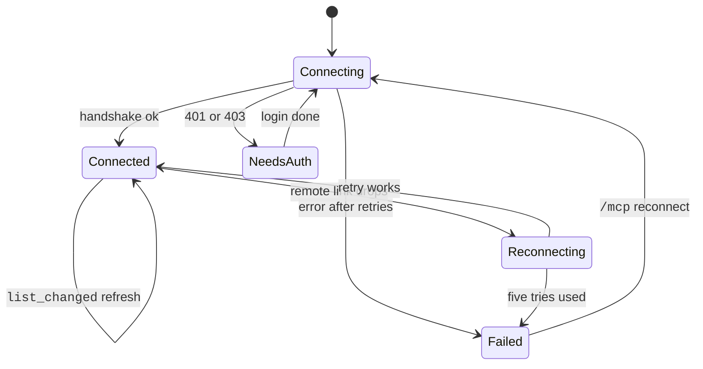

After an MCP server connects, Claude Code adds its tools, resources, and prompts to the session. The names, the permission rules, and the limits decide what Claude can use and for how long. Claude Code names a tool from a server `mcp__<server>__<tool>`. For example, `mcp__github__create_issue` is the `create_issue` tool of the `github` server.

This runs by itself once a server connects. To change it, use `permissions.deny` for tools, `ENABLE_TOOL_SEARCH` for deferral, and `CLAUDE_CODE_MCP_AUTO_BACKGROUND_MS` for background moves. Claude Code saves large results under `tool-results`.

## Tools and Names

Official pages: [Connect Claude Code to Tools via MCP](https://code.claude.com/docs/en/mcp) and [Configure Permissions](https://code.claude.com/docs/en/permissions).[^undoc]

| Item | Status | What It Does | How It Works |
| --- | --- | --- | --- |
| `mcp__<server>__<tool>` | <Documented /> | Names an MCP tool. | Characters outside `A-Z a-z 0-9 _ -` in the server name become `_`. Claude Code leaves out a tool whose full name is over 128 characters. Used in permission rules, hooks, `tools`, and `allowed-tools`. |
| `mcp__plugin_<plugin>_<server>__<tool>` | <Documented /> | Names a plugin server tool. | Its server name is `plugin:<plugin>:<server>`. A hook matcher on the bare server key never fires for it. |
| `mcp__github`, `mcp__github__*`, `mcp__*` | <Documented /> | Select tools by server. | The first two match one server. `mcp__*` matches all MCP tools. Used in subagent `tools` and `disallowedTools`. |
| Hook matcher `mcp__memory__.*` | <Documented /> | Matches a server in hooks. | A matcher with only exact-match characters, such as `mcp__memory`, matches no tool. You must add `.*`. |
| `mcp_server` hook input field | <Documented /> | Gives the origin of the server. | An object with `name` and `source` (`plugin`, `sdk`, `user`, `project`, and more). Sent to tool hooks. |
| `mcp_tool` hook type | <Documented /> | Calls an MCP tool as a hook. | The output counts as command stdout. Claude Code skips it on `Setup`, and at `SessionStart` before servers connect. |
| `updatedMCPToolOutput` | <Documented /> | Replaces an MCP tool result. | Output of a `PostToolUse` hook. MCP tools only. |
| `ToolSearch` | <Documented /> | Finds deferred MCP tools. | On by default. `permissions.deny: ["ToolSearch"]` turns the tool off. |
| [`WaitForMcpServers`](../../reference/tools/gated-and-other.md) | <Documented /> <Gated note="used when tool search is off" /> | Waits for a connecting server. | Used when tool search is off. With tool search the wait happens inside `ToolSearch`. Works in the main session and subagents. |
| `SearchMcpRegistry`, `SuggestConnectors`, `ListConnectors` | <Undocumented /> | Find and list MCP connectors. | `SearchMcpRegistry` searches the connector registry by keyword. `ListConnectors` lists the connectors of the claude.ai organization. |

## Resources and Prompts

| Item | Status | What It Does | How It Works |
| --- | --- | --- | --- |
| `@server:protocol://path` | <Documented /> | Attaches a resource. | Claude Code fetches it as an attachment. The `@` menu has fuzzy search. |
| `ListMcpResourcesTool` | <Documented /> | Lists resources of all servers. | The official page says Claude Code has tools to list and read resources but gives no names. Each entry has a `server` field. `ui://` entries are hidden. |
| `ReadMcpResourceTool` | <Documented /> | Reads one resource. | Parameters `server` and `uri`, both required. |
| `ReadMcpResourceDirTool` | <Undocumented /> | Lists the children of a directory resource. | Parameters `server` and `uri`. Uses `resources/directory/read`. Not recursive. Only for a server that declares directory support. |
| Old tool names | <Undocumented /> | Map old names to new. | `ListMcpResources`, `ReadMcpResource`, and `ReadMcpResourceDir` map to the `...Tool` names in rules and hooks. |
| `/server:prompt (MCP)` and `/mcp__server__prompt args` | <Documented /> | Runs a server prompt. | Arguments split on whitespace. Results go into the conversation. Needs the prompt capability. |
| MCP Apps resources | <Documented /> | UI pages for a host. | A `ui://` URI, or the media type `text/html` with the profile parameter `mcp-app`. Reading by URI still works. |
| `CLAUDE_CODE_MCP_APPS_HOST` | <Undocumented /> | Declares MCP Apps support. | Adds the extension `io.modelcontextprotocol/ui` with the MIME type to the client capabilities. |

## Elicitation and Channels

Elicitation is a server asking you for input.
A channel is a way for a server to push messages into your session.

| Item | Status | What It Does | How It Works |
| --- | --- | --- | --- |
| Elicitation dialog | <Documented /> | Asks you for input. | `form` mode shows fields. `url` mode asks to open a link. The escaped URL has a cap of about 8000 characters. Claude Code declares `elicitation: {form: {}, url: {}}`. When a background MCP task asks the question, the Esc hint reads `answer later` instead of `cancel`. Esc then sends nothing to the server, and the question stays in `/tasks` as `The server is waiting for your answer`.[^answer-later] A closed question marks its task as `needs your input`: the task row in `/tasks` and the footer show it. Press Enter on the task in `/tasks` to see the question again.[^task-question-closed] A question from a background MCP task stays hidden while you have a message in the input box. It opens when you send or clear the message.[^task-question-draft] |
| `Elicitation` hook | <Documented /> | Answers a request. | Input: `mcp_server_name`, `message`, `mode`, `url`, `elicitation_id`, `requested_schema`. Output action: `accept` (with `content`), `decline`, or `cancel`. |
| `ElicitationResult` hook | <Documented /> | Observes or overrides the answer. | Input has `action` and `content`. Runs before the answer goes to the server. |
| `claude/channel` capability | <Documented /> | Lets a server push messages. | You opt in with `--channels`. Claude Code does not register it on a v2 connection that agreed on revision 2026-07-28. |
| `claude/channel/permission` | <Documented /> | Relays permission prompts over a channel. | Notifications `notifications/claude/channel/permission_request` and `.../permission`. |
| `channels` plugin key | <Documented /> | Binds a channel to a plugin server. | Fields `server`, `displayName`, `userConfig`. In `plugin.json`. |

Official pages: [Channels Reference](https://code.claude.com/docs/en/channels-reference) and [Push Events into a Running Session with Channels](https://code.claude.com/docs/en/channels).

## Limits

| Item | Status | What It Does | How It Works |
| --- | --- | --- | --- |
| Output warning | <Documented /> | Warns on large output. | Fixed at 10000 tokens. |
| `MAX_MCP_OUTPUT_TOKENS` | <Documented /> | Sets the token limit of a result. | Default 25000. Over the limit, Claude Code saves the result to a file in `tool-results` and shows the path. Images stay under this limit. |
| 50000 characters | <Documented /> | File threshold for text. | Claude Code saves a successful text result over 50000 characters to a file, whatever the token count. |
| `ENABLE_MCP_LARGE_OUTPUT_FILES` | <Undocumented /> | Switch for the file path. | When `false`, Claude Code truncates instead of saving to a file. |
| `_meta["anthropic/maxResultSizeChars"]` | <Documented /> | Raises the threshold for one tool. | Up to 500000 characters. Text only. Set in the `tools/list` entry. |
| `_meta["anthropic/requiresUserInteraction"]` | <Documented /> | Always asks. | Only JSON `true` counts. It prompts in all modes. `dontAsk` denies. With `--permission-prompt-tool`, an allow becomes a deny. |
| `_meta["anthropic/alwaysLoad"]` | <Documented /> | Loads a tool upfront. | `false` keeps it deferred when the user config sets `alwaysLoad: true` |
| Error text | <Documented /> | Shortens long errors. | Over about 11000 characters, the first 5000 and last 5000 stay. For `isError: true` results. |
| 16 MiB response | <Documented /> | Caps one response or message. | HTTP and SSE stop reading. A WebSocket closes the connection. |
| Description limits | <Documented /> | Cuts long text. | 4096 characters for server instructions and an upfront tool. 16384 for a tool found by tool search. `CLAUDE_CODE_MAX_MCP_DESCRIPTION_LENGTH` replaces both. |
| Schema checks | <Documented /> | Drops bad tools. | Excludes a tool with a bad top-level property name or an invalid 2020-12 schema. Skips a tool whose input schema the Anthropic API would reject; `/mcp` says "Claude wasn't given N tools because the Anthropic API would reject their input schemas. Once the server is fixed, choose Reconnect." and lists each skipped tool as `name: reason`, up to 3 rows.[^schema-checks] Flattens a root `anyOf`, `oneOf`, or `allOf`. |

## Timing and Recovery

| Item | Status | What It Does | How It Works |
| --- | --- | --- | --- |
| Auto background | <Documented /> | Moves a long call to a task. | After 120000 ms in the main conversation. Not for subagents, IDE servers, or `-p` unless `CLAUDE_AUTO_BACKGROUND_TASKS=1`. |
| Idle timeout | <Documented /> | Aborts a silent call. | 5 minutes for remote servers, 30 minutes for stdio. `CLAUDE_CODE_MCP_TOOL_IDLE_TIMEOUT` changes it. `0` turns it off. Not for IDE and `sdk` servers. |
| Reconnection | <Documented /> | Retries a dropped remote server. | Five tries with backoff from 1 s. Claude Code does not reconnect stdio. The first connect retries 3 times, except `ws` and auth errors. |
| `list_changed` | <Documented /> | Refreshes tools, prompts, and resources. | Interactive sessions refresh all three. `-p` refreshes tools only. A failed refresh keeps the old lists. |
| Stdio shutdown | <Documented /> | Stops a stdio server. | On macOS and Linux: `SIGINT`, then `SIGTERM` after 100 ms, then `SIGKILL` after 400 ms more. |
| `roots/list` | <Documented /> | Tells servers which folders Claude Code allows. | Answers with the launch folder and added folders. |
| Tool search modes | <Documented /> | Controls deferral. | `ENABLE_TOOL_SEARCH`: not set, `true`, `auto`, `auto:N`, or `false`. Without the variable, tool search is on.[^v305] After a refusal Claude Code says `Tool search is off for this conversation: the endpoint refused it earlier in this process.` `ENABLE_TOOL_SEARCH=true` overrides a conversation that ran without `ToolSearch`, which stays that way until it is compacted or cleared.[^undoc] |

## Example

```json title="Settings: allow one server's tools, deny another's"
{
  "permissions": {
    "allow": ["mcp__github__*"],
    "deny": ["mcp__untrusted"]
  }
}
```

```json title="Hook matcher for every tool of the memory server"
{
  "hooks": {
    "PreToolUse": [
      {
        "matcher": "mcp__memory__.*",
        "hooks": [{ "type": "command", "command": "./audit.sh" }]
      }
    ]
  }
}
```

## How It Works



Claude Code retries in the background, for about a day, most remote servers that it reaches by hostname over `https`. This helps after a longer outage, such as a VPN drop. Claude Code skips servers at an IP address, at `localhost`, at a private or internal name such as `.local`, `.internal`, or `.lan`, and on the host name of your own machine.[^retry-day]

MCP server logs record only the mode, the action, and the field names of an elicitation request and of a hook answer. They do not record the full contents.[^elicit-log]

## Errors

Rows with a start of a message are families. The backticked text is the start that every message in the family shares.

| Start of Message | Status | What It Means | Cases |
| --- | --- | --- | --- |
| `.mcp.json is malformed (not valid JSON, or mcpServers is not an object)` | <Undocumented /> | Claude Code could not read the project `.mcp.json`. | The file is not valid JSON, or `mcpServers` is not an object. For broken JSON the error carries the line and column of the first syntax error. Its message is "MCP config is not a valid JSON" and suggests "Fix the JSON syntax errors in the file".[^json-position] |
| `MCP server "` | <Undocumented /> | A tool call or command named a server that cannot be used. | Managed policy blocks the server, the server is disabled (re-enable it with `/mcp`), or Claude Code did not find it. Your organization's connector settings can also hold a server. Then Claude Code does not send a message to the server, or does not show the question the server asks. The text says whether the settings do not allow the server or could not check it. Try again shortly, or ask your administrator.[^connector-hold] |
| `Server "` | <Undocumented /> | A server operation failed. | The server does not support resources, is not connected, or was not found. The last case lists the available servers. |
| `No MCP server named` | <Undocumented /> | A server name is not in the scope that the command searched. | The scope is `.mcp.json`, local, or user. |
| `StdioClientTransport already started`, `MCP tool call to server`, `Missing required ${…}: ${…}. Usage: /mcp__`, `The tool call was interrupted`, `Unsupported server type`, `claude.ai MCP proxy is not available`, `No claude.ai OAuth token`, `The "${…}" connector`, `"${…}" was disabled while reconnecting`, `Connection failed`, `Server status:`, `The result of MCP tool` | <Undocumented /> | An MCP server or tool call failed. | One of these causes applies. The server or client does not support a capability that the call needs (roots, sampling, elicitation, tasks, resources). The tool call was interrupted or aborted because the account changed. A required argument is missing. The server type is not supported. |
| `GET /api/directory/server-urls answered status ${…}, not 200 with a list of URLs` | <Undocumented /> | The unauthenticated fetch of the official MCP server URLs got an answer that is not a 200 with a list of URLs. | Claude Code does not follow redirects. It writes `Failed to fetch MCP registry:` and the reason to its debug log and sets no official URLs. On success it logs `[mcp-registry] Loaded N official MCP URLs`.[^registry] |

## Related Pages

- [MCP](index.md)
- [MCP Env Vars](env.md)
- [Plugin Manifest](../plugins/manifest.md) for the `channels` key
- [Agent Loop](../../how-it-works/agent-loop.md) for how tool calls run

## Sources

[^undoc]: The program, for example `chunk-54d1gdxa.js:13891` for `ENABLE_MCP_LARGE_OUTPUT_FILES`, `chunk-qebpc5de.js:57` for the old tool names, and `chunk-865at33z.js:46186` for the registry fetch (`/api/directory/server-urls`), for rows marked <Undocumented />.
[^schema-checks]: The program, `chunk-54d1gdxa.js:11199` (`inputSchema` with `apiValidateEnabled` and `normalizeEnabled`; the texts `Skipping tool` and `would be rejected by the Anthropic API`) and `chunk-e1cgntxd.js:715` (the `/mcp` text `Claude wasn't given`).
[^v305]: The program, `chunk-p44m8w7d.js:204` (the default mode is on) and `chunk-bzyb60p0.js:144255` (the refusal text).
[^registry]: The program, `chunk-865at33z.js:46186` (`maxRedirects: 0`) and `chunk-865at33z.js:46207` (`[mcp-registry] Loaded`).
[^answer-later]: The program, `chunk-3pqaw3hv.js:85708` (the `answer later` hint), `chunk-4e90ethg.js:121` (`canWait`), `chunk-4e90ethg.js:133` (a cancel on such a question returns the cancel marker), `chunk-rm1xmh9k.js:548` (`putAside`), and `chunk-4kd295t6.js:807` (the status text). The task puts the question aside and sends no response to the server.
[^task-question-closed]: The program, `chunk-3pqaw3hv.js:49415` (the task row), `chunk-3pqaw3hv.js:57232` (the footer), and `chunk-4kd295t6.js:692` (the task detail, `openQuestion`). The task row and the footer show `needs your input`. Enter in the task detail calls the stored question opener.
[^task-question-draft]: The program, `chunk-4e90ethg.js:123`. The question dialog of a background MCP task is requested with `alsoHideWhile: ["draft"]`.
[^json-position]: The program, `chunk-0jve1fep.js:867` (`line` and `column` of the first syntax error) and `chunk-bzyb60p0.js:206253` (`MCP config is not a valid JSON`).
[^connector-hold]: The program, `chunk-bzyb60p0.js:204682` (the held text) and `chunk-bzyb60p0.js:204686` (the check failed text), both starting with `MCP server "`.
[^retry-day]: The program, `chunk-hy0sycbj.js:72` for the 69 attempts (`69`), `chunk-hy0sycbj.js:77` for the wait of up to `900000` ms each, `chunk-3pqaw3hv.js:120464` for the attempt count (`slowAttempts`), and `chunk-e1cgntxd.js:979` for the label (`retriesInBackground`). The test is in `chunk-bmzkpe8r.js:34` (the server is `http`, `sse`, or `claudeai-proxy` with an error code) and `chunk-bmzkpe8r.js:44` (the gate `tengu_smooth_lark` is on, default on). The URL test is `chunk-bmzkpe8r.js:127`: the scheme is `https`, the host is not an IP address, `localhost`, or a private name, and not the host name of the machine (`chunk-bmzkpe8r.js:135`). The name lists are in `chunk-4wb31q07.js:100` (`.local`, `.internal`, `.lan`).
[^elicit-log]: The program, `chunk-jnzfg7cq.js:9` to `chunk-jnzfg7cq.js:17` (the log text `mode=` and `fields=`, and `action=` for an answer), the calls `$2b7c73` (the request summary, `$5c686d`) at `chunk-54d1gdxa.js:9272` and `$22d8ab` (the answer summary, `$473bf9`) at `chunk-4e90ethg.js:69`, and the embedded changelog text "Changed MCP server logs to record the mode, action, and field names of elicitation requests and hook answers, not their full contents" at `chunk-zxxe6wr3.js:567`.
