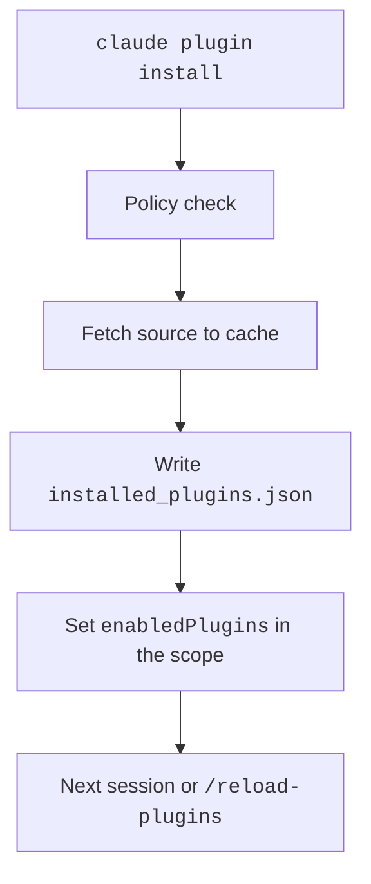

The `claude plugin` command installs, updates, checks, and removes plugins from the shell. Inside a session, `/plugin` opens a panel and `/reload-plugins` applies changes. `claude plugins` is an alias of `claude plugin`. For example, `claude plugin list --json` prints your installs as JSON.

Turn a plugin on or off with `claude plugin enable` and `disable`. Administrators can set managed `disableSideloadFlags` to turn off the session flags. State is in `~/.claude/plugins/` and in `enabledPlugins`.

## Subcommands

`-s` is `--scope`. Scopes are `user`, `project`, and `local`.
The hidden flag `--cowork` works on `install`, `uninstall`, `enable`, `disable`, `update`, `list`, `details`, `configure`, `prune`, `restore-set-aside`, `validate`, and `marketplace add`, `list`, `remove`, and `update`. It makes the command use the `cowork_plugins` directory.[^cowork]
Official page: [Plugin Commands Reference](https://code.claude.com/docs/en/plugins/cli-reference). Run `claude plugin --help` for the same list.

| Command | Status | What It Does | Flags and Notes |
| --- | --- | --- | --- |
| `init <name>` (alias `new`) | <Documented /> | Scaffolds `~/.claude/skills/<name>/`. It loads next session as `<name>@skills-dir`. | `--description`, `--author`, `--author-email`, `-f/--force`, `--with` (any of `skills`, `agents`, `hooks`, `mcp`, `lsp`, `output-style`, `channel`) |
| `install <plugin>` (alias `i`) | <Documented /> | Installs a plugin from a marketplace. | `-s/--scope` (default `user`), `--config key=value`, `-y/--yes`, `--accept-command <sha256>`, `--json`, `--marketplace <source>`. The hidden `--replace` switches a plugin installed from another marketplace to this copy. It installs the copy. It moves your plugin settings to the copy. It uninstalls the other plugin. `--json` output includes `unsetOptionCount`, the number of `userConfig` options not yet set.[^install-json] |
| `uninstall <plugin>` (aliases `remove`, `rm`) | <Documented /> <Caution note="On the last scope it removes options, secrets, and data" /> | Removes the plugin from one scope. | `-s`, `--keep-data`, `--prune`, `-y`, `--json`. On the last scope it removes options, secrets, and data. |
| `enable <plugin>` | <Documented /> | Enables a plugin. | `-s` (auto-detects local, project, then user), `--json` |
| `disable [plugin]` | <Documented /> | Disables a plugin. | `-a/--all`, `-s`, `--json`. Fails if another plugin depends on it. |
| `update <plugin>` | <Documented /> | Updates a plugin. | `-s`, `-y`, `--accept-command`, `--json`. A restart or `/reload-plugins` applies it. |
| `list` | <Documented /> | Lists installs. | `--json`, `--available`, `--data-size [plugin]` |
| `details <name>` | <Documented /> | Shows the component list and projected token cost. | No flags. |
| `configure <plugin>` | <Documented /> | Shows or saves the `userConfig` values. | `--values-stdin`, `--json`. Needs the full plugin id. |
| `prune` (alias `autoremove`) | <Documented /> | Removes automatic dependencies that nothing uses. | `-s`, `--dry-run`, `-y` |
| `restore-set-aside <plugin>` | <Undocumented /> | Gives a plugin id back the options and secrets that Claude Code set aside when a marketplace that your organization declares replaced a marketplace of the same name. | `--discard` deletes what is set aside in place of a restore. `claude plugin list` names each plugin id with values set aside and gives this command.[^restore] The [plugin commands reference](https://code.claude.com/docs/en/plugins/cli-reference) does not list it. |
| `validate <path>` | <Documented /> | Checks a plugin, marketplace, or component folder. | `--strict`, `--json`, and `--profile <name>`. Also `/plugin validate`. With `--profile directory` the command also exits 1 when the plugin directory (the catalog that plugins are submitted to) would refuse the plugin on a check it runs, or when a check could not be made. `--strict` then treats the directory's warnings as errors. Errors (exit 1) include `README_MISSING` and `README_TRIVIAL` (a README under 40 words), `LICENSE_MISSING` (no `LICENSE` file and no `license` in `plugin.json`), `PATH_TRAVERSAL` (a path that climbs out of the plugin), an MCP or hooks file that is unreadable or invalid, and manifest problems such as an invalid `plugin.json` or a badly formed name. A `hooks/hooks.json` must be a regular file under a size cap. Warnings (they fail only with `--strict`) include `ICON_MISSING` and `ICON_INVALID` (the local check reads only the file type; the fix text says the directory wants a square PNG or JPEG, 512 to 2048 px on each side, under 2 MB, and no SVG or WebP), `PRIVACY_URL_MISSING` (checked only when the plugin connects to a remote MCP server or HTTP hook; set `privacyPolicyUrl` in `plugin.json`), and `ARCHIVE_OS_METADATA_FILE` (a system file such as `.DS_Store`), plus others such as a README that does not render or a name that is not kebab-case. "A check could not be made" includes `plugin.json` listing more than 16 files for MCP servers or for hooks (16 of each are checked) and an MCP or hooks file the checks cannot use, such as one that is not valid JSON. The directory runs more checks than the command does. It needs a plugin folder, not a project's `.claude` folder.[^validate] The command also type-checks the TypeScript of a hooks module. Findings are warnings.[^validate-ts] An `engine.create` hook that is not in the one accepted form is an error: "this engine.create hook is outside its form".[^engine-create] `claude plugin list` and `validate` warn that a plugin's `agent` setting is deprecated.[^agent-dep] `validate` also reports some unsafe paths and links in the plugin folder.[^unsafe-paths] |
| `tag [path]` | <Documented /> | Creates the git tag `<name>--v<version>`. | `--push`, `--dry-run`, `-f/--force`, `-m/--message <msg>`, `--remote`. Also `/plugin tag`. |
| `test [dir]` | <Documented /> | Runs the tests of a mod. | Runs every `*.test.ts` and `*.test.tsx` file. |
| `eval [target]` | <Documented /> | Runs eval cases against a plugin. | Flags: `--case <glob>`, `--tag <tag...>`, `--eval-dir <dir>`, `--model <model>`, `--judge-model <model>` (default `haiku`), `--runs <n>` (default `case.runs ?? 3`), `-j/--concurrency <n>` (1 to 8, default 1), `--threshold <0..1>` (exit 1 when a case scores below it, default `1.0`), `--max-cost-usd <usd>` (no help text), `--ablation <none\|with-without>` (runs a no-plugin baseline arm and reports the score delta), `--allow-tools <tools...>` and `--disallow-tools <tools...>`, `--mocks <record\|off>` (mock stand-ins for MCP servers, from the `mocks/` folder of the eval dir; default `record`) with `--allow-real-servers`, `--scaffold` and `--no-scaffold` (`--scaffold` runs the `scaffold_script` of each case as you, and it is off by default), `--keep-temp`, `--output-dir <dir>`, `--json [path]`, `--report <path>`, `--publish-report` and `--no-publish` (the HTML report goes to claude.ai by default when your account supports it), `--verbose`. Also `--trust-plugin` for CI. |
| `eval init [name]` | <Documented /> | Creates an eval suite. | `--bare`, `-i/--interactive` (the hidden `--interview` is an alias), `--eval-dir` |

:::warning
`claude plugin eval` loads and runs the plugin on your machine, as you.
Run it only for plugins you trust. The sandbox limits a bad plugin. It does not guarantee safety.
:::

## Marketplace Subcommands

| Command | Status | What It Does | Flags and Notes |
| --- | --- | --- | --- |
| `marketplace add <source>` | <Documented /> | Adds a marketplace. | `--scope`, `--sparse <paths...>`, `--claudeai`, `--json`. The hidden `--from-link` adds the marketplace as an install link does. `--resolve-only` (with `--from-link`) adds nothing. It prints one JSON line. The line names the added marketplace that `--from-link` would reuse. The source is `owner/repo[#ref\|@ref]`, a git URL, an https URL, or a path. |
| `marketplace list` | <Documented /> | Lists marketplaces. | `--json` |
| `marketplace remove <name>` (alias `rm`) | <Documented /> | Removes the declaration. | `--scope`, `--json`. On the last scope, it removes the cache. It also uninstalls the plugins from that marketplace. |
| `marketplace update [name]` | <Documented /> | Refreshes marketplaces. | `--json` needs a name. |

## Session Commands

| Command | Status | What It Does | Notes |
| --- | --- | --- | --- |
| `/plugin` (aliases `/plugins`, `/marketplace`) | <Documented /> | Opens the panel with the tabs Discover, Installed, Marketplaces, Stats, and Errors. | Subcommands: `help`, `list [--enabled\|--disabled]`, `install`, `manage`, `stats`, `enable`, `disable`, `uninstall`, `configure`, `validate`, `tag`, `marketplace add\|list\|update\|remove`. Interactive sessions only. |
| `/reload-plugins [--force]` | <Documented /> | Applies pending plugin changes without a restart. | Refuses a change to MCP tools that would break the prompt cache, unless you add `--force`. Works in both modes. |

## Session Flags

| Flag | Status | What It Does | Notes |
| --- | --- | --- | --- |
| `--plugin-dir <path>` | <Documented /> | Loads a folder or `.zip` for this session only. | The id is `<name>@inline`. A folder of plugins loads each child. Repeatable. The env var `CLAUDE_CODE_PLUGIN_DIRS` does the same. |
| `--plugin-url <url>` | <Documented /> | Loads a `.zip` from a URL for this session only. | Repeatable. |
| `--plugin-dir-no-mcp <path>` | <Undocumented /> | Loads an inline plugin without its MCP servers. | Hidden flag. The SDK form is `skipMcpDiscovery`. |

Managed `disableSideloadFlags: true` rejects `--plugin-dir`, `--plugin-url`, `--agents`, and `--mcp-config`.

## Example

```bash title="Install, configure, and update a plugin"
claude plugin marketplace add example/team-tools
claude plugin install deploy-tools@team-tools --scope project --config REGION=eu-west-1
claude plugin details deploy-tools@team-tools
claude plugin disable deploy-tools@team-tools
claude plugin update deploy-tools@team-tools --yes
```

## How It Works



`claude plugin eval` keeps its deny rules over a plugin's permission hook. It also flags each call that the hook let through where the eval's own check did not allow it.[^eval-327] A call that a deny rule blocks, or that Claude Code cannot check against the deny rules, is refused.

`claude plugin eval --output-dir ''` stops with "Error: --output-dir was given an empty path; pass a directory, or omit it to use the default results directory".[^output-dir]

A failed HTTPS clone says that Claude Code runs the clone with terminal prompts and askpass programs turned off and tells credential helpers not to prompt, so git needs a credential it can get without asking you, such as one a credential helper already holds.[^clone]

The folder where `.mcpb` bundles are unpacked is `<config>/plugins/mcpb`, and the environment variable `CLAUDE_CODE_PLUGIN_MCPB_DIR` replaces it when the value is a usable folder (see below).[^mcpb]

`claude plugin uninstall` also deletes the files that Claude Code unpacked from the plugin's `.mcpb` and `.dxt` bundles. It keeps them while another plugin uses the same bundle. It does not delete them when `CLAUDE_CODE_PLUGIN_USE_ZIP_CACHE` is set. It also does not delete them when `CLAUDE_CODE_PLUGIN_MCPB_DIR` holds a usable folder. A folder is usable when its path is absolute, it is not the same as or inside the folder that Claude Code started in, and that starting folder is not inside it. Claude Code compares the paths after it resolves them, and the comparison ignores case. When the variable holds a relative path or an overlapping folder, Claude Code ignores it, uses `<config>/plugins/mcpb`, and deletes as usual.[^mcpb-uninstall]

A plugin whose `plugin.json` has a malformed display field, such as `author` or `homepage`, loads with its hooks and MCP servers. Claude Code ignores the field. The note shows only for an enabled plugin. It shows on the "Errors" tab and the plugin detail screen of `/plugin`, and in the output of `claude plugin list`. It names the field. The note says to disable the plugin from `/plugin` if you did not expect it to run, unless your organization requires it. Administrators should check the plugins they deploy. To see the fault, run `claude plugin validate <path>`.[^field-ignored]

The `/plugin` questions to uninstall a plugin, remove a marketplace, and switch a plugin to another copy are lists. Move with the arrow keys and press Enter to answer, or press Esc to cancel.[^plugin-lists]

## Validate JSON Report

The Mod API type file declares the shape of what `claude plugin validate --json` prints as `PluginValidateReport`. It is a public contract: Claude Code adds fields and renames or retypes none. Names are the true spelling of the author, never cut or cleaned, so a program that prints one must scrub it first. On an unexpected failure (exit code 2), the command prints nothing to stdout.[^validate-report]

| Field | Status | What it holds |
| --- | --- | --- |
| `success` | <Documented /> | The verdict under the flags given (`--strict` counts warnings). It is true exactly when the exit code is 0. |
| `strict` | <Documented /> | Whether `--strict` was given. |
| `target` | <Documented /> | The manifest path that was validated, or the component directory. |
| `manifest` | <Documented /> | The `plugin.json` or `marketplace.json`, as one file entry. Null for a bare skills, agents, or commands directory. |
| `contents` | <Documented /> | Each other file entry with an error, a warning, or a note. A hooks file that names a module is always listed. |
| `provides` | <Documented /> | What `plugin.register` carries as `e.provides` for an installed copy of the folder (`PluginProvides`). Null when it was not read: a target that is no plugin folder, one with errors, or one with a hooks or server file left unread. A report from an older CLI leaves it out. |
| `advice` | <Documented /> | What the validator advises without counting it under any flag. Today, it is the install line that the README of a plugin lacks. Each item has `file`, `message`, and `installLine`. |
| `directory` | <Documented /> | The checks of the plugin directory, which count under `--profile directory` alone. Null when they had nothing to run on and that was not passed. It holds `profile`, `findings`, `notes`, `undecided` (rule ids that could not be decided), `incomplete`, and `failure`. A finding has `code`, `title`, `severity` (`error`, `warning`, or `info`), `blocking`, `hold`, `file`, `field`, `message`, and `fix`. |

A file entry (`PluginValidateFile`) has these fields.

| Field | Status | What it holds |
| --- | --- | --- |
| `file` | <Documented /> | Where the findings were read from. It is a label that may be cleaned and cut, not a path to open. |
| `type` | <Documented /> | Which check made the entry: `plugin`, `marketplace`, `skill`, `agent`, `command`, `hooks`, or `mcp`. |
| `errors`, `warnings` | <Documented /> | Findings, each with `path` (a dotted JSON path, a frontmatter key, `root`, or `json`), `message`, and `code` (always null today). The file failed exactly when `errors` holds something. |
| `notes` | <Documented /> | Display lines of what the validator knows beyond pass or fail. The lists of hooks, calls, and nouns are notes, and they fail nothing. |
| `gatingHooks` | <Documented /> | Each hook at a site whose answer can refuse what was asked, except a `command.run` hook that answers its own command. A row has `module`, `pattern`, `hook`, and `hasCatch`. It is a fact for the author, never a verdict. |
| `wasm` | <Documented /> | What the `$.wasm.compile` calls of the module compile. A row has `module` and `file`; `file` is null for bytes that the module makes at run time, else `path`, `size`, `sha256`, `imports`, and `exports`. |
| `modules` | <Documented /> | What the hooks module that the file names does (`PluginValidateModule`). Null when it was not read. Each item has `module`, `uses`, `hooks`, `nextTo`, `telemetry`, `clients`, `breaksPromptCache`, `nouns`, and `shaders`. |

In a module item, each `hooks` row is one `on(...)` call: `pattern`, `matcher` (`{ has: {} }` for none), `defaultKeys` (the matcher keys that the engine fills in), `isGate`, and `hasCatch`. `nouns` is null when the `engine.create` hook is outside the one form that validate reads. Else it has `adds`, `addsUnlessThere`, `withholds` (a list, or `'everything'`), and `replaces`. `shaders` has one item for each file that a `Shader` element names, or is null when that is not all known. An item has `module`, `verdict` (`any`, `fast`, or `refused`), `refusal` (`line` and `message`), and `cost` (null when the file was refused before it was costed). A cost is the worst case in a window of 1512x945 points: `sharpness`, `fps` (30 or 60), `passes`, `reads`, `steps`, `guards`, `bytes`, `bits`, and `dearest` (up to three lines with their share of the work).

## Errors

Each row is a family of messages. The backticked text is the start that every message in the family shares.

| Start of Message | Status | What It Means | Cases |
| --- | --- | --- | --- |
| `mocks/`, `mocks:`, `mocks is not`, `ambiguous mock server`, `buildRunMockFiles` | <Undocumented /> | `claude plugin eval` refused a `mocks` folder or a mock file. | A folder or file is a symbolic link, is unreadable, or has more entries than the cap. A directory is not named after the server segment of the tool name. A responder file is not named after the tool. A name holds `__`, the tool-name separator. A responder needs `tools: [...]`. `expect:` or `error:` is in the wrong place. Two mocks claim the same server. |
| `case "${…}"`, `case ${…}:`, `case.yaml must be`, `YAML parse failed` | <Undocumented /> | `claude plugin eval` refused a case. | A `plugins` entry resolves outside the containment root or is not loaded. An `add_dirs` entry resolves outside the case directory. `case.yaml` is not a YAML object. `execution.env` has a key that is not an `EVAL_*` key. |
| `focus file` | <Undocumented /> | `claude plugin eval` could not read a focus file. | The file does not exist, is unreadable, or is not a regular file. It has more than one hard link, is over the size limit, or changed during the read. |
| `git metadata file` | <Undocumented /> | `claude plugin eval` refused a git metadata file. | The file is not a plain readable file, is not a regular file, or is larger than the byte limit. |
| `output base`, `output location`, `refusing to write`, `refusing to open through`, `refusing to use`, `append to ${…} made no progress`, `not a directory:`, `no variant directories`, `${…}/ has no result rows` | <Undocumented /> | A report or scaffold step refused to write or read a path. | The path is outside the allowed root or holds a `.` or `..` segment. It is a symbolic link or passes through one. It is not a regular file, has a second hard link, or is not a directory. |
| `Error: ${…} cannot be evaluated`, `Error: ${…} has a recorded install path`, `plugin eval:`, `claude plugin eval can't`, `git on this host did not`, `git ${…}.${…} is too old`, `judge call failed`, `No TTY available`, `results directory`, `${…} case file(s) failed`, `Interrupted — finishing up`, `Stopped — finishing up`, `Note: --scaffold`, `warning: eval result`, `warning: --json result`, `Publishing is unavailable`, `Skipped publishing`, `Publishing report to claude.ai`, `Published:` | <Undocumented /> | `claude plugin eval` could not run, or printed a notice. | The plugin cannot be evaluated where sessions load it. Git is missing or too old. The judge call failed. No TTY is available for the authoring interview. A results directory already existed. Case files failed to load. The run was interrupted. Publishing was unavailable or skipped. The result does not match the schema. |
| `the run created`, `the run made more`, `the run was granted artifact publishing`, `the run's artifact-publish`, `the case's scaffold`, `a corroborated artifact publish`, `the stub publish directory`, `the kept directory`, `the harness is running as root`, `directory modes do not`, `the directory modes`, `the sealed directory`, `home/ or tmp/`, `the operator's home`, `the home, Claude config`, `a cloud credential file`, `the Anthropic profile configs`, `a PATH directory could not`, `the organization policy snapshot`, `A shell tool was granted`, `${…} could not be examined after`, `${…} became a symlink`, `${…} already exists; refusing`, `${…} is a symlink`, `${…} is a directory, not a file`, `${…} could not be opened`, `${…} changed while being opened`, `${…} is not a regular file`, `${…} is hard-linked`, `${…} (this machine's managed settings`, `${…} directory name`, `${…} is on a network (UNC) path`, `${…} was not written by this run`, `${…} already exists and was not written`, `${…} no longer holds`, `${…} is no longer the directory`, `${…} vanished from`, `${…} is ${…} bytes (cap`, `${…} changed while being read`, `${…}/`, `${…} is not a directory`, `case ${…}`, `recording name`, `value nested too deep` | <Undocumented /> | `claude plugin eval` refused to run because a path, folder, or environment failed a safety check. | A file is a symbolic link, is hard-linked, is not a regular file, changed during the read, or is over its cap. A folder is not the one the harness created, has a glob character in its path, or is on a network (UNC) path. Folder modes did not take effect. The harness runs as root. A shell tool was granted, but the sandbox cannot exclude a home or credential path. The run created a name that is reserved for artifact publishes. The run was granted artifact publishing, but the child was not offered the stand-in tool. As a result, the local Artifacts server did not attach. |
| `${…}: frontmatter`, `${…}: unknown frontmatter key`, `${…}: invalid YAML frontmatter`, `${…}: unterminated frontmatter` | <Undocumented /> | A grader or responder file has bad frontmatter. | A key is not known. `type:` is missing (it is one of regex, tool_order, tool_used, file_exists, llm, baseline). The opening `---` has no closing one. The YAML is invalid. |
| `--config expects`, `--config key`, `--config ${…}`, `--config validation failed`, `--config was given`, `Aborted — the command was not run` | <Undocumented /> | `claude plugin install` refused `--config`. | The value is not `KEY=VALUE`. The plugin's `userConfig` does not declare the key, or more than one bundled MCP server declares it. A value is empty, not a number, or not a boolean (use true/false, 1/0, yes/no, on/off). The plugin failed to load after the install. |
| `This plugin has no ${…}`, `Plugin option` | <Undocumented /> | A plugin option has no value or a bad one. | A required value is missing. A value is over 64 KB. A value must be a single line. A value must be true or false. |

## Related Pages

- [Plugins](index.md)
- [Marketplaces](marketplace.md)
- [Plugin Loading](loading.md)
- [CLI Subcommands](../../configure/cli/subcommands.md) and [CLI Flags](../../configure/cli/flags.md) for the other commands

## Sources

[^cowork]: The program, `chunk-71qhfr8d.js:127`.
[^install-json]: The program, `chunk-d32c1n9p.js:852`.
[^restore]: The program, `chunk-kx248ng6.js:1203`.
[^validate]: The program, `chunk-wqygnvsa.js:146` and `chunk-wqygnvsa.js:491`.
[^validate-report]: The program, `chunk-kx248ng6.js:744` (the validate command, `cli_plugin_validate`), the Mod API type file published as `schemas/claude-code.d.ts` (`PluginValidateReport` at line 9986), `PluginValidateReport`, `PluginValidateFile`, `PluginValidateFinding`, `PluginValidateAdvice`, `PluginValidateDirectory`, `PluginValidateDirectoryFinding`, `PluginValidateGatingHook`, `PluginValidateWasm`, `PluginValidateWasmFile`, `PluginValidateModule`, `PluginValidateHook`, `PluginValidateMatcher`, `PluginValidateNouns`, `PluginValidateShader`, `PluginValidateShaderCost`, and `PluginProvides`.
[^validate-ts]: The program, `chunk-wae3ndpy.js:2887` (`typeCheckInChild`), `chunk-wae3ndpy.js:2916` (the findings become `warnings`), and `chunk-wae3ndpy.js:2946` (the "not type-checked" note).
[^engine-create]: The program, `chunk-wae3ndpy.js:2186`.
[^agent-dep]: The program, `chunk-mf7vnf0k.js:142`.
[^output-dir]: The program, `chunk-ty48xb2f.js:13532`.
[^clone]: The program, `chunk-hg1yqkjk.js:227505` (the message "Claude Code runs this clone with terminal prompts and askpass programs turned off").
[^mcpb]: The program, `chunk-38jz3ehd.js:176` (`mcpb` under the config folder) and `chunk-38jz3ehd.js:180` (`CLAUDE_CODE_PLUGIN_MCPB_DIR`).
[^mcpb-uninstall]: The program, `chunk-6h88xj3m.js:1265` for the uninstall function (`$976585`). It returns early when `CLAUDE_CODE_PLUGIN_USE_ZIP_CACHE` is set (`chunk-6h88xj3m.js:699` to `chunk-6h88xj3m.js:701`) or when the variable holds a usable folder. The `.mcpb` and `.dxt` check is at `chunk-6h88xj3m.js:917`. The program checks `CLAUDE_CODE_PLUGIN_MCPB_DIR` with `isAbsolute` and with a containment test on the resolved paths against the starting folder (`chunk-38jz3ehd.js:179` to `chunk-38jz3ehd.js:186`). The test (`$f077cd`) is at `chunk-ca90c7br.js:1297` and ignores case by default (`foldCase`, `chunk-ca90c7br.js:1280`). The function lists the unpacked bundles, takes the plugin id off each (`pluginIds`, `chunk-6h88xj3m.js:1288`), and deletes a bundle when no other plugin id is left.
[^field-ignored]: The program, `chunk-hg1yqkjk.js:240718` for the load (`ignoredFields`, and the warning "the plugin still loads" at `chunk-hg1yqkjk.js:240701`), and `chunk-mf7vnf0k.js:577` and `chunk-mf7vnf0k.js:666` for the note and its advice. The same note says "Earlier versions of Claude Code refused this plugin". The load rule sits behind a server flag (`refusesDisplayFaults`, `chunk-hg1yqkjk.js:240681`).
[^plugin-lists]: The program, `chunk-4g68nm9m.js:7538` (remove marketplace), `chunk-4g68nm9m.js:12204` (switch copy), and `chunk-4g68nm9m.js:12353` (uninstall). The lists set `disablePrintableKeybindings`, and the cancel entry has the focus at the start (`focus` and `defaultFocusValue`).
[^unsafe-paths]: The program, `chunk-q02wqt75.js:185` ("resolves outside the plugin's folder") and `chunk-hg1yqkjk.js:221449`. The loading side is on [Plugin Loading](loading.md#unsafe-paths-and-links).
[^eval-327]: The program, `chunk-ty48xb2f.js:12684` (`plugin_hook_approvals`, read per run), `chunk-ty48xb2f.js:12688` (the notice for refused calls, `refused`) and `chunk-ty48xb2f.js:12693` (the notice for calls that the hook approved, `approved`).
