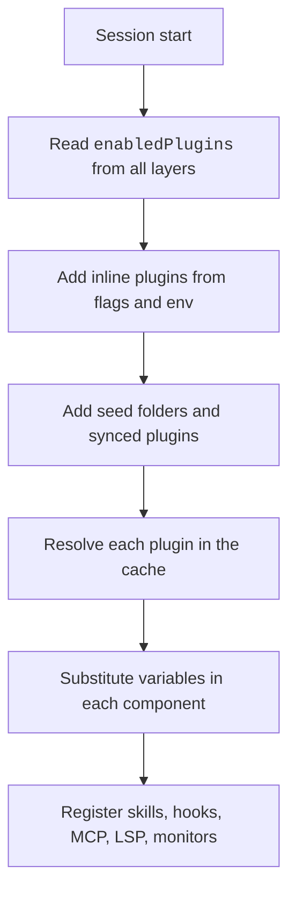

The loader finds plugins, copies them into a cache, and enables their parts. This page lists the paths, the variables a plugin can use, and the env vars and settings that change loading. For example, `${CLAUDE_PLUGIN_ROOT}` in a hook command is the folder of the plugin.

Loading runs automatically at session start. Env vars and settings change the paths, timeouts, and rules. To turn a plugin on or off, or to add a plugin folder, use `enabledPlugins`, `CLAUDE_CODE_PLUGIN_DIRS`, or `syncClaudeAiPlugins`.

## Paths

Official page: [Plugin Loading Reference](https://code.claude.com/docs/en/plugins/loading).[^undoc]

| Path | Status | What It Is | How It Works |
| --- | --- | --- | --- |
| `~/.claude/plugins/` | <Documented /> | The plugins root. | `CLAUDE_CODE_PLUGIN_CACHE_DIR` sets this parent folder, not the cache itself. |
| `plugins/data/<id>/` | <Documented /> | The folder behind `${CLAUDE_PLUGIN_DATA}`. | First use makes it. It survives updates. In `<id>`, every character other than letters, digits, `_`, and `-` becomes `-`. The last uninstall removes it, unless you use `--keep-data`. |
| `plugins/cache/<marketplace>/<plugin>/<version>/` | <Undocumented /> | One copy of each installed version. | Claude Code parses a cache path with these three parts this way. It accepts only a directory at that path.[^cache-path] |
| `.orphaned_at`, `.in_use`, `.gcs-sha`, `.links_materialized` | <Documented /> | State marker files in a version folder. | Claude Code writes `.orphaned_at` only inside the cache root, and not on a symlinked version. |
| `plugins/installed_plugins.json` | <Undocumented /> | Install records. | Fields: `version`, `installedAt`, `lastUpdated`, `installPath`, `gitCommitSha`, `resolvedVersion`, `auto` (set for a dependency install). |
| `plugins/known_marketplaces.json` | <Undocumented /> | Marketplace records. | Fields: `source`, `installLocation`, `lastUpdated`, `autoUpdate`. Clones live in `plugins/marketplaces/<name>`. |
| Registry files `installed`, `marketplaces`, `flagged`, `catalog`, `inUseSweep` | <Undocumented /> | Named files of the plugin registry. | The names come from a list in the program.[^registry] |
| `~/.claude/plugins/synced` | <Documented /> | Plugins synced from claude.ai. | The id is `<name>@synced`. Set `syncClaudeAiPlugins: false` to turn it off. |

## Variables

Source: [Plugin Manifest Reference](https://code.claude.com/docs/en/plugins/manifest-reference) and [Plugin Loading Reference](https://code.claude.com/docs/en/plugins/loading).

| Variable | Status | What It Is | Where You Can Use It |
| --- | --- | --- | --- |
| `${CLAUDE_PLUGIN_ROOT}` | <Documented /> | The installed plugin folder. It changes on update. Do not write state there. | Hook `command` and `args`, monitor `command`, MCP stdio `command`, `args`, `env`, MCP remote `url`, `headers`, `headersHelper`, LSP fields, skill and agent text |
| `${CLAUDE_PLUGIN_DATA}` | <Documented /> | The data folder. Claude Code exports it to hooks, MCP stdio servers, and LSP servers. | The same places |
| `${CLAUDE_PROJECT_DIR}` | <Documented /> | The project root. Claude Code exports it to hooks and LSP servers. | The same places |
| `${user_config.KEY}` | <Documented /> | A saved `userConfig` value. | MCP, LSP, exec-form hook `args`, skill and agent text. Not in shell-form hooks, monitor commands, or `headersHelper`. |
| `CLAUDE_PLUGIN_OPTION_<KEY>` | <Documented /> | The same value as an env var, with the key in upper case. | Hooks |

These variables are not in the env of commands the Bash tool runs for Claude.
That includes a program in a plugin's `bin/` folder, which the Bash tool finds on its `PATH`.[^bash-bin]
In a skill, write the reference as Markdown text instead.

Claude Code saves non-sensitive values in `pluginConfigs` of user settings.
Sensitive values go to the credential store.

## Env Vars

Official page: [Environment Variables](https://code.claude.com/docs/en/env-vars).[^undoc] See also [Plugin and MCP Env Vars](../../configure/env-vars/plugins-and-mcp.md).

| Env Var | Status | What It Does | How It Works |
| --- | --- | --- | --- |
| `CLAUDE_CODE_PLUGIN_DIRS` | <Documented /> | Gives plugin folders for the session. | Like `--plugin-dir`. Separate paths with a colon on Unix and a semicolon on Windows. |
| `CLAUDE_CODE_PLUGIN_GIT_TIMEOUT_MS` | <Documented /> | Sets the git timeout. | Default 120000. |
| `CLAUDE_CODE_PLUGIN_KEEP_MARKETPLACE_ON_FAILURE` | <Documented /> | Keeps the old checkout when a refresh fails. | Set to `1`. |
| `CLAUDE_CODE_PLUGIN_PREFER_HTTPS` | <Documented /> | Clones GitHub shorthand over HTTPS. | Set to `1`. |
| `CLAUDE_CODE_PLUGIN_SEED_DIR` | <Documented /> | Gives read-only seed folders. | Registers marketplaces at start. Uses the plugins already cached there. |
| `CLAUDE_CODE_PLUGIN_DIR_WATCH` | <Documented /> | Reloads a mod when its file changes. Also writes TypeScript types into the mod folder: `.claude-plugin/types/` and `tsconfig.json`. | On by default in interactive sessions and off in print mode for `--plugin-dir` folders. `1` turns it on in print mode. `0` turns it off everywhere. Print mode also watches `skills-dir` plugins that have a `modulePath` unless this is `0`.[^watch] |
| `FORCE_AUTOUPDATE_PLUGINS` | <Documented /> | Updates plugins even when `DISABLE_AUTOUPDATER` is set. | Set to `1`. |
| `CLAUDE_CODE_SYNC_PLUGINS`, `CLAUDE_CODE_SYNC_PLUGIN_INSTALL` and their `_TIMEOUT_MS` forms | <Documented /> | Sync claude.ai plugins in headless runs. | The exact effects are not documented. In print mode, `CLAUDE_CODE_SYNC_PLUGIN_INSTALL` makes the stream carry [`plugin_install`](../headless/stream-json.md) messages. |
| `CLAUDE_CODE_PLUGIN_USE_ZIP_CACHE`, `CLAUDE_CODE_PLUGIN_BINARY_ASSETS`, `CLAUDE_CODE_PLUGIN_ATTRIBUTION`, `CLAUDE_CODE_PLUGIN_ARCHIVE_URL`, `CLAUDE_CODE_PLUGIN_NAME` | <Undocumented /> | Plugin env names found in the program. | Only the names are known. A message in the program mentions "zip cache mode".[^zip] |
| `CLAUDE_CODE_SKIP_PLUGIN_MCP_SERVERS`, `CLAUDE_CODE_SKIP_PLUGIN_MCP_SERVERS_EXCEPT`, `CLAUDE_CODE_SKIP_PLUGIN_LOCAL_MCP_SERVERS`, `CLAUDE_CODE_SKIP_PLUGIN_MCP_BUNDLES` | <Undocumented /> | Skip plugin MCP servers, exempt some, skip local servers, or skip MCPB bundles. | See [MCP Env Vars](../mcp/env.md#undocumented-variables). |

## Settings Keys

The rows for these keys, with types, scopes, and details, are on [Hooks, Plugins, and Skills Settings](../../configure/settings/hooks-and-plugins.md#keys).

- Turn plugins on or off and store their saved options: [`enabledPlugins`](../../configure/settings/hooks-and-plugins.md#keys) and [`pluginConfigs`](../../configure/settings/hooks-and-plugins.md#keys).
- Lock down customization (managed): [`strictPluginOnlyCustomization`](../../configure/settings/hooks-and-plugins.md#keys), [`disableSideloadFlags`](../../configure/settings/hooks-and-plugins.md#keys), and [`prependPlugins`](../../configure/settings/hooks-and-plugins.md#keys) with [`appendPlugins`](../../configure/settings/hooks-and-plugins.md#keys).
- Channel plugins and trust text (managed): [`allowedChannelPlugins`](../../configure/settings/mcp-and-channels.md#keys) and [`pluginTrustMessage`](../../configure/settings/hooks-and-plugins.md#keys).

Marketplace keys are on the [Marketplaces](marketplace.md#settings-keys) page.

## Example

Seed a locked-down machine so that users need no network for a plugin.

```bash title="Seed folder and a one-session plugin"
export CLAUDE_CODE_PLUGIN_SEED_DIR=/opt/claude/plugin-seed
export CLAUDE_CODE_PLUGIN_GIT_TIMEOUT_MS=60000
claude --plugin-dir ./my-plugin
```

```json title=".claude/settings.local.json"
{ "enabledPlugins": { "deploy-tools@team-tools": false } }
```

## How It Works



Agents that you pass with `--agents` stay in the agent list when plugins load or reload. When you resume a session whose agent is not in the active list, Claude Code loads the plugins again and merges the `--agents` agents back in before it picks the agent.[^agents-327]

## Unsafe Paths and Links

A plugin that you load from a folder skips a path or link that leads outside the plugin folder. Claude Code logs a warning that names the path, such as `Skipping ".lsp.json" for directory-loaded plugin ...: it resolves outside the plugin directory`. It does the same for an MCP source that climbs out of the folder, and for an MCPB source, which needs a download that the folder load does not do. `claude plugin validate` reports a hooks-module file that resolves outside the plugin folder.[^unsafe-paths]

## Errors

Each row is a family of messages. The backticked text is the start that every message in the family shares.

| Start of Message | Status | What It Means | Cases |
| --- | --- | --- | --- |
| `Hooks file`, `hooks.json declares`, `hooks: must be`, `hooks: the array form`, `Server ${…} missing required`, `Unsupported plugin type`, `Invalid manifest`, `Invalid JSON in manifest.json`, `Failed to save sensitive config`, `Plugin ${…}:` | <Undocumented /> | The loader could not load a plugin file. | A hooks file cannot be read or is missing. `hooks.json` declares keys outside the `hooks` object. The manifest is not valid. An LSP server entry lacks `command` or `extensionToLanguage`. |
| `Plugin "${…}" is enabled in project settings but isn't installed` | <Undocumented /> | Only the settings of a repository enable the plugin, and it has no install. | The message gives the `claude plugin install … --scope project` command when it knows the source. When `installed_plugins.json` could not be read, it says that whether the plugin is installed could not be checked. A missing cache otherwise reads `not cached at <path> — run /plugin to refresh`.[^not-installed] |
| `Plugin "${…}" failed to start LSP server "${…}":` | <Undocumented /> | A language server that a plugin declares did not start. | The text ends with the reason. Related messages: `LSP server "…" crashed with exit code` or `with signal`, and `timed out on … request after …ms`.[^lsp] |
| `claude plugin install`, `${…} This install runs that command`, `${…}'s marketplace changed`, `${…}'s marketplace entry`, `${…} is installed by running a command`, `A top-level entry of the plugin directory`, `The link farm`, `A link in the staged farm`, `The link-farm marker`, `A tool server doesn't run`, `${…}: a tool server doesn't run`, `${…}: your organization's managed settings disable marketplace-declared` | <Undocumented /> | A plugin install that runs a command did not run. | The command has not been reviewed yet. The marketplace changed the command after it was accepted. A tool server never runs it. Managed settings disable marketplace-declared commands (`disableCommandPluginSources`). The plugin directory that the command produced points to a network location or through a link. |

## Related Pages

- [Plugins](index.md)
- [Plugin Manifest](manifest.md)
- [Plugin Commands](cli.md)
- [Hooks, Plugins, and Skills Settings](../../configure/settings/hooks-and-plugins.md)

## Sources

[^undoc]: The program, for the rows marked <Undocumented />: `chunk-fp3vnecp.js:72` (`inUseSweep`), `chunk-c203g5kd.js:455` (`CLAUDE_CODE_PLUGIN_USE_ZIP_CACHE`), and `chunk-bzyb60p0.js:241860` (`a3.length !== 3`).
[^cache-path]: The program, `chunk-bzyb60p0.js:241860` (`a3.length !== 3`, the path must have three parts) and `chunk-bzyb60p0.js:241867` (`isDirectory`, the path must be a directory).
[^registry]: The program, `chunk-fp3vnecp.js:72` (`inUseSweep`).
[^bash-bin]: The program, `chunk-bzyb60p0.js:251371` (the `bin/` folders that go on `PATH`). Probe case `print.plugindata.bash-bin`.
[^watch]: The program, `chunk-yg9g0473.js:508` for the default, `chunk-bzyb60p0.js:224429` for the type files (`./types/index.d.ts`), `chunk-bzyb60p0.js:224490` for the `tsconfig.json` (`tsconfig`), `chunk-bzyb60p0.js:224154` for the plugins that have a `modulePath` and a `skills-dir` source (`chunk-xcgcdx61.js:4273`), and `chunk-bzyb60p0.js:224932` for the print mode watch (`plugin_dir_watch_headless_skills`). Probe cases `print.cli319.plugin-dir-watch.unset`, `print.cli319.plugin-dir-watch.v1`, `pty.cli319.plugin-dir-watch.unset`, and `pty.cli319.plugin-dir-watch.v0`.
[^zip]: The program, `chunk-c203g5kd.js:449` and `chunk-c203g5kd.js:455` (`CLAUDE_CODE_PLUGIN_BINARY_ASSETS`, `CLAUDE_CODE_PLUGIN_USE_ZIP_CACHE`), `chunk-5e3gtsn9.js:660` (`CLAUDE_CODE_PLUGIN_ATTRIBUTION`), `chunk-zddv3vvj.js:2246` (`CLAUDE_CODE_PLUGIN_NAME`, `CLAUDE_CODE_PLUGIN_ARCHIVE_URL`), and `chunk-ctrhdh7d.js:189` ("zip cache mode").
[^not-installed]: The program, `chunk-mgntjepj.js:472`.
[^lsp]: The program, `chunk-mgntjepj.js:440`.
[^unsafe-paths]: The program, `chunk-bzyb60p0.js:83478` and `chunk-bzyb60p0.js:83478` (the path and link check), `chunk-bzyb60p0.js:202836` (the MCPB source), `chunk-bzyb60p0.js:202836` (the MCP source), and `chunk-p9da7c9y.js:185` (the `"resolves outside the plugin's folder"` text of `validate` for a file that resolves outside the plugin folder).
[^agents-327]: The program, `chunk-0rtj0bmp.js:8590` (the merge at load), `chunk-cktd05v4.js:548` (the merge at reload, `cliAgents`), and `chunk-cktd05v4.js:551` (the reload on resume, `cliAgents`).
