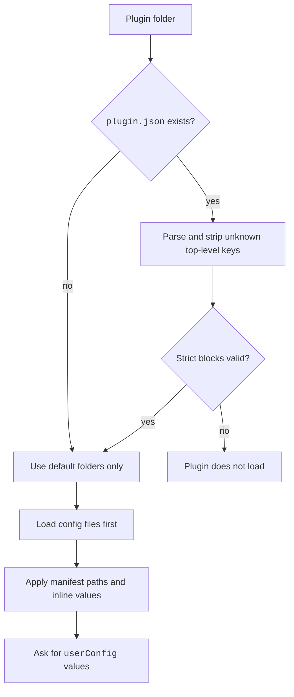

The manifest is the file `.claude-plugin/plugin.json` inside a plugin. It names the plugin and can point to its parts. The file is optional, and only `name` is required. For example, `{ "name": "my-plugin", "version": "1.0.0" }` is a valid manifest.

Write it by hand or start from `claude plugin init`. Run `claude plugin validate` after you edit it. `enabledPlugins` enables or disables the plugin as a whole. A manifest can set `defaultEnabled` for users who set nothing.

## Rules

- Claude Code strips an unknown top-level key. `claude plugin validate` warns about it.
- An unknown key inside `userConfig`, `channels`, `lspServers`, or `monitors` is an error. The plugin does not load.
- A component path starts with `./`. It stays inside the plugin folder. It must exist.

Official page: [Plugin Manifest Reference](https://code.claude.com/docs/en/plugins/manifest-reference).[^schema]
A marketplace entry can repeat many of these keys. See [Marketplaces](marketplace.md#plugin-entry-keys).

## Top-Level Keys

The last column says where the key may appear: the manifest, a marketplace entry, or both.

| Key | Status | What It Does | How It Works | Where |
| --- | --- | --- | --- | --- |
| `$schema` | <Documented /> | Gives an editor schema URL. | The loader ignores it. | Manifest |
| `name` | <Documented /> | Sets the plugin id and namespace. | Not empty, no spaces, no control or bidirectional characters. Reserved: names that start with `claude-`, `anthropic-`, `anthropics-`, or `cc-plugin-`, and the names `claude`, `anthropic`, `claude-code`, `claude-mods`. | Both |
| `displayName` | <Documented /> | Sets the name shown in the UI. | The entry value wins. | Both |
| `version` | <Documented /> | Sets the version text. | Must be a string (a number is an error). Any text works. Nothing checks it as semver. The validator only warns when it is missing or empty. Users stay on this version until you change it. The manifest value wins over the entry. `claude plugin validate` warns when they differ. | Both |
| `description`, `homepage`, `repository`, `license`, `keywords` | <Documented /> | Listing data. | `homepage` must be a URL. | Both |
| `author` | <Documented /> | Names the maker. | An object: `name` (required), `email`, `url`. | Both |
| `metadata` | <Documented /> | A free map for your own data. | Claude Code drops a value that is not an object.[^schema] | Both |
| `icon`, `documentationUrl`, `supportUrl`, `privacyPolicyUrl`, `termsOfServiceUrl` | <Documented /> | Directory listing data. | Claude Code also ignores these names without error: `screenshots`, `classification`, `privacy_policy`, `privacyPolicy`, `support`, `bugs`, `terms_of_service`, `docs`. | Manifest only |
| `defaultEnabled` | <Documented /> | Sets the start state when the user chose nothing. | Default `true`. The entry value wins. `enabledPlugins` always wins. | Both |
| `dependencies` | <Documented /> | Lists plugins that must be enabled too. | Each item is `"name"`, `"name@marketplace"`, or an object. Claude Code also accepts a trailing `@^range`. It strips the range.[^schema] | Both |
| `engines` | <Undocumented /> | Names the hosts the plugin runs on. | `engines["claude-code"]` is a semver range such as `>=2.1.329`. Outside the range the plugin is not installed, updated, or loaded. Other keys are ignored. An invalid range is reported as `engine-range-invalid`.[^engines] | Manifest |
| `settings` | <Documented /> | Applies settings while the plugin is enabled. | Only `agent` and `subagentStatusLine` take effect. Both are deprecated and will stop applying in a future release.[^settings-key] For each key, the last enabled plugin that sets it wins. If Claude Code cannot create the plugin data directory, the plugin `subagentStatusLine` command does not run.[^status-line] A `settings.json` in the plugin root wins. | Manifest |
| `userConfig` | <Documented /> | Asks the user for values when the plugin is enabled. | See [`userConfig` Option Keys](#userconfig-option-keys). | Manifest |
| `channels` | <Documented /> | Declares message channels. | Items have `server`, `displayName`, and `userConfig`. Strict. | Manifest |
| `types` | <Documented /> | Points to a `.d.ts` file for a mod. | Must end in `.d.ts` and must not contain `..`. | Manifest |
| `skills` | <Documented /> | Adds skill folders. | Adds to `skills/`. The value `"."` means the plugin root. | Manifest |
| `commands` | <Documented /> | Lists command files or a map. | Replaces `commands/`. A map entry has `source` or `content` (exactly one), `description`, `argumentHint`, `model`, and `allowedTools`. | Manifest |
| `agents` | <Documented /> | Lists agent `.md` files. | Replaces `agents/`. Folders are not allowed. | Manifest |
| `hooks` | <Documented /> | Gives hook files or inline hooks. | Merges with `hooks/hooks.json`. A file needs the `"hooks"` wrapper. | Manifest |
| `mcpServers` | <Documented /> | Gives MCP server config. | A path, a `.mcpb` or `.dxt` bundle path or URL, an inline map, or an array. A later name replaces an earlier one. | Manifest |
| `lspServers` | <Documented /> | Gives language server config. | Fields: `command`, `extensionToLanguage`, `args`, `transport`, `env`, `initializationOptions`, `settings`, `workspaceFolder`, `startupTimeout`, `shutdownTimeout`, `requestTimeout`, `restartOnCrash`, `maxRestarts`, `diagnostics`. | Manifest |
| `outputStyles` | <Documented /> | Lists style files or folders. | Replaces `output-styles/`. | Manifest |
| `workflows` | <Documented /> | Lists workflow `.js` files or folders. | Replaces `workflows/`. | Manifest |
| `experimental.themes` | <Documented /> <Experimental /> | Lists theme files or folders. | Replaces `themes/`. A top-level `themes` key still loads. It gives a warning. | Manifest |
| `experimental.monitors` | <Documented /> <Experimental /> | Declares background watchers. | Items: `name`, `command`, `description`, `when` (`always` or `on-skill-invoke:<skill>`). Interactive sessions only. | Manifest |
| `experimental.evals` | <Documented /> <Experimental /> | Names the eval folder. | Default `evals/`. `claude plugin eval` uses it. | Manifest |
| `experimental.syntaxHighlighting.hljsLanguages` | <Undocumented /> <Experimental /> | Adds highlight.js languages. | Up to 16 items. `id` matches `^[a-z][a-z0-9_-]*$` (64 characters at most). `remote` is `npm:<pkg>[@ver]` or `github:<owner>/<repo>@<ref>#<path>.js`. `integrity` is an SRI hash with `sha256-`, `sha384-`, or `sha512-`. Strict. | Manifest |
| `binaries` | <Undocumented /> | Lists files fetched into `bin/` at install. | A map of base name to `{ "sha256": <64 hex> }`. At most 64 entries. Names match `^[a-z0-9](?:[a-z0-9._-]*[a-z0-9_-])?$`. The env var `CLAUDE_CODE_PLUGIN_BINARY_ASSETS` also exists. | Manifest |

## Icon Checks

`claude plugin validate` checks the plugin icon for the directory listing. Both findings are warnings, not errors.[^icon]

| Finding | Status | When it appears | Fix |
| --- | --- | --- | --- |
| `ICON_MISSING` | <Undocumented /> | `plugin.json` has no `icon`, and the validator finds no file at `.claude-plugin/icon.png`, `.claude-plugin/icon.svg`, `assets/icon.png`, `assets/icon.svg`, or a similar path. | Add a square PNG at `.claude-plugin/icon.png`, or set `icon` to a square PNG or JPEG in the plugin. |
| `ICON_INVALID` | <Undocumented /> | The icon file fails the size or type test, or `icon` points at a path that is not a file in the plugin. | Use a PNG or JPEG of 512 to 2048 px on each side, under 2 MB. SVG and WebP are not accepted. |

A path in `icon` that holds `..` raises `PATH_TRAVERSAL`. A path with quotes, angle brackets, a backslash, a backtick, whitespace, or control characters raises `LISTING_URL_SCHEME`. So does an `icon` URL that is not `https://`.
The listing takes the icon file only once: the first time the plugin is saved or submitted in the developer portal. A later change does not change the icon.[^icon]

## `userConfig` Option Keys

Each key under `userConfig` is the name of one option. The name must match `^[A-Za-z_]\w*$`.
Claude Code passes the value to hooks as the env var `CLAUDE_PLUGIN_OPTION_<KEY>`.
The same option shape works inside `channels`.

| Option | Status | What It Does | How It Works |
| --- | --- | --- | --- |
| `type` | <Documented /> | Sets the value type. | `string`, `number`, `boolean`, `directory`, or `file`. |
| `title`, `description` | <Documented /> | Label and help text in the dialog. | Both are required. |
| `required`, `default` | <Documented /> | Say whether an empty value is allowed, and what the start value is. | A default is a string, number, boolean, or array of strings. |
| `multiple`, `sensitive` | <Documented /> | Allow a list, or mark a secret. | A `sensitive` value goes to secure storage, not to settings. |
| `min`, `max` | <Documented /> | Bound a number. | `number` type only. |
| `options` | <Documented /> | Gives fixed choices. | `string` type only, not `multiple`, not `sensitive`. Each choice is 1 to 64 characters. |

## Components and Layout

<FileTree>

- `my-plugin/`
  - `.claude-plugin/`
    - `plugin.json`
  - `skills/` one folder per skill, each with `SKILL.md`
  - `commands/` command files
  - `agents/` agent `.md` files
  - `hooks/`
    - `hooks.json` hooks, inside a `hooks` wrapper
  - `output-styles/`
  - `workflows/`
  - `themes/`
  - `bin/` programs added to the Bash tool `PATH`
  - `.mcp.json` MCP servers
  - `.lsp.json` language servers
  - `monitors/`
    - `monitors.json`
  - `settings.json` plugin settings

</FileTree>

| Item | Status | What It Does | How It Works |
| --- | --- | --- | --- |
| `skills/`, `commands/`, `agents/`, `output-styles/`, `workflows/`, `themes/` | <Documented /> | Default places for components. | A manifest key adds to or replaces the folder, as the table above says. |
| `hooks/hooks.json` | <Documented /> | Holds the plugin hooks. | Keys: `hooks`, and also `modules` (one path to a hooks module) and `description`. The old `surface` key is gone. |
| `.mcp.json`, `.lsp.json`, `monitors/monitors.json`, `settings.json` | <Documented /> | Config files at fixed places. | Claude Code loads these before it reads manifest entries. |
| `bin/` | <Documented /> | Puts programs on the `PATH` of the Bash tool. | claude.ai and Cowork do not install a plugin that has a `bin/` folder. |
| Root `SKILL.md` | <Documented /> | Makes a single-skill plugin. | The loader uses it only when there is no `skills/` folder and no `skills` key. |
| Root `CLAUDE.md` | <Documented /> | The loader does not load it. | `claude plugin validate` warns about it. |

## Example

```json title=".claude-plugin/plugin.json"
{
  "name": "deploy-tools",
  "displayName": "Deploy Tools",
  "version": "1.2.0",
  "description": "Skills and a hook for our deploy flow.",
  "author": { "name": "Platform Team", "email": "platform@example.com" },
  "defaultEnabled": true,
  "userConfig": {
    "REGION": {
      "type": "string",
      "title": "Region",
      "description": "Region to deploy to.",
      "options": ["eu-west-1", "us-east-1"],
      "default": "eu-west-1"
    },
    "API_TOKEN": {
      "type": "string",
      "title": "API Token",
      "description": "Token for the deploy API.",
      "sensitive": true
    }
  },
  "hooks": "./hooks/hooks.json",
  "mcpServers": "./.mcp.json"
}
```

Hooks of this plugin see `CLAUDE_PLUGIN_OPTION_REGION` and `CLAUDE_PLUGIN_OPTION_API_TOKEN` in their env.

## How It Works



A malformed display field, such as `author` or `homepage`, does not stop an enabled plugin from loading. Claude Code ignores the field. The plugin loads with its hooks and MCP servers. The note shows only for an enabled plugin. It shows on the "Errors" tab and the plugin detail screen of `/plugin`, and in the output of `claude plugin list`.[^display-field] See [Plugin Commands](cli.md#how-it-works) for the note.

## Related Pages

- [Plugins](index.md) for the overview.
- [Marketplaces](marketplace.md) for `marketplace.json` and plugin sources.
- [Plugin Loading](loading.md) for variables such as `${CLAUDE_PLUGIN_ROOT}`.
- [Hooks, Plugins, and Skills Settings](../../configure/settings/hooks-and-plugins.md) for `pluginConfigs` and `enabledPlugins`.

## Sources

[^schema]: The program, `chunk-xcgcdx61.js:2453` (`metadata`, which keeps a value only if it is an object), `chunk-xcgcdx61.js:4096` (the dependency pattern, with the `@^range` part), and `chunk-xcgcdx61.js:4104` (the range is removed), and `chunk-xcgcdx61.js:4106` (the object form, `name`).
[^engines]: The program, `chunk-xcgcdx61.js:2385` (`claude-code` as a semver range) and `chunk-mgntjepj.js:676` (`engine-range-invalid`).
[^settings-key]: The program, `chunk-mgntjepj.js:149-155`.
[^status-line]: The program, `chunk-bzyb60p0.js:249209` (`subagentStatusLine`, the last plugin that sets it) and `chunk-bzyb60p0.js:249218` (the data directory error).
[^icon]: The program, `chunk-afkr0w52.js:151` (`ICON_MISSING` and its fix text) and `chunk-afkr0w52.js:261` (the icon paths that the validator looks for, such as `.claude-plugin/icon.png`).
[^display-field]: The program, `chunk-mgntjepj.js:589` (`manifest-field-ignored`: the note text `malformed and ignored`), `chunk-bzyb60p0.js:245689` (the loader returns the `warnings`; `chunk-bzyb60p0.js:247080` adds those of a plugin only when it is enabled), `chunk-e1cgntxd.js:14421` (the note is a row of the `errors` tab), `chunk-e1cgntxd.js:11707` (the plugin detail screen lists the `noun: "note"` entries of the plugin), and `chunk-y45hgb0m.js:1242` (`claude plugin list` prints a `Note:` line).
