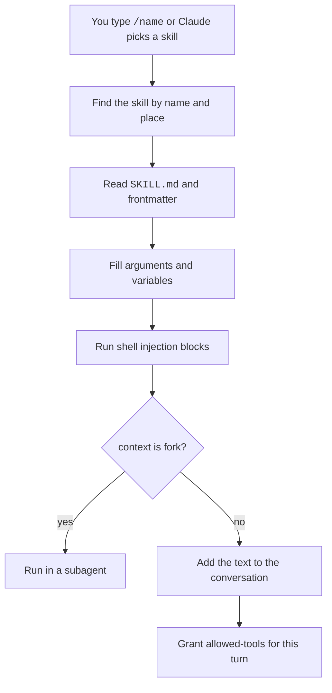

A skill is a folder with a `SKILL.md` file. It teaches Claude how to do one task.
A slash command is a short action that you type, such as `/compact` or `/model`.
A skill also gives you a slash command. For example, `.claude/skills/deploy/SKILL.md` gives you `/deploy`.
The older `.claude/commands/` folder still works and acts like a skill.
To add a skill, make a folder with a `SKILL.md` file in one of the places below. To hide a skill, set `skillOverrides` or `disableBundledSkills`; see Loading and Controls.

## Example

This skill makes a `/summarize-diff` command. Only you can start it.

```text title=".claude/skills/summarize-diff/SKILL.md"
---
description: Summarize the uncommitted changes in plain words.
argument-hint: "[focus]"
disable-model-invocation: true
allowed-tools: Bash(git diff *)
---

Run `git diff` and summarize the changes.
Focus on: $ARGUMENTS
```

Type `/summarize-diff tests` in the prompt. `$ARGUMENTS` becomes `tests`.

## Skill Locations

When two skills share a name, the one in the higher place wins.

| Place | Status | What it holds | Notes |
| --- | --- | --- | --- |
| Enterprise `<managed dir>/.claude/skills/<name>/SKILL.md` | <Documented /> | Skills for all users on a machine. | Wins over personal and project skills of the same name. |
| Personal `~/.claude/skills/<name>/SKILL.md` | <Documented /> | Skills for all your projects. | Wins over project skills. |
| Project `.claude/skills/<name>/SKILL.md` | <Documented /> | Skills for one repository. | Loaded from the start folder and each parent up to the repository root. |
| Nested `.claude/skills/` below the start folder | <Documented /> | Skills for a sub-project. | Loads when Claude first reads or edits a file there, or after `/add-dir <subdir>`. On a clash the nested skill is `/apps/web:deploy`. A `.claude/skills` folder inside `~/.claude/plugins` does not load when Claude works on files there. Claude Code skips the `plugins` and `cowork_plugins` folders of the config folder.[^plugin-skip] |
| `--add-dir` or `/add-dir` folder | <Documented /> | Skills, `commands/`, and `agents/` of another folder. | `permissions.additionalDirectories` grants file access only and loads none of these. Needs the `project` setting source. |
| Plugin `skills/<name>/SKILL.md` | <Documented /> | Skills of a plugin. | The command name is `/<plugin>:<skill>`. A plugin root `SKILL.md` with no `skills/` folder loads as one skill. |
| Synced skills `~/.claude/skills/synced/` | <Documented /> | Skills turned on in your claude.ai account. | Downloaded in the background. Checked about every 10 minutes while active and every 40 minutes while idle.[^sync] Never uploaded. The name `anthropic-skills` is reserved. Needs a claude.ai sign-in. Not in bare mode or `--safe-mode`. |
| Trash `~/.claude/skills/.trash/` | <Documented /> | Removed synced skills. | A sweep removes entries after 30 days by default. |
| `<name>@skills-dir` plugin | <Documented /> | A plugin made by `claude plugin init` in `~/.claude/skills/<name>/`. | Loads with no install step. The marketplace name `skills-dir` is reserved. |
| MCP-served skill | <Undocumented /> | A skill that an MCP server serves. | Claude Code reads supporting files through MCP resources. The origin tag is `mcp`. |
| Skill `loadedFrom` values | <Undocumented /> | Internal origin tags. | Found: `skills`, `commands_DEPRECATED`, `plugin`, `bundled`, `syncedSkills`, `mcp`, `memoryStore`.[^loaded-from] |

## Name Resolution

| Rule | Status | What it does | Notes |
| --- | --- | --- | --- |
| Clash order | <Documented /> | Picks the skill that `/name` runs. | Enterprise, then personal, then project. A skill replaces a bundled skill or a built-in command of the same name, but not its aliases. A skill wins over a `.claude/commands/` file. |
| Name from layout | <Documented /> | Sets the command name. | `.claude/commands/frontend/component.md` is `/frontend:component`. Frontmatter `name` sets the name of a skill folder. A plugin `name` sets the last part. |
| Refused characters | <Documented /> | Protects the `/` menu. | Refused: zero-width, control, private-use, bidirectional, odd blank characters, `<`, and `>`. The debug log tag is `[names]`. |
| Name length | <Undocumented /> | Caps a frontmatter `name`. | Claude Code ignores a name over 256 characters. It gives a warning. |

## Custom Commands

| Item | Status | What it does | Notes |
| --- | --- | --- | --- |
| `.claude/commands/<name>.md` and `~/.claude/commands/` | <Documented /> | The old form of a skill. | Accepts the same frontmatter except `name` and `paths`. Subfolders become `:` parts. |
| Plugin `commands` map | <Documented /> | Commands from a plugin manifest. | Keys: `source` or `content`, `description`, `argumentHint`, `model`, `allowedTools`. |

## Loading and Controls

| Item | Status | What it does | Notes |
| --- | --- | --- | --- |
| Live change detection | <Documented /> | Reloads `SKILL.md` text when it changes. | Not in bare mode. A new top-level skills folder needs `/reload-skills`. Changes to `hooks/`, `.mcp.json`, `agents/`, and `output-styles/` need `/reload-plugins`. |
| Skill listing budget | <Documented /> | Caps how much skill text goes into context. | The budget in characters is `floor(window * bytesPerToken * skillListingBudgetFraction)`, at least 1. The window defaults to 200,000 when unknown. `bytesPerToken` is 4 for Claude 3 to 4.6 models and 3 for newer ones. The fraction defaults to `0.01` and must be above 0 and at most 1. When the fraction is not set, a server flag can also set a larger minimum for some accounts, up to 100,000 characters. `SLASH_COMMAND_TOOL_CHAR_BUDGET` sets a fixed count and wins. A line is `- name: description`, where the description is the `description`, then ` - ` and `when_to_use` if set. It is cut at `skillListingMaxDescChars` (default 1,536) characters, with `…` at the end. Lines are joined by a newline. Over budget, Claude Code logs a warning. It keeps bundled skills and name-only skills as they are, sorts the other skills by a priority score (highest first), keeps full descriptions while the budget allows, and gives the rest only the name.[^budget] |
| `--disable-slash-commands` | <Documented /> | Turns off all skills and commands. | A CLI flag. Its help text is "Disable all skills and commands".[^disable-slash] |
| Setting `skillOverrides` | <Documented /> | Sets the visibility of each skill. | A map from skill name to a value. A skill with no entry is `on`. Values, from most visible to least: `on`, `name-only`, `user-invocable-only`, `off`. `name-only` lists the name with no description. `user-invocable-only` and `off` remove the skill from the model's listing. A managed or flag setting is read first, and the first source that has a value wins. The model gets a refusal for `off`, or for `user-invocable-only` when you did not type the command: `Skill <name> is disabled for model invocation in skillOverrides settings`. A skill with `disable-model-invocation: true` is also left out of the listing, and a call to it fails with the reason `disable_model_invocation`. A command that is not a skill gives `<name> is a UI command, not a skill` (or `built-in CLI command`).[^overrides] |
| Setting `disableBundledSkills` | <Documented /> | Removes bundled skills. | Same as `CLAUDE_CODE_DISABLE_BUNDLED_SKILLS=1`. Built-in commands stay. See [Bundled Skills](bundled-skills.md#controls). |
| Setting `disableSkillShellExecution` | <Documented /> | Disables `` !`cmd` `` injection. | Boolean. Commands in skills and custom slash commands from user, project, or plugin sources become a placeholder.[^schema] See [Substitutions](substitutions.md#shell-injection). |
| `CLAUDE_CODE_DISABLE_POLICY_SKILLS`, `CLAUDE_CODE_DISABLE_CLAUDE_API_SKILL`, `CLAUDE_CODE_DISABLE_CLAUDE_CODE_SKILL`, `CLAUDE_CODE_SKILL_PROPOSALS`, `CLAUDE_CODE_SKILL_ATTRIBUTION` | <Documented /> | Skill-related environment variables. | `CLAUDE_CODE_DISABLE_CLAUDE_API_SKILL` removes the `claude-api` skill (checked). `CLAUDE_CODE_DISABLE_POLICY_SKILLS` skips skills from the managed folder (checked: the managed skill was listed, and the variable removed it). `CLAUDE_CODE_SKILL_PROPOSALS` enables skill proposals in cloud sessions. It has no visible effect locally. Claude Code removes `CLAUDE_CODE_SKILL_ATTRIBUTION` from the env of subprocesses. `CLAUDE_CODE_DISABLE_CLAUDE_CODE_SKILL` disables the `claude-code` skill, which a plain `-p` run does not list. See [Environment Variables](../../configure/env-vars/index.md). |

## How It Works



Only the skill description sits in context until the skill runs.
After that the full text stays in the conversation.
See [Substitutions](substitutions.md#invocation-control) for what compaction keeps.

## Pages in This Section

| Page | Content |
| --- | --- |
| [Skill Frontmatter](frontmatter.md) | Every `SKILL.md` key. |
| [Substitutions](substitutions.md) | `$ARGUMENTS`, variables, shell injection, and who can invoke a skill. |
| [Bundled Skills](bundled-skills.md) | Skills that ship inside Claude Code. |
| [Slash Commands](slash-commands.md) | Every built-in slash command. |

## Related Pages

- [Hooks](../hooks/index.md): skills can carry hooks in frontmatter.
- [Subagent Runtime](../subagents/runtime.md): `context: fork` runs a skill in a subagent.
- [Subagent Frontmatter](../subagents/frontmatter.md): the `skills` key preloads skills into an agent.
- [Environment Variables](../../configure/env-vars/index.md): the full variable list.

## Sources

[^plugin-skip]: The program, `chunk-bzyb60p0.js:284511` (the log text `Skipped the nested skills search for a file in a sync-owned or plugin folder`) and `chunk-sqvd6je2.js:208` (the `plugins` and `cowork_plugins` folders).
[^sync]: The program, `chunk-539hrhrd.js:299` (10 minutes by default, set by `tengu_claudeai_skills_sync_interval_minutes`, and 4 intervals when idle, set by `tengu_claudeai_skills_sync_idle_intervals`) and `chunk-xcgcdx61.js:307` (the reserved name `anthropic-skills`).
[^disable-slash]: The program, `chunk-rckksdmd.js:3931`.
[^loaded-from]: The program, the skill loader and its `loadedFrom` tags, `chunk-4vsz8a99.js:83` and `chunk-bzyb60p0.js:100432`.
[^budget]: The program, the skill loader, `chunk-bzyb60p0.js:141061-141175`. The server flag minimum, `tengu_typed_pebble`, is read at `chunk-bzyb60p0.js:141061`.
[^overrides]: The program, the skill loader: `chunk-bzyb60p0.js:178147` (the values `on`, `name-only`, `user-invocable-only`, and `off`), `chunk-bzyb60p0.js:141261` (`name-only` lists no description), `chunk-tfs0ssqe.js:947` (`disable_model_invocation`), `chunk-tfs0ssqe.js:972` (`off` and `user-invocable-only`), `chunk-tfs0ssqe.js:985` (`is disabled for model invocation` and `in skillOverrides settings`), and `chunk-tfs0ssqe.js:896` (`is a ${a2} command, not a skill`, with `UI` or `built-in CLI` at `chunk-tfs0ssqe.js:991`). Setting text from `schemas/claude-code-settings.json`.
[^schema]: Description of `disableSkillShellExecution` in `schemas/claude-code-settings.json`.

Official pages: [Extend Claude with Skills](https://code.claude.com/docs/en/skills) and [Settings Reference](https://code.claude.com/docs/en/settings-reference).
