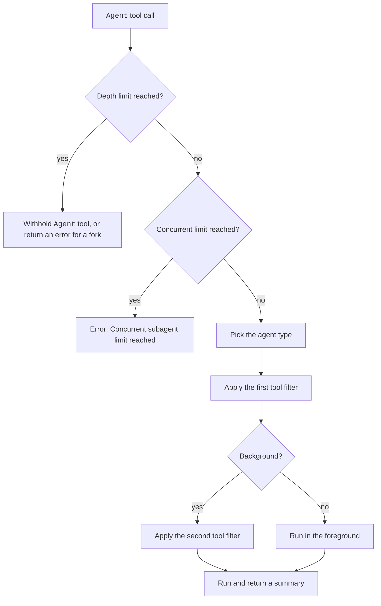

Claude Code ships a few built-in agents, and a set of rules limits every subagent.
The rules cover tool filters, forks, background runs, depth limits, and agent teams.
For example, a subagent cannot start another one past the depth limit, which is 3 by default.
A fork is a subagent that inherits the whole conversation and shares the prompt cache with its parent.

Your own agent file replaces a built-in one of the same name. Limits come from env vars and settings. The switches are `CLAUDE_CODE_FORK_SUBAGENT`, `CLAUDE_CODE_DISABLE_BACKGROUND_TASKS`, `CLAUDE_CODE_DISABLE_EXPLORE_PLAN_AGENTS`, and `CLAUDE_AGENT_SDK_DISABLE_BUILTIN_AGENTS`.

## Example

Limit nesting to one level. Run every subagent in the foreground.

```bash
export CLAUDE_CODE_MAX_SUBAGENT_SPAWN_DEPTH=1
export CLAUDE_CODE_DISABLE_BACKGROUND_TASKS=1
claude
```

## Built-In Agents

Claude Code has 14 built-in names. Six are in the docs. The rest are internal or are not agents.[^builtins]

| Agent | Status | What it does | Notes |
| --- | --- | --- | --- |
| `Explore` | <Documented /> | A fast read-only search agent. | Model `inherit`, with a cap at the `opus` tier when the session model is newer than `opus` (`CLAUDE_CODE_DISABLE_EXPLORE_INHERIT_CAP` removes the cap). It has `omitClaudeMd` and no git status. Denies `Agent`, `ExitPlanMode`, `Edit`, `Write`, `NotebookEdit`, and the four Artifact tools `Artifact`, `ArtifactComments`, `ArtifactData`, and `ArtifactCheck`. A user agent named `Explore` overrides it. `CLAUDE_CODE_DISABLE_EXPLORE_PLAN_AGENTS=1` removes it (since `2.1.198`).[^explore] |
| `Plan` | <Documented /> | A research agent for plan mode. | Model `inherit`. The same `disallowedTools` as `Explore`. `omitClaudeMd` is true. |
| `general-purpose` | <Documented /> | A capable agent for multi-step work. | `tools:["*"]`. Model: `CLAUDE_CODE_SUBAGENT_MODEL` or the main model. The default when you omit `subagent_type`. `CLAUDE_AGENT_SDK_DISABLE_BUILTIN_AGENTS=1` removes it in `-p`. |
| `claude` | <Documented /> | A catch-all agent with every tool. | `tools:["*"]`, `appendSystemPrompt` true, no model of its own. Also the default agent for a dispatched background session. |
| `statusline-setup` | <Documented /> | Configures the status line for `/statusline`. | Tools `Read` and `Edit`. Model `sonnet`. Color `orange`. Interactive. |
| `claude-code-guide` | <Documented /> | Answers questions about Claude Code. | Model `haiku` (checked: the interactive screen sent `claude-haiku-5-5`). Mode `dontAsk`. Tools `Bash`, `Read`, `WebFetch`, `WebSearch`. The prompt also lists your custom skills, agents, MCP servers, plugin skills, and the names of your settings keys. Claude Code leaves it out when `CLAUDE_CODE_ENTRYPOINT` is `sdk-ts`, `sdk-py`, or `sdk-cli` (a `-p` run reports `sdk-cli`). So it exists only in the interactive CLI. Prompt text: [Subagent, Claude Code Guide](../../prompts/agents/subagent-claude-code-guide.md). |
| `fork` | <Documented /> | A fork of the main conversation. | Inherits the system prompt, tools, model, and history. Cannot start a fork. At the depth limit it keeps `Agent`, but the tool returns an error. Needs fork mode. Since `2.1.307`, forks started together are each told which launch is their own, so they start each other's work less often.[^v307] In the interactive screen the `Agent` tool accepted `fork` (`Fork started`) with no extra setting in the probe run; the switch was not looked for. |
| `workflow-subagent` | <Undocumented /> | The agent that `Workflow` scripts use. | `Workflow` scripts start their agents with this type. The model is `CLAUDE_CODE_WORKFLOW_SUBAGENT_MODEL` if set (and not `inherit`), then `CLAUDE_CODE_SUBAGENT_MODEL`, then the main model. Both win over a `model` option in `agent()`. The prompt tells the agent that its final text goes back to the script as a string. You cannot start it with the `Agent` tool, in `-p` or in the interactive screen (`Agent type 'workflow-subagent' not found`).[^probes] |
| `comment-thread-analyst` | <Undocumented /> | Analyzes artifact comment threads. | One tool. Model `inherit`. `maxTurns` 6. `omitClaudeMd` true. Only the artifact comment pipeline starts it (the definition says it is not for direct spawning). It is not in the agent list in any entry point. |
| `web-fetch` | <Undocumented /> <Gated note="CLAUDE_CODE_WEB_FETCH_AGENT" /> | Fetches URLs for a caller. | Prompt "web-reading specialist". `maxTurns` 15. Color `blue`. `omitClaudeMd` true. Model `haiku` or `inherit`, by a flag (a probe run inherited the main model). The agent exists only when `CLAUDE_CODE_WEB_FETCH_AGENT` is on (or its server flag). With default settings the interactive screen also answers `Agent type 'web-fetch' not found`. Then the main session loses its own `WebFetch` tool and calls this agent instead. The agent has only `WebFetch`. It is off when you set `CLAUDE_CODE_SIMPLE` or `CLAUDE_CODE_DISABLE_WEB_FETCH`.[^probes] |

:::note
In `-p` and the SDK entry points the spawnable built-in types are `claude`, `Explore`, `general-purpose`, `Plan`, and `statusline-setup`, plus `web-fetch` when it is on. In the interactive screen with default settings the list is `claude`, `claude-code-guide`, `Explore`, `general-purpose`, `Plan`, and `statusline-setup`, plus `fork`. `comment-thread-analyst` and `workflow-subagent` are not spawnable with `Agent` in either place (`Agent type '...' not found`). The artifact comment pipeline starts `comment-thread-analyst`, and `Workflow` scripts start `workflow-subagent`.
The names `worker`, `renewal`, `killed`, `decorations`, and `main-session` also appear in the program. They are not spawnable agent types as far as anyone read.
See [Probes](../../reference/probes.md#subagents-and-hooks).
:::

## Tools and Context of a Subagent

| Rule | Status | What it does | Notes |
| --- | --- | --- | --- |
| First filter | <Documented /> | Removes tools from every subagent. | Removed: `Agent` at the depth limit (not for a fork), `AskUserQuestion`, `EndConversation`, `EnterPlanMode`, `ExitPlanMode` (kept in `plan` mode), `ScheduleWakeup`, `WaitForMcpServers`, `Workflow`. Forks skip both filters. |
| Second filter | <Documented /> | The built-in tools that a background subagent keeps. | File and search tools, shell tools, web tools, `TodoWrite`, `Skill`, `ToolSearch`, the worktree tools, `Monitor`, `TaskStop`, `SendMessage`, `Artifact`, `SubagentHandback`, and every MCP tool. |
| Foreground or background | <Documented /> | How Claude Code places a start. | A teammate start and `CLAUDE_CODE_DISABLE_BACKGROUND_TASKS=1` run in the foreground. Fork mode and `background: true` run in the background. Otherwise the default is background, and `Ctrl+B` backgrounds a running task. |
| Resume | <Documented /> | Continues a finished subagent. | Use `SendMessage` with the name or agent ID. A per-call `model` also applies on resume (since `2.1.211`). Claude Code saves the per-call `model` (after a hook changes the call) in the agent metadata, and it reads the saved value on resume.[^resume] A subagent started with no per-call `model` saves none. Since `2.1.327`, such a subagent stays on the model it started on when you resume it, also after `/model`. The `2.1.327` release notes add two changes, and the program shows both. A sibling is a subagent that messages the resumed one and is not its parent. When a sibling resumes a subagent, the resumed subagent no longer takes the model and the effort of the sibling. It takes the model of the main session, and the effort that the sibling had picked is cleared. The resumed subagent also does not keep the allowed-tools and permission-mode rules of the sibling. Its permission mode stays the mode of the sibling only when that mode is no more permissive than the session mode, in the order `plan`, `default` (and `dontAsk`), `acceptEdits`, `auto`, `bypassPermissions`. Otherwise the session mode replaces it. A `default` mode also becomes the session mode when the session mode is `dontAsk`.[^resume-327] |
| Initial context | <Documented /> | What a non-fork subagent loads. | The agent prompt, the task message, `CLAUDE.md` files (unless `omitClaudeMd`), git status (not for `Explore` and `Plan`), preloaded skills, and a roster of siblings with `SendMessage`. No output style and no auto memory. |

## Limits and Switches

| Item | Status | What it does | Notes |
| --- | --- | --- | --- |
| `CLAUDE_CODE_MAX_SUBAGENT_SPAWN_DEPTH` | <Documented /> | Layers of nesting below the main session. | Default 3. At the limit `Agent` is withheld, except from a fork. `1` turns nesting off. Earlier defaults: 5 (`2.1.172`), 1 (`2.1.217`). Claude Code reads the depth from this variable, then from a server experiment value, then uses 3.[^depth] |
| Order of `Agent` refusals | <Undocumented /> | The checks that run before a subagent starts. | In order: spawn depth, a stop pending on the spawner, an unknown agent type, the concurrency limit, then the budget. The first check that fails gives the error.[^refusals] |
| `CLAUDE_CODE_MAX_CONCURRENT_SUBAGENTS` | <Documented /> | The most subagents running at once. | Default 20. The error is `Concurrent subagent limit reached`. Ultracode sessions are exempt. Resumes and `/subtask` forks take a slot but are not blocked. |
| Hook agent turn cap | <Undocumented /> | Stops an agent hook that runs too long. | At turn 50 the hook agent aborts and logs `Hooks: Agent turn N hit max turns, aborting`. The hook outcome is `cancelled`.[^hook-cap] See [Hook Handlers](../hooks/handlers.md). |
| First subagent on a model | <Undocumented /> | Waits for the model's settings from Anthropic. | Since `2.1.327`, the first subagent on a model waits up to 1.5 seconds for those settings, and up to 10 seconds in `claude -p`, instead of starting without them.[^model-wait] |
| Subagent `maxTurns` | <Documented /> | Stops a subagent at its turn limit. | The loop adds a `max_turns_reached` attachment, and the debug log says `Reached max turns limit`. A `-p` run that reaches its own `--max-turns` ends with the result subtype `error_max_turns` and the error `Reached maximum number of turns (N)`.[^max-turns] |
| `CLAUDE_CODE_FORK_SUBAGENT` | <Documented /> | Fork mode. | On in interactive sessions (since `2.1.232`), off in `-p` and the SDK. `1` forces on, `0` forces off. In fork mode every subagent runs in the background, and `Agent` has no `run_in_background`. |
| `CLAUDE_CODE_DISABLE_BACKGROUND_TASKS` | <Documented /> | Runs all subagents in the foreground. | Set `1`. Also removes `run_in_background`. |
| `CLAUDE_ASYNC_AGENT_STALL_TIMEOUT_MS` | <Documented /> | The stall timeout. | Default 600000. |
| `CLAUDE_CODE_FORWARD_SUBAGENT_TEXT` and `--forward-subagent-text` | <Documented /> | Sends subagent text in `stream-json`. | Print mode only. |
| `CLAUDE_CODE_SUBAGENT_MODEL`, `CLAUDE_CODE_SUBAGENT_MODEL_FORCE` | <Documented /> | The default model, and forcing it. | See `model` on [Subagent Frontmatter](frontmatter.md). |
| `CLAUDE_CODE_SUBAGENT_PROMPT_CACHE_TTL`, `subagentPromptCacheTtl` | <Documented /> | The cache TTL for subagent requests. | `5m` or `1h`. Frontmatter `experimental.cacheTtl` is the third source. See [Request and Cache](../../how-it-works/request-and-cache.md). |
| `CLAUDE_CODE_ENABLE_APPEND_SUBAGENT_PROMPT`, `CLAUDE_CODE_MEMORY_SUBAGENT_APPEND`, `CLAUDE_CODE_SUBAGENT_PROMPT_SNAPSHOT`, `CLAUDE_CODE_SUBAGENT_CACHE_EVICT`, `CLAUDE_CODE_SUBAGENT_CONFIG_WARNING` | <Undocumented /> | Other subagent variables in the program. | `--append-subagent-system-prompt <text>` (or `--append-subagent-system-prompt-file <file>`, print mode only, hidden) adds text to the end of every subagent system prompt. It turns on `CLAUDE_CODE_ENABLE_APPEND_SUBAGENT_PROMPT`, and the variable alone changes nothing. Using both flags gives an error. `CLAUDE_CODE_SUBAGENT_CONFIG_WARNING` turns the startup notice that your config asks for subagents on (`1`) or off (`0`). `CLAUDE_CODE_SUBAGENT_CACHE_EVICT` adds the `prompt-caching-evict-2026-05-12` beta to a subagent's last request, on a first-party login. `CLAUDE_CODE_SUBAGENT_PROMPT_SNAPSHOT` and `CLAUDE_CODE_MEMORY_SUBAGENT_APPEND` showed no change in print mode.[^probes] |
| Settings `agent`, `teammateMode` | <Documented /> | `agent` sets the main-session agent. `teammateMode` picks the teammate display. | `teammateMode` takes `auto`, `tmux`, `iterm2`, or `in-process`.[^teammate-mode] |
| Setting `subagentStatusLine` | <Documented /> <Deprecated note="Works; will stop in a future release" /> | Custom row for each subagent in the agent panel. Since `2.1.326`, the command runs again. In `2.1.323`, it had no effect. | The program logs "subagentStatusLine is deprecated in favor of mods and will stop working in a future release".[^status-line] |
| Safeguards stop a subagent | <Undocumented /> | The text that Claude gets when safeguards stop an agent. | It starts `Safeguards stopped this agent.` The text adds `, and automatic model switching is off` when that is the case for the stopped model. For a `cyber` stop where a retry is allowed, it says Claude can start a new agent with a clearer prompt that asks for no more than it needs, and that the same content reworded is likely to be stopped too. Otherwise it says to pass the message on to the user. It ends `Don't do the agent's work yourself: safeguards cover this conversation too.`[^safeguards] |
| Subagent output limit | <Undocumented /> | What a subagent gets when its reply stops at the output token limit. | Since `2.1.326`, a subagent whose reply stops at the limit with some text, and no unfinished block, gets this text: "Output token limit hit. Your caller does not receive an answer in pieces." It asks for the whole answer again, more briefly, if this was the final answer, and otherwise for the work in smaller pieces. If the reply stops a second time, the text starts "Output token limit hit again." It asks for the whole answer in at most half the length of the last try, or for what fits with a first line that says so. Since `2.1.327`, answers that hit the limit twice more often come back whole or say up front that they are partial.[^output-limit] |

All variables are also listed on [Environment Variables for Agents and Teams](../../configure/env-vars/agents-and-teams.md).

## Agent Teams

An agent team is a group of Claude sessions that work as teammates.

| Item | Status | What it does | Notes |
| --- | --- | --- | --- |
| Agent teams | <Gated note="Set CLAUDE_CODE_EXPERIMENTAL_AGENT_TEAMS=1." /> <Experimental /> | Several sessions work as teammates. | A named subagent started in an interactive team session starts as a teammate. `team_name` and `mode` on `Agent` are deprecated. Claude Code ignores them. |
| Teammate tools | <Gated note="Same switch as agent teams." /> | Extra tools for a teammate. | Teammates keep `TaskCreate`, `TaskGet`, `TaskList`, `TaskUpdate`, `CronCreate`, `CronDelete`, `CronList`. `SendMessage` routes by name, `main`, or agent ID. |
| `TeammateIdle` hook | <Documented /> | Runs when a teammate is about to go idle. | Exit 2 or `continue:false` keeps it working. See [Hook Events](../hooks/agent-events.md#teammateidle). |
| `TaskCreated`, `TaskCompleted` hooks | <Documented /> | Task lifecycle events. | `TaskCompleted` also fires when a teammate finishes its turn. |
| `agent.spawn` mod event | <Documented /> | Fires before a subagent or teammate starts. | `e.isTeammate` is true for a teammate. `next({...e, model})` sets the model. See [Plugin Mods Reference](https://code.claude.com/docs/en/plugins/mods/reference). |
| `CLAUDE_CODE_TEAM_TEARDOWN_PARK_TIMEOUT_MS` | <Documented /> | The wait at exit for team teardown. | 1000 to 60000 ms in print mode. |

## How It Works



## Git Commands in a Worktree Subagent

Since `2.1.326`, a subagent that runs isolated in a worktree cannot run some git commands in `Bash`. A main session that runs in a worktree it created is covered in the same way. A main session in your own checkout is not affected. These commands can rewrite what the worktree shares with your own checkout, such as its branches, or start a program that Claude Code cannot check. The rule holds in every repository. Most of these commands are refused only when a server-side flag is on; the Status column says which.[^worktree-guard]
Status: <Gated />. The official docs do not state it.

The message names the worktree and the command. For the commands in the first part of the table, it says that the command is refused in every repository. It tells the agent to change its own branch with `git commit`, `git reset`, or `git rebase`, to start another with `git branch <new-branch> <commit>`, and to leave your branches as they are. It ends with "If the task needs it, say so when you report back."[^worktree-guard]

| Git Command | Status | What Is Refused |
| --- | --- | --- |
| `git for-each-repo` | <Undocumented />. Needs a server flag. | Every use. |
| `git worktree` | <Undocumented />. Needs a server flag. | Every verb except `add`, `list`, `lock`, `prune`, `remove`, and `unlock`. `git worktree add` works for a path under the worktree or in a scratch directory. |
| `git fast-import` | <Undocumented />. Needs a server flag. | Every use. Without the server flag, only `--allow-unsafe-features` is refused, and `git fast-import` works without it.[^worktree-optout] |
| `git filter-branch` | <Undocumented />. Needs a server flag. | A call with arguments. |
| `git filter-repo` | <Undocumented />. Needs a server flag. | Every option except `--analyze` and `--version`. |
| `git history` | <Undocumented />. Needs a server flag. | The verbs `drop`, `fixup`, `reword`, and `split`. |
| `git replay` | <Undocumented />. Needs a server flag. | A call with arguments. |
| `git update-ref` | <Undocumented />. Needs a server flag. | A change to a ref, except refs under `refs/bisect/`, `refs/rewritten/`, and `refs/worktree/`, and refs such as `HEAD`. |
| `git refs` | <Undocumented />. Needs a server flag. | Every verb except `exists`, `list`, `optimize`, and `verify`. |
| `git symbolic-ref` | <Undocumented />. Needs a server flag. | A form that changes a ref. |
| `git replace` | <Undocumented />. Needs a server flag. | Every form except `list`. |
| `git reflog` | <Undocumented />. Needs a server flag. | The verbs `delete`, `drop`, `expire`, and `write`. |

| `git bisect` | <Undocumented />. Needs a server flag. | `git bisect run`. Also `git bisect view` and `git bisect visualize` with a word that is not an option, and a first word that the shell can expand. `git bisect good` and `git bisect bad` still work: run the test yourself, then mark each commit. `git bisect view` still works with only `git log` options, such as `--oneline`.[^worktree-optout] |
| `git maintenance` | <Undocumented />. Needs a server flag. | `git maintenance register` and `git maintenance start`. Also a word after `git maintenance` that the shell can expand, as the program cannot tell which verb it is. `git gc` and `git maintenance run`, `stop`, `unregister`, and `is-needed` still work.[^worktree-optout] |
| `scalar` | <Undocumented />. Needs a server flag. | `scalar register`, `scalar clone`, `scalar reconfigure`, `scalar run all`, and `scalar run config`. `git gc` and `git maintenance run` still work, and so does `scalar run` with one task: `fetch`, `commit-graph`, `loose-objects`, or `pack-files`.[^worktree-optout] |
| `git checkout` and `git switch` | <Undocumented /> | The option `--ignore-other-worktrees`. Use a branch of its own: `git checkout -b <new-branch> <commit>` or `git switch -c <new-branch> <commit>`.[^worktree-optout] |
| `git worktree add` | <Undocumented /> | The option `--force`. Run it without the option, and add `-b <new-branch>` for a new branch. If git says that the path is registered but missing, run `git worktree prune` first.[^worktree-optout] |
| `git fetch` | <Undocumented /> | The option `--update-head-ok`. Fetch into a branch of its own.[^worktree-optout] |
| `git apply` | <Undocumented /> | The option `--unsafe-paths`. Use a patch whose paths stay inside the worktree.[^worktree-optout] |
| `git merge-index` | <Undocumented />. Needs a server flag. | Every call with arguments. Use `git merge-file` or `git merge`.[^worktree-optout] |
| `git config` | <Undocumented />. Needs a server flag. | `--edit`, `--remove-section`, and `--rename-section`. Also a set or an unset of a setting that is not on a short list of harmless settings, and of any setting in a file named with `--file`. Pass a setting for one command with `git -c`, or ask the person to set it.[^worktree-optout] |
| A git command that starts a program | <Undocumented />. Needs a server flag. | An option that names a program, such as `--upload-pack`, `--exec`, `--extcmd`, `--receive-pack`, `--httpd`, or the filter options of `git filter-branch`. Also `git remote-ext`, and a URL that starts with `ext::` or `fd::`. Run it without that option or remote.[^worktree-optout] |
| A git internal helper | <Undocumented /> | A name that looks like an internal helper, which is a git command with `--` in its name. Run the ordinary git command, add the missing space if `--` starts an option, or write a path as `./name`.[^worktree-optout] |

Without its flag, a command that needs one runs as before.[^worktree-guard]

## Errors

Each row is a family of messages. The backticked text is the start that every message in the family shares.

| Start of Message | Status | What It Means | Cases |
| --- | --- | --- | --- |
| `Failed to create iTerm2 split pane`, `Failed to send command to iTerm2 pane`, `Failed to send command to pane` | <Undocumented /> | Claude Code could not put a teammate in a terminal pane. | The `it2` split call or the `tmux respawn-pane` call returned an error. The text ends with the error output of that call. |
| `Failed to create swarm session`, `Failed to create swarm-view window` | <Undocumented /> | The tmux backend could not open the window for teammates. | With `teammateMode` `tmux`, a session that runs outside tmux puts its teammates in a separate tmux session. The text ends with the error output of `tmux new-session` (no such session yet) or `tmux new-window` (the session exists without its view window). The `Agent` tool result holds the text. Only an interactive session builds the team, so the probes use the terminal screen.[^swarm] |

## Related Pages

- [Subagents](index.md): where agent files live.
- [Subagent Frontmatter](frontmatter.md): the keys of an agent file.
- [Hook Events](../hooks/agent-events.md#agent-and-task-events): the agent and task events.
- [Environment Variables for Agents and Teams](../../configure/env-vars/agents-and-teams.md): the full variable list.
- [Agents and Tasks Tools](../../reference/tools/agents-and-tasks.md) for `Agent`.

## Sources

[^builtins]: The program, the agent definitions, `chunk-56bhcxay.js:2952534`, and the `Agent` tool schema, `chunk-tt7pb888.js:28728`.
[^v307]: [`2.1.307` release notes](https://github.com/anthropics/claude-code/releases/tag/v2.1.307).
[^probes]: The program, `chunk-svkxb0xj.js:213` and `chunk-1xegr4vz.js:451`, and [Probes](../../reference/probes.md#subagents-and-hooks).
[^resume]: The program, `chunk-56bhcxay.js:320663` and `chunk-7fpae888.js:32408`.
[^resume-327]: [`2.1.327` release notes](https://github.com/anthropics/claude-code/releases/tag/v2.1.327). The program, `chunk-7fpae888.js:43081` for the saved model, which the resume reads only when the metadata holds one, and for the saved effort model. For a resume from a sibling, the check is `chunk-7fpae888.js:31844`. The program compares the id of the calling agent with the parent of the resumed agent, and skips the check for an observer. For a sibling, it clears the effort layers and the picked effort model of the call context, adds a model layer with the main-loop model of the main session, then runs the permission step at `chunk-7fpae888.js:14720`. That step drops the allowed-tools and permission-mode layers of the sibling, keeps their modes as caps (`chunk-xbsm23hs.js:3196`), and resets the permission mode to the session mode with `chunk-56bhcxay.js:1680598` unless the rank check at `chunk-jkpzhr7r.js:181146` keeps it. The program shows no prompt or refusal text for this step. The `2.1.326` build has no such check.
[^model-wait]: [`2.1.327` release notes](https://github.com/anthropics/claude-code/releases/tag/v2.1.327). The program, `chunk-56bhcxay.js:209144-209177` for the wait (1500 ms, or 10000 ms when the session is a single print run; the wait is on unless the gate `tengu_deep_shore` is off, and on timeout the run goes on without the settings) and `chunk-1k75prj1.js:9013` for the call from the subagent start.
[^depth]: The program, the `Agent` tool, `chunk-h20nfgdp.js:341` and `chunk-tt7pb888.js:34296`.
[^refusals]: The program, the `Agent` tool, `chunk-tt7pb888.js:34296`.
[^hook-cap]: The program, the agent hook runner, `chunk-56bhcxay.js:4190170`.
[^max-turns]: The program, the agent loop, `chunk-56bhcxay.js:2412588`.
[^teammate-mode]: The program, `chunk-jkpzhr7r.js:298121` and `chunk-eczrspp8.js:798`.
[^status-line]: The program, `chunk-j2wfp6sf.js:56038-56589`, `chunk-a3rr42d2.js:148-151`. For `2.1.323`, the program, `chunk-jkpzhr7r.js:258124`, and the [`2.1.323` release notes](https://github.com/anthropics/claude-code/releases/tag/v2.1.323).
[^safeguards]: The program, `2.1.323`: `chunk-1k75prj1.js:10593`.
[^output-limit]: The program, `chunk-qre0n3qw.js:11455` (first text) and `chunk-qre0n3qw.js:11714` (second text). [`2.1.327` release notes](https://github.com/anthropics/claude-code/releases/tag/v2.1.327).
[^swarm]: The program, `chunk-2v0j7fr6.js:130722` (`initializeSessionTeam`) and `chunk-k1n6v1vy.js:4220`. Probe cases `pty.cli319.tmux-swarm-session` and `pty.cli319.tmux-swarm-window`, with a stand-in `tmux` whose `new-session` and `new-window` fail.
[^worktree-optout]: The program, `chunk-h473xnp6.js:1454-1610`, `chunk-h473xnp6.js:1614-1661`, and `chunk-h473xnp6.js:1663-1678`, called from `chunk-h473xnp6.js:439-439`, `chunk-h473xnp6.js:1700`, `chunk-h473xnp6.js:1783`, and `chunk-h473xnp6.js:1794`. The server flag `tengu_mellow_platypus` turns on the `git bisect` row, `tengu_buzzing_emerson` turns on the `git maintenance` and `scalar` rows, and `tengu_gentle_harbor` turns on the `git merge-index`, `git config`, and program rows (`chunk-h473xnp6.js:790-798`). The other rows need none of these flags. The `git bisect`, `git maintenance`, and `scalar` rows are in the [`2.1.325` release notes](https://github.com/anthropics/claude-code/releases/tag/v2.1.325), which this site dates as `2.1.326`.

Official pages: [Create Custom Subagents](https://code.claude.com/docs/en/sub-agents), [Environment Variables](https://code.claude.com/docs/en/env-vars), and [Hooks Reference](https://code.claude.com/docs/en/hooks).
[^worktree-guard]: The program, `chunk-56bhcxay.js:3830215` and `chunk-h473xnp6.js:6004-6255` and `chunk-h473xnp6.js:18712`. The program applies the check to an agent that has its own worktree and to a main session that runs in a worktree it created (`chunk-56bhcxay.js:3830215`). The server flag `tengu_level_meadow` turns on the rows without a separate flag in the table. [`2.1.326` release notes](https://github.com/anthropics/claude-code/releases/tag/v2.1.326).
[^explore]: The program, `chunk-56bhcxay.js:17953-17963` for the definition, `chunk-56bhcxay.js:17965-17971` for the model cap, `chunk-1k75prj1.js:8062-8065` for the missing git status, and `chunk-56bhcxay.js:13956` for the environment variable.
