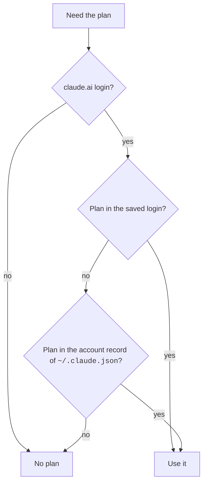

Your account is the login that Claude Code uses: a claude.ai login, a Console login, an API key, or a cloud provider.
Your plan is the subscription of that account, such as Pro or Max.
Claude Code reads both once from the server and saves them, so it does not ask again at each start. The plan decides which usage messages you see and which model entries the picker shows. To change what Claude Code knows, log in again, or set the environment variables in the Example section.[^scope]

## Example

Run a script with a long-lived token. Tell Claude Code the plan of that token, because it cannot ask for it:

```bash
CLAUDE_CODE_OAUTH_TOKEN="$TOKEN" CLAUDE_CODE_SUBSCRIPTION_TYPE=max claude -p "Reply with 'OK'."
```

Pick a Mythos model by its full ID, because `/model` does not list it:

```bash
claude --model claude-mythos-5-1
```

## Where the Plan Comes From

Claude Code asks for the plan only with a claude.ai login.
With an API key or a cloud provider, the plan is empty. Plan rules do not apply.



- The plan is one of `max`, `pro`, `team`, or `enterprise`.[^plan-values]
- The server names the plan by its organization type. Claude Code maps `claude_max` to `max`, `claude_pro` to `pro`, `claude_team` to `team`, and `claude_enterprise` to `enterprise`. Any other value gives no plan.[^plan-map]
- With `CLAUDE_CODE_OAUTH_TOKEN`, Claude Code does not ask the server for the plan. It takes the plan from `CLAUDE_CODE_SUBSCRIPTION_TYPE` and the rate limit tier from `CLAUDE_CODE_RATE_LIMIT_TIER`. Each is empty when unset.[^oauth-token] See [Auth and Accounts](../configure/env-vars/auth-and-accounts.md).
- A host can pass the account with `CLAUDE_CODE_ACCOUNT_UUID`, `CLAUDE_CODE_USER_EMAIL`, and `CLAUDE_CODE_ORGANIZATION_UUID`. Claude Code uses them only when the host sets all three and no account record exists yet.[^host-account]

## The Profile Request

Claude Code reads the account and plan from one request.

| Login | Request |
| --- | --- |
| claude.ai | `GET https://api.anthropic.com/api/oauth/profile`, with a 10 second timeout[^oauth-profile] |
| API key | `GET https://api.anthropic.com/api/claude_cli_profile`[^key-profile] |

`ANTHROPIC_BASE_URL` does not change the host of these requests.
Only `CLAUDE_CODE_CUSTOM_OAUTH_URL` changes it, and only to an approved Anthropic host. See [Auth and Accounts](../configure/env-vars/auth-and-accounts.md).

The table shows where each field of the profile reply goes.[^probe-run]

| Reply field | What it is | Where Claude Code keeps it |
| --- | --- | --- |
| `account.uuid` | The account id. | `oauthAccount.accountUuid` |
| `account.email` | Your email. | `oauthAccount.emailAddress` |
| `account.display_name`, `account.full_name` | Your names. | `oauthAccount.displayName`, `oauthAccount.fullName` |
| `account.created_at` | When the account began. | `oauthAccount.accountCreatedAt` |
| `organization.uuid` | The organization id. | `oauthAccount.organizationUuid` |
| `organization.organization_type` | The plan, mapped as above. `claude_max` became `max`. | `subscriptionType` of the login, with `subscriptionTypeSource: "profile"` and `subscriptionTypeVerifiedAt` |
| `organization.rate_limit_tier` | The rate limit tier. | `rateLimitTier` of the login |
| `organization.seat_tier` | The seat tier of a Team or Enterprise seat. | `oauthAccount.seatTier` |
| `organization.has_extra_usage_enabled` | Whether usage credits are on. | `oauthAccount.hasExtraUsageEnabled` |
| `organization.billing_type` | How the organization pays. `usage_based` changes the model picker (see below). | `oauthAccount.billingType` |
| `organization.claude_code_trial_ends_at`, `organization.claude_code_trial_duration_days` | The Claude Code trial, when there is one. | `oauthAccount.claudeCodeTrialEndsAt`, `oauthAccount.claudeCodeTrialDurationDays` |
| `organization.subscription_created_at` | When the plan began. | `oauthAccount.subscriptionCreatedAt` |
| `organization.cc_onboarding_flags` | Onboarding flags for Claude Code. | `oauthAccount.ccOnboardingFlags` (`{}` when the reply has none) |
| `organization.plan_display_name` | The plan name to show. | `oauthAccount.planDisplayName` |
| `organization.name` | The organization name. | Not kept. The program writes no key for it. |

## Where Claude Code Keeps It

- The account record is the `oauthAccount` key of `~/.claude.json`. It holds the keys in the table above and `profileFetchedAt`, the time of the last request in milliseconds.
- Claude Code saves the plan and the rate limit tier with the login. On macOS, Claude Code reads the login from the keychain with `security find-generic-password`.[^keychain] The file store is `~/.claude/.credentials.json`. See [Sessions and Storage](sessions-and-storage.md#where-files-live).
- Claude Code saves the plan with the login only when the reply has a `request-id` header that starts with `req_`.[^request-id] When the reply has no such header, the debug log says `OAuth: stored login plan not recorded from the profile`.
- You can edit these records. The Mod API type file describes the account that Claude Code gives a mod. The account takes `organizationType` from the login record on disk. The person can edit that record.[^mod-type]

## When It Asks Again

- At start, Claude Code skips the profile request when `profileFetchedAt` is less than 24 hours old and the record has its billing, onboarding, and creation fields.[^skip-profile]
- It also skips the request when there is no claude.ai login with the inference scope.[^scope-check]
- Pro and Max accounts skip two requests at start. The Consumer Terms check calls `GET /api/oauth/account/settings` and `GET /api/claude_code_grove`. When the server confirmed your answer less than one hour ago, Claude Code saves that time under `groveChoiceSeenAt` in `~/.claude.json`, keyed by your account id, and does not ask again.[^grove] The check runs only for the `max` and `pro` plans.[^grove-plans]

## How Model Access Is Decided

The plan does not hide models from `/model`.
The picker lists a model when the model catalog has an ID for your provider. It also lists a model when the `modelOverrides` setting maps it.[^picker]
So the provider decides which models the picker lists. The plan changes only the Fable entry below.

| Model | How it reaches the picker |
| --- | --- |
| Fable | The picker lists the `fable` alias when the catalog has a Fable ID for your provider. `ANTHROPIC_DEFAULT_FABLE_MODEL` replaces it with your own model.[^fable] |
| Mythos | The picker never lists a Mythos model. There is no `mythos` alias.[^mythos] Pick it by its full ID, such as `claude-mythos-5-1`. The model-name check also accepts `claude-mythos-preview`. |

These rules change the Fable entry:

- **Usage credits.** A server config says for each model whether it needs usage credits. When it does, the entry ends in "· Requires usage credits". You cannot set this config.[^credits]
- **Disabled entry.** A server flag must be on. Then the entry turns into "Fable (disabled)" if all of these are true:[^disabled]
  - Your plan is not `max` or `pro`, and your organization role is not `admin`, `billing`, `owner`, or `primary_owner`. Without a claude.ai login with the inference scope, neither the plan nor the role keeps the entry on.
  - Usage credits are off for the organization, or not set up (`org_level_disabled` or `overage_not_provisioned`).
  - The model's billing mode is not `pay_per_request` or `included_in_plan`.
- **Credits-only plans.** A server config names the plans that use models only with credits. Its default is `["enterprise"]`.[^credits-only]
- To limit the models people can pick, use `availableModels` and `deniedModels`. See [Model Settings](../configure/settings/model.md).

## Login and an Unused API Key

`/login` does not end on "Login successful" while an approved `ANTHROPIC_API_KEY` is still used. It says that requests still use the key. "Not logged in", `/login`, and `/status` name an unused `ANTHROPIC_API_KEY`.[^v326]
Status: <Undocumented /> in the official docs.

- After a login, when an approved `ANTHROPIC_API_KEY` still serves requests, Claude Code says "Signed in, but requests still use ANTHROPIC_API_KEY. To use this login, turn off "Use custom API key" in /config".[^api-key-note]
- The footer says "Not logged in · run /login".[^footer]
- The not-logged-in message and the login screen add the dim note `ANTHROPIC_API_KEY not used here · turn on "Use custom API key" in /config`. The note shows only when the key is set, no managed setting fixes the login method or organization, and the key is not already approved.[^unused-note]
- `/status` adds an "Unused API key" row. Its value is `ANTHROPIC_API_KEY`, followed by "· claude -p uses it · /config to use".[^status-row]

## Finishing a Login

After you submit the login code, the screen shows "Finishing sign-in…" while Claude Code waits for the login to finish.[^finishing]

## What a Refusal Says

When something needs usage credits, such as fast mode or the 1M context window, the message names where to turn them on.[^refusal]
In most cases it is "turn on usage credits at" your own usage page, whatever the plan.

A Team or Enterprise plan gets other wording only in one case. Claude Code runs as the main session with no terminal. It runs inside Claude Desktop (`claude-desktop` or `claude-desktop-3p`) or a `local-agent` host:[^desktop]

| Who | Message |
| --- | --- |
| A claude.ai login with the inference scope and an `admin`, `billing`, `owner`, or `primary_owner` role | "turn on usage credits at" the organization's admin usage page |
| Other roles | "ask your admin to turn on usage credits" |

Pro and Max subscribers get the billing settings link in place of "ask your admin".[^v311]

## What the Usage Limits Are Called

Claude Code names each rate limit window in its usage limit messages.[^windows]

| Window | Name in Messages |
| --- | --- |
| `five_hour` | "5-hour limit" |
| `seven_day` | "weekly limit" |
| `seven_day_opus` | "Opus limit" |
| `seven_day_sonnet` | "Sonnet limit" |
| `seven_day_overage_included` | "Fable limit" |
| `overage` | "usage credit limit" |

Claude Code calls the five-hour window the "5-hour limit". The name also appears in the reset messages, such as "Resetting your 5-hour limit… this usually takes a few seconds" and "Couldn't reset your 5-hour limit with this login · run /login, then try again".[^five-hour]

## The Usage Limit Menu

`/rate-limit-options` opens a menu at a usage limit.[^menu] These rows can appear:

| Row | When |
| --- | --- |
| "Switch to usage credits", or "Add funds to continue with usage credits" | The limit can be passed with usage credits. |
| "Ask your admin for more usage" | The account cannot turn on credits itself. |
| "Upgrade your plan" | The limit lists an upgrade path. |
| "Stop and wait for limit to reset", or "Stop" | Always. |

Claude Code shows "Couldn't load your current spend limit, so it can't be changed right now. Try /rate-limit-options again later." when it cannot read the current spend limit. The menu then shows `unavailable` as the limit, gives no hint to adjust it, and does not change it.[^spend]

## What Others Can See

- An SDK host gets the account from the control protocol: `email`, `organization`, `subscriptionType`, `tokenSource`, `apiKeySource`, and `apiProvider`.[^control]
- A mod gets `kind` (`claude.ai`, `console`, `api-key`, `oauth-token`, `none`, or a cloud provider), `email`, and `isVerified`. It gets `organizationId` and `organizationType` only when managed `forceLoginOrgUUID` names that organization.[^mod-account]

## Related Pages

- [Models](models.md)
- [Models and Providers](../configure/models-and-providers/index.md)
- [Auth and Accounts](../configure/env-vars/auth-and-accounts.md)
- [Sessions and Storage](sessions-and-storage.md)

## Sources

[^scope]: Claude Code `2.1.328`. Each footnote below names the chunk and the place in it.
[^plan-values]: The program, `chunk-xethrx83.js:33508`, `chunk-xethrx83.js:33517`.
[^plan-map]: The program, `chunk-xethrx83.js:18286`.
[^oauth-token]: The program, `chunk-xethrx83.js:32105`.
[^host-account]: The program, `chunk-xethrx83.js:19022`.
[^oauth-profile]: The program, `chunk-xethrx83.js:324748`.
[^key-profile]: The program, `chunk-xethrx83.js:324283`.
[^probe-run]: The program, `chunk-xethrx83.js:331829` (the `oauthAccount` writes) and `chunk-xethrx83.js:336536` (the plan type).
[^keychain]: The program, `chunk-szxhkqtw.js:756`.
[^request-id]: The program, `chunk-xethrx83.js:325145`, `chunk-xethrx83.js:340955`.
[^mod-type]: `schemas/claude-code.d.ts`.
[^skip-profile]: The program, `chunk-xethrx83.js:17913`, `chunk-xethrx83.js:19043`.
[^scope-check]: The program, `chunk-xethrx83.js:33295`.
[^grove]: The program, `chunk-sv9jmdf1.js:1005` (the account settings read), `chunk-sv9jmdf1.js:3751` (the Grove read), `chunk-sv9jmdf1.js:5645` (the save), `chunk-sv9jmdf1.js:6517` (the one hour test, `3600000` ms).
[^grove-plans]: The program, `chunk-xethrx83.js:641165` (`max` or `pro` only).
[^picker]: The program, `chunk-xethrx83.js:15858`.
[^fable]: The program, `chunk-y5weakn8.js:14377`, `chunk-y5weakn8.js:14777`.
[^mythos]: The program, `chunk-699j6sfp.js:41`. The model-name check is at `chunk-699j6sfp.js:52`.
[^credits]: The program, `chunk-y5weakn8.js:11134`, `chunk-y5weakn8.js:14391`. The server config is `tengu_saffron_lattice`.
[^disabled]: The program, `chunk-y5weakn8.js:15613`. The server flag is `tengu_saffron_picker_dim`. The plan and role check is at `chunk-y5weakn8.js:11039` and `chunk-xethrx83.js:33480`. The login scope check is at `chunk-xethrx83.js:33295`.
[^credits-only]: The program, `chunk-y5weakn8.js:187090`. The server config is `tengu_saffron_credits_only_tiers`.
[^v326]: The program, `chunk-shaz62gz.js:12038` ("Signed in, but requests still use ANTHROPIC_API_KEY").
[^api-key-note]: The program, `chunk-shaz62gz.js:495`.
[^footer]: The program, `chunk-j2wfp6sf.js:892393`.
[^unused-note]: The program, `chunk-xethrx83.js:581604-581926` (the test and the text), `chunk-bjgpjqze.js:58994` (the not-logged-in message), and `chunk-deg3e0xc.js:28738` (the login screen).
[^status-row]: The program, `chunk-xdedspyt.js:10929`.
[^refusal]: The program, `chunk-xethrx83.js:33753`, `chunk-xethrx83.js:20874`, `chunk-56bhcxay.js:114270`.
[^desktop]: The program, `chunk-xethrx83.js:20542`, `chunk-374y7r0w.js:103`, `chunk-374y7r0w.js:474`.
[^v311]: The program, `chunk-xethrx83.js:636154` (the `Jco` text; non-team plans get the `claude.ai/settings/usage` link) and `chunk-xethrx83.js:287280` (the link).
[^windows]: The program, `chunk-g78ks3d1.js:1815`.
[^five-hour]: The program, `chunk-g78ks3d1.js:34436` (the `five_hour` name), `chunk-xwcpzc12.js:26184`, and `chunk-322fww3s.js:45980`.
[^menu]: The program, `chunk-56bhcxay.js:2610519`. The rows are built at `chunk-gab9myev.js:44229`.
[^spend]: The program, `chunk-gab9myev.js:34152` (the `unavailable` label) and `chunk-gab9myev.js:34313` (the empty hint) and `chunk-gab9myev.js:35317` (the message).
[^control]: `schemas/claude-code-control-protocol.json`.
[^mod-account]: `schemas/claude-code.d.ts`.
[^finishing]: The program, `chunk-deg3e0xc.js:9752` and `chunk-deg3e0xc.js:33411`.
