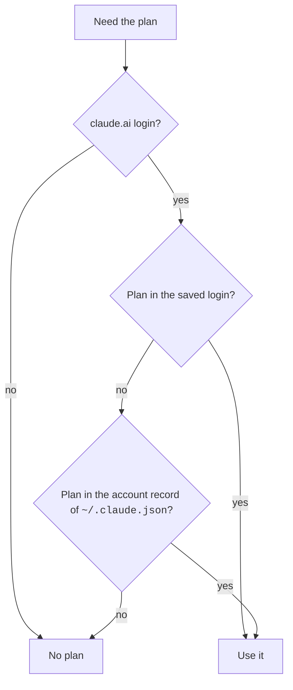

Your account is the login that Claude Code uses: a claude.ai login, a Console login, an API key, or a cloud provider.
Your plan is the subscription of that account, such as Pro or Max.
This page explains where Claude Code gets these facts, where it keeps them, and what they change.
Source for all facts: the program (Claude Code `2.1.311`), with the module and line in its cleaned code.

## Where the Plan Comes From

Claude Code asks for the plan only with a claude.ai login.
With an API key or a cloud provider, the plan is empty. Plan rules do not apply.



- The plan is one of `max`, `pro`, `team`, or `enterprise` (`chunk-yqezv9gr.js:32572`, `:32581`).
- The server names the plan by its organization type. Claude Code maps `claude_max` to `max`, `claude_pro` to `pro`, `claude_team` to `team`, and `claude_enterprise` to `enterprise`. Any other value gives no plan (`chunk-yqezv9gr.js:18441`).
- With `CLAUDE_CODE_OAUTH_TOKEN`, Claude Code does not ask the server for the plan. It takes the plan from `CLAUDE_CODE_SUBSCRIPTION_TYPE` and the rate limit tier from `CLAUDE_CODE_RATE_LIMIT_TIER`. Each is empty when unset (`chunk-yqezv9gr.js:31272`). See [Auth and Accounts](../configure/env-vars/auth-and-accounts.md).
- A host can pass the account with `CLAUDE_CODE_ACCOUNT_UUID`, `CLAUDE_CODE_USER_EMAIL`, and `CLAUDE_CODE_ORGANIZATION_UUID`. Claude Code uses them only when the host sets all three and no account record exists yet (`chunk-yqezv9gr.js:18528`).

## The Profile Request

Claude Code reads the account and plan from one request.

| Login | Request | Source |
| --- | --- | --- |
| claude.ai | `GET https://api.anthropic.com/api/oauth/profile`, with a 10 second timeout | `chunk-yqezv9gr.js@324412` |
| API key | `GET https://api.anthropic.com/api/claude_cli_profile` | `chunk-yqezv9gr.js@323947` |

`ANTHROPIC_BASE_URL` does not change the host of these requests.
Only `CLAUDE_CODE_CUSTOM_OAUTH_URL` changes it, and only to an approved Anthropic host. See [Auth and Accounts](../configure/env-vars/auth-and-accounts.md).

The table below comes from a run of `2.1.319` (see [Account Probes](../reference/probes.md#account-probes)).
A claude.ai login sent the profile request to a local copy of `api.anthropic.com`, which gave a reply with every field set.
The right column shows where each value went.

| Reply field | What it is | Where Claude Code keeps it |
| --- | --- | --- |
| `account.uuid` | The account id. | `oauthAccount.accountUuid` |
| `account.email` | Your email. | `oauthAccount.emailAddress` |
| `account.display_name`, `account.full_name` | Your names. | `oauthAccount.displayName`, `oauthAccount.fullName` |
| `account.created_at` | When the account began. | `oauthAccount.accountCreatedAt` |
| `organization.uuid` | The organization id. | `oauthAccount.organizationUuid` |
| `organization.organization_type` | The plan, mapped as above. `claude_max` became `max`. | `subscriptionType` of the login, with `subscriptionTypeSource: "profile"` and `subscriptionTypeVerifiedAt` |
| `organization.rate_limit_tier` | The rate limit tier. | `rateLimitTier` of the login |
| `organization.seat_tier` | The seat tier of a Team or Enterprise seat. | `oauthAccount.seatTier` |
| `organization.has_extra_usage_enabled` | Whether usage credits are on. | `oauthAccount.hasExtraUsageEnabled` |
| `organization.billing_type` | How the organization pays. `usage_based` changes the model picker (see below). | `oauthAccount.billingType` |
| `organization.claude_code_trial_ends_at`, `organization.claude_code_trial_duration_days` | The Claude Code trial, when there is one. | `oauthAccount.claudeCodeTrialEndsAt`, `oauthAccount.claudeCodeTrialDurationDays` |
| `organization.subscription_created_at` | When the plan began. | `oauthAccount.subscriptionCreatedAt` |
| `organization.cc_onboarding_flags` | Onboarding flags for Claude Code. | `oauthAccount.ccOnboardingFlags` (`{}` when the reply has none) |
| `organization.plan_display_name` | The plan name to show. | `oauthAccount.planDisplayName` |
| `organization.name` | The organization name. | Not kept. The run wrote no key for it. |

## Where Claude Code Keeps It

- The account record is the `oauthAccount` key of `~/.claude.json`. It holds the keys in the table above and `profileFetchedAt`, the time of the last request in milliseconds.
- Claude Code saves the plan and the rate limit tier with the login. On macOS, Claude Code reads the login from the keychain with `security find-generic-password` (`chunk-bhpyrgb8.js:641`). The file store is `~/.claude/.credentials.json`. See [Sessions and Storage](sessions-and-storage.md#where-files-live).
- Claude Code saves the plan with the login only when the reply has a `request-id` header that starts with `req_` (`chunk-fb2t2yvp.js@415`). In the run, a reply with no `request-id` header left the login as it was, and the debug log said `OAuth: stored login plan not recorded from the profile (unstamped)`. The `oauthAccount` record was written in both runs.
- You can edit these records. The Mod API type file describes the account that Claude Code gives a mod. The account takes `organizationType` from the login record on disk. The person can edit that record (`schemas/claude-code.d.ts`).

## When It Asks Again

- At start, Claude Code skips the profile request when `profileFetchedAt` is less than 24 hours old and the record has its billing, onboarding, and creation fields (`chunk-yqezv9gr.js:18073`, `:18549`).
- It also skips the request when there is no claude.ai login with the inference scope (`chunk-yqezv9gr.js:32391`).
- Since `2.1.311`, Pro and Max accounts skip two more requests at start. The Consumer Terms check calls `GET /api/oauth/account/settings` and `GET /api/claude_code_grove`. When the server confirmed your answer less than one hour ago, Claude Code saves that time under `groveChoiceSeenAt` in `~/.claude.json`, keyed by your account id, and does not ask again (`chunk-4mrf83bh.js:33`, `:281`, `:338`). The check runs only for the `max` and `pro` plans (`chunk-yqezv9gr.js:32867`).

## How Model Access Is Decided

The plan does not hide models from `/model`.
The picker lists a model when the model catalog has an ID for your provider. It also lists a model when the `modelOverrides` setting maps it (`chunk-yqezv9gr.js:14220`).
So the provider decides which models the picker lists. The plan changes only the Fable entry below.

| Model | How it reaches the picker |
| --- | --- |
| Fable | The picker lists the `fable` alias when the catalog has a Fable ID for your provider. `ANTHROPIC_DEFAULT_FABLE_MODEL` replaces it with your own model (`chunk-jshe6j36.js:14151`, `:14532`). |
| Mythos | The picker never lists a Mythos model. There is no `mythos` alias (`chunk-cpnyxng2.js:41`). Pick it by its full ID, such as `claude-mythos-5-1`. The model-name check also accepts `claude-mythos-preview` (`chunk-cpnyxng2.js:52`). |

These rules change the Fable entry:

- **Usage credits.** A server config, `tengu_saffron_lattice`, says for each model whether it needs usage credits. When it does, the entry ends in "· Requires usage credits" (`chunk-jshe6j36.js:11346`, `:14165`). Users cannot set this config.
- **Disabled entry.** The server flag `tengu_saffron_picker_dim` must be on. Then the entry turns into "Fable (disabled)" if all of these are true (`chunk-jshe6j36.js:15343`):
  - Your plan is not `max` or `pro`, and your organization role is not `admin`, `billing`, `owner`, or `primary_owner` (`chunk-jshe6j36.js:11262`, `chunk-yqezv9gr.js:32550`). Without a claude.ai login with the inference scope, neither the plan nor the role keeps the entry on (`chunk-yqezv9gr.js:32391`).
  - Usage credits are off for the organization, or not set up (`org_level_disabled` or `overage_not_provisioned`).
  - The model's billing mode is not `pay_per_request` or `included_in_plan`.
- **Credits-only plans.** The server config `tengu_saffron_credits_only_tiers` names the plans that use models only with credits. Its default is `["enterprise"]` (`chunk-jshe6j36.js:11398`).
- To limit the models people can pick, use `availableModels` and `deniedModels`. See [Model Settings](../configure/settings/model.md).

## What a Refusal Says

When something needs usage credits, such as fast mode or the 1M context window, the message names where to turn them on (`chunk-yqezv9gr.js:32554`, `:21300`, `chunk-9r1hbf9p.js:96424`).
In most cases it is "turn on usage credits at" your own usage page, whatever the plan.

A Team or Enterprise plan gets other wording only in one case. Claude Code runs as the main session with no terminal. It runs inside Claude Desktop (`claude-desktop` or `claude-desktop-3p`) or a `local-agent` host (`chunk-yqezv9gr.js:20785`, `chunk-an81b96c.js:84`, `:380`):

| Who | Message |
| --- | --- |
| A claude.ai login with the inference scope and an `admin`, `billing`, `owner`, or `primary_owner` role | "turn on usage credits at" the organization's admin usage page |
| Other roles | "ask your admin to turn on usage credits" |

Since `2.1.311`, Pro and Max subscribers get the billing settings link in place of "ask your admin" ([release notes](https://github.com/anthropics/claude-code/releases/tag/v2.1.311)).

## What the Usage Limits Are Called

The program names each rate limit window in its usage limit messages (`chunk-7w2a9f4k.js:850`).

| Window | Name in Messages |
| --- | --- |
| `five_hour` | "5-hour limit" |
| `seven_day` | "weekly limit" |
| `seven_day_opus` | "Opus limit" |
| `seven_day_sonnet` | "Sonnet limit" |
| `seven_day_overage_included` | "Fable limit" |
| `overage` | "usage credit limit" |

Since `2.1.312`, the program calls the five-hour window the "5-hour limit". Earlier it said "session limit" (`2.1.311`). The same change reaches the reset messages, such as "Resetting your 5-hour limit… this usually takes a few seconds" (`chunk-s4kb1551.js:645`) and "Couldn't reset your 5-hour limit with this login · run /login, then try again" (`chunk-1pk1x242.js:2546`). Source: the [release notes](https://github.com/anthropics/claude-code/releases/tag/v2.1.312) and the program.

## What Others Can See

- An SDK host gets the account from the control protocol: `email`, `organization`, `subscriptionType`, `tokenSource`, `apiKeySource`, and `apiProvider` (`schemas/claude-code-control-protocol.json`).
- A mod gets `kind` (`claude.ai`, `console`, `api-key`, `oauth-token`, `none`, or a cloud provider), `email`, and `isVerified`. It gets `organizationId` and `organizationType` only when managed `forceLoginOrgUUID` names that organization (`schemas/claude-code.d.ts`).

## Example

Run a script with a long-lived token. Tell Claude Code the plan of that token, because it cannot ask for it:

```bash
CLAUDE_CODE_OAUTH_TOKEN="$TOKEN" CLAUDE_CODE_SUBSCRIPTION_TYPE=max claude -p "Reply with 'OK'."
```

Pick a Mythos model by its full ID, because `/model` does not list it:

```bash
claude --model claude-mythos-5-1
```

## Related Pages

- [Models](models.md)
- [Models and Providers](../configure/models-and-providers/index.md)
- [Auth and Accounts](../configure/env-vars/auth-and-accounts.md)
- [Sessions and Storage](sessions-and-storage.md)
