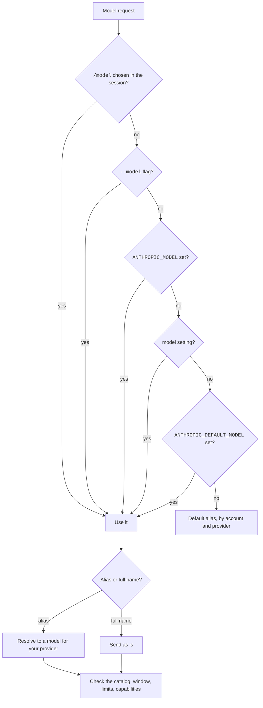
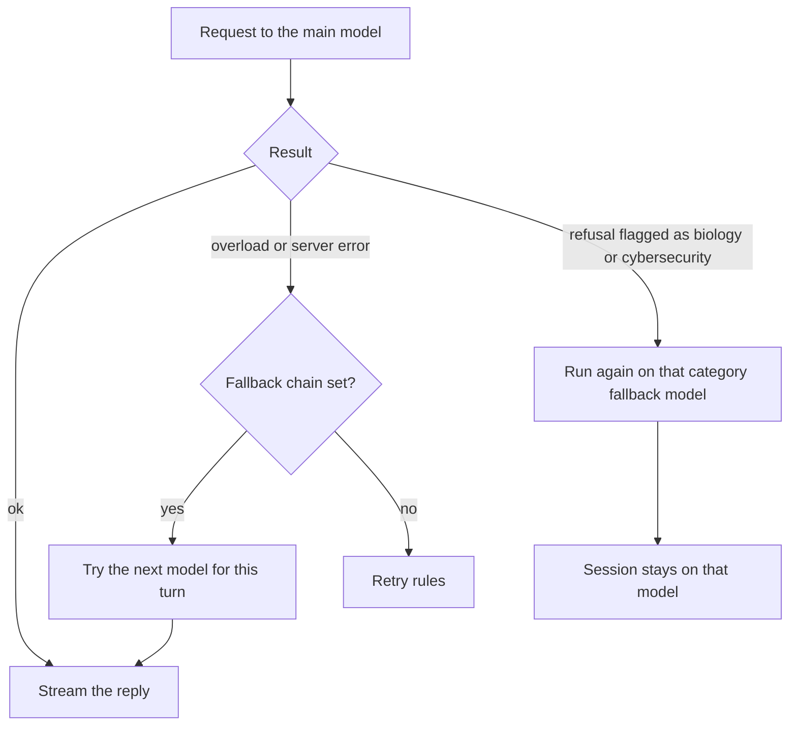

A model is the Claude version that answers you.
Effort is how hard the model thinks before it answers.
An API call is one request to the model server.
Claude Code picks each one from your flags, environment variables, and settings, and it retries or falls back when a call fails. You can set the model with `/model`, `--model`, or the `model` setting, and the effort with `--effort`.
The full list of models, aliases, and providers is on [Models and Providers](../configure/models-and-providers/index.md).

## Example

Run one hard task with a stronger model and more thinking.
Make a script fail sooner by lowering the retry count.

```bash
claude --model opus --effort high
CLAUDE_CODE_MAX_RETRIES=3 claude -p "summarize this repo"
```

## Choosing the Model

Official pages: [Model Configuration](https://code.claude.com/docs/en/model-config) and [Hooks Reference](https://code.claude.com/docs/en/hooks).



Other pages list the items that set the model. They are flags, environment variables, settings, aliases such as `default`, `opusplan`, and `best`, the `[1m]` suffix, and the switch hooks. See [Choose a Model](../configure/models-and-providers/model-catalog.md#choose-a-model) and [Aliases](../configure/models-and-providers/model-catalog.md#aliases).

A switch of the model is a cache miss. See [Request and Cache](request-and-cache.md#what-breaks-the-cache).

## Effort

The effort levels are `low`, `medium`, `high`, `xhigh`, and `max`.
A level that the model does not accept runs as the highest accepted level below it. See [Model Configuration](https://code.claude.com/docs/en/model-config).

The flags, variables, settings, request field, and default level for each model are in [Effort](../configure/models-and-providers/effort-thinking-and-fallback.md#effort).
The cache warning, the prompt note, and the spinner text for an effort change are in the same section.

## Thinking

Official pages: [Model Configuration](https://code.claude.com/docs/en/model-config) and [Environment Variables](https://code.claude.com/docs/en/env-vars).

The thinking flags, variables, and settings are in [Thinking](../configure/models-and-providers/effort-thinking-and-fallback.md#thinking).

`MAX_THINKING_TOKENS` cannot turn thinking off on Opus 5.5, Sonnet 5.5, Haiku 5.5, and the Fable models.
`CLAUDE_CODE_DISABLE_ADAPTIVE_THINKING` has no effect on newer models.

## Capabilities

The model catalog gives each model a list of capability flags.
The code tests a flag to enable a feature for that model.
The flag list, with what each flag does and how many models have it, is in [Capabilities](../configure/models-and-providers/model-catalog.md#capabilities).
The flags `effort`, `max_effort`, `xhigh_effort`, and `adaptive_thinking` say which effort levels and which thinking mode a model accepts.
The betas `per-turn-control-2026-07-01` and `timing-2026-09-09` match the flags `per_turn_effort` and `per_turn_timing`.

## Fallback



- A fallback chain (`--fallback-model`, `fallbackModel`) holds at most three models.
  It covers overload and server errors, and not auth, billing, rate-limit, request-size, or transport errors.
  The switch lasts for the current turn. The next turn tries the main model first.
  See [Model Configuration: Fallback Model Chains](https://code.claude.com/docs/en/model-config#fallback-model-chains).
- Content-based fallback applies to the Fable models, Opus 5.5, Sonnet 5.5, and Opus 5.
  A request that is flagged as biology or cybersecurity runs again on the fallback model of that category.
  The session then stays on that model.
  See [Model Configuration: Automatic Model Fallback](https://code.claude.com/docs/en/model-config#automatic-model-fallback).
- `CLAUDE_CODE_NO_MODEL_FALLBACK` forbids the substitution of a model (<Undocumented />).[^no-fallback]

## Retries and Timeouts

Official pages: [Error Reference: Automatic Retries](https://code.claude.com/docs/en/errors#automatic-retries) and [Environment Variables](https://code.claude.com/docs/en/env-vars).

The variables, with their defaults, are in [Fallback and Retries](../configure/models-and-providers/effort-thinking-and-fallback.md#fallback-and-retries).

Claude Code does not retry a `429` or `529` that the API marked with `x-should-retry: false`, and that includes unattended mode (`CLAUDE_CODE_RETRY_WATCHDOG`).[^no-retry]
Before, such a request could hold a turn for minutes, or for good in that mode.
[^retry-rule]

When a request is too long for the context, Claude Code tries again with a smaller `max_tokens`. It compacts when that is not enough.
A session on a standard window (not 1M) that gets the error "Usage credits required for 1M context" compacts the conversation and goes on.[^reactive]
Claude Code also knows the context length errors of many third-party gateways. It matches phrases such as "maximum context length", "context_length_exceeded", "exceeds the context window", and "reduce the length of the messages". A reply with "policy_blocked" or "dlp_request_denied" does not count. The check runs for the statuses `400`, `413`, `422`, or none.[^gateways]
The loop also recovers from a stop at `max_tokens` and from a bad tool call. See [The Agent Loop](agent-loop.md#recovery-inside-the-loop).

## Related Pages

- [Models and Providers](../configure/models-and-providers/index.md)
- [Request and Cache](request-and-cache.md)
- [Context and Compaction](context-and-compaction.md)
- [Settings](../configure/settings/index.md) and [Environment Variable](../configure/env-vars/index.md) pages in Configure.

## Sources

[^no-fallback]: The program, `chunk-wm04tzdx.js:9033`, a message that names the variable.
[^retry-rule]: The [Claude Code changelog](https://code.claude.com/docs/en/changelog). The program, `chunk-hg1yqkjk.js:160380` (a `429` or `529` with `x-should-retry: false` is not retried) and `chunk-hg1yqkjk.js:158817` (`CLAUDE_CODE_RETRY_WATCHDOG` does not change that).
[^no-retry]: The program, `chunk-76t3g1yn.js:10760` (the shared retry check) and `chunk-hg1yqkjk.js:160380` (the Claude Code check for the statuses `429` and `529`).
[^reactive]: The program, `chunk-hg1yqkjk.js:119503` for the error text, `chunk-wm04tzdx.js:9495` (`$718cc2`) checks for that refusal against the standard window (`200000` at `chunk-aq3ms068.js:24061`), then the code at `chunk-hg1yqkjk.js:130448` (`$6f243c`) runs the reactive compaction.
[^gateways]: The program, `chunk-nchg3ttk.js:245` for the phrases and `chunk-nchg3ttk.js:267` for the replies that do not count (`policy_blocked`, `dlp_request_denied`), and `chunk-hg1yqkjk.js:118378` for the statuses (`undefined`, `400`, `413`, `422`).
