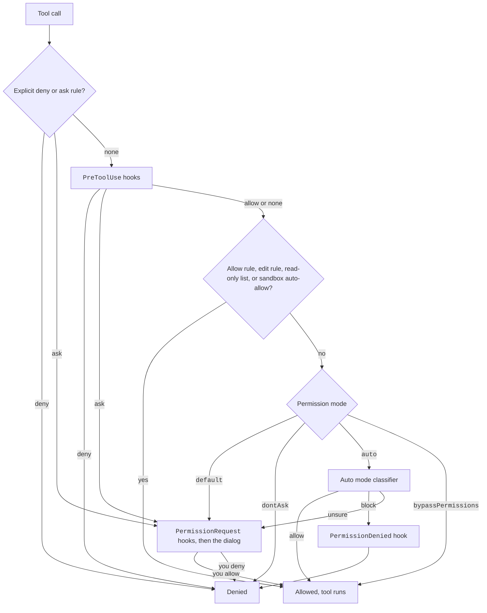

Before a tool runs, Claude Code decides one of three things: allow it, ask you, or deny it. Several parts take a turn: rules, hooks, the permission mode, safety checks, and sometimes a classifier model. This page shows the order, so you know which setting to change to stop or to allow a call.

## Example

You set `deny: ["Bash(git push:*)"]` and `allow: ["Bash(bun test)"]`. You run in `default` mode.

1. Claude asks to run `git push origin main`. The `deny` rule matches, so Claude Code denies the call. No prompt shows.
2. Claude asks to run `bun test`. No deny or ask rule matches. The `allow` rule matches, so it runs.
3. Claude asks to run `rm -rf build`. No rule matches. The mode is `default`, so you get a prompt.

## The Order of Checks

Official pages: [Configure Permissions](https://code.claude.com/docs/en/permissions) and [Choose a Permission Mode](https://code.claude.com/docs/en/permission-modes).
The steps below follow the program.[^order]

### Step by Step

1. **Explicit `deny` and `ask` rules** apply first, before workspace trust. See [Settings Reference](https://code.claude.com/docs/en/settings-reference).
2. **`PreToolUse` hooks** can allow, deny, or ask. A hook `allow` does not override a `deny` or `ask` rule.[^hook-allow]
3. **Allow sources** let the call run: `allow` rules, the rules of `acceptEdits`, and read-only command lists. The permission reason reads `Read-only command is allowed` or `Auto-allowed with sandbox (autoAllowBashIfSandboxed enabled)`.[^allow-texts]
4. **The mode decides the rest.** `default` prompts. `dontAsk` denies. `auto` asks the classifier. `bypassPermissions` allows. The other modes follow the rules on [Permission Modes](../configure/permissions/modes.md).
5. **A prompt runs `PermissionRequest` hooks first.** Then the dialog shows. `Notification` hooks fire for unanswered requests in SDK hosts. Set `CLAUDE_CODE_DISABLE_PERMISSION_PROMPT_NOTIFY_HOOKS=1` to stop that.
6. **An auto mode denial fires `PermissionDenied`.** The hook can ask for a retry.

The docs do not give the full order, so treat the exact order as unstable.

### Mounted Drive Check

A safety check covers `rm -r` on a mounted drive, the folder that holds mounted drives (`/Volumes`, `/media`, WSL `/mnt/c`), or a top-level file or folder of a drive. Since `2.1.304` this call "requires explicit approval and cannot be auto-allowed by permission rules".[^mounted] Set `CLAUDE_CODE_DISABLE_MOUNTED_DRIVE_RM_PROMPT` to turn this prompt off. See [Tools and Bash](../configure/env-vars/tools-and-bash.md).

### Rule Warnings

Claude Code checks `deny` and `ask` rules at startup. It warns about a rule that matches no tool (`matches no tool · check for typos`). It also warns about a rule that gives a raw string where the tool needs its own matcher (`never matches`).[^rule-warn] Since `2.1.323` it also warns about a Bash `allow` rule that has `*` in a variable's value.[^star-warn]

Since `2.1.311`, a warning about a rule from a settings file shows once per user until the rule changes. Claude Code saves a key for each shown warning in the `seenSecurityWarnings` entry of the user config file (the last 256 keys). The key holds the source, the settings file, and the warning text.[^seen-warn]

### Untrusted Git Repositories

<Gated /> Since `2.1.326`, a read-only `git` command asks first if git would use a repository that Claude Code cannot match to the project or to one you trusted. The warning says "Its settings can make git run programs."[^git-trust] To run such commands without a prompt, name that folder with `--add-dir` at the start. This also loads its skills and commands. The `additionalDirectories` setting does not do this. If you trust a folder that holds no trust yet, start Claude Code there once and accept the trust dialog. When Claude Code cannot offer `--add-dir`, the text says "An allow rule for git would apply in every repository."[^git-text]

### Circuit Breakers

Built-in safety checks, called circuit breakers, can also force a prompt. Some are immune to `bypassPermissions`. See [Permission Modes](../configure/permissions/modes.md#safety-checks). The diagram omits them because the program does not show where they run.

### Working Folders

A path outside the working folders gets the reason `workingDir` (`Path is outside allowed working directories`).

`permissions.blockReadsOutsideWorkingDirectories: true` refuses reads outside the working folders in every mode. Since `2.1.323` it also binds shell commands. They ask in every mode, the sandbox denies such reads, and a computed or unparseable command asks.[^block-reads] See [Permission Rules](../configure/permissions/rules.md).

## What You Can Change at Each Step

| Step | What you change |
| --- | --- |
| Rules | `permissions.allow`, `ask`, `deny`. See [Permission Rules](../configure/permissions/rules.md). |
| Hooks | `PreToolUse`, `PermissionRequest`, and `PermissionDenied` hooks. See the [Hooks](../extend/hooks/index.md) pages. |
| Safety checks | Mostly fixed. `blockReadsOutsideWorkingDirectories`, `blockFileToolReadsOutsideWorkingDirectories`, `--restricted`, and `isolatePeerMachines` enable some. |
| Mode | `permissions.defaultMode` and `--permission-mode`. See [Permission Modes](../configure/permissions/modes.md). |
| Sandbox | `sandbox.*` keys. See [Sandbox](../configure/permissions/sandbox.md). |
| Classifier | The `autoMode` setting. See [Auto Mode](../configure/permissions/auto-mode.md). |

## Where It Sits in a Turn

The check runs in the tool stage of every turn. See [The Agent Loop](agent-loop.md) for the stages around it and [Architecture](architecture.md) for the pieces.

## Related Pages

- [Permissions Overview](../configure/permissions/index.md)
- [Permission Modes](../configure/permissions/modes.md)
- [Permission Rules](../configure/permissions/rules.md)
- [Sandbox](../configure/permissions/sandbox.md)
- [Auto Mode](../configure/permissions/auto-mode.md)
- [Captured Plan Mode Prompt](../prompts/modes/mode-plan.md)

## Sources

[^order]: The program. The official pages do not give the full order.
[^hook-allow]: The Mod API type file of the `2.1.322` program (`schemas/claude-code.d.ts`) and the program text `hook allows approve the command`.
[^allow-texts]: The program texts `Read-only command is allowed` and `Auto-allowed with sandbox (autoAllowBashIfSandboxed enabled)`.
[^mounted]: The program, `2.1.304`.
[^rule-warn]: The program, `chunk-r2xdymmc.js:1165`.
[^star-warn]: The program, `chunk-3dhh2g49.js:191921`.
[^seen-warn]: The program, `chunk-r2xdymmc.js:1239`, `chunk-mk1dn8k6.js:10`.
[^git-trust]: The program, `chunk-4h798pp0.js:71295`. A server-side flag gates it.
[^git-text]: The program, `chunk-4h798pp0.js:71313`.
[^block-reads]: The program, `chunk-kpnan531.js:5207`, `chunk-rqvvpwt0.js:67829`.
