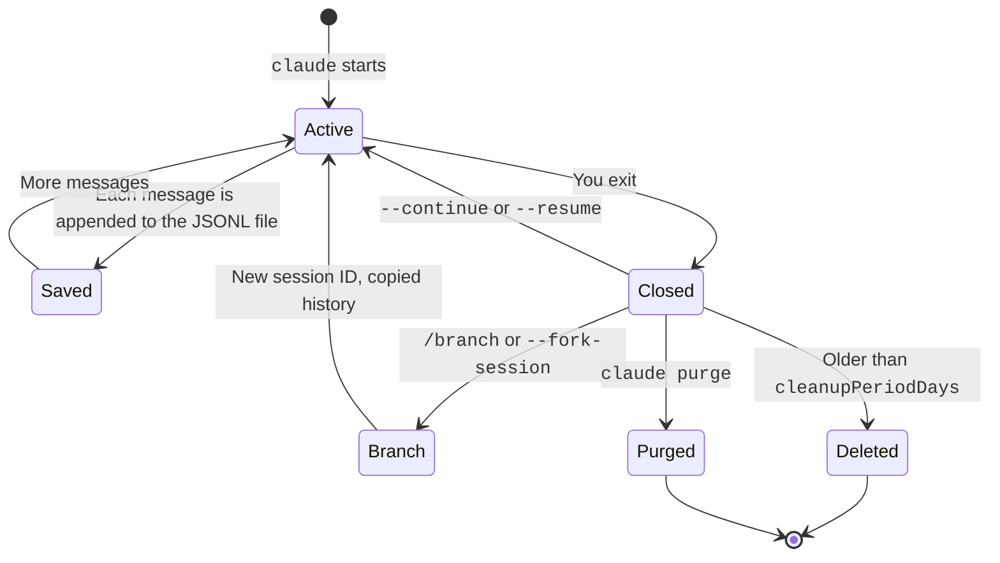

A session is one saved conversation. Claude Code writes it to a file on your disk as you work, so you can leave and come back to continue. You can also branch the conversation to try another path.

Use the flags to resume or branch a session. Set `cleanupPeriodDays` to choose how long Claude Code keeps the files, or `CLAUDE_CODE_SKIP_PROMPT_HISTORY` to write none. The line format is on the [Transcript Format](../reference/transcript-format.md) page.

## Example

You close the terminal in the middle of a task. The next day you run `claude --continue` in the same folder. The conversation, the model, and the permission mode come back.

```bash
claude --continue
claude --resume my-feature --fork-session
claude purge --dry-run
```

## The Life of a Session



## Resume and Branch

See [Manage Sessions](https://code.claude.com/docs/en/sessions).

| Item | Status | What it does |
| --- | --- | --- |
| `claude --continue`, `-c` | <Documented /> | Reopens the newest session of the current folder. |
| `claude --resume [value]`, `-r` | <Documented /> | Opens the picker, or resumes by session ID, name, or transcript path. |
| `claude --from-pr [value]` | <Documented /> | Opens a picker with the sessions that link to a pull request. |
| `claude --fork-session` | <Documented /> | With `--resume` or `--continue`, copies the history to a new session ID. |
| `/branch [name]` | <Documented /> | Copies the conversation and switches to the copy. The "allow for this session" grants carry over. |
| `--session-id <uuid>` | <Documented /> | Uses a UUID that you give for a new session. |
| `-n`, `--name <name>` | <Documented /> | Names the session in the picker and the terminal title. |
| `--no-session-persistence` | <Documented /> | Writes nothing. Print mode only. |
| `--resume-session-at <message id>` | <Undocumented /> | A hidden flag that resumes only up to one message. |
| `--reply-on-resume` | <Undocumented /> | A hidden flag that asks the model to reply at once when the transcript ends with a user message. |
| `--rewind-files <user-message-id>` | <Undocumented /> | A hidden flag that restores the files to the state at a message. Then Claude Code exits. It needs `--resume`. |
| `claude attach`, `logs`, `stop`, `rm`, `respawn` | <Documented /> | Control background sessions. |
| `CLAUDE_CODE_RESUME_INTERRUPTED_TURN` | <Documented /> | Resumes a turn that a crash cut off. |

A resumed session restores the history, the model, the agent, the permission mode, an active goal, and scheduled tasks. It does not restore the values of `--mcp-config`, `--settings`, `--plugin-dir`, `--fallback-model`, or `--add-dir`. Pass them again.

After a compaction, a resume does not load the lines before the last `compact_boundary` line, unless that line lists kept messages in `preservedSegment` or `preservedMessages`. Then the loader also loads those messages. A missing kept message makes the load abort. See [Compaction Rows](../reference/transcript-format.md#compaction-rows).

If you resume one session in two terminals, the messages mix in one transcript.

## Where Files Live

See [Explore the .claude Directory: Application Data](https://code.claude.com/docs/en/claude-directory#application-data). `CLAUDE_CONFIG_DIR` moves `~/.claude`. The `<project>` name is the folder path with every character other than a letter or a digit changed to `-`. Claude Code cuts a name over 200 characters and adds a hash. `CLAUDE_CODE_PROJECT_DIR_NAME` sets the name by hand. It needs `CLAUDE_CONFIG_DIR`.

<FileTree>

- `~/.claude/`
  - `projects/`
    - `<project>/`
      - `<session>.jsonl` transcript
      - `<session>.orphaned-<time>-<id>.jsonl` set aside, not in the picker
      - `<session>.jsonl.superseded-<time>` set aside, not in the picker
      - `<session>/`
        - `subagents/` subagent transcripts
        - `tool-results/` large tool outputs and MCP images
      - `memory/` auto memory (never cleaned)
  - `file-history/<session>/` snapshots before edits
  - `plans/`
  - `debug/`
  - `paste-cache/`
  - `uploads/<session>/`
  - `dev-mods/<session>/`
  - `session-env/`
  - `tasks/`
  - `shell-snapshots/`
  - `backups/` keeps 5 copies of `~/.claude.json`
  - `sessions/` one small file per running session
  - `history.jsonl` every prompt you typed
  - `stats-cache.json`
  - `remote-settings.json`
  - `policy-limits.json`
  - `cache/`
    - `changelog.md`
  - `.credentials.json`
  - `agent-memory/`
  - `jobs/`
  - `daemon/`
  - `settings.json`
  - `plugins/`
  - `skills/`
  - `agents/`
  - `CLAUDE.md`

</FileTree>

The last column shows whether Claude Code deletes the item after `cleanupPeriodDays`.

| Path under `~/.claude/` | Status | Content | Cleaned |
| --- | --- | --- | --- |
| `projects/<project>/<session>.jsonl` | <Documented /> | The transcript. | ✅ |
| `projects/<project>/<session>/subagents/` | <Documented /> | The transcripts of subagents. | ✅ |
| `projects/<project>/<session>/tool-results/` | <Documented /> | Large tool outputs and MCP images. | ✅ |
| `projects/<project>/memory/` | <Documented /> | Auto memory. | ❌ |
| `*.orphaned-<time>-<id>.jsonl`, `*.jsonl.superseded-<time>` | <Documented /> | Transcripts that Claude Code set aside. | ✅ |
| `file-history/<session>/` | <Documented /> | Snapshots from before edits, with the 100 newest checkpoints. | ✅ |
| `plans/`, `debug/`, `paste-cache/`, `uploads/<session>/`, `dev-mods/<session>/`, `session-env/` | <Documented /> | Plan files, debug logs, pastes, uploads, mods that Claude wrote, and session data. | ✅ |
| `tasks/`, `shell-snapshots/`, `backups/` | <Documented /> | Task lists, shell setup, and copies of `~/.claude.json` (Claude Code keeps 5). | ✅ |
| `sessions/` | <Documented /> | One small file for each running session, deleted at exit. | ❌ |
| `history.jsonl` | <Documented /> | Every prompt you typed. It leaves out most launch prompts of sessions that another Claude Code session started, such as `claude --bg` run by Claude.[^history-launch] | ❌ |
| `stats-cache.json`, `remote-settings.json`, `policy-limits.json`, `cache/changelog.md` | <Documented /> | Usage totals, cached organization settings, organization limits, and the [changelog](https://code.claude.com/docs/en/changelog). | ❌ |
| `.credentials.json`, `agent-memory/`, `jobs/`, `daemon/` | <Documented /> | Files that you should keep. | ❌ |
| `settings.json`, `plugins/`, `skills/`, `agents/`, `CLAUDE.md` | <Documented /> | Your configuration. | ❌ |
| `state/` | <Undocumented /> | Holds `settings-review.json`, the staged settings changes that you review with `/settings-review`. Each entry has the file path, hashes, the proposed content, and the tool and session that staged it. It also holds `unattended-serving-consent.json`. A write there by Claude is denied with the text "Staged Claude Code settings changes". The retention sweep drops staged entries and `unattended-serving-runs` files older than `cleanupPeriodDays`. | ✅ |
| `seed-admin/` | <Undocumented /> | The root for temp folders `claude-seed-admin-<pid>-...` (mode 0700). They hold the private git directories of cloud-session uploads. Its own sweep removes folders older than one hour, not `cleanupPeriodDays`. Claude cannot write there. It is refused inside a git work tree. | ❌ |
| `bridge-spawn/` | <Undocumented /> | The root folder (mode 0700) for sessions started over the bridge. Its own cleanup removes entries older than one day, not `cleanupPeriodDays`. The sandbox rules allow it. | ❌ |
| `child-logs/` | <Undocumented /> | The debug logs of sessions started over Remote Control with `--verbose` go here (mode 0700). Claude Code does not write them when you set `--debug-file`. If it cannot use the folder, it shows `Session debug logs are off: <reason>`.[^child-logs] | ❌ |
| `cache/model-catalog/` | <Undocumented /> | `masked-ids.json` is a saved list of model IDs (version 1, at most 131072 bytes) that the served model catalog masks. Claude Code reads it at startup. It keeps a file it cannot parse as `masked-ids.unparseable.json`.[^model-catalog] The folder also holds cached catalog `.json` files. The retention sweep removes those after `cleanupPeriodDays`. It keeps `masked-ids.json` and the floor marks file. | ✅ |
| `mods/`, `downloads/` | <Undocumented /> | Claude Code has no `mods/` path in the config folder (it uses `dev-mods/`, listed above). `mods` is the name of the mod folder inside a plugin. `downloads/` is only in the list of known folders. No code writes it.[^mods-downloads] The retention sweep does not touch either name. | ❌ |

`~/.claude.json`, next to the folder, holds app state, the sign-in, and personal MCP servers.
The default retention is 30 days, and the minimum is 1.

The scratchpad of a session is in the temp folder (`/private/tmp/claude-<uid>/<project>/<session-id>/scratchpad/` on macOS). `claude purge` does not touch it.

:::warning
The files are plain text and are not encrypted. A secret that a tool prints goes into the transcript. To limit this, lower `cleanupPeriodDays` or set `CLAUDE_CODE_SKIP_PROMPT_HISTORY`.
:::

## Controls

| Item | Status | Effect |
| --- | --- | --- |
| `cleanupPeriodDays`, `desktopSessionCleanupPeriodDays` | <Documented /> | Set how long Claude Code keeps files. |
| `CLAUDE_CODE_SKIP_PROMPT_HISTORY` | <Documented /> | Writes no transcript and no history in any mode. |
| `CLAUDE_CODE_TRANSCRIPT_LOCAL_GC` | <Documented /> | Limits the transcript size of `-p` and SDK sessions. |
| `CLAUDE_CONFIG_DIR` | <Documented /> | Moves `~/.claude` to another folder. |
| `CLAUDE_CODE_PROJECT_DIR_NAME` | <Documented /> | Sets the `<project>` folder name by hand. Needs `CLAUDE_CONFIG_DIR`. |
| `claude purge [path]` | <Documented /> | Deletes the transcripts, tasks, file history, and config entry of a project. Flags: `--all`, `--dry-run`, `-i`, `-y`. |
| `/export` | <Documented /> | Exports a conversation. Use it, not the JSONL file, for scripts. |

## Errors

Each row is a family of messages. The backticked text is the start that every message in the family shares. A row marked `Various` gathers the messages of one feature that do not share one start.

| Start of Message | Status | What It Means | Cases |
| --- | --- | --- | --- |
| Various | <Undocumented /> | Self-hosted runner and orchestrator: A self-hosted runner or orchestrator flag, environment value, or hook was refused. | A flag or `SELF_HOSTED_RUNNER_*` variable is out of range or not one of the listed values. A flag was renamed. The command takes no positional argument and fails with `unexpected argument '<arg>' — this command takes no positional arguments`.[^unexpected-arg] `--configure-git` could not prepare its artifacts. A hook is missing or not executable. A proxy authorization source is empty, too long, or unreadable. The environment secret is missing. |
| Various | <Undocumented /> | Remote Control and cloud sessions: Remote Control, a cloud session, or `--teleport` failed or was refused. | The user is not signed in with claude.ai. The policy `disableRemoteControl` is set. The base URL uses HTTP. A cloud session reached its timeout, waits for input that nothing here can give, or lost its connection. `claude --teleport` was run from the wrong checkout. `claude --teleport` did not check out the cloud session's branch because the sandbox may be on in the folder: the text names the two `git` commands to run in your own terminal, and ends `The prompt was not run. Run the same claude command again after switching.`[^teleport-sandbox] |
| Various | <Undocumented /> | Transcripts and storage: A transcript, session record, or storage backend could not be read or written. | A transcript file is too large, is not valid JSON, or holds no messages. A diskless session has no file to write to. A storage read, write, stat, or delete failed. |
| Various | <Undocumented /> | Resume under an organization: A session that records an organization (`hybridOrganizationUuid`) was not resumed. | The refusal names the organization and says why. It can say that the conversation `ran under more than one organization`, so Claude Code does not resume it under any of them.[^resume-org-many] It can say that you are signed in to that organization now, but earlier in this session you were signed in to a different one, so parts of the connection to the other organization's cloud provider can stay until Claude Code starts again.[^resume-org-prior] It can say that this computer has its own managed settings, and `they take priority over that organization's settings`.[^resume-org-managed] It can say that the session `runs through` a gateway and does not use that organization's settings, so you start a new conversation.[^resume-org-gateway] It can say that you are signed in to that organization but the session `does not use that organization's settings`, and name `--bare`, a gateway, or Claude Desktop as causes.[^resume-org-notused] Otherwise it says the session `does not run under that organization` and asks you to sign in to it.[^resume-org-other] A resume from a URL under an organization sign-in stops with `did not resume the session from a URL`, because it would upload the new content of the session to that URL.[^resume-org-url] |
| Various | <Undocumented /> | Worktree: a worktree was not removed or not created. | `ExitWorktree` found work at removal, files saved from connectors, a running task, or another Claude Code session in the worktree (`Worktree not removed`). The session-exit dialog keeps the worktree for the same reason (`Worktree kept at`). Worktree mode has no git repository, no `WorktreeCreate` hook, or a mod that is not loaded. A worktree name is another worktree's or branch's. A worktree name starts with a dash while a mod hooks `vcs.isolate` (`A worktree name can't start with a dash. Choose a different name.`).[^worktree-dash] A runner refuses an unsafe repository URL for a checkout hook (`[runner:session] refusing to pass unsafe repo URL`).[^worktree-errors] |

A transcript write that fails can leave a partial last line. Claude Code then marks the file and writes a newline before the next append, so the next record does not join the partial line. When Claude Code re-appends session metadata and finds a transcript whose last byte is not a newline, it marks the file the same way when the caller asks for it.[^seal]

## Related Pages

- [Transcript Format](../reference/transcript-format.md)
- [Context and Compaction](context-and-compaction.md)
- [Architecture](architecture.md)
- [CLI](../configure/cli/index.md) and [Environment Variable](../configure/env-vars/index.md) pages in Configure.

## Sources

[^model-catalog]: The program, `chunk-865at33z.js:42392`.
[^mods-downloads]: The program, `chunk-bzyb60p0.js:183834` (`downloads` in the list of known folders, which has no `mods` entry).
[^unexpected-arg]: The program, `chunk-q0y1fm2x.js:16409` (`unexpected argument` and `takes no positional arguments`).
[^seal]: The program marks the file in `sealTornTailOnNextAppend` and writes the newline in `sealTornTailSync` at `chunk-bzyb60p0.js:31412`. The metadata re-append checks the last byte at `chunk-bzyb60p0.js:31703`.
[^child-logs]: The program, `chunk-jy29ybqd.js:6621` (the notice, and the skip when `--debug-file` is set or `--verbose` is not), `chunk-jy29ybqd.js:3393` (`--debug-file` with a path in the folder goes to each child session), `chunk-ha393e1n.js:28424` (the `child-logs` folder), `chunk-ha393e1n.js:28449` (`mode: 448`, which is 0700), and `chunk-ha393e1n.js:28464` (the `has unexpected owner or mode` check).
[^history-launch]: The program, `chunk-3pqaw3hv.js:115537` (`isNotSaved`): a prompt that does not come from the Enter key of the prompt box is marked not to save when the list of sessions that launched this session (`chunk-v6ez7m15.js:29`, the function `$c9ef1d`) is not empty. The `add` method at `chunk-bq31aqv6.js:2316` then skips the write (`isNotSaved`).
[^resume-org-many]: The program, `chunk-p1ewvgeh.js:6897` (the text "ran under more than one organization").
[^resume-org-prior]: The program, `chunk-p1ewvgeh.js:6905` (the text "You are signed in to that organization now").
[^resume-org-managed]: The program, `chunk-p1ewvgeh.js:6909` (the text "This computer has its own managed settings").
[^resume-org-gateway]: The program, `chunk-p1ewvgeh.js:6914` (the text "This session runs through").
[^resume-org-notused]: The program, `chunk-p1ewvgeh.js:6921` (the text "does not use that organization's settings", with `--bare` and `CLAUDE_CODE_USE_GATEWAY`).
[^resume-org-other]: The program, `chunk-p1ewvgeh.js:6929` (the text "does not run under that organization"); the record is read at `chunk-p1ewvgeh.js:6889` (`hybridOrganizationUuid`).
[^resume-org-url]: The program, `chunk-a0tz781a.js:54513` (the text "did not resume the session from a URL").
[^worktree-errors]: The program, `chunk-aw5nczax.js:8077` ("Worktree not removed. The session is still in it"), `chunk-aw5nczax.js:8098` ("another Claude Code session"), `chunk-3pqaw3hv.js:119329` ("Worktree kept at"), `chunk-jy29ybqd.js:7833` ("Worktree mode needs a git repository"), `chunk-2p0e1k2g.js:857` ("is another worktree's or branch's"), `chunk-4m3xfy89.js:692` ("no WorktreeCreate hook is enabled"), and `chunk-q0y1fm2x.js:9082` ("refusing to pass unsafe repo URL").
[^worktree-dash]: The program, `chunk-p5m4fqpp.js:46` (the text) and `chunk-p5m4fqpp.js:44` (the check of the name).
[^teleport-sandbox]: The program, `chunk-bzyb60p0.js:186221` (the end of the text) and `chunk-bzyb60p0.js:186216` (the text of the branch and the two `git` commands).
