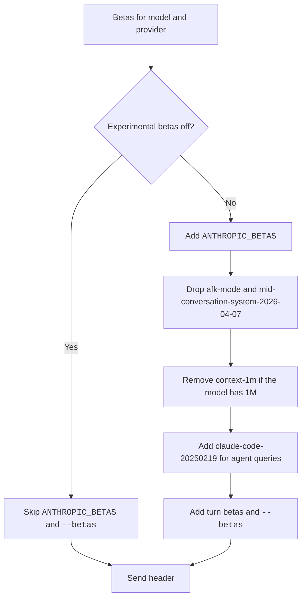

A beta is an early API feature that a request switches on with a value in the `anthropic-beta` header. Claude Code keeps a list of these values and sends the ones that fit the model and the provider. If a proxy rejects a request with a beta error, set `CLAUDE_CODE_DISABLE_EXPERIMENTAL_BETAS=1` to stop the pre-release values.

`ANTHROPIC_BETAS` adds values (comma list), and so does the `--betas` flag. `DISABLE_INTERLEAVED_THINKING` turns off one value. The betas go in the `anthropic-beta` header, or in the `betas` field of the body on Bedrock.

## Example

Add a beta by hand, then turn all experimental betas off for a proxy that rejects them.

```bash title="Betas from the shell"
# Add one value to the header
ANTHROPIC_BETAS="files-api-2025-04-14" claude -p "hi"

# Stop the experimental values (also ignores ANTHROPIC_BETAS and --betas)
CLAUDE_CODE_DISABLE_EXPERIMENTAL_BETAS=1 claude -p "hi"
```

## About the List

Claude Code joins the active values into the `anthropic-beta` header (or into the `betas` field of the body on Bedrock). A row is <Documented /> when a docs page other than the [changelog](https://code.claude.com/docs/en/changelog) and the Agent SDK pages names the value. Few values have that. See [Environment Variables](https://code.claude.com/docs/en/env-vars) for `ANTHROPIC_BETAS` and `CLAUDE_CODE_DISABLE_EXPERIMENTAL_BETAS`.[^list-source]

## How Claude Code Builds the List

Claude Code takes these steps for each request.

1. It adds the betas that fit the model and the provider.
2. It adds the values of `ANTHROPIC_BETAS`, a comma list, unless the experimental betas are off. It drops a value that has `afk-mode`, and it skips `mid-conversation-system-2026-04-07`, because that feature is generally available.
3. It removes `context-1m-2025-08-07` when the model has the 1M window already.
4. For an agent query, it adds `claude-code-20250219` if the list lacks it.
5. It adds the betas that depend on the turn, and then the values of the flag `--betas`. On a third-party provider it keeps only the allowed values of `--betas`.

`CLAUDE_CODE_DISABLE_EXPERIMENTAL_BETAS` or a HIPAA policy turns the experimental betas off. Then Claude Code ignores `ANTHROPIC_BETAS` and `--betas`, and it leaves out the betas that only the Anthropic API takes.



## Registry

The Registry Name column is the internal name of the value.[^registry]

| Header Value | Status | Registry Name | When Claude Code Sends It |
| --- | --- | --- | --- |
| `claude-code-20250219` | <Undocumented /> | `claude_code` | For every model whose name has no `haiku`, and for agent queries. |
| `oauth-2025-04-20` | <Undocumented /> | `oauth_auth` | When you sign in with a subscription (OAuth). |
| `interleaved-thinking-2025-05-14` | <Documented /> | `interleaved_thinking` | For each model except `claude-3-*`, unless `DISABLE_INTERLEAVED_THINKING` is set. The docs name it as `interleaved-thinking`. |
| `context-1m-2025-08-07` | <Undocumented /> | `long_context` | When the model name has the `[1m]` suffix, also for a model with a 1M window. Never without the suffix (see [Probes](../probes.md)). |
| `context-management-2025-06-27` | <Undocumented /> | `context_management` | On the Anthropic API, on Anthropic-run clouds, and on Foundry, for each model except `claude-3-*`. |
| `structured-outputs-2025-12-15` | <Undocumented /> | `structured_outputs` | On the Anthropic API for a model that supports it, behind an experiment. |
| `web-search-2025-03-05` | <Undocumented /> | `web_search` | On Vertex for models with web search there, and on Foundry. |
| `web-search-results-only-2026-11-15` | <Undocumented /> <Gated note="server config" /> | `web_search_results_only` | On the first-party API, for the search request that the `WebSearch` tool runs, when a server setting asks for results only and the experimental betas are on. Added in `2.1.327`.[^results-only] |
| `advanced-tool-use-2025-11-20` | <Undocumented /> | `tool_search` | With tool search, as a second header value. |
| `tool-search-tool-2025-10-19` | <Undocumented /> | `tool_search` | With tool search. On Bedrock it goes in the body instead. |
| `effort-2025-11-24` | <Undocumented /> | `effort` | No source states when it is sent. Since `2.1.310`, when the server refuses the effort setting, Claude Code sends the request again without `output_config.effort` and this beta, and leaves both out for that model until the process ends.[^effort-retry] |
| `task-budgets-2026-03-13` | <Undocumented /> | `task_budgets` | No source states when it is sent.[^listed] |
| `prompt-caching-scope-2026-01-05` | <Undocumented /> | `prompt_caching_scope` | On the Anthropic API and Anthropic-run clouds, and when MCP tools are in the tool list. Since `2.1.307` it is not sent behind a custom `ANTHROPIC_BASE_URL` gateway or on Foundry.[^v307] |
| `prompt-caching-evict-2026-05-12` | <Undocumented /> | `prompt_caching_evict` | When a message has the `evict_on_complete` cache control. |
| `cache-keepalive-2026-09-03` | <Undocumented /> | `cache_keepalive` | When the keep-alive switch is on. It needs a subscriber login (see [Probes](../probes.md)). |
| `extended-cache-ttl-2025-04-11` | <Documented /> | `extended_cache_ttl` | When the cache time is `1h` on the Anthropic API. The docs name it as `extended-cache-ttl`. |
| `fast-mode-2026-02-01` | <Undocumented /> | `speed` | On the Anthropic API, with each request that has `speed: "fast"` .[^fast-cases] A Vertex request with `speed: "fast"` does not have it. See [Fast Mode](../../configure/models-and-providers/fast-mode.md#request). |
| `redact-thinking-2026-02-12` | <Undocumented /> | `redact_thinking` | On the Anthropic API when interleaved thinking is on and the session is interactive. |
| `thinking-resumption-2026-07-17` | <Undocumented /> | `thinking_resumption` | No source states when it is sent.[^listed] |
| `resumption-2026-10-08` | <Undocumented /> <Gated note="server config" /> | `resumption` | Since `2.1.328`, on the first-party API, when a server gate is on, the session has no `CCR_SESSION_PROFILE`, and the request does not resume an incomplete thinking block.[^resumption-beta] |
| `thinking-token-count-2026-05-13` | <Undocumented /> | `thinking_token_count` | With interleaved thinking on the Anthropic API, and on Bedrock and Mantle for some models. |
| `afk-mode-2026-01-31` | <Undocumented /> | `afk_mode` | For auto mode. |
| `advisor-tool-2026-03-01` | <Undocumented /> | `advisor_tool` | No source states when it is sent.[^listed] |
| `cache-diagnosis-2026-04-07` | <Undocumented /> | `cache_diagnosis` | No source states when it is sent.[^listed] |
| `context-hint-2026-04-09` | <Undocumented /> | `context_hint` | No source states when it is sent.[^listed] |
| `mcp-servers-2025-12-04` | <Undocumented /> | `mcp_servers` | No source states when it is sent.[^listed] |
| `files-api-2025-04-14` | <Undocumented /> | `files_api` | No source states when it is sent.[^listed] |
| `environments-2025-11-01` | <Undocumented /> | `environments` | No source states when it is sent.[^listed] |
| `ccr-byoc-2025-07-29` | <Documented /> | `ccr_byoc` | No source states when it is sent. The docs name it in [Self-Hosted Environments Testing](https://code.claude.com/docs/en/self-hosted-environments-testing). |
| `per-turn-control-2026-07-01` | <Undocumented /> | `per_message_effort` | For models that take the effort with each message. |
| `timing-2026-09-09` | <Undocumented /> | `per_turn_timing` | When the time goes with each message. |
| `mid-conversation-tool-changes-2026-07-01` | <Undocumented /> | `mid_conv_tool_change` | For models that allow tool changes in the middle of a conversation. |
| `inline-tools-2026-09-15` | <Undocumented /> | `inline_tools` | With the previous value, when a second check passes. `CLAUDE_CODE_INLINE_TOOLS=1` also adds it (see [Probes](../probes.md)). |
| `server-side-fallback-2026-06-01` | <Undocumented /> | `server_side_fallback` | No source states when it is sent.[^listed] |
| `server-side-fallback-2026-07-01` | <Undocumented /> | `server_side_fallback_category` | No source states when it is sent.[^listed] |
| `fallback-credit-2026-06-01` | <Undocumented /> | `fallback_credit` | No source states when it is sent.[^listed] |
| `auto-mode-classifier-2026-07-16` | <Undocumented /> | `auto_mode_classifier` | No source states when it is sent.[^listed] |
| `dangerous-tool-use-2026-09-03` | <Undocumented /> | `dangerous_tool_use` | No source states when it is sent.[^listed] |
| `thinking-display-updates-2026-08-18` | <Undocumented /> | `thinking_display_updates` | No source states when it is sent.[^listed] |
| `thinking-binding-controls-2026-08-01` | <Undocumented /> | `thinking_binding_controls` | No source states when it is sent.[^listed] |
| `message-threads-2026-08-12` | <Undocumented /> | `message_threads` | No source states when it is sent.[^listed] |
| `mid-conversation-system-2026-04-07` | <Undocumented /> | - | Claude Code holds it as a plain constant, with no registry name. `ANTHROPIC_BETAS` skips it, because that feature is generally available. |
| `mid-conversation-system-clear-at-2026-08-21` | <Undocumented /> | `mid_conversation_system_clear_at` | For the wire shape that keeps reminders. |
| `claude-code-side-query-2026-09-29` | <Undocumented /> <Gated note="First-party base URL and experimental betas on" /> | `claude_code_side_query` | On a side query. A side query is a request with the `querySource` `generate_session_title`, `artifact_comment_reply`, `artifact_comment_triage`, `artifact_comment_analyst`, or `artifact_comment_fast_ack`. A request that sets `sendSideQueryBeta` also counts. The `hook_agent` source counts when the host flag test `g4()` is on. The provider must be the Anthropic API, the base URL must be first-party, the experimental betas must be on, `ANTHROPIC_UNIX_SOCKET` must be unset, and the list must not hold the value yet. No body field goes with it.[^side-query] |
| `program-use-case-ids-2026-09-17` | <Undocumented /> <Gated note="Server flag tengu_federated_possum and a first-party base URL" /> | `program_use_case_ids` | When a program use case ID exists and the list has no reason to skip it. The ID is the value of `CLAUDE_CODE_PROGRAM_USE_CASE_ID`. It counts only when it matches the allowed pattern, a server-side flag is on, and no host ID was refused. `CLAUDE_CODE_PROGRAM_USE_CASE_STAMPED` and `CCR_SESSION_PROFILE` change the source of the ID: a stamped value replaces the env value, and `CCR_SESSION_PROFILE` leaves no ID. The body gets the field `program_use_case_id` with the ID. The beta needs the first-party base URL and the experimental betas on.[^use-case] |
| `tool-provenance-2026-10-26` | <Undocumented /> <Gated note="Anthropic API, first-party base URL, and a sign-in that is not an API key" /> | `ccr_tool_provenance` | When the provider is the Anthropic API, the base URL is first-party, the experimental betas are on, and the key source is none or a subscription sign-in is active. It is off when `CCR_SESSION_PROFILE` is set or a login is in progress. In a remote session (`CLAUDE_CODE_REMOTE`) it also needs a server-side flag. The tool list then gets `ownership_metadata` on an MCP tool whose server is the claude.ai connector proxy, an SDK server, or an http, sse, or ws server at an Anthropic host. The value is `{verified: false, owner: "mcp"}`, and `server_url` when the address is known. A local stdio server or a local http server gets none. If the API answers 400, Claude Code drops the beta and sends the request again. If the API refuses a `server_url`, Claude Code sets the internal switch `x-cc-internal-tool-provenance-server-url` and sends the request again without addresses.[^provenance] |

The registry also holds three internal switches: `x-cc-internal-mid-conv-cache-promotion`, `x-cc-internal-mid-conv-cache-promotion-ok`, and `x-cc-internal-tool-provenance-server-url`.
They are <Undocumented />, and Claude Code does not send them as header values.

## Other Beta Values in the Program

These values belong to the embedded Anthropic SDK client or to the provider code. Claude Code does not put them in the model request. All of them are <Undocumented />.

| Value | Where It Is Used |
| --- | --- |
| `managed-agents-2026-04-01` | The endpoints `/v1/agents`, `/v1/sessions`, and `/v1/environments`. |
| `dreaming-2026-04-21` | The endpoint `/v1/dreams`. |
| `user-profiles-2026-08-18` | The endpoint `/v1/user_profiles`. |
| `agent-memory-2026-07-22` | The endpoint `/v1/memory_stores`. |
| `message-batches-2024-09-24` | The batch endpoint. |
| `token-counting-2024-11-01` | The endpoint `/v1/messages/count_tokens`. |
| `mcp-tunnels-2026-06-22` | The endpoint `/v1/tunnels`. |
| `oidc-federation-2026-04-01` | The federation endpoints. |
| `ccr-triggers-2026-01-30` | The endpoint `/v1/code/triggers`. |
| `request-tags-2026-08-21` | The `claude gateway` server only, not the client. When the admin sets `admin.billing_group_tag`, the gateway takes this value out of the `anthropic-beta` header and the `tags` field out of the body before it sends the request upstream. It logs the group of `tags` in its audit log if the bearer token lists it. The client sends no `tags` field. Without `billing_group_tag`, the upstream gets the `tags` field and the beta unchanged. On `2.1.316`, the gateway does not start with `billing_group_tag`: it exits with code 1 and prints `Unrecognized key(s) in object: 'billing_group_tag'`.[^request-tags] |
| `bedrock-2023-05-31` | The `anthropic_version` of the Bedrock body. |
| `vertex-2023-10-16` | The `anthropic_version` of the Vertex body. |

## Observed Request

A transcript of `2.1.305` records each request in an `api-request` line. In a stub run with an API key, that line held 10 betas, from `claude-code-20250219` to `thinking-display-updates-2026-08-18`. On `2.1.307` the same stub run held 9 betas. `prompt-caching-scope-2026-01-05` is gone, because the stub is a custom `ANTHROPIC_BASE_URL`.[^transcripts]

On a local machine, the `api-request` lines of `2.1.305` held 19 betas (with `claude-sonnet-5-5` and with `claude-opus-5-5`) or 20 betas (with `claude-opus-5-5` only, which added `extended-cache-ttl-2025-04-11`). The list ran from `claude-code-20250219` and `oauth-2025-04-20` to `message-threads-2026-08-12`. This is one observation, so do not read it as a rule. See [Transcript Format](../transcript-format.md).

On `2.1.306` we compared the main request (the first one with tools) of `claude -p "Reply with 'OK'."` with a subscription login (`CLAUDE_CODE_OAUTH_TOKEN`) and with a fake API key. Each side sent one `/v1/messages` request. The body had the same keys, the same tool names, and 4 system blocks. The login sent 15 betas, and the key sent 13. The two only the login sent were `oauth-2025-04-20` and `extended-cache-ttl-2025-04-11`. The default model differed: `claude-sonnet-5-5` with the login and `claude-opus-5-5` with the key. See [Probes](../probes.md#live-login-probes).

## Related Pages

- [Endpoints and Headers](endpoints.md)
- [Request and Cache](../../how-it-works/request-and-cache.md)
- [Probes](../probes.md)
- [Environment Variables](../../configure/env-vars/index.md)

## Sources

[^list-source]: The program, for the rows that the official pages do not name. The registry is at `chunk-20bv8pca.js:170038`.
[^registry]: The program, `chunk-20bv8pca.js:170038`.
[^effort-retry]: [`2.1.310` release notes](https://github.com/anthropics/claude-code/releases/tag/v2.1.310). The program, `chunk-56bhcxay.js:3400322`.
[^fast-cases]: Probe cases `print.cli322.fast-request-first-party` and `print.cli322.fast-request-first-party-off`.
[^v307]: [`2.1.307` release notes](https://github.com/anthropics/claude-code/releases/tag/v2.1.307).
[^results-only]: The program, `chunk-56bhcxay.js:3370816` (the value is added) and `chunk-r1yxtgw6.js:76550` (the `WebSearch` side query that asks for it), and the registry entry at `chunk-20bv8pca.js:169883`.
[^listed]: The program lists the value in the registry at `chunk-20bv8pca.js:170038`.
[^side-query]: The program, read site `chunk-56bhcxay.js:3370793`. The source list is `chunk-xethrx83.js:417407`. Run: the `generate_session_title` control request with a first-party stub URL sent 10 betas, and the list held the value. Without the first-party URL it sent 8, and with `CLAUDE_CODE_DISABLE_EXPERIMENTAL_BETAS=1` it sent 2. Neither list held it. Probe cases `print.api319.beta.side-query.title`, `.title-no-first-party`, `.title-experimental-off`.
[^use-case]: The program, read site `chunk-20bv8pca.js:221144`. The server flag is `tengu_federated_possum`. Run: with the first-party stub URL, `CLAUDE_CODE_PROGRAM_USE_CASE_ID=probe-use-case`, and the flag set in the cached flags, the request sent 13 betas with the value, and the body held `program_use_case_id: "probe-use-case"`. With the flag off it sent 12 betas and none of the four. Without the first-party URL it sent 9. Probe cases `print.api319.beta.use-case-id-flag`, `.use-case-id`, `.use-case-id-flag-no-first-party`.
[^provenance]: The program, read sites `chunk-xethrx83.js:527498` (the test), `chunk-4h0jyvmx.js:431125` (the body), and `chunk-56bhcxay.js:3403295` (the retry). The remote-session flag is `tengu_woven_kestrel`. Run: with a fake API key and a first-party stub URL the request sent 12 betas, none of the four, and no `ownership_metadata` (probe case `print.api319.beta.provenance.fake-key`). A run without a key exits with "Not logged in" and sends no request. With the real sign-in (token only in the child process, temporary `HOME`, probe case `live.api319.provenance`) the request sent 15 betas, and `tool-provenance-2026-10-26` was one of them. A local stdio MCP server (`live.api319.provenance-mcp`) and a local http MCP server (`live.api319.provenance-http`), both with `ENABLE_TOOL_SEARCH=false` so the tool is in the list, were listed with only `description`, `input_schema`, and `name`: the beta was sent and no tool had `ownership_metadata`. No run used a connector or an Anthropic-hosted server, so the `ownership_metadata` value is from source only.
[^request-tags]: The program, read sites `chunk-39421vhy.js:774788` and `chunk-39421vhy.js:988075`. Every `print.api319` case had a body with no `tags`. Probe cases `print.api319.gateway.request-tags-billing-group` and `print.api319.gateway.request-tags-plain` start `claude gateway --config` with a Postgres container, `cri` auth, `CLAUDE_GATEWAY_ALLOW_LOOPBACK=1`, and a stub upstream. With `admin.billing_group_tag: team`, the upstream got no `tags` field and no `request-tags-2026-08-21` in `anthropic-beta` (the other betas stayed). The audit log showed `billing_group` when the bearer token listed the group and `billing_group_ignored: true` when it did not (the same strip happened for another tag name and for a request with no `tags`).
[^transcripts]: Probe case `print.transcripts.lines`.
[^resumption-beta]: The program, `chunk-20bv8pca.js:8378` (the value), `chunk-56bhcxay.js:162734-162743` (the checks), and `chunk-56bhcxay.js:172329-172333` (the header).
