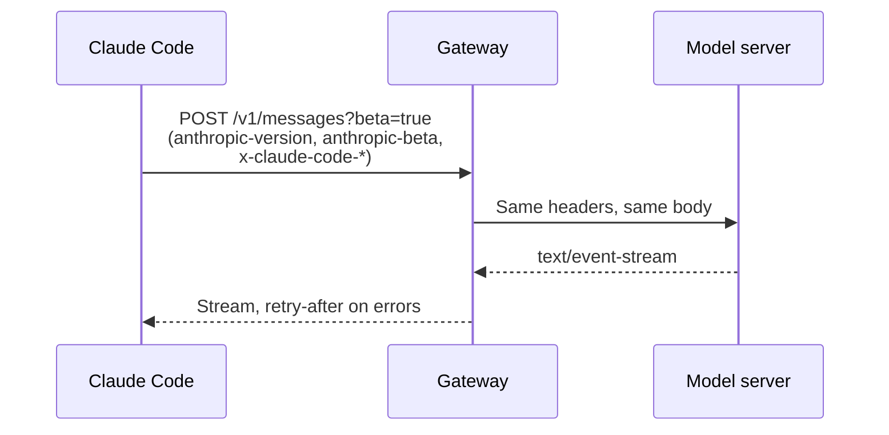

An endpoint is a URL path on a server, and a header is a named value that a request carries.
Claude Code calls the model server and a few account servers, and it adds headers to each request.
If you run Claude Code behind a proxy, the proxy must pass `anthropic-version` and `anthropic-beta` on without a change.

Base URL variables pick the server, and `ANTHROPIC_CUSTOM_HEADERS` adds headers. The switches are `CLAUDE_CODE_GATEWAY_HINT_HEADERS`, `CLAUDE_CODE_ATTRIBUTION_HEADER=0`, and `CLAUDE_CODE_ENABLE_GATEWAY_MODEL_DISCOVERY=1`. The model list is cached in `~/.claude/cache/gateway-models.json`.

## Model Endpoints

Source: [Gateway Compatibility Guide](https://code.claude.com/docs/en/llm-gateway-protocol), and [Probes](../probes.md) for `cache_touch`.

| Path | Status | What It Does |
| --- | --- | --- |
| `/v1/messages?beta=true` | <Documented /> | Sends the model request. |
| `/v1/messages/count_tokens` | <Documented /> | Counts tokens. Without it, Claude Code estimates from the number of characters. |
| `/v1/messages/cache_touch` | <Undocumented /> | Claude Code calls it every 30 seconds (10 to 120) to keep the prompt cache warm. It needs a subscriber login and the `cache-keepalive-2026-09-03` beta. |
| `/v1/models` | <Documented /> | Lists the models for the `/model` picker, only with `CLAUDE_CODE_ENABLE_GATEWAY_MODEL_DISCOVERY=1`. |
| `HEAD /api/hello` | <Documented /> | Warms up the connection. Claude Code skips it when an HTTP proxy or a client certificate is set. |
| `/model/{model}/invoke` and `/model/{model}/invoke-with-response-stream` | <Documented /> | The Amazon Bedrock format, chosen with `ANTHROPIC_BEDROCK_BASE_URL`. |
| `:rawPredict` and `:streamRawPredict` | <Documented /> | The Google Cloud Agent Platform format, chosen with `ANTHROPIC_VERTEX_BASE_URL`. |

## Account and Service Endpoints

These paths are strings in the program. The docs do not describe them, except the OpenTelemetry row.
The Use column comes from the code that calls each path.

| Path | Status | Use |
| --- | --- | --- |
| `/v1/oauth/token`, `/api/oauth/profile`, `/api/oauth/usage`, `/api/oauth/account/settings` | <Undocumented /> | `/v1/oauth/token` is the OAuth token URL. `/api/oauth/profile` returns the sign-in profile and organization. `/api/oauth/usage` returns plan usage (the `/usage` data). `/api/oauth/account/settings` is read and patched for the `grove_enabled` choice and for artifact pins. |
| `/api/oauth/account/settings?opt_in_only_if_unset=grove_enabled` | <Undocumented /> | The program sends a `PATCH` with the body `{ "grove_enabled": true }` when you accept the opt-in in the Grove notice. It reads `grove_enabled` back from the reply when that value is a boolean. The program does not state what the query parameter does. |
| `/api/claude_code/policy_limits` | <Undocumented /> | The limits of your organization, cached in `policy-limits.json`. |
| `/api/claude_code/organizations/metrics_enabled`, `/api/claude_code/notification/preferences`, `/api/claude_code/skills` | <Undocumented /> | The metrics opt-out check (`metrics_logging_enabled`), the notification preferences, and the skill health data, which is fetched only when the server flag `tengu_skills_dashboard_enabled` is on. |
| `/api/event_logging/v2/batch` | <Undocumented /> | Event logging by Anthropic. |
| `/v1/metrics`, `/v1/logs`, `/v1/traces` | <Documented /> | OpenTelemetry export. See [Monitoring](https://code.claude.com/docs/en/monitoring-usage). |
| `/api/claude_cli_feedback`, `/api/claude_code_shared_session_transcripts` | <Undocumented /> | Feedback and shared transcripts. |
| `/v1/code/sessions`, `/v1/code/triggers`, `/v1/code/github/*`, `/v1/code/agent-proxy` | <Undocumented /> | Cloud sessions, routines (`/v1/code/triggers`), GitHub pull request and review comment helpers, and the relay that the agent proxy uses. |
| `/v1/code` | <Undocumented /> | The bare prefix in the list of paths that the agent proxy relays. A path is relayed when it is this prefix or below it. The other entries are `/v1/sessions`, `/api/organizations/:orgUUID/claude_code/onboarding`, `/api/organizations/:orgUUID/cowork/remote_devices`, and `/api/organizations/:orgUUID/dust/generate_title_and_branch`. Read site: `chunk-yqezv9gr.js@859645`. The program holds the list and does not call the bare prefix. |
| `/v1/organizations/analytics/cost` | <Undocumented /> | A route of the `claude gateway` admin API, not a path that the client calls. `GET` only, with an admin credential in `x-api-key`. It reads past spend for a date range in total, per developer, per day, or per IdP group ([v2.1.317 release](https://github.com/anthropics/claude-code/releases/tag/v2.1.317)). `starting_at` is required (RFC 3339 with an offset). `ending_at` defaults to now, and the range is at most 31 days. `time_bucket_width` takes `1d` and needs `ending_at`. `group_by[]` takes `actor` or `rbac_group_id`. `actor_ids[]` and `rbac_group_ids[]` take at most 100 values each. `actor_types[]` takes `user_actor`. `exclude_deleted_users` needs `group_by[]=actor`. `order_by` takes `amount`, `list_amount`, or `time`. `order` takes `asc` or `desc` (default `desc`). `limit` is 1 to 1000 (default 20). `page` is a token, and the route refuses it for a range that includes today or ended less than 5 minutes ago. Read sites: `chunk-95zy4jce.js@1461291` (the route) and `chunk-95zy4jce.js@1445571` (the handler). The gateway needs a `listen` object and a Postgres store. Run: the cases `print.api319.gateway.cost-route-admin`, `print.api319.gateway.cost-route-no-key` and `print.api319.gateway.no-postgres` start the gateway with a Postgres container (none for the last). `GET /v1/organizations/analytics/cost?starting_at=…&ending_at=…&time_bucket_width=1d` and an admin read key in `x-api-key` answered 200 with `{"data":[],"has_more":false,"next_page":null,"data_refreshed_at":…}`. Without the key it answered 401 "missing or invalid admin credentials". Without a reachable Postgres the gateway exits with code 1 and a "could not connect to Postgres" message, and never listens, so the route never starts. |
| `/v1/me` | <Undocumented /> | The API auth warm. The program sends `GET /v1/me` with a 3000 ms limit (`auth warm timed out`) to refresh the credential cache before a model call. It runs only for a first-party host that is not in gateway mode, when the credential lifetime is known (120000 ms for the `remote_cowork` entrypoint with `CLAUDE_CODE_REMOTE` on, or the tenant lifetime), and when the policy gate `allow_api_auth_warm` is not denied (HIPAA denies it). The triggers are `turn_start`, `lapse_timer`, and `owner_present`. A fresh full check inside the lifetime skips it, and a failure pauses it for 60000 ms. Code: `chunk-7nmpvy5x.js@35626`. The program also turns it off when `CLAUDE_CODE_DISABLE_NONESSENTIAL_TRAFFIC` is set (`DISABLE_TELEMETRY` and `DO_NOT_TRACK` do not turn it off) and when there is no claude.ai login with the right scopes. Run: with the real sign-in in a temporary `HOME`, `CLAUDE_CODE_REMOTE=1`, `CLAUDE_CODE_ENTRYPOINT=remote_cowork`, `DISABLE_TELEMETRY=1`, and `CLAUDE_CODE_DISABLE_NONESSENTIAL_TRAFFIC` unset, one `-p` turn sent `GET /v1/me` (answer 404, which the program counts as a passed check) before `POST /v1/messages` (case `live.api319.auth-warm`). With `CLAUDE_CODE_DISABLE_NONESSENTIAL_TRAFFIC=1`, the same run sent no `/v1/me`. |
| `/v1/ultrareview/quota`, `/v1/ultrareview/preflight` | <Undocumented /> | The quota check and the preflight check for an ultrareview cloud run. |
| `/api/model_selector/{id}`, `/api/organization/claude_code_first_token_date` | <Undocumented /> | Model picker data, and a one-time fetch of the date of first use that is kept as `claudeCodeFirstTokenDate`. |
| `/api/ws/speech_to_text/voice_stream` | <Undocumented /> | Voice dictation. |
| `/api/frame/*`, `/v1/design/*` | <Undocumented /> | Artifact frames (`/api/frame/*`, through the agent proxy) and Claude Design MCP servers (`/v1/design/*`). |

The program also holds an Anthropic SDK client with paths such as `/v1/agents`, `/v1/skills`, `/v1/vaults`, and `/v1/organizations/*`.
They belong to the SDK code, and the Claude Code loop does not call them.
The program names these hosts: `code.claude.com`, `claude.ai`, `claude.com`, `api.anthropic.com`, `platform.claude.com`, `www.anthropic.com`, `support.claude.com`, `downloads.claude.ai`, and `mcp-proxy.anthropic.com`.

## Self-Hosted Runner Paths

`claude self-hosted-runner` calls these paths under `/v1/code/runners/self-hosted/` and `/v1/code/auth/refresh`.
The Use column comes from the code of the program and from stub runs with the release probe (`env319b.runner.*` and `env319b.orchestrator.*`).
Each log line quoted here comes from the debug log of that run.

| Path | Status | Use |
| --- | --- | --- |
| `runners/register` | <Undocumented /> | The runner starts here. The reply holds the runner ID (the run used `runner-probe`). Run `env319b.runner.base` made this the first call. |
| `runners/{id}/poll` | <Undocumented /> | The runner polls for work orders. The log shows `PollWork -> 200 assignments=1`. Each order starts one session. A second poll that returns the same order logs `Ignoring duplicate assignment`. |
| `sessions/{id}/release` | <Undocumented /> | The runner gives a session slot back with an empty `POST` body and a 15 s limit. The log shows `ReleaseSession -> 200 released=true`. The triggers are `--release-idle-session-min` (no user input for that many minutes), `--retire-at <epoch-seconds>`, and the stop drain. Run `env319b.runner.retire-at` with `--retire-at` 7 s ahead: the child got `SIGTERM`, then `release`, then `deregister reason=retire_at`. |
| `sessions/{id}/report-failure` | <Undocumented /> | Reports a failed session. The body is `{reason, setup_failure_kind?, failure_kind?}`, with a 15 s limit. Run `env319b.runner.child-exits-1` (the child exits with 1) logged `reason=child exited 1: cause=SESSION_FAILURE_KIND_RUNNER_CRASH` and `ReportSessionFailure -> 200 excluded_count=0 stuck=false`. Run `env319b.runner.child-exits-0` made no call. |
| `deregister` | <Undocumented /> | The runner leaves the pool when it exits. The body has an optional `reason` and `drain_hold`, with a 10 s limit. The log shows `DeregisterRunner -> 200`. The `--retire-at` run sent `reason=retire_at`. |
| `spawn-hints/poll` | <Undocumented /> | Orchestrator mode polls for spawn hints. The log shows `dispatching 1 hint(s)`, then the spawn-runner hook runs with `CLAUDE_RUNNER_SPAWN_REASON` set. Run `env319b.orchestrator.reason-set` used only this path. |
| `spawn-hints/nack` | <Undocumented /> | Orchestrator mode sends a refusal for a hint, with the failure cause and the error cut to 512 characters. It fires when the spawn-runner hook exits with a non-zero code, times out, or is stopped by the shutdown drain. It also fires when the server returns more hints than the limit. Run `env319b.orchestrator.hook-fails` (the hook printed `boom` and exited 1) logged `POST .../spawn-hints/nack ... retryable=true cause=SESSION_FAILURE_KIND_SPAWN_HOOK_ERROR`. |
| `/v1/code/auth/refresh` | <Undocumented /> | Swaps the runner token (or a session token) for a new one before it expires. It is a `POST` with an empty body, the old token as bearer, and a 15 s limit. The reply needs a `token` field. Without it the program throws `RefreshToken: response missing token`. Run `env319b.runner.token-ttl-8` (a runner token that ends after 8 s) logged `RefreshToken -> 200` and `runner_token refreshed`. |

## Sign-In and Account Paths

These paths are strings in the program. No source states their rules, so the Use column comes from the code that calls each path.
Where the code does not show the purpose, the row says so.

| Path | Status | Use |
| --- | --- | --- |
| `/api/claude_cli/bootstrap` | <Undocumented /> | A startup fetch with a 5 second timeout. Claude Code skips it on third-party providers. |
| `/api/claude_code/settings` | <Undocumented /> | The URL that the remote managed settings are read from. |
| `/api/claude_code/metrics` | <Undocumented /> | The target of the first-party metrics exporter, with a 5 second timeout. |
| `/api/claude_cli_profile` | <Undocumented /> | Reads a profile with an API key and the account UUID. |
| `/api/claude_code_grove`, `/api/oauth/account/grove_notice_viewed` | <Undocumented /> | The Grove notice. The first path returns the config with a `grove_enabled` flag. The second is named for the notice-viewed event. |
| `/api/claude_code_penguin_mode` | <Undocumented /> | The fast mode status of your organization. Claude Code emits `orgFastModeChange` when it changes. On Vertex, the program skips this check (see [Fast Mode](../../configure/models-and-providers/fast-mode.md#controls)). |
| `/api/auth/trusted_devices` | <Undocumented /> | Enrolls the device with your OAuth token. The body holds a display name such as `Claude Code on` and the host. |
| `/api/oauth/validate` | <Undocumented /> | Part of the Claude in Chrome check. The OAuth token needs a scope that this path accepts (`user:profile`, `user:office`, or `user:ccr_inference`), or Claude Code turns the feature off. |
| `/api/oauth/org` | <Undocumented /> | A `POST` with the OAuth token as bearer. The reply holds `organization_uuid`. Claude Code calls it for the managed setting `forceLoginOrgUUID`, with a 10 second timeout. It skips the call when the token has the scope `user:profile`, `user:office`, or `user:ccr_inference`, and falls back to `/api/oauth/validate`. Read sites: `chunk-yqezv9gr.js@325848` (the call) and `chunk-yqezv9gr.js@627546` (the check). Run: with the real sign-in in a temporary `HOME`, the hidden flag `--managed-settings '{"forceLoginOrgUUID":"…"}'` made the program call `POST /api/oauth/org` (answer 200) after `GET /api/claude_code/policy_limits` and `GET /api/claude_code/settings`, and exit 1 with no `/v1/messages` request (case `live.api319.org-pin`). |
| `/api/oauth/claude_cli/create_api_key`, `/api/oauth/claude_cli/roles`, `https://api.anthropic.com/api/oauth/claude_cli/create_api_key`, `https://api.anthropic.com/api/oauth/claude_cli/roles` | <Undocumented /> | The `API_KEY_URL` and `ROLES_URL` of the OAuth config. |
| `/api/oauth/organizations/${…}`, `/api/oauth/organizations/${…}/code/repos/${…}/${…}`, `/api/oauth/organizations/${…}/code/repos/resync`, `/api/oauth/organizations/${…}/sync/github/auth` | <Undocumented /> | Organization paths for the GitHub app. `/code/repos/<owner>/<repo>` checks whether the app is installed, `/code/repos/resync` asks the server to resync that status, and `/sync/github/auth` checks whether the GitHub token is synced by web setup. Other calls also use the first path as a prefix. |
| `/api/organizations/${…}/reset_rate_limits` | <Undocumented /> | Posts a rate limit reset claim for your OAuth organization. |
| `/api/oauth/file_upload`, `/api/oauth/files/${…}/content${…}` | <Undocumented /> | File upload with your OAuth token (scope `user:file_upload`), and file content. In `2.1.314` the content URL ends with `?model_copy=inference_highres` when the caller asks for the model copy of the file, and with nothing otherwise (`chunk-fnvjb5xt.js:2442`). |
| `/api/oauth/cri`, `https://api.anthropic.com/api/oauth/cri` | <Undocumented /> | The base of an issuer for `cri+jwt` tokens (ES256), with its keys at `/jwks.json` below it. No source states what it is for. |
| `/api/oauth/local_pairing` | <Undocumented /> | The issuer for local pairing. Claude Code builds `/attest` and `/jwks.json` below it. |
| `/v1/oauth/hello` | <Undocumented /> | The startup preflight checks `/api/hello` on the API host and `/v1/oauth/hello` on the OAuth host, with a 10 second timeout. |
| `/v1/code/environments/${…}/host_requests` | <Undocumented /> | A `GET` that long-polls for folder requests from claude.ai. The query is `wait_ms`, and the request limit is `wait_ms` plus 10 s. The headers are the bridge headers with `anthropic-client-feature: ccr`. The caller is the Remote Control environment code, which runs it while claude.ai browses the folders of this computer, so that it can start a session. It starts on a wake item, and it stops after a period with no requests, when folder browsing is off, or after repeated failures. The code reads `requests` from the reply, an array of objects. Each object needs `request_id` (a string that fits in a URL), `kind` (only `list_directory` is answered, others are dropped), and `path`. A status of 401, 403, 404, 410, or 429 raises an error named `PollHostRequests`. Read sites: client `chunk-h92fn9c4.js:10408`, caller `chunk-78cr37t4.js:31409`. |
| `/v1/code/environments/${…}/host_requests/${…}/result` | <Undocumented /> | A `POST` that answers one folder request, with a 10 s limit. The caller is the same listener, once for each `list_directory` request. The body is either `{ entries: [{ name, git_root }], truncated }` or `{ refusal }`, where `refusal` is `unreadable` or a code for a read error. The code reads `delivered` from the reply and counts the answer as sent only when it is `true`. A status of 401, 403, 404, 410, or 429 raises an error named `AnswerHostRequest`. Read sites: `chunk-h92fn9c4.js:10408`, `chunk-78cr37t4.js:31409`. |
| `/v1/privacy-consents/checkup` | <Undocumented /> | A `GET`, with a 10 s limit, that asks whether the account owes a privacy checkup. The caller is the privacy checkup refresh. It runs only for a claude.ai sign-in, and only when the gate `tengu_quiet_almanac` (default on) is true. The program asks again no sooner than one hour (`waitMs` is clamped to 1 hour to 7 days), and it stays quiet for 10 minutes after it showed a checkup. The reply is `{ show: false }`, or `{ show: true, checkup_id, ends_at }` where `checkup_id` matches `[a-z0-9-]{1,128}` and `ends_at` is a date with offset. A shown checkup may also carry `text` (1 to 200 characters), `url` (an `https` link, up to 300 characters), and `link_text`, and a reply may carry `next_check_after_seconds`. The program saves the answer in `privacyCheckupCache` of the global config. The same code `POST`s `…/checkup/shown` with `{ checkup_id, surface, event_id, dismissed? }` after it shows or dismisses the checkup. Read site: `chunk-9dwwt39s.js:7072` (the path is the constant at `:5167`). |

## OAuth URLs and Hosts

The URLs below are part of the production OAuth config in the program. `CLAUDE_CODE_CUSTOM_OAUTH_URL` changes them.

| URL | Status | Use |
| --- | --- | --- |
| `https://platform.claude.com/oauth/authorize` | <Undocumented /> | The Console sign-in page (`CONSOLE_AUTHORIZE_URL`). |
| `https://claude.com/cai/oauth/authorize` | <Undocumented /> | The claude.ai sign-in page (`CLAUDE_AI_AUTHORIZE_URL`). |
| `https://platform.claude.com/v1/oauth/token` | <Undocumented /> | The token URL (`TOKEN_URL`). |
| `https://platform.claude.com/oauth/code/callback` | <Undocumented /> | The redirect for the manual code flow (`MANUAL_REDIRECT_URL`). |
| `https://platform.claude.com/oauth/code/success?app=claude-code`, `https://platform.claude.com/buy_credits?returnUrl=/oauth/code/success%3Fapp%3Dclaude-code` | <Undocumented /> | The success pages (`CLAUDEAI_SUCCESS_URL` and `CONSOLE_SUCCESS_URL`) where the local callback server sends the browser. |
| `https://claude.ai/oauth/claude-code-client-metadata` | <Undocumented /> | Held next to the OAuth config. No source states its use. |
| `https://api.anthropic.com`, `https://claude.ai`, `https://mcp-proxy.anthropic.com` | <Undocumented /> | `BASE_API_URL`, `CLAUDE_AI_ORIGIN`, and `MCP_PROXY_URL`. |

## MCP Paths

| Path | Status | Use |
| --- | --- | --- |
| `/v1/mcp_servers?limit=1000` | <Undocumented /> | Lists your claude.ai MCP connectors. It needs the `user:mcp_servers` scope, and Claude Code adds `include_additional_installs=true`. |
| `/v1/mcp/{server_id}`, `/v1/toolbox/shttp/mcp/{server_id}` | <Undocumented /> | The `MCP_PROXY_PATH` on `https://mcp-proxy.anthropic.com`, and the one of the local OAuth config at `http://localhost:8205`. |
| `/api/organizations/${…}/mcp/start-auth/${…}?product_surface=${…}` | <Undocumented /> | A claude.ai URL that starts the sign-in of a connector. `product_surface` is the entrypoint, such as `cli`. |
| `/api/directory/servers?${…}`, `/api/directory/plugins` | <Undocumented /> | `servers` is read without credentials, with a 5 second timeout, in pages of 500, and Claude Code keeps the URLs of the remote servers. `plugins` is a constant, and no source states its use. |
| `/v1/pages/mcp`, `/api/artifacts/mcp`, `/v1/code/mcp/ccr-artifacts`, `/v1/code/mcp/hearthbot`, `/v1/claudeai-agents/mcp` | <Undocumented /> | Paths of built-in MCP servers that the program holds as constants. It names the servers `Claude_Pages`, `Claude_Docs`, and `claude-artifacts`. No source states the use of each path. |
| `/api/mcp/claude_ai`, `/api/cowork/widgets_mcp`, `/v1/code/mcp/cowork` | <Undocumented /> | Paths that tool provenance uses to tell an Anthropic connector from another MCP server in a remote session. `/api/mcp/claude_ai` and `/api/cowork/widgets_mcp` are the `at` paths of two built-in connectors. In a remote session, an MCP server whose URL is `https://<Anthropic host>` plus this path counts as a known connector, and then `server_url` may go into its `ownership_metadata`. `/v1/code/mcp/cowork` is the path of the cowork server, compared with the URL path without the query. The program does not call these paths itself. Read sites: `chunk-jshe6j36.js@206114` and `chunk-jshe6j36.js@208549`. In the run `print.api319.beta.provenance.fake-key` (first-party stub URL, one MCP server) the only request path was `/v1/messages?beta=true`. In the live runs `live.api319.provenance` and `live.api319.startup` (real sign-in, nonessential traffic on) the program made no call to these paths or to `/v1/code`. Startup calls were `/api/claude_code/policy_limits`, `/api/claude_code/settings`, `/api/claude_cli/bootstrap`, and `/mcp-registry/v0/servers`. |
| `https://platform.claude.com/docs/mcp` | <Undocumented /> | The `docs` HTTP MCP server of the built-in plugin `cc-plugin-claude-platform` (`chunk-9zq8jnw1.js:572`). It is for building with the Claude API. The plugin is available only when a server-side gate is on and the other checks of the program pass (`chunk-9zq8jnw1.js:548`). |
| `https://microsoft365.mcp.claude.com/mcp` | <Undocumented /> | The URL of the managed MCP preset "Microsoft 365" (name `m365`, HTTP transport). |

## Flags, Environments, and Files

| Path | Status | Use |
| --- | --- | --- |
| `/api/features/${…}`, `/api/eval/${…}`, `/api/eval-authed/${…}`, `https://api.anthropic.com/` | <Undocumented /> | The GrowthBook client that delivers the `tengu_*` gates. It reads the feature list, evaluates remotely, and evaluates with your auth headers (it falls back to `/api/eval` on an error). `${…}` is the client key, and `https://api.anthropic.com/` is the host. `DISABLE_GROWTHBOOK` turns the fetch off. |
| `/v1/environments/bridge`, `/v1/environments/bridge/${…}`, `/v1/environments/bridge/${…}/offline`, `/v1/environments/${…}/bridge/reconnect` | <Undocumented /> | The bridge client of Remote Control. `POST /v1/environments/bridge` registers the environment. The other paths are named for the environment, going offline, and reconnecting. |
| `/v1/environments/${…}/work/poll`, `/v1/environments/${…}/work/${…}/ack`, `/v1/environments/${…}/work/${…}/heartbeat`, `/v1/environments/${…}/work/${…}/stop` | <Undocumented /> | Work item calls of the same bridge client, named for polling, acknowledging, heartbeat, and stop. |
| `/v1/environment_providers`, `/v1/environment_providers/cloud/create` | <Undocumented /> | `cloud/create` posts a new cloud environment of kind `anthropic_cloud` with the description "Default - trusted network access". |
| `/v1/sessions`, `/v1/sessions/${…}`, `/v1/sessions/${…}${…}`, `/v1/sessions/${…}/archive`, `/v1/sessions/${…}/events` | <Undocumented /> | Session paths without `beta=true`. Claude Code posts events to `/v1/sessions/<id>/events`, and to `/v1/code/sessions/<id>/events` for a cloud session. |
| `/v1/files`, `/v1/files/${…}`, `/v1/files/${…}/content` | <Undocumented /> | Files API paths without `beta=true`. Both Claude Code and the SDK client hold them. |
| `/v1/filestore/fs/listDirectory`, `/v1/filestore/fs/readFile` | <Undocumented /> | File store calls. `readFile` posts a `filesystem_id` and a `path` with a JWT, and stops after 60 seconds without bytes. |
| `/v1/code/local/memory/mounts`, `/v1/code/local/memory/credential` | <Undocumented /> | Organization memory stores. The program caches the discovery answer in `org-memory-discovery.json`. |
| `/v1/code/channels` | <Undocumented /> | Creates a private Claude Project (`POST`). The body holds `name`, `icon` (`Code` by default), and the optional `color`, `topic`, `system_prompt_addendum`, `default_environment_id`. The program calls a channel a project. The `/send-to-project` command and its tools use these project routes. |
| `/v1/code/channels?${…}` | <Undocumented /> | Lists the projects that you joined (`GET`, query `scope=joined`, `limit`, and `cursor`). |
| `/v1/code/channels/${…}${…}` | <Undocumented /> | One builder for the routes of one project. The id must look like `chan_…`. With no suffix, `GET` looks up the project, and `?include_members=true` adds the members. `PATCH …/config` updates the default source URLs, and `POST …/setup-proposals` submits a setup proposal. |
| `/v1/code/channels/${…}/messages` | <Undocumented /> | Sends a message to a project (`POST`). The body holds `body`, `client_message_id`, and an optional `reply_to_message_id`. The answer holds `message_id` and `thread_root_id`. |
| `/v1/code/memory/channel/${…}/memories` | <Undocumented /> | The memory files of a project. The program lists them (`GET`, 100 for each page) and saves a new file with `POST` (it fails if the path exists). |
| `/v1/code/mcp/meta` | <Undocumented /> | A JSON-RPC `tools/call` of `send_message` with a `session_id`, a `message`, and the priority `now`. The program uses it to hand a summary to a project. |
| `/v1/filestore/fs/readFileMetadata` | <Undocumented /> | File store call. It posts a `filesystem_id` and a `path` with a JWT, and reads the `size` and `md5` of the file. The program accepts at most 65,536 bytes of answer. |

## Hosts and Downloads

| URL | Status | Use |
| --- | --- | --- |
| `https://downloads.claude.ai/claude-code-releases` | <Undocumented /> | The base URL for release downloads, next to the update errors (`update_apply_*`). |
| `https://downloads.claude.ai/claude-code-releases/plugins/claude-plugins-official` | <Undocumented /> | Where the program fetches the official plugin marketplace. It is cached under `marketplaces/claude-plugins-official/`. |
| `https://downloads.claude.ai/model-catalog/v1/catalog.json`, `https://downloads.claude.ai/model-catalog/v1/schema.json` | <Undocumented /> | The signed model catalog (the signature is a `.raw-sig.json` file, key `claude-code-release-signing-key`), and the `$schema` of its entries. |
| `https://anthropic.com/claude-code/plugin.schema.json` | <Undocumented /> | The URL of the plugin manifest schema, by its name. |
| `https://code.claude.com/docs/en/claude_code_docs_map.md`, `https://platform.claude.com/llms.txt`, `https://claude.com/docs/llms.txt`, `https://claude.com/docs/claude-tag/overview.md` | <Undocumented /> | Doc sources that the program holds next to the `claude-code-guide` agent. |
| `https://status.claude.com` | <Undocumented /> | Named next to the "Repeated 529 Overloaded errors" message. |
| `https://preview.claude.ai` | <Undocumented /> | A host that the program accepts for a Claude Project link, in place of `https://claude.ai`, when the claude.ai origin is the staging one. It also names the host in the hint that tells the model to read artifact links with the Artifact tool. |

## Request Headers

Source: [Gateway Compatibility Guide](https://code.claude.com/docs/en/llm-gateway-protocol#request-headers). Header names are not case-sensitive.

| Header | Status | Meaning |
| --- | --- | --- |
| `Authorization`, `x-api-key` | <Documented /> | The credential. |
| `anthropic-version` | <Documented /> | The API version, `2023-06-01`. |
| `anthropic-beta` | <Documented /> | The list of beta values. See [Betas](betas.md). |
| `x-claude-code-session-id` | <Documented /> | One value for each session. |
| `x-claude-code-agent-id`, `x-claude-code-parent-agent-id` | <Documented /> | The subagent that sent the request, and its parent. |
| `x-claude-code-request-class` | <Documented /> | The kind of request: `main`, `subagent`, `workflow`, `compaction`, or `auxiliary`. |
| `x-claude-code-agent-type` | <Documented /> | The kind of agent: `Explore`, `Plan`, `general-purpose`, `custom`, `teammate`, or `fork`. |
| `x-claude-code-compaction`, `x-claude-code-context-compacted` | <Documented /> | Marks a compaction request, and the first request after one. |
| `x-claude-code-prev-tool-durations` | <Documented /> | The run time of the last tool batch, such as `Bash=742;Read=9`, with at most 32 entries and 4 KB. |
| `x-claude-code-prompt-id` | <Documented /> | A random UUID for the user prompt, from `2.1.283`. |
| `anthropic-workspace-id` | <Documented /> | Needed on Claude Platform on AWS. |
| `ANTHROPIC_CUSTOM_HEADERS` | <Documented /> | An env var for extra headers, one `Name: value` on each line. It is not a header itself. |
| `x-app`, `anthropic-client-platform`, `X-Stainless-*`, `X-Trusted-Device-Token`, `x-organization-uuid` | <Undocumented /> | Names in the program. No source states their rules. |

The hint headers (`x-claude-code-request-class` and the next four rows) go out on a direct connection to the Anthropic API.
On a custom base URL they need `CLAUDE_CODE_GATEWAY_HINT_HEADERS=1`. Setting it to `0` stops them everywhere.

## Response Headers Claude Code Reads

| Header | Status | Use |
| --- | --- | --- |
| `retry-after` | <Documented /> | A number of seconds. A value above 60 stops the retries unless `CLAUDE_CODE_RETRY_WATCHDOG` is set. |
| `x-should-retry` | <Documented /> | `true` or `false`. It is one input to the retry decision. |
| `anthropic-ratelimit-unified-*` | <Documented /> | Plan usage and limits for `claude.ai` sign-ins. |
| `content-type` | <Documented /> | `text/event-stream`, or `application/vnd.amazon.eventstream` on Bedrock. |

## Attribution Block

The first block of `system` is a text line that starts with `x-anthropic-billing-header:`.
The docs say the block holds the client version and a fingerprint of the conversation ([Gateway Compatibility Guide](https://code.claude.com/docs/en/llm-gateway-protocol#system-prompt-attribution-block)).
The field names below come from the program.

| Field | Status | Meaning |
| --- | --- | --- |
| `cc_version` | <Undocumented /> | The client version. |
| `cc_entrypoint` | <Undocumented /> | Where Claude Code runs, such as `cli`, `sdk-cli`, or `claude-vscode`. |
| `cc_workload`, `cc_is_subagent` | <Undocumented /> | The workload tag (`--workload`), and a flag for subagents. |
| `cc_prev_req`, `cc_prompt_id`, `cc_turn_origin`, `cc_prompt_index`, `cc_turn_index` | <Undocumented /> | Request and turn tracking, only on the Anthropic API. |
| `cc_gateway`, `cc_project`, `cc_project_src` | <Undocumented /> | Tags for the gateway and the project. |

`CLAUDE_CODE_ATTRIBUTION_HEADER=0` removes the block.
The `api.anthropic.com` server strips it when it is the first and only block of its entry.

## Example

Keep the hint headers on a custom gateway and read them there.

```bash title="Send hint headers to a gateway"
export ANTHROPIC_BASE_URL=https://gateway.example.com
export CLAUDE_CODE_GATEWAY_HINT_HEADERS=1
claude -p "hi"
```

The gateway then sees `x-claude-code-request-class: main` and the other hint headers on each request.

## How It Works



## Related Pages

- [Betas](betas.md)
- [Request and Cache](../../how-it-works/request-and-cache.md)
- [Environment Variables](../../configure/env-vars/index.md)
- [Gateway Compatibility Guide](https://code.claude.com/docs/en/llm-gateway-protocol)
