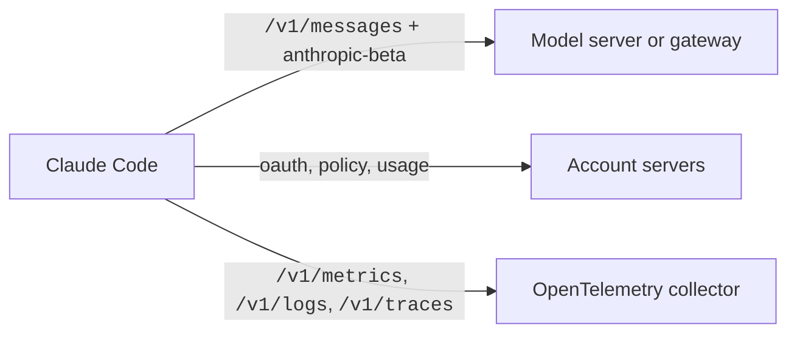

Claude Code is a client of the Messages API. It sends model requests, counts tokens, and calls a few account and service servers. Each request carries headers and a list of beta values. These pages list them all.

If you run Claude Code behind a gateway or proxy, read these pages first. The gateway must pass some headers on without a change. Set `ANTHROPIC_BASE_URL` to send requests to your gateway.

## Pages

| Page | What It Covers |
| --- | --- |
| [Endpoints and Headers](endpoints.md) | Model and service paths, request and response headers, the attribution block |
| [Betas](betas.md) | Every `anthropic-beta` value, when it is sent, and how the list is built |

## Example

Send Claude Code through a gateway and pass an extra header.

```bash title="Use a gateway"
export ANTHROPIC_BASE_URL=https://gateway.example.com
export ANTHROPIC_CUSTOM_HEADERS=$'X-Team: docs\nX-Env: staging'
claude
```

## How It Works



## Related Pages

- [Gateway Compatibility Guide](https://code.claude.com/docs/en/llm-gateway-protocol) is the official page for the model server contract.
- [Request and Cache](../../how-it-works/request-and-cache.md)
- [Models and Providers](../../configure/models-and-providers/index.md)
- [Network and Proxy Variables](../../configure/env-vars/network-and-proxy.md)
