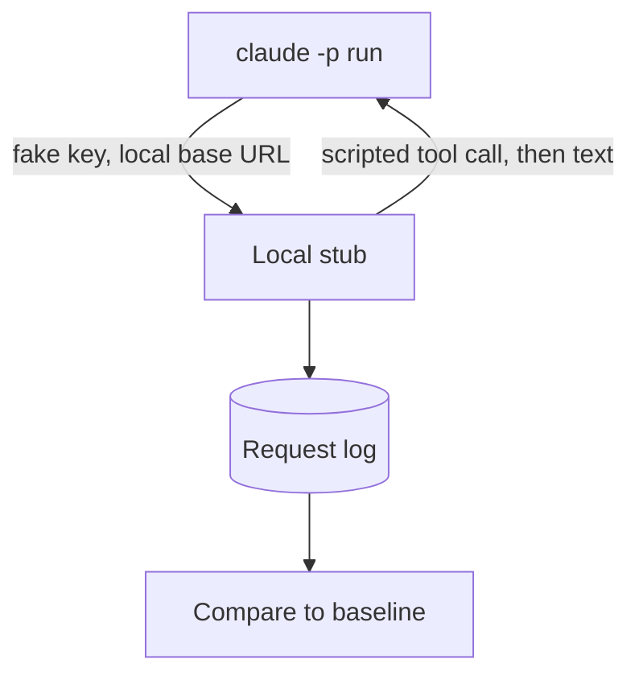

A probe is a small test that runs Claude Code `2.1.329` and checks what one setting changes.
The probes ran against a local stub of the Messages API, so they cost nothing and sent no data to Anthropic.
They show which environment variables and settings have an effect that you can see. Use the results to learn what a variable does before you set it. The [Example](#example) shows one probe that you can run by hand.

## Example

Repeat the `[1m]` probe by hand against any stub or proxy that logs request headers.

```bash title="Check the 1M beta"
ANTHROPIC_BASE_URL=http://127.0.0.1:8787 \
ANTHROPIC_API_KEY=sk-ant-fake-probe \
claude -p "Reply with 'OK'." --model "claude-sonnet-4-5[1m]" --output-format stream-json --verbose
```

Look for `context-1m-2025-08-07` in the `anthropic-beta` header. Run it again without `[1m]` and the value is gone. Not every model sends the beta: see [Request Details](#request-details).

## How We Probed

1. We ran the unmodified `2.1.329` program with `claude -p "Reply with 'OK'." --output-format stream-json --verbose`. Every probe used that prompt unless a row says otherwise.
2. We gave each run a fresh config folder, a fresh home folder, a fake API key, and a base URL that points to the local stub.
3. We turned off telemetry and other optional traffic. We pointed the proxy settings to a closed port, so a stray request to `api.anthropic.com` fails.
4. The stub answered `POST /v1/messages` as a stream or as JSON. It sent one scripted tool call and then the plain text `OK`. It wrote the method, path, headers, and body of each request to a log.
5. We made two baselines. The first was a plain run. The second ran a `Bash` tool call with command hooks and a local plugin with a skill, a hook, and an MCP server. Two repeat runs of each baseline were identical after we removed ids, paths, and times.
6. We set each variable name to `1` in both baselines. The release toolkit built the name list from the strings of the program and from its list of environment names. The sweep tested 2,123 names and skipped 104, because `childEnv` fixes them or their names look like credentials (`ANTHROPIC_API_KEY` is one). Each run got an explicit environment with only the probe setup and the name under test, so no variable of the parent shell reached the program. We compared headers, betas, the system prompt, tools, body fields, output events, files in the config folder, the hook log, and the environment names that hooks saw. The sweep keeps the names of the changed fields, not their values. We read each wording in the table below from a request in a separate run that set the one variable, or from the text of the program, and we keep the field name alone where we did not.
7. Some names got extra runs: auto mode with a `Bash` call, `--brief`, `--resume`, and the plugin variables with a plugin.
   `--brief` changed the requests (see the table).[^brief] `--resume` with the id of an earlier run kept the session id.

Every request carried the fake key.



## Results

Of the 2,123 names, 138 had an effect that we could see: 68 are <Undocumented /> in the [Environment Variables](../configure/env-vars/index.md) pages and 70 are documented there. The rest had none. The sweep flagged 40 more names (`BUILDKITE` to `YARN_REGISTRY`). Their only change was in the first message of the second baseline, so we counted them as noise.
The table below leaves out 13 of the 138, because their only difference was in the environment names that hooks saw. The 14th, `CLAUDE_CODE_SUBPROCESS_ENV_SCRUB`, is in [Static and Print Probes](#static-and-print-probes).
No visible effect in print mode does not prove that a variable does nothing.
Many variables work only in other modes, in remote sessions, or with a login.
This page lists the undocumented names with a clear effect and the items that differ from the docs. The other documented names with an effect, and all names with no visible effect, are left out.

### Effects and Differences

An item is <Differs /> when the result differs from the docs.
The status of an environment variable is the one on its row in the [Environment Variables](../configure/env-vars/index.md) pages. This table records only what the probe saw.

| Name | What We Set | Status | What We Saw |
| --- | --- | --- | --- |
| `--model X[1m]` | model flag | <Undocumented /> | `context-1m-2025-08-07` is added for `claude-sonnet-4-5[1m]` and `claude-opus-4-6[1m]`. It is not added for `sonnet[1m]`, `opus[1m]`, `claude-sonnet-5-5[1m]`, `claude-opus-5-5[1m]`, or `claude-haiku-5-5[1m]`. Without `[1m]` it is never sent. |
| hook `type: "script"` | settings | <Differs /> | Rejected at load. Under `PostToolUse` the text is `Unknown hook type "script"; entry ignored. Valid types: command, prompt, agent, http`, and the command hooks in the same file still ran. Under `PreToolUse` the text starts `Unknown hook type "script" — a PreToolUse/PermissionRequest hook that cannot be loade`. No hook of that file ran, command hooks included. |
| `CLAUDE_AGENT_SDK_VERSION` | `1` | <Undocumented /> | Changes the user agent. The program adds `, agent-sdk/<value>` after the entrypoint.[^sdk-version] |
| `CLAUDE_CODE_ACTION` | `1` | <Undocumented /> | The request names the entrypoint `claude-code-github-action`. The user agent and the agent list change too. |
| `CLAUDE_CODE_ADDITIONAL_PROTECTION` | `1` | <Undocumented /> | Adds the request header `x-anthropic-additional-protection` with the value `true`.[^protection] |
| `CLAUDE_CODE_AGENTS_MD_ROWS_EVERY_PROCESS` | `1` | <Undocumented /> | Changes files in the config folder. |
| `CLAUDE_CODE_AMBER_ASTROLABE` | `1` | <Undocumented /> | Adds a block to the system prompt that has the words `Shall I`. |
| `CLAUDE_CODE_ATTACHMENTS_BY_PATH` | `1` | <Undocumented /> | Adds the `SendUserFile` tool. |
| `CLAUDE_CODE_BASALT_COVE` | `1` | <Undocumented /> | Adds a "Communicating with the user" section to the system prompt. |
| `CLAUDE_CODE_BISON_CAIRN` | `1` | <Undocumented /> | Adds a "Delivering work" section to the system prompt. |
| `CLAUDE_CODE_BRIDGE_CHILD_AUTO_DEFAULT` | `1` | <Undocumented /> | Starts in `auto` permission mode (`permissionMode` in `init`). Adds the betas `dangerous-tool-use-2026-09-03` and `afk-mode-2026-01-31`. The body fields and the first message change. |
| `CLAUDE_CODE_BRIEF` | `1` | <Undocumented /> <Gated note="Works only behind a feature flag or server gate" /> | Adds a "Talking to the user" section to the system prompt and a tool to the tool list. The run needs a second request. |
| `CLAUDE_CODE_CONTAINER_ID` | `1` | <Undocumented /> | Adds the request header `x-claude-remote-container-id`.[^container] |
| `CLAUDE_CODE_COORDINATOR_MODE` | `1` | <Undocumented /> <Gated note="Works only behind a feature flag or server gate" /> | The tool list, the agent list, and the first message change. The beta `advanced-tool-use-2025-11-20` is not sent. |
| `CLAUDE_CODE_COWORK_PLUGIN_SKILL` | `1` | <Undocumented /> | Changes the first message. |
| `CLAUDE_CODE_DISABLE_CLAUDE_API_SKILL` | `1` | <Undocumented /> | Removes the `claude-api` skill from the request. The `init` skill list and slash commands change too. |
| `CLAUDE_CODE_DISABLE_REFUSAL_RETRY` | `1` | <Undocumented /> | Adds the beta `fallback-credit-2026-06-01`. |
| `CLAUDE_CODE_EMIT_STARTUP_TIMING` | `1` | <Undocumented /> | Adds `startup_timing` to the `init` event. |
| `CLAUDE_CODE_EMIT_TOOL_USE_SUMMARIES` | `1` | <Undocumented /> | Adds events to the output. The program has a `tool_use_summary` event type.[^summary] |
| `CLAUDE_CODE_EMIT_USER_PROMPT_SUBMIT_HOOK_EVENTS` | `1` | <Undocumented /> | Adds events to the output. |
| `CLAUDE_CODE_ENABLE_EXPERIMENTAL_ADVISOR_TOOL` | `1` | <Undocumented /> <Gated note="A feature flag or server gate decides by default. This variable overrides it" /> <Experimental /> | Adds the beta `advisor-tool-2026-03-01` and changes the slash commands. |
| `CLAUDE_CODE_ENABLE_REFRESH_MCP_TOOLS` | `1` | <Undocumented /> | Adds a tool to the tool list (seen with a plugin MCP server configured). |
| `CLAUDE_CODE_ENABLE_TOKEN_USAGE_ATTACHMENT` | `1` | <Undocumented /> | Changes the first message. |
| `CLAUDE_CODE_ENTRYPOINT` | `1` | <Undocumented /> | Sets the entrypoint in the request to the value (`1` here). The user agent and the agent list change too. |
| `CLAUDE_CODE_FOOTER_INDICATOR` | `1` | <Undocumented /> | Adds `footer_indicator` to the `init` event. |
| `CLAUDE_CODE_HUMBLE_HAMMOCK` | `1` | <Undocumented /> <Gated note="A feature flag or server gate decides by default. This variable overrides it" /> | Changes the keys of the output events. The program has a `wire_tool_inputs` field on the assistant event.[^wire] |
| `CLAUDE_CODE_INCLUDE_PARTIAL_MESSAGES` | `1` | <Undocumented /> | Adds events to the output. |
| `CLAUDE_CODE_INLINE_TOOLS` | `1` | <Undocumented /> <Gated note="Works only behind a feature flag or server gate" /> | Adds the beta `inline-tools-2026-09-15` to `anthropic-beta`. |
| `CLAUDE_CODE_LANTERN_PRISM` | `1` | <Undocumented /> <Gated note="Works only behind a feature flag or server gate" /> | Changes the slash command list in the `init` event. |
| `CLAUDE_CODE_LARCH_CISTERN` | `1` | <Undocumented /> <Gated note="A feature flag or server gate decides by default. This variable overrides it" /> | Adds a "Corrections" section to the system prompt. |
| `CLAUDE_CODE_PEWTER_OWL` | `1` | <Undocumented /> <Gated note="A feature flag or server gate decides by default. This variable overrides it" /> | Adds a "Talking to the user" section to the system prompt and a tool to the tool list. The run needs a second request. |
| `CLAUDE_CODE_PEWTER_OWL_TOOL` | `1` | <Undocumented /> <Gated note="A feature flag or server gate decides by default. This variable overrides it" /> | Adds only the `SendUserMessage` tool. |
| `CLAUDE_CODE_PROFILE_STARTUP` | `1` | <Undocumented /> | Writes files under `startup-perf/` in the config folder (`.json` and `.txt` in the program).[^startup-perf] |
| `CLAUDE_CODE_REMOTE_MEMORY_DIR` | `1` | <Undocumented /> | The system prompt names the memory folder as the value plus `/projects/` (`1/projects` here). |
| `CLAUDE_CODE_REPLY_GATE_POLICY` | `1` | <Undocumented /> | Changes `capabilities` in the `init` event. |
| `CLAUDE_CODE_SDK_READS_SESSION_STATE` | `1` | <Undocumented /> | Adds events to the output. The program has a `session_state_changed` system event.[^session-state] |
| `CLAUDE_CODE_SDK_READS_STARTUP_MARKS` | `1` | <Undocumented /> | Adds events to the output. The program writes lines with a `startup_mark` field.[^startup-mark] |
| `CLAUDE_CODE_SIMULATE_PROXY_USAGE` | `1` | <Undocumented /> | Removes the whole `anthropic-beta` header. The `thinking` body field and the first message change too. |
| `CLAUDE_CODE_SKILL_PROPOSALS` | `1` | <Undocumented /> | Adds a "Saving skills" section to the system prompt. |
| `CLAUDE_CODE_SKIP_PLUGIN_LOCAL_MCP_SERVERS` | `1` | <Undocumented /> | Plugin MCP servers do not start. `mcp_servers` and the tool list change. |
| `CLAUDE_CODE_SKIP_PLUGIN_MCP_SERVERS` | `1` | <Undocumented /> | Plugin MCP servers do not start. `mcp_servers` and the tool list change. |
| `CLAUDE_CODE_SYNC_PLUGIN_INSTALL` | `1` | <Documented /> | Adds events to the output (seen with a plugin). |
| `CLAUDE_CODE_TETHER_LIVE` | `1` | <Undocumented /> <Gated note="A feature flag or server gate decides by default. This variable overrides it" /> | Changes the `anthropic-beta` header and the body fields. |
| `CLAUDE_CODE_TURN_UPDATES` | `1` | <Undocumented /> | Adds guidance to the system prompt about what you are about to do. |
| `CLAUDE_CODE_USE_COWORK_PLUGINS` | `1` | <Undocumented /> | Changes files in the config folder, the output events, and the hook environment. |
| `CLAUDE_CODE_WEBSEARCH_CITATIONS` | `1` | <Undocumented /> | Changes the system prompt. |
| `CLAUDE_CODE_WILLOW_TERN` | `1` | <Undocumented /> <Gated note="A feature flag or server gate decides by default. This variable overrides it" /> | Adds a "Writing for the user" section to the system prompt. |
| `CLAUDE_COWORK_MEMORY_EXTRA_GUIDELINES` | `1` | <Undocumented /> | Changes the system prompt. |
| `CLAUDE_COWORK_MEMORY_GUIDELINES` | `1` | <Undocumented /> | Replaces the memory section of the system prompt with a `# auto memory` section. |
| `CLAUDE_COWORK_MEMORY_INDEX_CONTENT` | `1` | <Undocumented /> | Changes the first message. |
| `CLAUDE_MEMORY_STORES` | `1` | <Undocumented /> | Changes the system prompt. [Configure and Memory](#configure-and-memory) has the JSON forms. |
| `CLAUDE_PROJECT_UUID` | `1` | <Undocumented /> <Gated note="Works only behind a feature flag or server gate" /> | Adds the `Projects` tool. |

Names that ended the run with the value `1`, because they need a real value: `CLAUDE_CODE_BLOCKING_LIMIT_OVERRIDE`, `CLAUDE_CODE_CLIENT_DATA_URL`, `CLAUDE_CODE_CUSTOM_OAUTH_URL`, `CLAUDE_CODE_REMOTE_TOOLS_PIN_STORED_LOGIN`, `CLAUDE_CODE_USE_ANTHROPIC_GOOGLE_CLOUD`, and `ANTHROPIC_LOG`. `CLAUDE_CODE_WEB_FETCH_AGENT` is in [Subagents and Hooks](#subagents-and-hooks).
`CLAUDE_CODE_PLUGIN_DIRS` needs a folder path. The sweep did not test it with one, so this page has no result for it.

## Request Details

- `cc_version=2.1.329.25f`: this suffix appeared in a run with the prompt `Reply with 'OK'.` on the default model `claude-opus-5-5` and on `claude-sonnet-5-5`.
- `/v1/messages/cache_touch`: never called. In the `cachetouch` cases, with and without `CLAUDE_INTERNAL_FC_OVERRIDES`, the stub got no `cache_touch` request and no `cache-keepalive` beta, and only `/v1/messages` was called. The program sends a touch only when the response has `anthropic-cache-keepalive: active` for a request with the `cache-keepalive-2026-09-03` beta.
  The program turns that beta on only when `allow_cache_keepalive` is set and `ANTHROPIC_UNIX_SOCKET` is not.
  The body is `{"request_id": ...}`. Touches repeat every 30 s by default (10 to 120). The path, the header name, the body field, and the interval range come from the program.[^cache-touch]
- `context-1m-2025-08-07`: added by a `[1m]` suffix for `claude-sonnet-4-5[1m]` and `claude-opus-4-6[1m]`, and not for `sonnet[1m]`, `opus[1m]`, `claude-sonnet-5-5[1m]`, `claude-opus-5-5[1m]`, or `claude-haiku-5-5[1m]`. Not sent without the suffix.
  The default model in this setup was `claude-opus-5-5` and it did not send the beta. The program ties the beta to a test for `[1m]` in the model name, and it strips the suffix before it names the model.[^one-m]
- Base betas in the plain run: `claude-code-20250219`, `interleaved-thinking-2025-05-14`, `context-management-2025-06-27`, `per-turn-control-2026-07-01`, `mid-conversation-tool-changes-2026-07-01`, `thinking-token-count-2026-05-13`, `advanced-tool-use-2025-11-20`, `effort-2025-11-24`, `thinking-display-updates-2026-08-18`.
  A first-party connection adds `prompt-caching-scope-2026-01-05`, `thinking-binding-controls-2026-08-01`, and `cache-diagnosis-2026-04-07`, and a `diagnostics` body field. The beta `mid-conversation-system-clear-at-2026-08-21` appeared only in the login run. Before the first request the program also called `GET /api/claude_code/settings` and `GET /api/claude_code/policy_limits`.
  We tested that with the cc-inspect `code` action `cli` and `apiHost: true`, with the base URL left unset, so the TLS copy of the stub took the request and nothing left the machine. Behind the stub, `prompt-caching-scope-2026-01-05` is not sent.

## Auto Mode

With `--permission-mode auto` and a `Bash` call, the stub got no classifier request in the default run: the stub saw 2 requests and the debug log said `server_no_result`. `CLAUDE_CODE_AUTO_MODE_SERVER=1` and `CLAUDE_CODE_TWO_STAGE_CLASSIFIER=1` gave the same result.

| Case | Classifier Requests | `server_no_result` In The Debug Log |
| --- | --- | --- |
| Default (`automode.classifier-server.default`) | 0 | Yes |
| `CLAUDE_CODE_AUTO_MODE_SERVER=1` | 0 | Yes |
| `CLAUDE_CODE_TWO_STAGE_CLASSIFIER=1` | 0 | Yes |
| `CLAUDE_CODE_AUTO_MODE_SERVER=0` | 10 (five `xml_s1`, five `xml_s2`) | No |
| `CLAUDE_CODE_DISABLE_EXPERIMENTAL_BETAS=1` | 10 (five `xml_s1`, five `xml_s2`) | No |
| `CLAUDE_CODE_AUTO_MODE_SERVER=1` with `CLAUDE_CODE_DISABLE_EXPERIMENTAL_BETAS=1` | 10 (five `xml_s1`, five `xml_s2`) | Yes |

The cc-inspect `code` action `cli` ran `claude auto-mode` subcommands with a fake key and a temp home, config folder, and project:

| Run | Status | Result |
| --- | --- | --- |
| `claude --settings s.json auto-mode config`, with `autoMode.allow` in `s.json` | <Documented /> | Exit 0. The output holds the rule. |
| `claude auto-mode config --settings s.json` | <Documented /> | Exit 1, `error: unknown option '--settings'`. |
| `claude auto-mode defaults` and `claude auto-mode config`, with no settings | <Documented /> | Exit 0, the same output. |

### `autoMode.classifyAllShell`

We ran `claude -p --permission-mode auto` against the stub with `CLAUDE_CODE_AUTO_MODE_SERVER=0`, the command `curl -s http://127.0.0.1:9/x`, and a user allow rule `Bash(curl -s http://127.0.0.1:9/x)`. The table shows whether the stub got requests that carried the classifier system prompt: `1` means the classifier ran (10 requests), `0` means it did not. Without the variable, the stub gives the [server-side check](../configure/permissions/auto-mode.md#the-server-side-check) no verdict, and the stub gets no classifier request. A managed folder needs `sudo`, so the user ran the managed cases (`managed.*.classify-*`): managed `true`, managed `false`, and managed unset, each in 7 settings combinations.

| Settings | Classifier Requests |
| --- | --- |
| No allow rule | 1 |
| Allow rule, flag unset | 0 |
| Allow rule, user `true` or `--settings` `true` | 1 |
| Allow rule, user `false` or `--settings` `false` | 0 |
| User `false` and `--settings` `true`, or the reverse | 1 |
| Managed `false`, with user or `--settings` `true` | 1 |
| Managed `false`, with user or `--settings` `false`, or neither | 0 |
| Managed `true`, with user `false`, `--settings` `false`, or neither | 1 |

Any `true` in user, `--settings`, or managed settings turns the flag on. `false` is the same as unset. The program reads no project or local source: `true` in project settings or in local settings gave 0 classifier requests (cases `print.automode.classify-all-shell.project-true` and `local-true`).

## Subagents and Hooks

Follow-up probes ran `2.1.329` against the same stub, with a fake key, a temp home folder, and `-p "Reply with 'OK'." --output-format stream-json --verbose`. The stub scripted `Agent`, `Workflow`, `Bash`, and `Skill` calls, so each subagent request could be logged. No login was used. The interactive screen has its own section below.

| What We Ran | Status | What We Saw |
| --- | --- | --- |
| `Workflow` script with `agent()`, and the model variables | <Undocumented /> | An `agent()` `model` option is used: `haiku` gave a `haiku` subagent, and with `CLAUDE_CODE_SUBAGENT_MODEL=haiku` and the option `sonnet` the subagent ran on `sonnet`. `CLAUDE_CODE_WORKFLOW_SUBAGENT_MODEL` wins over the option and over `CLAUDE_CODE_SUBAGENT_MODEL`. The value `inherit` is skipped, so `CLAUDE_CODE_SUBAGENT_MODEL` applies. With `CLAUDE_CODE_SUBAGENT_MODEL_FORCE`, the workflow variable is dropped. With no setting, the subagent runs on the main model, `claude-opus-5-5`. |
| `CLAUDE_CODE_WEB_FETCH_AGENT=1` | <Undocumented /> | The roster gains `web-fetch`. The agent has only `WebFetch`. |
| `Agent` with each built-in type | <Undocumented /> | `claude`, `Explore`, `general-purpose`, `Plan`, `statusline-setup`, and `fork` started. `claude-code-guide`, `comment-thread-analyst`, `observer`, and `workflow-subagent` gave `Agent type '...' not found` in `-p`, and the text lists `claude, Explore, general-purpose, Plan, statusline-setup`. |
| `--append-subagent-system-prompt` | <Undocumented /> | The marker text reached the subagent system prompt. The two variants with environment variables only did not. |
| `observer` frontmatter | <Undocumented /> | Without `CLAUDE_CODE_EXPERIMENTAL_OBSERVER_AGENTS=1` the run had 7 requests and no `ObserverReport` tool. With it, the run had 10 requests, and three of them carried the `ObserverReport` tool. |
| Agent frontmatter spelling | <Undocumented /> | `Tools` and `disallowed-tools` were ignored. `disallowedTools` worked (the subagent had only `Read`). |
| `isolation: remote` in a file | <Undocumented /> | No error. The agent ran in a local worktree, like `worktree`. `isolation: none` did not. |
| Command hooks with `continue:false` and `systemMessage` | <Documented /> | See [Hook Input and Output](../extend/hooks/input-and-output.md#what-continue-and-systemmessage-do-per-event). |
| Setup hook `additionalContext` | <Differs note="Not in the model request." /> | It never reached the model request. |

## Configure and Memory

These checks ran `2.1.329` against the same stub. Nothing was run with a login.

| What We Ran | Status | What We Saw |
| --- | --- | --- |
| User `outputStyle` plus a plugin style with `force-for-plugin: true` | <Undocumented /> | The system prompt used the forced plugin style. The `init` event still named the configured style. |
| `CLAUDE_CODE_REMOTE=1`, with and without `CLAUDE_CODE_REMOTE_MEMORY_DIR` | <Undocumented /> | Without the dir, the auto-memory section is missing. With it, the section returns and names the dir. |
| `CLAUDE_MEMORY_STORES` set to a JSON value | <Undocumented /> | A list of objects with `name` and `path` changed the memory section: it names the store and is longer. A read-only mode adds a read-only note, and a read-write mode adds a team folder. A list of strings, `[]`, and text that was not JSON changed nothing. No tool was added. |
| `CLAUDE_COWORK_MEMORY_*` | <Undocumented /> | `CLAUDE_COWORK_MEMORY_EXTRA_GUIDELINES`, `CLAUDE_COWORK_MEMORY_GUIDELINES`, and `CLAUDE_COWORK_MEMORY_INDEX_CONTENT` put their value in the request. The guidelines variable removes the memory heading. See [Memory and Rules](../configure/memory-and-rules.md). |
| `CLAUDE_CODE_POST_TURN_MEMORY` without a mounted memory server | <Undocumented /> | The debug log said `[extractMemories] skipping (mcp) — CCR memory server not mounted, turned off, or it lists no write tool`. |
| `claude auto-mode config` with `autoMode.allow` in each source | <Documented /> | User settings and `--settings` applied. `.claude/settings.json` and `.claude/settings.local.json` were ignored. Managed settings applied too, see [Managed Folder Probe](#managed-folder-probe). |

## Context Budget

This run used the default model, with a fresh config folder and a project that holds only a `README.md`. `/context` is a local command, so no model reply is needed.

| What We Ran | Status | What We Saw |
| --- | --- | --- |
| `claude -p "/context" --output-format stream-json` in an empty session | <Undocumented /> | The server accepted the login, so the numbers are counts from the token counting endpoint, not a local estimate. The session reported the model `claude-sonnet-5-5`. The session held 13,244 tokens: System prompt 2,250, System tools 8,790, and Skills 2,194. After one prompt it held 17,125 tokens, with Messages 3,695 and System tools 8,986. See [Context Budget](../how-it-works/context-budget.md). |

## Live Login Probes

These runs used a subscription login (`CLAUDE_CODE_OAUTH_TOKEN`) on `2.1.329` with a fresh config folder and an empty project. The service accepted the token: the message request got status `200`, `policy_limits` got `200`, and `settings` got `404`. The request runs went through a local proxy that kept only the paths and the `anthropic-beta` header.

| What We Ran | Status | What We Saw |
| --- | --- | --- |
| `claude -p "Reply with 'OK'."` with the login, compared with the same run using a fake API key against the stub | <Undocumented /> | The main request had the same 11 body keys, the same tool names, and 4 system blocks on both sides. One system line was on the key side only. The model puts it there, not the login: the key side runs Opus 5.5 and the login side runs Sonnet 5.5, and the probe keeps no body text. Only the login sent `oauth-2025-04-20`, `extended-cache-ttl-2025-04-11`, and `tool-provenance-2026-10-26`. The default model was `claude-sonnet-5-5` with the login and `claude-opus-5-5` with the key. The login run also called `GET /api/claude_code/policy_limits` and `GET /api/claude_code/settings`. See [Betas](api/betas.md#observed-request). |
| `attributionProject` in user settings, with a good value and with a value that names no Project | <Undocumented /> | A good value put `cc_project` and `cc_project_src=user` in the billing header, and the debug log said `Attribution Project: <value> (from user)`. A bad value left out `cc_project`, and the debug log said `[WARN] Attribution Project: ignored a value that names no Project (from user)`. |
| `/upg` typed in the interactive screen with the login | <Undocumented /> | One typeahead row showed. The screen did not report an unknown command. |

## Account Probes

These runs used the real `2.1.329` binary with the cc-inspect `code` tool, action `cli`. Each run had a fake claude.ai login in `.credentials.json` (`login: "oauth"`): the token was the fake key, with the scopes `user:inference` and `user:profile`. There was no API key. With `apiHost: true`, a local proxy sent `api.anthropic.com` to a TLS copy of the stub, with a throw-away CA that only the child trusted. The proxy refused every other host. The prompt was `Reply with 'OK'.`.

The stub reply to `GET /api/oauth/profile` set every field: `account` with `uuid`, `email`, `display_name`, `full_name`, and `created_at`, and `organization` with `uuid`, `name`, `organization_type` (`claude_max`), `rate_limit_tier`, `seat_tier`, `has_extra_usage_enabled`, `billing_type`, `subscription_created_at`, `claude_code_trial_ends_at`, `claude_code_trial_duration_days`, `cc_onboarding_flags`, and `plan_display_name`. The stub always sends the header `request-id: req_probe` with that reply.

| Hypothesis | Prediction | Command | Status | Result |
| --- | --- | --- | --- | --- |
| `USE_LOCAL_OAUTH=1` and `CLAUDE_LOCAL_OAUTH_API_BASE` point the profile request at a local server. | The stub gets `GET /api/oauth/profile`. | `code {"action":"cli","login":"oauth","env":{"USE_LOCAL_OAUTH":"1","CLAUDE_LOCAL_OAUTH_API_BASE":"<stub>"},"args":["--debug-file","<config-dir>/debug.log","-p","Reply with 'OK'."],"show":"debug.log"}` | <Undocumented /> | Wrong. The stub got only `POST /v1/messages`. The debug log said `connect ECONNREFUSED 127.0.0.1:9`, so the request went to the dead proxy. The program always picks the production OAuth config.[^oauth-config] |
| The profile request goes to `api.anthropic.com` whatever `ANTHROPIC_BASE_URL` says. | With `apiHost`, the request shows up with the host `api.anthropic.com`. | The same input with `"apiHost":true` and the profile reply in `replies` | <Undocumented /> | Right. The requests were `GET https://api.anthropic.com/api/oauth/profile` and `POST /v1/messages?beta=true` (the stub). |
| The reply fields land in `oauthAccount` of `.claude.json` under camelCase names. | `oauthAccount` holds a key for each field. | The same input with `"show":".claude.json"` | <Undocumented /> | `oauthAccount` had `accountUuid`, `emailAddress`, `organizationUuid`, `hasExtraUsageEnabled`, `billingType`, `accountCreatedAt`, `subscriptionCreatedAt`, `ccOnboardingFlags`, `claudeCodeTrialEndsAt`, `claudeCodeTrialDurationDays`, `seatTier`, `planDisplayName`, `displayName`, `fullName`, and `profileFetchedAt`. `organization.name`, `organization_type`, and `rate_limit_tier` were not in it. See [Account and Access](../how-it-works/account-and-access.md#the-profile-request). |
| The plan and the rate limit tier go to the stored login. | `.credentials.json` gets `subscriptionType` and `rateLimitTier`. | The same input with `"show":".credentials.json"` | <Undocumented /> | With the header `request-id: req_probe`, the login got `subscriptionType: "max"`, `subscriptionTypeSource: "profile"`, `subscriptionTypeVerifiedAt`, and `rateLimitTier`. The program checks the id against the pattern `^req_[A-Za-z0-9_-]{1,36}$`.[^req-id-pattern] |

## Static and Print Probes

These runs used `2.1.329`, the same stub, a fake key, a temp home folder, and a dead proxy, plus static reading of the program. Nothing was run with a login or with `sudo`. The [Managed Folder Probe](#managed-folder-probe) is the one section that used `sudo`.

A hook inherits the environment of the probe, so a change in the probe environment shows as a change in the hook environment. Read a hook-environment difference against `tools/release/lib/env.ts` before you record it.

| What We Ran | Status | What We Saw |
| --- | --- | --- |
| Control requests on stdin with `--input-format stream-json` | <Undocumented /> | `set_model`, `get_binary_version`, `mcp_status`, `interrupt`, and `set_permission_mode` with `plan` got `success`. An unknown model ID still got `success`. A bad mode got `error: Cannot set permission mode: must be one of acceptEdits, auto, bypassPermissions, default, dontAsk, plan`. An unknown subtype got `error: Unsupported control request subtype: bogus_sub`. See [Control Protocol](../extend/headless/control-protocol.md). |
| A user agent with `mcpServers` frontmatter | <Undocumented /> | The server started with the agent. The same agent in the project folder did not start its server (the probe folder was not trusted). |
| `claude plugin validate` with odd `version` values | <Documented /> | A string of any text and a semver string passed, with one warning. A number, `null`, and an array failed with exit 1. An empty string counted as missing. See [Plugin Manifest](../extend/plugins/manifest.md). |
| `CLAUDE_CODE_SUBPROCESS_ENV_SCRUB` with test variables | <Undocumented /> | `AWS_SECRET_ACCESS_KEY`, `MY_SECRET`, `HF_TOKEN`, `DATABASE_URL`, and `KUBECONFIG` were removed from the hook environment. The GitHub token variables, `GH_HOST`, and `PLAIN_VAR` stayed. The permission mode was forced to `default`. See [Tools and Bash Variables](../configure/env-vars/tools-and-bash.md#what-the-scrub-removes). |
| Default `-p "Reply with 'OK'."` for 25 models | <Undocumented /> | The probe recorded the size of the system prompt and the tool count per model: `claude-opus-5-5` had 7,116 characters and 12 tools, and `claude-sonnet-5-5` had 6,849 characters and 12 tools. See [System Prompt](../how-it-works/system-prompt.md#prompt-by-model). |
| `PostToolUse` hook logging per tool | <Undocumented /> | The `tool_response` shapes in [Hook Events](../extend/hooks/tool-events.md#posttooluse-tool_response-shapes). The model was not offered `CronCreate`, `CronList`, `Glob`, `Grep`, `NotebookEdit`, `WebFetch`, or `WebSearch` in `-p`, so those shapes are missing. |
| `claude -p "/context"` | <Undocumented /> | 25 `count_tokens` requests and no `/v1/messages` request. |
| `CLAUDE_CODE_MANAGED_SETTINGS_PATH` | <Undocumented /> | Ignored. The log still read the machine default managed folder. |
| A `CLAUDE.md` of 45,000 characters in `-p`, `claude doctor`, and `get_status` | <Undocumented /> | No size warning in these three. It shows in the interactive screen (see [Interactive Probes](#interactive-probes)). |
| A nested `CLAUDE.md` over the limit, on `claude-opus-5-5` and on `claude-sonnet-4-5` | <Undocumented /> | The nested file loaded and the program kept the start of it: 149,988 characters on Opus and 39,988 on Sonnet. The end was not kept. |

## Toolkit Case Groups

The release toolkit runs the case files in `tools/release/probes/` against the installed `claude`. A print case uses the local stub and a fake key. A pty case drives the interactive screen. A live case runs through `tools/release/secret-runner.sh`, which loads the login inside the child process. The `2.1.329` captures are in `captures/2.1.329/`. The table lists the groups and what they run. It does not repeat their results, which are in the tables above and in the pages they link to.

| Layer | Group or Case | Cases | Status | What It Runs |
| --- | --- | --- | --- | --- |
| Print | `api319` | 73 | <Undocumented /> | Betas and tools: `beta.*` (plain, first-party, use-case ID, provenance, side query), `tool.wrap-up.*`, `tool.exit-plan.*`, `tool.propose-skills.*`, `tool.widget.*`, and the `gateway.*` cases (`assume-role-*`, `identity-retention-*`, cost route, `request-tags-billing-group`, `request-tags-plain`, `no-postgres`). |
| Print | `cli319` | 31 | <Undocumented /> | `disableReplyCheck` (`reply-check.*`), the theme calls (`theme.engine`), `cowork-plugin.*`, `mcp-add-web`, `ultrareview-*`, the Chrome tool names (`chrome-tools.*`), `CLAUDE_CODE_PLUGIN_DIR_WATCH` in print mode (`plugin-dir-watch.*`), and the `attr.*` cases of `attributionProject`. |
| Print | `cacerts319` | 10 | <Undocumented /> | The `NODE_EXTRA_CA_CERTS` file faults: `extra-ca.*` (valid, empty, not PEM, damaged, missing) and `extra-ca-tls.*` (a TLS stub that needs the CA at the end of the file). |
| Print | `fork319` | 10 | <Undocumented /> | The `effort` option of the Mod API call `$.model.fork`: `model-fork.*`. |
| Print | `notes319` | 21 | <Undocumented /> | The sign-in end date (`login-expiry.*`) and the `anthropic.*` OpenTelemetry attributes (`otel-attrs.*`). |
| Print | `env319a` | 34 | <Undocumented /> | A set of environment variable names, among them `code-mode.*` and `config-lock-wait.*`. |
| Print | `env319b` | 93 | <Undocumented /> | A second set: `curried-trinket.*`, `gateway.*`, `inert.*`, `memory-push.probe`, `offline.*`, `orchestrator.*`, `otel-timeout.*`, `personal-hooks-off.*`, `plain-delta.*`, `reply-gate.*`, `runner.*`, and `stream-hold.*`. |
| Print | `err319` | 27 | <Undocumented /> | Error texts that a user can trigger, among them `auto-mode-print-refused`. |
| Print | `evalcreds` | 37 | <Undocumented /> | The credential paths that `claude plugin eval` hides from its Bash sandbox. |
| Print | `cli321` | 38 | <Undocumented /> | `rc-*` runs `claude remote-control` with its options. `runner-*` runs `claude self-hosted-runner` and its `orchestrator` with bad or odd values. `daemon-*` runs `list`, `hub`, `install`, `start`, `restart`, `remote-control list`, and an unknown name. Each case records the lines the program printed. |
| Print | `cli322` | 26 | <Undocumented /> | `/fast` on Vertex in print mode: `fast-vertex-global`, `fast-vertex-us`, `fast-vertex-eu`, and `fast-vertex-us-east5` set `CLOUD_ML_REGION`. `fast-vertex-model-region`, `fast-vertex-model-region-bad`, and `fast-vertex-mythos-region` set a `VERTEX_REGION_*` variable. `fast-vertex-fable` and `fast-vertex-mythos` set the model. `fast-vertex-off`, `fast-vertex-toggle`, and `fast-vertex-bad-argument` change the argument. `fast-vertex-flag`, `fast-vertex-no-settings`, and `fast-vertex-settings-off` change how `fastMode` is set. `fast-vertex-disabled` sets `CLAUDE_CODE_DISABLE_FAST_MODE`. `fast-vertex-capability-on`, `fast-vertex-capability-off`, and `fast-capability-first-party` set `CLAUDE_CODE_MODEL_CAPABILITIES`. `fast-bedrock` and `fast-foundry` use another provider. `fast-first-party` and `fast-first-party-sonnet` use the Anthropic API. `fast-request-first-party`, `fast-request-first-party-off`, and `fast-request-first-party-disabled` record the request of a prompt. [Fast Mode](../configure/models-and-providers/fast-mode.md) has the results. |
| Print | `cli323` | 16 | <Undocumented /> | `workspace-trust-*` runs `claude workspace-trust` with `--json`, with `--help`, and with `--ignore-persisted-trust` before or after the subcommand, and a project with a persisted trust record. `plugin-install-*` runs `claude plugin install --json` from a local directory marketplace, with and without `userConfig` options. `subagent-status-line-*` runs a print run with `subagentStatusLine` in a settings file, in `--settings`, with a wrong type, and without the key. `mcp-add-help` records the example lines of `claude mcp add --help`. |
| Print | `modcontext` | 1 | <Undocumented /> | `prompt-context.added-files` loads a mod from a `--plugin-dir` plugin. The mod adds one instruction file of each kind (`managed`, `user`, `project`, `local`, and `memory`) to the answer of `prompt.context`. The case records the line that the program writes above each file in the first user message. [Memory and Rules](../configure/memory-and-rules.md#labels-in-the-prompt) has the results. |
| cc-inspect | `code` action `cli`, `provider: "vertex"` | none | <Undocumented /> | A Vertex client against the stub. With the default region `us-east5` and the model `claude-fable-5-2`, `/fast` reported `Fast mode unavailable: Fast mode needs Vertex region global, us or eu · set VERTEX_REGION_CLAUDE_FABLE_5_2 to one of them and restart`. With `VERTEX_REGION_CLAUDE_FABLE_5_2=global` the request path held `locations/global`, and `/fast on` in stream mode gave `Fast mode is not available in the Agent SDK`. |
| cc-inspect | `code` action `cli`, `fastRefusal` | none | <Undocumented /> | The stub refuses each request that has `speed: "fast"` with a chosen status. A test in `inspect/mcp` covers this action. |
| cc-inspect | `code` action `cli`, the `betas` line | none | <Undocumented /> | Lists the `anthropic-beta` names of each request that sent the header. Page sections above used it for the beta lists. |

The `gateway.*` cases start a `postgres:17-alpine` container, so they need Docker. The first run pulls the image. Without Docker they stop with an error that names the install step.
The live `ultrareview` steps were removed by the owner's decision, so this site has no run of `ultrareview` on a live account. Read the official [Ultrareview](https://code.claude.com/docs/en/ultrareview) page for that command.

## Managed Folder Probe

The user ran the 61 managed cases with `sudo` on `2.1.328`. The managed folder `/Library/Application Support/ClaudeCode` was made with `sudo` (owner `root:wheel`) on macOS. It held `CLAUDE.md`, a rule, a skill, an output style, `managed-settings.json`, a `managed-settings.d/` drop-in, and `managed-mcp.json` with one stdio server. Each run also had a user server and a project `.mcp.json` server. A baseline ran without the folder. Runs used `-p --output-format stream-json`, plus `claude mcp list` and `claude mcp get`.

| What We Ran | Status | What We Saw |
| --- | --- | --- |
| `managed-mcp.json` with a user server and a project server | <Documented /> | Only the managed server started. The user and project servers were not started and not in `init` (the baseline started both). `claude mcp list` showed only the managed server. `claude mcp get` on a user server exited 1 and named only `managed_srv` among the configured servers. |
| `--mcp-config <file>` with `managed-mcp.json` present | <Documented /> | The run had no `init` event, and no server started (the baseline started all three). See [Servers passed with `--mcp-config`](https://code.claude.com/docs/en/managed-mcp#servers-passed-with---mcp-config-or---strict-mcp-config). |
| Managed `outputStyle` with a style file in the managed `.claude/output-styles/` | <Documented /> | The `init` event named the managed style and its text was in the request. A `--settings` style named `flag-style` won in the baseline only. |
| A skill in the managed `.claude/skills/`, with and without `CLAUDE_CODE_DISABLE_POLICY_SKILLS=1` | <Documented /> | The skill was listed and its description was in the request. The variable removed it. |
| Managed `CLAUDE.md` with user and project `CLAUDE.md` | <Documented /> | Order in the request: managed, then `~/.claude/CLAUDE.md`, then project `CLAUDE.md`. |
| `claudeMdExcludes` of `**/CLAUDE.md`, in user or project settings | <Documented /> | User and project `CLAUDE.md` were removed. The managed `CLAUDE.md` and the managed rule still loaded. |
| `claudeMdExcludes` of the managed absolute path, or of `<managed>/**`, in user or project settings | <Documented /> | Nothing was removed: user and project `CLAUDE.md` stayed, and the managed `CLAUDE.md` and the managed rule loaded. |
| A `managed-settings.d/` drop-in that denies `NotebookEdit` | <Documented /> | `NotebookEdit` left the `init` event tool list (present there in the baseline). It was not in the request tool list in either run (12 tools). |
| The prompt note "not verified as your organization's policy" | <Undocumented /> | It did not appear with a root-owned folder, also with `CLAUDE_CODE_ENTRYPOINT=remote_cowork` (`managed.main.claudemd-remote-cowork`). With a folder that the user owns, it appeared only with that entry point (`managed.owned.claudemd-remote-cowork`) and not without it (`managed.owned.claudemd-order`). The program has a list of two entry points, `remote_cowork` and `remote_cowork_trigger`.[^managed-note-entry] The note text is in the program.[^managed-note] The note did appear in the print case `modcontext.prompt-context.added-files` and when user settings enabled a mod from a `directory` marketplace (`managed.baseline.mod-vouch-user`). It did not appear when managed settings declared the marketplace and enabled the mod (`managed.vouch.mod-vouch-managed`). See [Labels in the Prompt](../configure/memory-and-rules.md#labels-in-the-prompt). |
| User agent with `mcpServers` frontmatter, no `--mcp-config` | <Undocumented /> | The agent ran, but its server did not start (without the managed folder it did). A notice said `blocked by enterprise MCP config: agent_srv`. |
| `autoMode` in `managed-settings.json` and a `managed-settings.d/` drop-in, with `claude auto-mode config` | <Documented /> | Both files applied. The order was user, `--settings`, managed, then the drop-in. See [Auto Mode](../configure/permissions/auto-mode.md). |

## Interactive Probes

These runs used the real `2.1.329` binary in a pseudo-terminal driven by the release toolkit (`probe:pty`). The stub, the fake key, the temp home and config folders, and the dead proxy were as in the other probes. Plain prompts were `Reply with 'OK'.` and the stub answered `OK`. Onboarding and trust were skipped by seeding the config file. The stub answered a scripted tool call where a case needed one. No login and no real credentials were used.

| What We Ran | Status | What We Saw |
| --- | --- | --- |
| `PermissionRequest` hook with `allow`, `deny`, an interrupt, exit code 2, `block`, and empty output | <Undocumented /> | The hook fired once in each case. The input had `cwd`, `effort`, `hook_event_name`, `permission_mode`, `permission_suggestions`, `prompt_id`, `session_id`, `tool_input`, `tool_name`, and `transcript_path`. With `allow` the tool ran. With `deny` it did not, and the model got a denial message. With the interrupt the turn stopped. With exit code 2, `block`, and empty output the dialog stayed open and the tool did not run. See [Hook Input and Output](../extend/hooks/input-and-output.md#what-fires-and-what-is-honored-in-the-interactive-screen). |
| `PermissionDenied` hook in auto mode, with a server check that flags the call | <Undocumented /> | The hook fired once. The input had `reason`, `tool_input`, `tool_name`, `tool_use_id`, and `permission_mode`. The reason was `The server-side auto mode classifier judged this action dangerous (it gave no explanation)`. No `PermissionRequest` hook fired. The retry case showed the retry text. |
| `Notification` hook on a permission dialog | <Undocumented /> | It fired after about 6 s with `notification_type` `permission_prompt` and the message `Claude needs your permission`. The input had `cwd`, `hook_event_name`, `message`, `notification_type`, `prompt_id`, `session_id`, and `transcript_path`. With `continue:false` in the hook output the tool still ran. |
| `PreCompact` hook on `/compact` | <Undocumented /> | The hook fired once with `trigger` `manual`. The input had `custom_instructions`, `cwd`, `hook_event_name`, `prompt_id`, `session_id`, `transcript_path`, and `trigger`. A `block` output and exit code 2 both stopped the compaction with the line `Compaction blocked by PreCompact hook`, and only `block` showed its reason. With a `systemMessage`, the message showed and a `PostCompact` hook fired with `compact_summary` in its input. |
| `Elicitation` hook that answers `accept` for an MCP form question | <Undocumented /> | The hook fired once, with `mcp_server_name`, `message`, `mode` (`form`), and `requested_schema` in its input. No dialog opened, and the server got `accept` with the content. The `ElicitationResult` hook did not fire. |
| `statusLine` with `refreshInterval` 3 | <Undocumented /> | The command ran about every 3 s. Its input had `context_window`, `cost`, `cwd`, `effort`, `exceeds_200k_tokens`, `fast_mode`, `model`, `output_style`, `session_id`, `thinking`, `transcript_path`, `version`, and `workspace`. With no `refreshInterval` an idle session ran it only at start. Runs paused while a permission dialog showed. Three mode changes in 0.2 s, or in one write, gave one run. See [Status Line](../configure/status-line.md). |
| Instruction file size warning | <Undocumented /> | A `CLAUDE.md` of 45.6k characters gave a banner `CLAUDE.md is over the 40.0k-char limit (45.6k chars)` on `claude-sonnet-4-5`, and a line in `/status`. The same file on `claude-opus-5-5` gave no banner. A file of 116.0k gave none on Opus, and 156.0k gave `CLAUDE.md is over the 150.0k-char limit (156.0k chars)`. Four files of 34.4k gave `4 instruction files add up to 137.6k chars, over the 120.0k-char total limit` on Sonnet. See [Memory and Rules](../configure/memory-and-rules.md). |

### Notification Types

Follow-up probes ran the interactive screen with a hook that logs each `Notification` input. The same stub and fake key were used, with a temp home and config folder.

| What We Ran | Status | What We Saw |
| --- | --- | --- |
| An MCP form question that the user cancels | <Documented /> | The hook got `elicitation_dialog` (message `Claude Code needs your input`) and `elicitation_response` (message `Elicitation response for server "probe": cancel`). |
| An MCP URL question that the user accepts | <Documented /> | The hook got `elicitation_url_dialog`, `elicitation_response` (`accept`), and `elicitation_complete` (message `MCP server "probe" confirmed elicitation el-1 complete`). |
| An idle session after a prompt | <Documented /> | The hook got `idle_prompt` with the message `Claude is waiting for your input` 60 s after the prompt. |
| Auto mode with no usable check | <Documented /> | The hook got `agent_needs_input` with the message `Auto mode can't check actions in this session and needs your choice`. A server that refused the beta gave the debug line `[server-classifier] the platform rejected a beta on this request (HTTP 400)`. |
| Auto mode with the local classifier (`notifications.auto-mode-local`) | <Documented /> | No notification, no billing notice, and no server check request. |

Types seen in the interactive screen: `permission_prompt`, `idle_prompt`, `elicitation_dialog`, `elicitation_response`, `elicitation_url_dialog`, `elicitation_complete`, and `agent_needs_input`. See [Hook Events](../extend/hooks/session-events.md#notification).

Types that we read in the program and did not run:

- `PushNotification` tool: the program has a flag `tengu_kairos_push_notifications` for it.[^push-flag]
- `worker_permission_prompt`: the program sends it with the text `needs permission for` and, for the network form, `needs network access to`.[^worker-prompt]
- `auth_storage_failure` and `auth_success`: sent when the login save fails or succeeds.[^auth-notify]
- `agent_completed`.[^agent-completed]
- `quota_auto_resume_fired`.[^quota-fired]
- `model_refusal_fallback`: the name is in the `notification_type` list.[^type-list] No code sends a Notification with it. The only other use is a system message subtype.[^refusal-subtype]

## What We Did Not Probe

- Cloud hook forwarding (`callback`) and the post-turn memory pass with a mounted memory server need a cloud session.
- Chrome variables need the extension.
- Remote, CCR, and cloud variables need a remote session.
- Subscriber-only paths such as `cache_touch` need a login that the service accepts.
- The `/usage` panel texts need a login that the service accepts. The program holds the text `Per-model breakdown unavailable` and `Partial usage data`,[^usage-partial] the text `Claude is temporarily limiting requests to the usage page (not your usage limit). Try again in a moment.`,[^usage-limit] and the text `Couldn't load usage data`.[^usage-fail]

## How It Works

The harness reads an env var at start or at the point of use. A probe sets one variable, runs the same short session, and compares every output to the baseline.
A change in a header, the system prompt, the tool list, or an event is an effect. A run with no change shows nothing in print mode, but the variable can still matter in another mode.

## Related Pages

- [API Betas](api/betas.md)
- [API Endpoints and Headers](api/endpoints.md)
- [Environment Variables](../configure/env-vars/index.md)
- [Hooks](../extend/hooks/index.md)
- [Request and Cache](../how-it-works/request-and-cache.md)

## Sources

[^brief]: The sweep keys for `CLAUDE_CODE_BRIEF` include the tool list, the system prompt, and a second request.
[^sdk-version]: The program, `chunk-aq3ms068.js:31171` (`agent-sdk/${process.env.CLAUDE_AGENT_SDK_VERSION}`), `chunk-aq3ms068.js:50920` (`CLAUDE_AGENT_SDK_VERSION`).
[^protection]: The program, `chunk-76t3g1yn.js:18611`.
[^container]: The program, `chunk-aq3ms068.js:19516`, `chunk-76t3g1yn.js:18959`.
[^summary]: The program, `chunk-w03c3634.js:15830`.
[^wire]: The program, `chunk-w03c3634.js:12968` (`wire_tool_inputs`).
[^startup-perf]: The program, `chunk-541wtx57.js:453`.
[^session-state]: The program, `chunk-w03c3634.js:15290`.
[^startup-mark]: The program, `chunk-541wtx57.js:88`, `chunk-541wtx57.js:88` (`startup_mark`).
[^one-m]: The program, `chunk-w03c3634.js:6777` (the beta table, `context-1m-2025-08-07`), `chunk-aq3ms068.js:24076` (the test for `[1m]`, `/\[1m\]/i`), `chunk-aq3ms068.js:23866` (the strip function for `[1m]`, `/\[1m\]/gi`).
[^cache-touch]: The program, `chunk-hg1yqkjk.js:20245` (the path `/v1/messages/cache_touch` and the header name), `chunk-hg1yqkjk.js:20265` (`touchIntervalSeconds`: the interval range), `chunk-hg1yqkjk.js:20769` (the request code, the body field `request_id`), `chunk-w03c3634.js:6791` (the `cache-keepalive` beta).
[^oauth-config]: The program, `chunk-3q5b9bqc.js:7` (`return "prod"`).
[^req-id-pattern]: The program, `chunk-v6p5k257.js:5` (the pattern `^req_[A-Za-z0-9_-]{1,36}$`), `chunk-aq3ms068.js:46915`.
[^managed-note]: The program, `chunk-qsd8sbe8.js:7143`.
[^managed-note-entry]: The program, `chunk-d2hzm69x.js:5`, `chunk-0v6g5ynk.js:188` (`remote_cowork`).
[^push-flag]: The program, `chunk-fcpsf9hj.js:257`, `chunk-apt8rb8k.js:10`.
[^worker-prompt]: The program, `chunk-zs9k1w9q.js:116222`, `chunk-zs9k1w9q.js:116404`.
[^auth-notify]: The program, `chunk-z9j6gvtc.js:1391` (`auth_storage_failure`), `chunk-z9j6gvtc.js:1223` and `chunk-z9j6gvtc.js:1413` (`auth_success`).
[^agent-completed]: The program, `chunk-rmx0yhc6.js:11696`.
[^quota-fired]: The program, `chunk-ev45d3pa.js:457`, `chunk-ev45d3pa.js:563`.
[^type-list]: The program, `chunk-0wbf18qr.js:29`, `chunk-0wbf18qr.js:29`.
[^refusal-subtype]: The program, `chunk-w03c3634.js:14693`.
[^usage-partial]: The program, `chunk-vxkg9ahh.js:3850`.
[^usage-limit]: The program, `chunk-vxkg9ahh.js:3850`.
[^usage-fail]: The program, `chunk-vxkg9ahh.js:3735`.
