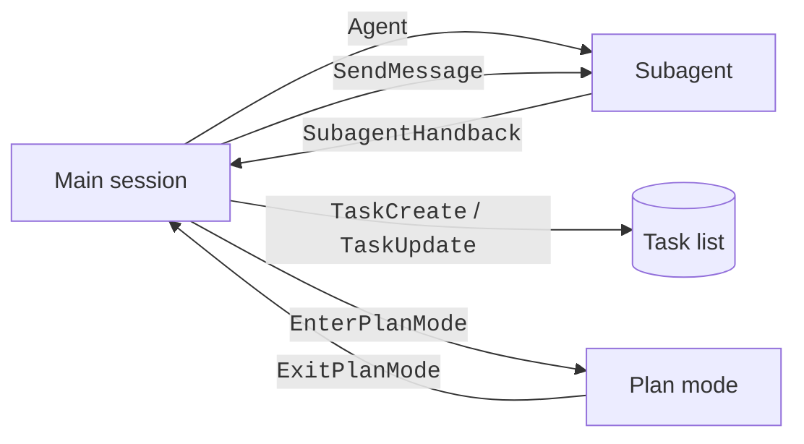

These tools start subagents, send messages, track tasks, schedule work, and control plan mode and worktrees.
Claude uses them to split a large job into parts.[^tools-sources]
For example, `Agent` starts a subagent with its own context, and `TaskCreate` adds a step to the task list.
[Tools](index.md#how-to-read-the-tool-tables) explains the Yes and No columns.

You see subagents, tasks, and plans in the interface. You can turn tasks off with `CLAUDE_CODE_ENABLE_TASKS=0`. Claude uses `TodoWrite` instead. You can turn workflows off with `CLAUDE_CODE_DISABLE_WORKFLOWS=1`. You can also add a deny rule. The task, cron, plan, and agent-listing tools need a gate.

## Example

Stop Claude from running workflows. Use the old checklist tool.

```json title=".claude/settings.json"
{
  "env": {
    "CLAUDE_CODE_DISABLE_WORKFLOWS": "1",
    "CLAUDE_CODE_ENABLE_TASKS": "0"
  }
}
```

## Tools

| Tool | Status | What It Does | How It Works | Available In | Read-Only | Parallel | Deferred |
| --- | --- | --- | --- | --- | --- | --- | --- |
| `Agent` | <Documented /> | Starts a subagent (alias `Task`). | See [Agent Parameters](#agent-parameters). | Main session and subagents until the depth limit. At the limit only a fork keeps it. | ✅ | ✅ | ❌ |
| `SubagentHandback` | <Documented /> | A subagent returns its final report to its caller. | `message` (string, required). `alwaysLoad` is true. Claude Code offers it only to a subagent that reports through it. | Subagents | ❌ | ❌ | ❌ |
| `SendMessage` | <Documented /> | Sends a message to a teammate, a named subagent, `main`, or a background agent. | `to` (string, required), `summary` (string, optional label), `message` (string, required). In a build with `notify_when_idle`, that boolean field asks for one idle notice. | Main session and subagents. | ✅ | ❌ | ✅ |
| `ListAgents` | <Documented /> <Gated note="cross-session messaging must be on, or the org setting messagingBeyondOwnAgentsDisabled" /> | Lists agents that `SendMessage` can reach. Since `2.1.327`, a long list comes in pages. Each page ends with a cursor line for the next one.[^list-agents] | `channel` and `q` (strings, optional, "not available in this build"). `cursor` (string, optional, at most 256 characters, the cursor from the last line of a long list, omit it to start from the start). Alias `ListPeers`. Not kept in background subagents. | Main session and foreground subagents. | ✅ | ✅ | ❌ |
| `Skill` | <Documented /> | Runs a skill or slash command. | `skill` (string, required), `args` (string, optional). | Main session and subagents. Kept in background subagents. | ❌ | ❌ | ❌ |
| `TodoWrite` | <Documented /> <Gated note="CLAUDE_CODE_ENABLE_TASKS=0, and a model test" /> | Writes the session checklist (legacy). | `CLAUDE_CODE_ENABLE_TASKS=0` selects `TodoWrite` over the Task tools. | Main session and subagents. Kept in background subagents. | ❌ | ❌ | ✅ |
| `TaskCreate` | <Documented /> <Gated note="CLAUDE_CODE_ENABLE_TASKS is not 0, and a model test" /> | Creates a task. | `subject` (string, required), `description` (string, required), `activeForm` (string, optional), `metadata` (object, optional). | Main session. Teammates keep it. Other subagents do not. | ❌ | ❌ | ✅ |
| `TaskGet` | <Documented /> <Gated note="hidden server-side flag" /> | Reads a task. | `taskId` (string, required). | Same as `TaskCreate`. | ✅ | ❌ | ✅ |
| `TaskUpdate` | <Documented /> <Gated note="same gate as TaskCreate" /> | Updates or deletes a task. | `taskId` (required), `subject`, `description`, `activeForm`, `status` (a task status or `deleted`), `addBlocks`, `addBlockedBy` (string arrays), `owner`, `metadata` (a null value deletes a key). | Same as `TaskCreate`. | ❌ | ❌ | ✅ |
| `TaskList` | <Documented /> <Gated note="hidden server-side flag" /> | Lists tasks. | No parameters. | Same as `TaskCreate`. | ✅ | ❌ | ✅ |
| `CronCreate` | <Documented /> <Gated note="hidden server-side flag" /> | Schedules a prompt (recurring or once). | `cron` (5-field string, local time, required), `prompt` (string, required), `recurring` (boolean, default true, expires after a set number of days), `durable` (boolean, optional). | Main session. Teammates keep it. | ❌ | ❌ | ✅ |
| `CronDelete` | <Documented /> <Gated note="hidden server-side flag" /> | Cancels a cron job. | `id` (string, required). | Same as `CronCreate`. | ❌ | ❌ | ✅ |
| `CronList` | <Documented /> <Gated note="hidden server-side flag" /> | Lists cron jobs. | No parameters. | Same as `CronCreate`. | ✅ | ❌ | ❌ |
| `ScheduleWakeup` | <Documented /> <Gated note="dynamic /loop" /> | Schedules the next turn of a dynamic `/loop`. | `delaySeconds` (number, clamped to 60 to 3600), `reason`, `prompt`, `stop` (boolean), `noop` (boolean). All are optional, but the first three are required unless `stop` is true. | Main session. | ❌ | ❌ | ❌ |
| `Workflow` | <Documented /> <Gated note="off with CLAUDE_CODE_DISABLE_WORKFLOWS=1" /> | Runs a JavaScript workflow that orchestrates subagents. | `script`, `name`, `scriptPath`, `args`, `resumeFromRunId`. `description` and `title` are ignored. Alias `RunWorkflow`. Removed from subagents. | Main session. | ❌ | ❌ | ❌ |
| `EnterWorktree` | <Documented /> | Creates a git worktree and switches into it. | `name` (string, optional) or `path` (string, optional, an existing worktree). Not both. Not deferred when `CLAUDE_CODE_SESSION_KIND` is `bg`. Refused from a subagent with a cwd override. | Main session and subagents. Kept in background subagents. | ❌ | ❌ | ✅ |
| `ExitWorktree` | <Documented /> | Leaves the worktree. | `action` (`keep` or `remove`, required), `discard_changes` (boolean, needed for `remove` when there are changes). Refused from a subagent with a cwd override. Since `2.1.327`, `remove` with `discard_changes: true` asks you first when the worktree may hold unsaved work: uncommitted files, commits, a state that Claude Code cannot check, files saved from connectors, or a task that still runs. Without `discard_changes`, the call is refused with a message to confirm with the user, and it does not ask. `keep` never asks. The ask is refused in don't-ask mode. A tool-wide `ExitWorktree` allow rule or bypass permissions mode allows it, and auto mode sends it to the auto-mode classifier.[^exit-worktree-ask] Since `2.1.326`, `remove` is also refused while a background subagent or shell command may still run in the worktree, unless Claude passes `discard_changes`.[^exit-worktree-refusal] The text says to wait for the task, ask you before it stops the task, or use `keep`.[^exit-worktree-text] | Main session and subagents. Kept in background subagents. | ❌ | ❌ | ✅ |
| `EnterPlanMode` | <Documented /> <Gated note="non-interactive runs need a permission prompt tool" /> | Switches to plan mode. | No parameters. Gives a validation error from an agent. Removed from subagents. | Main session only. | ✅ | ❌ | ✅ |
| `ExitPlanMode` | <Documented /> <Gated note="non-interactive runs need a permission prompt tool" /> | Presents the plan and leaves plan mode. | `allowedPrompts` (deprecated, unused). A subagent keeps it only when its `permissionMode` is `plan`. | Main session. | ❌ | ❌ | ✅ |
| `AskUserQuestion` | <Documented /> <Gated note="non-interactive runs need a permission prompt tool" /> | Asks the user 1 to 4 multiple-choice questions. A permission hook or prompt tool can return `afkTimeoutMs` (an integer) only in a bare allow report with empty answers and no other fields. The program refuses it in any other form.[^afk-timeout] | Removed from every subagent. The answer to a question can set `annotations[question].unanswered` to `skipped`, `replied_in_chat`, or `dismissed`. The tool result echoes it. The model does not see it. Send it only to a session whose `init` line lists `ask_user_question_unanswered_v1`. See [Capabilities of the `init` Line](../../extend/headless/stream-json.md#capabilities-of-the-init-line). | Main session. | ✅ | ❌ | ❌ |
| `SetGoal` | <Undocumented /> <Gated note="hidden server-side flag" /> | Sets a session goal, a stop check that keeps Claude working until a separate evaluator confirms it is met. Since `2.1.326`, this tool is the former `ProposeGoal`, and the program keeps `ProposeGoal` as an alias.[^setgoal-alias] | `condition` (string, required, at most 500 display columns; wide characters count double), `ask_user` (boolean, default true). With `ask_user` true, or while a goal is active, the user gets an approval dialog first. | Main session. | ✅ | ❌ | ✅ |
| `GetGoal` | <Undocumented /> <Gated note="hidden server-side flag" /> | Since `2.1.326`, reads the session goal and the last reason the evaluator gave for "not met". It says so when no goal is active.[^getgoal] | No parameters. | Same flag as `SetGoal`. | ✅ | ✅ | ✅ |
| `PauseGoal` | <Undocumented /> <Gated note="hidden server-side flag" /> | Since `2.1.326`, pauses the session goal until the next user message, and shows the user why. Claude uses it only for a blocker that the user must remove.[^pausegoal] | `reason` (string, required, at most 500 characters). Refused from an agent. The goal must exist, must not be paused, and must have had a check. | Main session. | ✅ | ❌ | ✅ |
| `ReportFindings` | <Documented /> | Reports code-review findings as a list. | `level` (`low`, `medium`, `high`, `xhigh`, `max`, optional), `findings` (array of at most 32, required). Used only when review instructions ask for it. | Main session. | ✅ | ✅ | ❌ |

## `Agent` Parameters

Claude passes these parameters when it calls `Agent`.[^agent-schema]

| Parameter | What It Does | Required |
| --- | --- | --- |
| `description` | A short (3-5 word) description of the task. | ✅ |
| `prompt` | The task for the agent. | ✅ |
| `subagent_type` | Type of agent to use. | ❌ |
| `model` | `sonnet`, `opus`, `haiku`, or `fable`. Overrides the agent definition. | ❌ |
| `effort` | Reasoning effort for this agent. Omitted in some sessions. Also takes `lower` and `higher` when `CLAUDE_CODE_SNAPPY_PELICAN` is on (or a hidden server flag is on) and no model override is set. Ignored for forks, remote isolation, and teammates. | ❌ |
| `run_in_background` | Agents run in the background by default. `false` waits for the result. | ❌ |
| `name` | Name that makes the agent addressable by `SendMessage` while it runs. | ❌ |
| `isolation` | `worktree` for a temporary git worktree, or `remote` for a cloud environment. | ❌ |
| `cwd` | Absolute path to run in. Not with `isolation: "worktree"`. Offered only in some sessions. | ❌ |
| `team_name` | Deprecated and ignored. | ❌ |
| `mode` | Deprecated and ignored. | ❌ |

`Agent` was `Task` before `2.1.63`. `Task(...)` still works as an alias in rules and agent files ([Create Custom Subagents](https://code.claude.com/docs/en/sub-agents)).

## Result Fields New in `2.1.311`

Two result fields are new in `2.1.311`.[^result-311]

| Field | Status | Tool and Result | Type | What It Means |
| --- | --- | --- | --- | --- |
| `toolsUsed` | <Undocumented /> | `Agent`, the completed result | Array of strings | A list of tool names that the program builds from the messages of the subagent. The program leaves the field out when the list is empty.[^tools-used] `Skill` turns the same list into `toolsUsedLine`. |
| `toolsUsedLine` | <Undocumented /> | `Skill`, the forked result | String | The line that the `tool_result` text opens with. It names the tools that the subagent called and that the requests of this conversation did not yet name. The program leaves the field out when there is no such tool.[^tools-used-line] |

In `2.1.327` the program has no server flag for this list. It builds the list from the tools that each agent recorded, and it leaves the field out when the list is empty.[^tools-used-321]

## Result Fields Added After `2.1.319`

One result field is in `2.1.327`.[^result-321]

| Field | Status | Tool and Result | Type | What It Means |
| --- | --- | --- | --- | --- |
| `endedLoopWakeup` | <Undocumented /> | `CronDelete` | `true` or left out | `true` when the job that `CronDelete` removed was a loop job (its `kind` is `loop`). The program then also emits a signal that a loop wakeup ended. When the program reads the lines of a session, it uses the time of a result with this field as the time the loop wakeup ended. The program leaves the field out for any other job.[^ended-loop] |

## Enable Tests

Each tool object has an `isEnabled` function. Claude Code leaves the tool out of the request when it answers no.[^enable-tests]

| Tools | Test | Result |
| --- | --- | --- |
| `ExitPlanMode` | The session is a teammate: an in-process teammate, or a dynamic team context with an agent ID and a team name. Then it uses the shared test below. | Shared test |
| | Any other session. The `denyInsteadOfPrompting` setting is on in a settings source, or in a plugin's settings (always off when the host has no disk). | Off |
| | Any other session without that setting. The shared test below. | Shared test |
| `AskUserQuestion` | The second and third rows above, with no teammate branch. | Same as `ExitPlanMode` for a session that is not a teammate |
| Shared test | The run is not interactive and channels are allowed. | Off |
| | The run is not interactive and no permission prompt tool is named (the name is empty or `none`). | Off |
| | Anything else. An interactive session is always on. | On |
| `EnterPlanMode` | It calls the `ExitPlanMode` test. | Same as `ExitPlanMode` |
| `TodoWrite` | `CLAUDE_CODE_ENABLE_TASKS` is `false`, and the model test below passes. | On |
| `TaskCreate`, `TaskGet`, `TaskUpdate`, `TaskList` | `CLAUDE_CODE_ENABLE_TASKS` is not `false`, and the model test below passes. | On |

- `2.1.319` changed the `ExitPlanMode` test.[^exit-plan-test] Before, `ExitPlanMode` used the shared test alone. Now a session that is not a teammate also turns it off when `permissions.denyInsteadOfPrompting` is `true`.
- `ExitPlanMode` is a deferred tool. A `claude -p` request lists deferred tools only when `ENABLE_TOOL_SEARCH=false`. All runs below use `-p`, a stub API, and `--permission-prompt-tool` naming an MCP tool, unless the row says otherwise.[^exit-plan-cases]

| Case | Setup | `ExitPlanMode` in `tools` | `AskUserQuestion` in `tools` |
| --- | --- | --- | --- |
| `direct` | Tool search off. | Yes | Yes |
| `direct-deny` | Tool search off. `denyInsteadOfPrompting: true`. | No | No |
| `direct-no-prompt-tool` | Tool search off. No prompt tool. | No | No |
| `teams-env-deny` | As `direct-deny`, plus `CLAUDE_CODE_EXPERIMENTAL_AGENT_TEAMS=1`. | No | No |
| `teammate` | Tool search off. Teams env. `--agent-id`, `--agent-name` and `--team-name`. | Yes | Yes |
| `teammate-deny` | As `teammate`, plus `denyInsteadOfPrompting: true`. | Yes | No |
| `teammate-no-prompt-tool` | As `teammate`, with no prompt tool. | No | No |

- In the `teammate-deny` row, a teammate asks the shared test, so the deny setting does not remove `ExitPlanMode`. `AskUserQuestion` has no teammate branch, so it goes off. The program reads the three hidden flags only when agent teams are on, and it refuses a run that gives only some of them.[^teams-flags]
- With tool search on, the same split shows through `AskUserQuestion` alone (13 tools listed, then 12), and a run with no prompt tool lists neither.[^tool-search-cases]
- A non-interactive run is `claude -p` or an SDK run. So a plain `claude -p` run has none of the three tools. Adding `--permission-prompt-tool <name>` turns them on, unless channels are allowed.
- The model test passes when any of these holds: a launch test passes (one is a host option that opts in to the todo tools); the main-loop model is not known yet; the model name holds `application-inference-profile`; the model is one of `claude-3-opus`, `claude-3-sonnet`, `claude-3-haiku`, `claude-3-5-sonnet`, `claude-3-5-haiku`, `claude-3-7-sonnet`, `claude-opus-4-0`, `claude-opus-4-1`, `claude-opus-4-5`, `claude-opus-4-6`, `claude-opus-4-7`, `claude-sonnet-4-0`, `claude-sonnet-4-5`, `claude-sonnet-4-6`, or `claude-haiku-4-5`; or `CLAUDE_CODE_ENABLE_TODO_TOOLS` is `true`.
- A probe on `2.1.322` (Opus 5.5, `-p`) sends 12 tools.[^baseline-probe] None of `TodoWrite`, `TaskCreate`, `AskUserQuestion`, or `EnterPlanMode` is among them. `Glob` and `Grep` are not among them either, because `Bash` is.
- `CLAUDE_CODE_ENABLE_TASKS=0` switches the Task tools off and `TodoWrite` on. Any other value does the reverse. The two families never run together.

## How It Works



A subagent gets a smaller tool list than the main session. For example, Claude Code removes `AskUserQuestion` and `EnterPlanMode` from every subagent.
See [Subagent Runtime](../../extend/subagents/runtime.md) for the full rules.

## Errors

Each row is a family of messages. The backticked text is the start that every message in the family shares. A row marked `Various` gathers the messages of one feature that do not share one start.

| Start of Message | Status | What It Means | Cases |
| --- | --- | --- | --- |
| `Cannot enter worktree` | <Undocumented /> | `EnterWorktree` with `path` refused the worktree. | The worktree belongs to another running session (locked). The worktree does not exist. It is a network path. Git marks it prunable. It is not a registered or linked worktree. It is the current directory. It is not under the worktrees that Claude Code manages. |
| `Orphaned worktree dir` | <Undocumented /> | Claude Code left a leftover worktree directory alone. | It will not self-heal when `git remote`, `rev-list`, or `rev-parse` fails. It will also not self-heal when the branch has unpushed commits. |
| `WorktreeCreate hook failed` | <Undocumented /> | A `WorktreeCreate` hook did not give a worktree. | The hook errored. A configured hook did not run (workspace not trusted or matcher mismatch). The hook returned no worktree path. |
| Various | <Undocumented /> | Goal tools: `SetGoal` or `PauseGoal` refused a call. Before `2.1.326`, `SetGoal` was `ProposeGoal`. | It cannot be used in agent contexts. The goal condition is empty or too wide once shown. `SetGoal` cannot clear a goal (use `/goal clear`). No interactive session can render the prompt. An earlier question about the goal has no answer yet. `PauseGoal` found no active goal, or the goal is already paused, or the goal has not been checked yet. |
| Various | <Undocumented /> | Workflow: a `Workflow` run or workflow script was refused. | A script uses syntax that workflow scripts do not support (`with`, `import()`, `await using`, a reserved identifier, a `meta` statement with spread or computed keys). A `workflow()`, `agent()`, `parallel()`, or `pipeline()` call got wrong arguments. A named workflow does not exist. A permission rule denies `agentType`. A run was killed or was restored from the journal. A run hides its script and cannot be resumed. |
| Various | <Undocumented /> | Task tools: a task, notification, or worktree tool call was refused. | A subagent called `ReadNotifications`. A task is not running, or another agent owns it. A task type or parameter is missing or not supported (`Missing required parameter: task_id`, `Unsupported task type: <type>`). `EnterWorktree` needs `path` or would give no write access. The session is already in a worktree. |
| Various | <Undocumented /> | Plan mode: `ExitPlanMode` or `EnterPlanMode` was refused. | The approval arrived without the plan. No plan file was found. The request to the lead could not be written. An agent context used `EnterPlanMode`. |
| Various | <Undocumented /> | Worktree creation: a worktree could not be created or reused. | A leftover worktree folder points to another location. A branch is already checked out elsewhere or already exists. The worktree already exists and cannot be reused. Workspace trust was not accepted yet (run `claude` once in the directory). A `WorktreeCreate` hook emitted a path that cannot be verified. Since `2.1.323`, a checkout where git could write outside the repository through a link, a symbolic ref, or another entry that is not a plain file gives `Cannot create worktree "<name>": git could write outside this repository through ...`. The text names `git-new-workdir` checkouts, older Android `repo` checkouts, and `cp -al` copies, and says to use a plain clone.[^worktree-outside] |
| `auth: this session signs in with` | <Undocumented /> | `SendMessage`: since `2.1.326`, the tool refuses to send to a session on another machine when this session signs in with an API key, an auth token, a profile, or a workload identity.[^send-auth] | The text goes on: it can't send under your claude.ai login, messaging other machines needs a session on that login, and a retry won't help. Messages to sessions on this machine still work. A second text, `auth: this session can't use the sign-in it began on, so nothing was sent.`, covers a sign-in that is gone. |

## Related Pages

- [Tools](index.md)
- [Subagents](../../extend/subagents/index.md)
- [Subagent Frontmatter](../../extend/subagents/frontmatter.md)
- [Tools Reference](https://code.claude.com/docs/en/tools-reference)

## Sources

[^tools-sources]: [Tools Reference](https://code.claude.com/docs/en/tools-reference), [Configure Permissions](https://code.claude.com/docs/en/permissions), [Create Custom Subagents](https://code.claude.com/docs/en/sub-agents), and the program, `chunk-r1yxtgw6.js:201784`.
[^list-agents]: [`2.1.327` release notes](https://github.com/anthropics/claude-code/releases/tag/v2.1.327). The program, `chunk-aey1cypd.js:7916` (the `cursor` input) and `chunk-aey1cypd.js:8642` (`isEnabled`: the org setting `messagingBeyondOwnAgentsDisabled` turns the tool on for a list of this session's own agents, and cross-session messaging turns it on for the rest).
[^exit-worktree-ask]: The program, `chunk-r1yxtgw6.js:176150` (`checkPermissions` returns `ask` only for `remove` with `discard_changes` when the state check finds work at stake, else `allow`), `chunk-r1yxtgw6.js:172300` (the state check and its messages) and `chunk-r1yxtgw6.js:174757` (`validateInput` refuses `remove` without `discard_changes` when work is at stake). The ask becomes a deny in don't-ask mode, and a whole-tool allow rule or bypass permissions mode allows it, in `chunk-56bhcxay.js:3735317`. The ask text "The session left its worktree before this call ran" is in the `2.1.327` program and not in the `2.1.325` or `2.1.326` programs. See the [`2.1.327` release notes](https://github.com/anthropics/claude-code/releases/tag/v2.1.327).
[^exit-worktree-refusal]: The program, `chunk-r1yxtgw6.js:171808`, `chunk-r1yxtgw6.js:171852`.
[^exit-worktree-text]: The program, `chunk-r1yxtgw6.js:168607`.
[^afk-timeout]: [`2.1.321` release notes](https://github.com/anthropics/claude-code/releases/tag/v2.1.321). The program, `chunk-7jayty67.js:2704`.
[^setgoal-alias]: The program, `chunk-mhtpe42j.js:1329` (the alias `ProposeGoal` to `SetGoal`), `chunk-agbay4mv.js:225` (the 500 column limit) and `chunk-t74h12d4.js:9118` (the checks: agent contexts, empty or too long condition, no clear, approval dialog). `SetGoal` is in `2.1.326` and not in `2.1.325`.
[^getgoal]: The program, `chunk-czz1aqdw.js:246` (the text) and `chunk-bhn1c6ne.js:8516` (the reply). `GetGoal` is in `2.1.326` and not in `2.1.325`.
[^pausegoal]: The program, `chunk-f6n5x3p4.js:246` (the text) and `chunk-xfc94wgg.js:8118` (the checks: agent context, active goal, not paused, already checked). `PauseGoal` is in `2.1.326` and not in `2.1.325`.
[^agent-schema]: The program, `chunk-tt7pb888.js:26338`, the `Agent` input schema.
[^result-311]: `AgentResult` and `SkillResult` in [`claude-code-tools.json`](../schemas.md), and the program, `chunk-1k75prj1.js:194737`, `chunk-z1v4zs3g.js:12591`.
[^tools-used]: The program, `chunk-1k75prj1.js:194500`, `chunk-1k75prj1.js:194737`.
[^tools-used-line]: The program, `chunk-z1v4zs3g.js:12591`, `chunk-z1v4zs3g.js:27151`.
[^tools-used-321]: The program, `chunk-56bhcxay.js:222463`, `chunk-1k75prj1.js:194737`.
[^result-321]: `CronDeleteResult` in [`claude-code-tools.json`](../schemas.md), which has the field in `2.1.327`, and the program, `chunk-492gd0dc.js:8609` (`endedLoopWakeup`).
[^ended-loop]: The program, `chunk-492gd0dc.js:8609`, `chunk-ep7e5a3y.js:23272`.
[^enable-tests]: The program, `chunk-f5fby59j.js:343-345` (`ExitPlanMode`), `chunk-prjcxrfv.js:665-667` (`AskUserQuestion`), `chunk-py588db4.js:88-92` (the teammate test), and `chunk-mfgyas5b.js:12-40` (the `denyInsteadOfPrompting` test, the shared test, and the combination of both).
[^exit-plan-test]: The program, `chunk-f5fby59j.js:11325`. The shared test is `chunk-mfgyas5b.js:836`. The teammate test is `chunk-py588db4.js:1938`.
[^teams-flags]: The program, `chunk-2v0j7fr6.js:132909`.
[^tool-search-cases]: Probe cases `print.api319.tool.exit-plan.prompt-tool`, `.prompt-tool-deny`, `.plan-mode`, `.plan-mode-deny`, and `.print`.
[^baseline-probe]: Probe case `print.request.baseline-a`.
[^worktree-outside]: The program, `chunk-56bhcxay.js:4444679`.
[^exit-plan-cases]: Probe cases `print.api319.tool.exit-plan.*`. Each row names the case suffix.
[^send-auth]: The program, `chunk-ggqna3k4.js:526` and `chunk-ggqna3k4.js:537`. [`2.1.326` release notes](https://github.com/anthropics/claude-code/releases/tag/v2.1.326).
