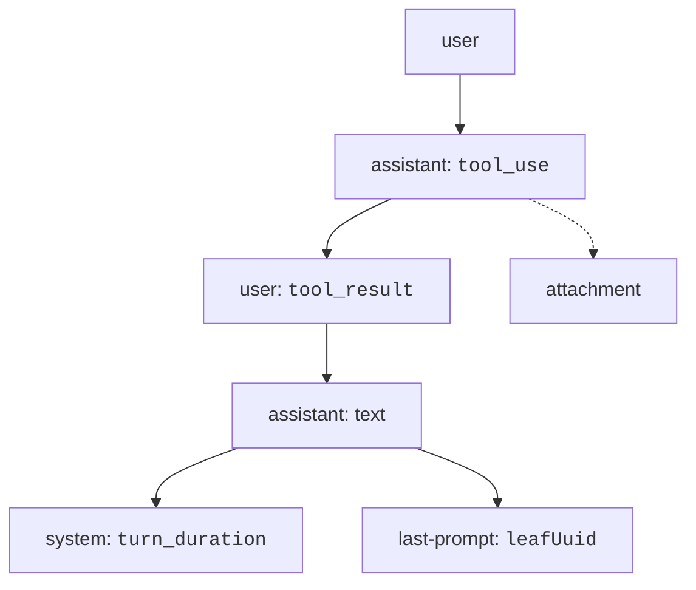

A transcript is a text file with one JSON object on each line.
Each object is a message, or a note about the session.
Claude Code appends a line as things happen. So a crash loses little.
The [official docs](https://code.claude.com/docs/en/claude-directory) say the format is internal and changes between versions. So a script that reads it can break.
Do not edit the file. For scripts, use `/export` or print mode output.

## Where Files Live

Source: [Explore the .claude Directory: Application Data](https://code.claude.com/docs/en/claude-directory#application-data).

<FileTree>

- `~/.claude/`
  - `history.jsonl` every prompt you typed
  - `projects/`
    - `<project>/`
      - `<session>.jsonl` the transcript
      - `<session>.orphaned-<time>-<id>.jsonl` set aside, not in the picker
      - `<session>.jsonl.superseded-<time>` set aside, not in the picker
      - `<session>/`
        - `subagents/` one transcript per subagent, `agent-<agentId>.jsonl`, with a `agent-<agentId>.meta.json` beside it (nested paths allowed, up to six levels)
        - `tool-results/` large tool outputs and MCP images

</FileTree>

The `<project>` name is the folder path. In it, `-` replaces every character other than a letter or a digit.
`CLAUDE_CONFIG_DIR` moves `~/.claude`. See [Sessions and Storage](../how-it-works/sessions-and-storage.md) for cleanup and resume rules.

## How the Lines Link

Most lines carry `uuid` and `parentUuid`. The `parentUuid` field points to the line before. So the lines form a chain.
A branch or a rewind makes a second child for one parent. The `last-prompt` line holds a `leafUuid` that marks the tip the picker uses.



## Common Fields

These keys appear on `user`, `assistant`, `attachment`, and `system` lines.

| Field | Status | Meaning |
| --- | --- | --- |
| `type` | <Undocumented /> | The line type (see the next section). |
| `uuid` | <Undocumented /> | ID of the line. The same in the file and in every later read. |
| `parentUuid` | <Undocumented /> | `uuid` of the line before. `null` for the first line. |
| `sessionId` | <Undocumented /> | The session ID. Also written as `session_id` on some lines. |
| `timestamp` | <Undocumented /> | When Claude Code wrote the line, in ISO form. |
| `cwd` | <Undocumented /> | The working folder. |
| `gitBranch` | <Undocumented /> | The git branch at the time, if any. |
| `version` | <Undocumented /> | The Claude Code version that wrote the line. |
| `entrypoint` | <Undocumented /> | The host that started the session, such as `cli` or `sdk-cli`. See [Architecture](../how-it-works/architecture.md#where-it-runs). |
| `userType` | <Undocumented /> | The kind of user account. |
| `isSidechain` | <Undocumented /> | `true` on lines that belong to a subagent branch. |
| `isMeta` | <Undocumented /> | `true` on a user-side row the person did not type, such as a reminder. |

## Line Types

All rows are <Undocumented />, because no docs page lists the line types.
The meanings come from the program and its type file where they are clear.

| `type` | Main keys | Meaning |
| --- | --- | --- |
| `user` | `message`, `promptId`, `permissionMode`, `permissionDecision`, `toolUseResult`, `sourceToolAssistantUUID`, `origin`, `promptSource`, `turnOrigin`, `turnPosition`, `sandboxed`, `madeBy` | A user turn or a tool result. A shell tool result can carry `sandboxed`, whether the command ran in the sandbox (the program, `chunk-bzyb60p0.js:298643`). A tool result can carry `connectorFileLines` (`chunk-bzyb60p0.js:298644`, `chunk-n6v2whwr.js:1693`): an array of rows, one per file that a connector tool fetched to or sent from the machine, which the screen shows under the result. A row has `direction` (`fetching` or `sending`), `state`, `fileName`, `bytesDone`, `bytesTotal`, `connectorName`, `fileIndex`, and `fileCount` (integer, 1 or more). `state` is `done`, `stopped`, `stopped-maybe-saved`, or an object `{refused: string, leftBehind?: true}`. The optional keys are `place` (a folder), `savedAs` (the saved path), and `groupedFiles` (integer, 2 or more, how many files the row stands for). The screen drops a row that does not match this shape. |
| `assistant` | `message`, `requestId`, `requestRef`, `requestedModel`, `effort`, `perTurnEffort`, `advisorModel`, `apiBlockIndex`, `madeBy` | A reply of the model. An entry can have `madeBy`, which tells what made it: `model` (the model wrote it), `input` (the entry was made from user input; the program also sets it on a `system` `local_command` entry), or `other` (Claude Code made the entry, not the model). The program counts an `other` entry as a model reply only when it is also `handedOff` (`chunk-7f901c6t.js:42` and `chunk-7f901c6t.js:42`, `chunk-a0tz781a.js:11386`). On a `user` entry the value is `other` (the transcript schema). |
| `system` | `subtype`, `content`, `level`, `durationMs`, `messageCount` | A note that the model never reads. |
| `attachment` | `attachment`, `rendered`, `renderedRole`, `renderedInHumanTurn`, `renderedBesideToolResult` | Context that Claude Code adds beside the conversation. `rendered` is the text the model sees and `renderedRole` is `user` or `system`. `renderedBesideToolResult` is `true` on a `remote_session_change` attachment, and `renderedInHumanTurn` is on a `queued_command` attachment whose text differs inside a human turn (the program). |
| `queue-operation` | `operation`, `content`, `commandUuid`, `deliveryId`, `reason` | A prompt or command that waits in the queue. |
| `api-request` | `params`, `shapeHash`, `cacheControl`, `requestDigest`, `querySource`, `base`, `keep`, `tail`, `id` | The shape of one request. |
| `api-request-shape` | `shape`, `shapeHash` | The `system` and `tools` of a request, stored once. |
| `api-request-blob` | `hash`, `message` | A message stored by its hash. |
| `file-history-snapshot` | `messageId`, `snapshot`, `isSnapshotUpdate` | A file checkpoint for rewind. |
| `file-history-delta` | `messageId`, `snapshotMessageId`, `backup`, `trackingPath` | A change to a checkpoint. |
| `last-prompt` | `lastPrompt`, `leafUuid` | The last prompt, for the picker. |
| `ai-title` | `aiTitle` | The title that the model made for the session. |
| `mode` | `mode` | The mode of the session. Seen value: `normal`. |
| `permission-mode` | `permissionMode` | The permission mode. Seen value: `auto`. |
| `cost-state` | `totalCostUSD`, `totalAPIDuration`, `totalAPIDurationWithoutRetries`, `totalToolDuration`, `totalDuration`, `totalLinesAdded`, `totalLinesRemoved`, `modelUsage`, `hasUnknownModelCost`, `startTime`, `modelCallCostUSD` | Totals for cost and time. The line can have `modelCallCostUSD`, the cost of the model calls that the cost ledger counts apart. The program writes it only when it is above 0 (`chunk-bzyb60p0.js:24567`, `chunk-f9x2f6cx.js:1895`). Each `modelUsage` entry also has `cacheCreationEphemeral5mInputTokens` and `cacheCreationEphemeral1hInputTokens` (see [Stream JSON Messages](../extend/headless/stream-json.md#usage-error-and-process-fields)). |
| `atis-latch` | `atis` | The `atis` value of the session's feature-flag client, Claude Code keeps it once per conversation, so it stays the same. Claude Code sends it as the `x-cc-atis` header. Empty without a flag value (it was empty in our stub run). |

Lines of types `file-history-snapshot`, `file-history-delta`, `last-prompt`, `ai-title`, `mode`, `permission-mode`, `cost-state`, `atis-latch`, and `queue-operation` carry `sessionId` but not the chain fields.

### Other Types in the Writer

These names are in the program next to the writer. The meanings come from the writer and reader code (source: the program), not from example lines.

| `type` | Main keys | Meaning |
| --- | --- | --- |
| `custom-title` | `customTitle` | The title you set, for example with `/rename`. |
| `agent-name`, `agent-color` | | The name and color of the session's agent. `/rename`, `/color`, or an agent sets them. |
| `agent-setting` | | The agent definition that the session runs as, for example from `--agent`. |
| `tag` | `tag` | A tag on the session. |
| `worktree-state` | `worktreeSession` | The worktree that the session works in. `null` after it ends. `worktreeSession` can have `extensionRoot`: the project root of the session before `EnterWorktree` made the worktree. The program sets it only when the session was in that root and the worktree is in the same repo. While the session is in the worktree and has not moved out, the program loads skills, plugins, and commands from this root, not from the worktree (`chunk-aw5nczax.js:7302`, `chunk-rb36kwbn.js:541`). |
| `tools-used` | `tools`, `sessionId`, `uuid` | The names of the tools that the session used, written again when the set grows. Last line wins. The first such line of a session file can have `uuid`, a new ID. The program adds it only when it also sends the line to its internal event writer (`chunk-bzyb60p0.js:33489`). |
| `pr-link` | `prNumber`, `prUrl`, `prRepository`, `timestamp` | Ties the session to a pull request. |
| `bridge-session` | `bridgeSessionId`, `lastSequenceNum`, `sessionGroupingId`, owner ids | The Remote Control link. |
| `content-replacement` | `replacements`, `agentId` | Records which large tool results a short stand-in replaced. A resume then uses the same stand-ins. |
| `attribution-snapshot` | `messageId` | A snapshot of file-contribution data for commits. On load the program keeps only the last one (`chunk-bzyb60p0.js:41238`) and trims a large one. |
| `fork-context-ref` | `agentId`, `parentSessionId`, `parentLastUuid`, `contextLength` | A forked agent's pointer to its parent. The fork reads the parent's lines and does not copy them. |
| `observer-ref` | `observerTaskId`, `observerAgentType`, `agentId`, `timestamp` | An observer agent's pointer. |
| `session-owner` | `sessionId`, `accountUuid`, `organizationUuid` | The account and organization that own the session. The program writes it only when it has an account with an `accountUuid` (`chunk-bzyb60p0.js:32033`, `chunk-j7dp96he.js:29`). |
| `data-flow-records` | `v`, `sessionId`, `agentId`, `records`, `snapshot` | Records of which responses and tool calls fed the work of the main loop or of an agent (`agentId`). Each record has a `response_id`, or a `tool_name` with `tool_use_id` or `event_id`. `snapshot` is `true` when the line holds all records, not only the new ones (`chunk-bzyb60p0.js:31742`, `chunk-bzyb60p0.js:32103`). |
| `data-flow-incomplete` | `v`, `sessionId`, `codes`, `agentId` | Marks that the records of the main loop or of an agent are not complete. `codes` lists the loss codes, which are integers from 1 to 255 when the program replays a saved session. `agentId` is present only when the record is for an agent (`chunk-bzyb60p0.js:38261`, `chunk-bzyb60p0.js:31737`, `chunk-bzyb60p0.js:33532`, `chunk-01eypw0a.js:161`). |
| `derived-from` | `v`, `sessionId`, `sessions` | The sessions that this one came from. Each item has `type`, `id`, `via` (for example `clear`, `fork`, `resume`, or `import`), and can have `started`. A child process reads them from `CLAUDE_CODE_LAUNCHED_BY_SESSION_IDS` (`chunk-bzyb60p0.js:33515`, `chunk-v6ez7m15.js:43`). |
| `resume-head-vouch` | `sessionId`, `sum` | A hex `sum` that vouches for `resume-head.jsonl`. The program calls this file "the side file that speeds up loading" the transcript. It writes the file in the session folder when you resume a large session file (`chunk-bzyb60p0.js:40170`, `chunk-bzyb60p0.js:41896`). See the conditions below the table. |
| `progress` | `toolUseID`, `parentToolUseID`, `data` | Progress of a running tool, hook, skill, or agent. `data.type` is `hook_progress`, `tool_heartbeat`, `bash_progress`, `powershell_progress`, `agent_progress`, `agent_api_retry`, `skill_progress`, `search_results_received`, `query_update`, `workflow_log`, `workflow_phase`, `workflow_agent`, or `artifact_publish_retry`. The transcript writer drops each `progress` row before it writes (`chunk-bzyb60p0.js:42867` for the filter, and `chunk-bzyb60p0.js:34391`, where the writer applies it before it calls `insertMessageChain`). The schema lists only the shared fields for this type. |
| `isolation-latch` | `side` | Records a one-time choice about where the session runs, kept for resume. |
| `memory-mode` | `mode`, `afterUuid`, `reason`, `account` | A stamp that auto memory switched mode. One per switch. |
| `dev-mods` | `folder` | The folder of a mod under development that the session uses. |
| `frame-link` | `path`, `frameUrl`, `title`, `artifactCount` | A link from the session to an artifact page. |
| `ended-by-model` | `timestamp` | Marks that the model ended the session. |
| `line-withheld` | `bytes` | Not a stored type. When a transcript is uploaded, `{"type":"line-withheld","bytes":N}` replaces a line that could not be read or was too large. |
| `artifact-autoreact-ledger` | `artifacts`, `accountUuid`, `v` | Bookkeeping for automatic replies to artifact comments. |
| `relocated` | `relocatedCwd` | The working folder was moved. |
| `summary` | `leafUuid`, `summary` | A summary line. The program reads these lines on load (`chunk-bzyb60p0.js:41052`). |
| `continued-in` | `continuedInSessionId` | Points to the session that continued this one. |
| `history-suppression`, `artifact-comment-monitor` | | Also in the program's table. We read no further meaning. |

The program writes the `data-flow-records`, `data-flow-incomplete`, and `derived-from` lines only when a feature flag and an organization policy (`allow_data_flow`) allow data-flow records (`chunk-865at33z.js:33925`).

The program writes `resume-head-vouch` on `--resume` when all of these are true (the program):

- `CLAUDE_CODE_TRANSCRIPT_TAIL_LOAD` is `on` or `verify`.
- The platform is not Windows. On `"windows"`, tail loading is off (`chunk-bzyb60p0.js:29692`).
- The session file is larger than 5 MiB, the size from which the program can write `resume-head-vouch` (`chunk-bzyb60p0.js:29662`, `chunk-bzyb60p0.js:40170`).
- The file has a `compact_boundary` line at 4 MiB or more from the start, and no `user`, `assistant`, `system`, `attachment`, or `progress` line comes before it (`chunk-bzyb60p0.js:25240`, `chunk-bzyb60p0.js:39469`).
- The `compact_boundary` line is at most 1 MiB (`boundaryLength`, `chunk-bzyb60p0.js:25489`).

`proactivity` and `language` are not line types. They are kinds of `attachment` (`attachment.type`). `proactivity` carries `status`, `level`, and `tools`. `language` carries the reply `language`.

On resume the program applies a replay policy to each type. Unknown types add up.

- Last line wins: most types in the lists above, including `atis-latch`.
- Add up: `content-replacement`, `fork-context-ref`, `frame-link`, `artifact-comment-monitor`, and `memory-mode`.
- Dropped at a compact boundary: `progress`, `file-history-snapshot`, `file-history-delta`, `last-prompt`, `continued-in`, `api-request-shape`, `api-request-blob`, and `api-request`.

## The `message` Object

On `user` and `assistant` lines, `message` holds an API message.

| Field | Where | Meaning |
| --- | --- | --- |
| `role` | both | `user` or `assistant`. |
| `content` | both | A string (a typed prompt), or an array of blocks. |
| `id`, `model`, `type` | assistant | The API message ID, the model that answered, and `message`. |
| `stop_reason`, `stop_sequence`, `stop_details` | assistant | Why the model stopped. Seen values: `tool_use`, `end_turn`. |
| `usage` | assistant | Token counts (next table). |
| `container`, `context_management`, `diagnostics`, `input_transformations` | assistant | Extra fields of the API reply. |

Content block types seen: `text`, `thinking`, `tool_use` (in `assistant` lines), and `text`, `tool_result` (in `user` lines).

### The `usage` Object

| Field | Meaning |
| --- | --- |
| `input_tokens`, `output_tokens` | Tokens read and written. |
| `cache_creation_input_tokens`, `cache_read_input_tokens` | Tokens written to and read from the prompt cache. |
| `cache_creation` | A break-down of cache writes by lifetime. |
| `output_tokens_details`, `iterations` | More detail about output and about repeated passes. |
| `server_tool_use` | Counts of server-side tool calls. |
| `service_tier`, `speed`, `inference_geo` | The tier, the speed mode, and the region of the call. |
| `fallback_credit` | Present when a fallback model answered. |

## `user` Line Fields

| Field | Meaning |
| --- | --- |
| `promptId` | Groups the lines of one prompt. |
| `permissionMode` | The permission mode when the prompt was sent. |
| `permissionDecision` | On a tool result: an object with `decision` (seen: `accept`), `source` (seen: `config`), and `reasonType` (seen: `classifier`, `mode`). |
| `toolUseResult` | The structured result of a tool. Its keys depend on the tool. Seen for `Bash`: `stdout`, `stderr`, `interrupted`, `isImage`. Seen for edits: `filePath`, `structuredPatch`, `originalFile`, `userModified`. Seen for `Agent`: `agentId`, `status`, `outputFile`, `isAsync`. |
| `sourceToolAssistantUUID` | `uuid` of the assistant line whose `tool_use` this answers. |
| `origin` | Who caused the line. Seen kinds: `human`, `peer` (a subagent hand-back). |
| `promptSource` | How the prompt came in. Seen: `typed`. |
| `turnOrigin`, `turnPosition` | Where the turn came from and its place in the chain. |
| `queueSkipAttachments`, `queueSkipSlashCommands` | Set on queued prompts that skip those steps. |

## `assistant` Line Fields

| Field | Meaning |
| --- | --- |
| `requestId` | The request ID from the API. |
| `requestRef` | A reference to the matching `api-request` line. |
| `requestedModel` | The model Claude Code asked for. The `message.model` field shows the model that answered. |
| `effort`, `perTurnEffort` | The effort level of the call. The program reads `effort` from `output_config.effort` of the request it built (`chunk-bzyb60p0.js:167505` and `chunk-bzyb60p0.js:169735`). |
| `advisorModel` | The advisor model, if the advisor tool was on. |
| `apiBlockIndex` | The index of this block in the API reply. One reply can produce several lines. |
| `thinkingDisplay`, `thinkingDurationMs` | How Claude Code showed the thinking text, and how long it took. |
| `serverClassifierRequest`, `wireToolInputs`, `wireIngestContext` | Internal fields about classifier calls and tool input on the wire. |

## `system` Subtypes

| `subtype` | Extra keys | Meaning |
| --- | --- | --- |
| `turn_duration` | `durationMs`, `messageCount`, `pendingBackgroundAgentCount` | How long a turn took. |
| `local_command` | `content`, `level`, `commandRun` | The output of a local slash command. |
| `informational` | `content`, `level` | A notice for the user. |
| `compact_boundary` | `compactMetadata`, `logicalParentUuid` | Marks where a compaction replaced the history. See [Compaction Rows](#compaction-rows). |

## Compaction Rows

Source: the program (`chunk-bzyb60p0.js:306314` for the `compact_boundary` line, `chunk-bzyb60p0.js:132646` for the `isCompactSummary` line, and `chunk-bzyb60p0.js:24945` and `chunk-bzyb60p0.js:24970` for the loader aborts `preserved_uuid_missing` and `preserved_walk_broken`).

A compaction writes a `system` line with `subtype: compact_boundary` and the content `Conversation compacted`. Its `compactMetadata` object holds these keys.

| Key | When set | Meaning |
| --- | --- | --- |
| `trigger` | At creation | `auto` or `manual`. |
| `preTokens` | At creation | The token count before the compaction. |
| `userContext` | At creation | The focus text that you gave `/compact`. |
| `messagesSummarized` | At creation | How many messages the summary covers. |
| `postTokens` | After the summary exists | The token count of the new context. |
| `durationMs` | After the summary exists | The time the compaction took. |
| `cumulativeDroppedTokens` | After the summary exists | The tokens dropped by all compactions so far. It adds `preTokens - postTokens` to the largest earlier value (`chunk-bzyb60p0.js:92850`). |
| `preservedSegment` | Partial compaction | The `headUuid` and `tailUuid` of the kept messages. |
| `preservedMessages` | Hook-built compaction | The `uuids` of the kept messages. |

The summary is a `user` line with `isCompactSummary: true` and `isVisibleInTranscriptOnly: true`.
On `--resume`, the loader finds the last boundary line. A boundary with neither `preservedSegment` nor `preservedMessages` cuts the chain: lines before it are not loaded.
With `preservedMessages`, the loader keeps each listed `uuid`. With `preservedSegment`, it walks `parentUuid` from `tailUuid` back to `headUuid`.
If a listed `uuid` is missing, or the walk does not reach `headUuid`, the load aborts with `preserved_uuid_missing` or `preserved_walk_broken`.

## Subagent Lines

A subagent writes its lines to its own file, `<session>/subagents/agent-<agentId>.jsonl`, and not to the session transcript. A search of the session file alone finds no subagent line. A line in that file can carry `attributionAgent`. It holds the agent name, for the sources `agent:builtin:<name>` and `agent:custom:<name>`. Lines caused by a skill carry `attributionSkill`, and `attributionPlugin` when the skill belongs to a plugin (the program, `chunk-865at33z.js:46485` and `chunk-865at33z.js:46498`).

## `attachment` Types

An `attachment` line holds an object in `attachment` with a `type` key.

| `attachment.type` | Meaning |
| --- | --- |
| `total_tokens_reminder` | A reminder of the token budget. Only for a model that carries the `total_tokens_reminder` capability, (`chunk-xcgcdx61.js:9395`). |
| `output_limit_note` | A note that the output hit a limit. The program has no code that builds it. Only the reader, the renderer, and the kind lists remain, so the kind still parses in an older transcript.[^output-limit-note] |
| `output_style`, `output_style_instructions` | The active output style. |
| `queued_command` | A prompt that was queued while a turn ran. |
| `nested_memory` | A nested `CLAUDE.md` that Claude Code loaded. |
| `skill_listing` | The list of skills. |
| `agent_listing_delta`, `deferred_tools_delta`, `mcp_instructions_delta` | Changes to agents, deferred tools, or MCP instructions. |
| `deferred_tools_record` | A record of deferred tools. |
| `edited_text_file` | A note that a file changed outside the model. |
| `environment`, `date`, `model`, `session_context`, `instructions` | Environment and session facts. |
| `remote_session_change` | The commit and pull request attribution text for git, as a reminder to the model. |
| `goal_status`, `auto_mode`, `credential_org`, `prompt_snapshot`, `silent_turn_reminder` | State of a goal, auto mode, the account, the prompt snapshot, and a reminder after a silent turn. |

The Mod API type `SessionAppendMessage` lists the `name` of an attachment as `queued_command`, `nested_memory`, and similar, and notice names such as `compact_boundary` and `local_command`.

## `queue-operation` Values

The `operation` key was seen as `enqueue`, `dequeue`, and `remove`. A `remove` line carries `reason`.

## File History Lines

A `file-history-snapshot` line holds `snapshot` with `messageId`, `timestamp`, and `trackedFileBackups`.
`/rewind` and `--rewind-files` use these to restore files. Claude Code keeps the newest 100 checkpoints.

## `api-request` Lines

The `params` object of an `api-request` line has these keys: `model`, `max_tokens`, `thinking`, `output_config`, `context_management`, `safeguards`, and `betas`.
The `system` and `tools` parts are in a separate `api-request-shape` line with the same `shapeHash`.
Claude Code stores large messages once in `api-request-blob` lines. Lines refer to them by hash. See [Request and Cache](../how-it-works/request-and-cache.md#body-fields).

## Example

Count the lines by `type` to see what a session holds:

```bash
jq -r .type ~/.claude/projects/<project>/<session>.jsonl | sort | uniq -c
```

List the tools the model called, in order:

```bash
jq -r 'select(.type=="assistant") | .message.content[]? | select(.type=="tool_use") | .name' \
  ~/.claude/projects/<project>/<session>.jsonl
```

:::warning
The file is plain text. A secret that a tool prints goes into it.
Set `cleanupPeriodDays` low, or `CLAUDE_CODE_SKIP_PROMPT_HISTORY`, if that matters to you.
:::

## Exact Fields

The exact fields are in this schema: `https://clawdipedia.cc/schemas/claude-code-transcript.json`, with one definition for each line `type`. The program builds this payload in code, not with a validator. So the schema comes from that code. A field marked `x-unverified` has a type that the code does not show. A field marked `x-observed` is a field that a probe saw.

Details of some typed fields in the program:

- `api-request.cut.markAddresses`: the program writes `cut` with an integer `markAddresses` (`chunk-bzyb60p0.js:19624`).
- `api-request.renderedWithdrawn`: the program sets it for a rendered `file` attachment that has `overTokenLimit` (`chunk-bzyb60p0.js:304630`).
- `attachment.attachment.hooks` is not in the schema. The display builds the `async_hook_response_batch` and `teammate_shutdown_batch` attachments (`chunk-w3q7cmdt.js:6389`, `chunk-w3q7cmdt.js:6507`).

An array field states the type of its items where the code shows it, for example `api-request.withheld`, `api-request.cacheControl`, `user.sandboxViolations`, and the hook lists of `stop_hook_summary` lines. Only `toolUseResult.content` keeps items of any type, because it holds the result of any tool.
It lists every field of this release. Build on the fields it names. Look each one up there before you rely on it.

## Related Pages

- [Sessions and Storage](../how-it-works/sessions-and-storage.md)
- [Request and Cache](../how-it-works/request-and-cache.md)
- [Context and Compaction](../how-it-works/context-and-compaction.md)
- [Undocumented Items](undocumented.md)

## Sources

[^output-limit-note]: The program, `chunk-bzyb60p0.js:102037` (the kind list), `chunk-bzyb60p0.js:301852` (the reader), and `chunk-bzyb60p0.js:304115` (the renderer).
