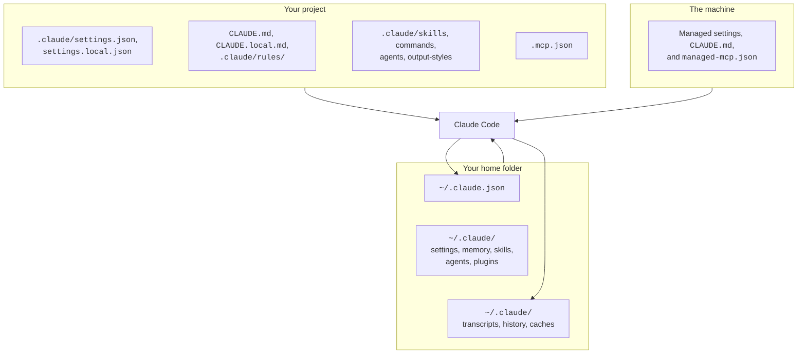

Claude Code keeps its state in plain files. You write some of them, such as settings and `CLAUDE.md`. Claude Code writes others, such as transcripts and caches. This page lists them by place, says what each one is, and links to the page with the details. See also [Explore the .claude Directory](https://code.claude.com/docs/en/claude-directory).[^overview]

## Example

You want to find where Claude Code kept the last session in `/work/app`. Then you want to remove old ones.

```bash
ls ~/.claude/projects/-work-app/
claude purge --dry-run
```

The first command lists the transcripts of that project.
The second shows what `claude purge` would delete. It deletes nothing.

:::warning
The files are not encrypted.
A secret that a tool prints goes into the transcript. Every prompt you type goes into `history.jsonl`.
:::

## The Big Picture



## Files in a Project

You usually commit these files, except the ones marked local.

| Path | Status | You write? | What it is | Page |
| --- | --- | --- | --- | --- |
| `.claude/settings.json` | <Documented /> | ✅ | Shared project settings. | [Settings Files and Scopes](../configure/settings/index.md) |
| `.claude/settings.local.json` | <Documented /> | ✅ | Your private project settings. Claude Code adds it to your global git excludes. | [Settings Files and Scopes](../configure/settings/index.md) |
| `CLAUDE.md` or `.claude/CLAUDE.md` | <Documented /> | ✅ | Project instructions. Files in the working folder and each folder above it load at launch. | [Memory and Rules](../configure/memory-and-rules.md) |
| `CLAUDE.local.md` | <Documented /> | ✅ | Private project notes. Add it to `.gitignore`. | [Memory and Rules](../configure/memory-and-rules.md) |
| `AGENTS.md` or `.claude/AGENTS.md` | <Documented /> | ✅ | Claude Code reads it when no `CLAUDE.md` or `CLAUDE.local.md` is in or above the working folder. | [Memory and Rules](../configure/memory-and-rules.md) |
| `.claude/rules/**/*.md` | <Documented /> | ✅ | Rules. A `paths` key limits a rule to matching files. | [Memory and Rules](../configure/memory-and-rules.md) |
| `<subfolder>/CLAUDE.md` | <Documented /> | ✅ | Loads after Claude reads or edits a file in that subfolder. | [Memory and Rules](../configure/memory-and-rules.md) |
| `.claude/skills/<name>/SKILL.md` | <Documented /> | ✅ | A project skill. | [Skills and Commands](../extend/skills-and-commands/index.md) |
| `.claude/commands/<name>.md` | <Documented /> | ✅ | A project slash command. Skills replace this form, but it still loads. | [Slash Commands](../extend/skills-and-commands/slash-commands.md) |
| `.claude/agents/*.md` | <Documented /> | ✅ | A project subagent. The closest definition wins. | [Subagents](../extend/subagents/index.md) |
| `.claude/agent-memory/` | <Documented /> | ❌ | Memory of subagents that set `memory: project`. `memory: local` uses `.claude/agent-memory-local/`. | [Subagent Frontmatter](../extend/subagents/frontmatter.md) |
| `.claude/output-styles/*.md` | <Documented /> | ✅ | A project output style. | [Output Styles](../configure/output-styles.md) |
| `.mcp.json` | <Documented /> | ✅ | Project MCP servers. Claude Code asks you to approve them first. | [MCP Config](../extend/mcp/config.md) |

## Files in Your Home Folder

`CLAUDE_CONFIG_DIR` moves `~/.claude`. It does not move `~/.claude.json` unless you set the variable.

| Path | Status | You write? | What it is | Page |
| --- | --- | --- | --- | --- |
| `~/.claude.json` | <Documented /> | Mostly no | App state, sign-in data, personal and local MCP servers, and per-project state. Claude Code writes it. | [Extra Keys and Global Config](../configure/settings/extra-keys.md) |
| `~/.claude/settings.json` | <Documented /> | ✅ | Your user settings. | [Settings Files and Scopes](../configure/settings/index.md) |
| `~/.claude/CLAUDE.md` | <Documented /> | ✅ | Your personal instructions for every project. | [Memory and Rules](../configure/memory-and-rules.md) |
| `~/.claude/rules/*.md` | <Documented /> | ✅ | Your personal rules. They load before project rules. | [Memory and Rules](../configure/memory-and-rules.md) |
| `~/.claude/skills/<name>/SKILL.md` | <Documented /> | ✅ | Your personal skills. | [Skills and Commands](../extend/skills-and-commands/index.md) |
| `~/.claude/skills/synced/` | <Documented /> | ❌ | Skills from your claude.ai account. | [Skills and Commands](../extend/skills-and-commands/index.md) |
| `~/.claude/skills/.trash/`, `~/.claude/plugins/.trash/` | <Documented /> | ❌ | Removed synced items. They stay so you can recover them until the retention sweep deletes them. The sweep uses `cleanupPeriodDays`, which is 30 days by default. | [Skills and Commands](../extend/skills-and-commands/index.md) |
| `~/.claude/commands/` | <Documented /> | ✅ | Your personal slash commands. | [Slash Commands](../extend/skills-and-commands/slash-commands.md) |
| `~/.claude/agents/*.md` | <Documented /> | ✅ | Your personal subagents. | [Subagents](../extend/subagents/index.md) |
| `~/.claude/output-styles/*.md` | <Documented /> | ✅ | Your personal output styles. | [Output Styles](../configure/output-styles.md) |
| `~/.claude/keybindings.json` | <Documented /> | ✅ | Your keyboard shortcuts. Run `/keybindings` to open it. | [Slash Commands](../extend/skills-and-commands/slash-commands.md) |
| `~/.claude/agent-memory/` | <Documented /> | ❌ | Memory of subagents that set `memory: user`. | [Subagent Frontmatter](../extend/subagents/frontmatter.md) |

## Plugins and Marketplaces

Official page: [Plugin Loading Reference](https://code.claude.com/docs/en/plugins/loading).

| Path | Status | What it is | Page |
| --- | --- | --- | --- |
| `~/.claude/plugins/` | <Documented /> | The plugin root. `CLAUDE_CODE_PLUGIN_CACHE_DIR` sets this parent folder. | [Plugin Loading](../extend/plugins/loading.md) |
| `plugins/cache/<marketplace>/<plugin>/<version>/` | <Undocumented /> | One copy of each installed version. | [Plugin Loading](../extend/plugins/loading.md) |
| `plugins/data/<id>/` | <Documented /> | The folder behind `${CLAUDE_PLUGIN_DATA}`. It survives updates. | [Plugin Loading](../extend/plugins/loading.md) |
| `plugins/installed_plugins.json` | <Undocumented /> | The install records. Claude Code may keep dated `set-aside` or `unreadable` copies. | [Plugin Loading](../extend/plugins/loading.md) |
| `plugins/known_marketplaces.json` | <Documented /> | The marketplace records. | [Plugin Loading](../extend/plugins/loading.md) |
| `plugins/marketplaces/<name>` | <Documented /> | A clone of each marketplace. | [Marketplaces](../extend/plugins/marketplace.md) |
| `plugins/synced` | <Documented /> | Plugins synced from claude.ai. The id is `<name>@synced`. | [Plugin Loading](../extend/plugins/loading.md) |
| `<plugin>/.claude-plugin/plugin.json` | <Documented /> | The manifest inside a plugin. | [Plugin Manifest](../extend/plugins/manifest.md) |
| `.claude-plugin/marketplace.json` | <Documented /> | The catalog inside a marketplace repository. | [Marketplaces](../extend/plugins/marketplace.md) |
| `<plugin>/hooks/hooks.json` | <Documented /> | Hooks and mod modules that a plugin ships. | [Hooks Configuration](../extend/hooks/configuration.md) |
| `.claude-plugin/types/` | <Documented /> | Type files that Claude Code writes for a mod that you load from a folder. | [Files, Nouns, and Gates](../extend/mod-api/nouns-and-gates.md) |

## Sessions and Transcripts

All paths here are under `~/.claude/`.
`<project>` is the project folder path. In it, `-` replaces every character other than a letter or digit. See [Explore the .claude Directory](https://code.claude.com/docs/en/claude-directory).

| Path | Status | What it is | Cleaned by age? |
| --- | --- | --- | --- |
| `projects/<project>/<session>.jsonl` | <Documented /> | The transcript of one session. | ✅ |
| `projects/<project>/<session>/subagents/` | <Documented /> | Subagent transcripts. | ✅ |
| `projects/<project>/<session>/tool-results/` | <Documented /> | Large tool outputs and MCP images. | ✅ |
| `projects/<project>/memory/` | <Documented /> | Auto memory. `MEMORY.md` is the index. | ❌ |
| `file-history/<session>/` | <Documented /> | Snapshots from before edits, for rewind. | ✅ |
| `plans/` | <Documented /> | Plan files from plan mode. | ✅ |
| `tasks/` | <Documented /> | Task lists. | ✅ |
| `dev-mods/<session>/` | <Documented /> | Mods that Claude wrote during a session. | ✅ |
| `uploads/<session>/` | <Documented /> | Files attached from the web or mobile app. | ✅ |
| `debug/` | <Documented /> | Debug logs, written while debug logging is on. | ✅ |
| `paste-cache/` | <Documented /> | Large pastes. | ✅ |
| `shell-snapshots/`, `session-env/` | <Documented /> | Shell setup and per-session metadata. | ✅ |
| `backups/` | <Documented /> | Copies of `~/.claude.json`. The five newest stay. | ✅ |
| `sessions/` | <Documented /> | One small file for each running session. | ❌ |
| `history.jsonl` | <Documented /> | Every prompt you typed, for up-arrow and `Ctrl+R`. | Entries age out |
| `feedback-bundles/`, `feedback/drafts/` | <Documented /> | Feedback archives and drafts that you have not sent. | Drafts age out |
| `usage-data/` | <Documented /> | Reports from `/insights` and their cached data. | ❌ |

The full list, the retention rules, and the controls are on [Sessions and Storage](../how-it-works/sessions-and-storage.md).
The line format of a transcript is on [Transcript Format](../reference/transcript-format.md).

## Caches and Account Files

| Path | Status | What it is | Page |
| --- | --- | --- | --- |
| `~/.claude/.credentials.json` | <Documented /> | Your login credentials. On macOS, the Keychain holds them. Claude Code uses this file when the Keychain rejects the write. On Linux and Windows, Claude Code uses this file (mode `0600` on Linux). Keep it private and do not delete it. | [Sessions and Storage](../how-it-works/sessions-and-storage.md) |
| `~/.claude/stats-cache.json` | <Documented /> | Totals that `/usage` shows. | [Sessions and Storage](../how-it-works/sessions-and-storage.md) |
| `~/.claude/remote-settings.json` | <Documented /> | Cached server-managed settings, or `{}`. | [Enterprise Settings](../configure/settings/enterprise.md) |
| `~/.claude/policy-limits.json` | <Documented /> | Cached organization limits. Some account types only. | [Enterprise Settings](../configure/settings/enterprise.md) |
| `~/.claude/cache/changelog.md` | <Documented /> | A cached copy of the [changelog](https://code.claude.com/docs/en/changelog) for `/release-notes`. | [What Changed](what-changed.md) |
| `~/.claude/daemon/roster.json`, `~/.claude/jobs/<id>/state.json`, `~/.claude/jobs/<id>/tmp/` | <Documented /> | The list of running background sessions, the state of each session, and its scratch folder. Keep them. The official "Agent View" page describes them. | [Sessions and Storage](../how-it-works/sessions-and-storage.md) |
| `state/`, `mods/`, `bridge-spawn/`, `seed-admin/`, `downloads/`, `cache/model-catalog/` | <Undocumented /> | Named in the program. No docs page describes them. See the link for what the program says about `state/`, `seed-admin/`, `bridge-spawn/`, and `cache/model-catalog/`.[^config-folders] | [Sessions and Storage](../how-it-works/sessions-and-storage.md) |
| `~/.claude/child-logs/` | <Undocumented /> | The session debug logs of Remote Control, written under `--verbose`. Claude Code does not write them when you set `--debug-file`.[^child-logs] | [Sessions and Storage](../how-it-works/sessions-and-storage.md) |
| `chrome/chrome-native-host` (`chrome-native-host.bat` on Windows), in `~/.claude/` | <Undocumented /> | A start script. Claude Code writes it, and the first lines say "Generated by Claude Code - do not edit manually". It starts the program with `--chrome-native-host`.[^chrome-host] | [All Flags](../configure/cli/flags.md) |
| `teams/<team>/config.json`, `teams/<team>/inboxes/<name>.json`, in `~/.claude/` | <Undocumented /> | The files of an agent team: the config of the team, and one inbox for each member. A read tool may read the `teams` folder without a prompt, as "Team files". Cleanup removes a team folder whose name ends in `.deleted-<uuid>`.[^teams-files] | [Subagent Runtime](../extend/subagents/runtime.md#agent-teams) |

## Names in the Config Folder

The tables above show full paths. This table lists each name on its own, so you can look one up.
The paths are under `~/.claude/` unless the Where column says otherwise.
Claude Code uses more names than this table lists. They are internal files, or names with a use that this page could not confirm.[^more-names]

| Name | Status | Where | What it is |
| --- | --- | --- | --- |
| `settings.json` | <Documented /> | `~/.claude/`, `.claude/` | Your user or project settings. |
| `keybindings.json` | <Documented /> | `~/.claude/` | Your keyboard shortcuts. The contexts and actions are on [Keybindings](../configure/keybindings/index.md). |
| `commands` | <Documented /> | `~/.claude/`, `.claude/` | Slash commands. |
| `skills` | <Documented /> | `~/.claude/`, `.claude/` | Skills. |
| `rules` | <Documented /> | `~/.claude/`, `.claude/` | Rules. |
| `output-styles` | <Documented /> | `~/.claude/`, `.claude/` | Output styles. |
| `plugins` | <Documented /> | `~/.claude/` | The plugin root. |
| `agent-memory` | <Documented /> | `~/.claude/`, `.claude/` | Memory of subagents. |
| `projects` | <Documented /> | `~/.claude/` | Transcripts and auto memory, one folder for each project. |
| `sessions` | <Documented /> | `~/.claude/` | One small file for each running session. |
| `tasks` | <Documented /> | `~/.claude/` | Task lists. |
| `plans` | <Documented /> | `~/.claude/` | Plan files from plan mode. |
| `debug` | <Documented /> | `~/.claude/` | Debug logs. |
| `paste-cache` | <Documented /> | `~/.claude/` | Large pastes. |
| `uploads` | <Documented /> | `~/.claude/` | Files attached from the web or mobile app. |
| `dev-mods` | <Documented /> | `~/.claude/` | Mods that Claude wrote during a session. |
| `shell-snapshots` | <Documented /> | `~/.claude/` | Shell setup. |
| `backups` | <Documented /> | `~/.claude/` | Copies of `~/.claude.json`. The five newest stay. |
| `usage-data` | <Documented /> | `~/.claude/` | Reports from `/insights` and their cached data. |
| `jobs` | <Documented /> | `~/.claude/` | The state of background sessions. |
| `daemon` | <Documented /> | `~/.claude/` | The list of running background sessions. |
| `cache` | <Documented /> | `~/.claude/` | Caches, such as `changelog.md`. |
| `changelog.md` | <Documented /> | `~/.claude/cache/` | A cached copy of the [changelog](https://code.claude.com/docs/en/changelog) for `/release-notes`. |
| `stats-cache.json` | <Documented /> | `~/.claude/` | Totals that `/usage` shows. |
| `remote-settings.json` | <Documented /> | `~/.claude/` | Cached server-managed settings. |
| `policy-limits.json` | <Documented /> | `~/.claude/` | Cached organization limits. |
| `feedback-bundles` | <Documented /> | `~/.claude/` | Feedback archives. |
| `drafts` | <Documented /> | `~/.claude/feedback/` | Feedback drafts that you have not sent. |
| `chrome` | <Undocumented /> | `~/.claude/` | Holds the start script `chrome-native-host`. Claude Code writes it.[^chrome-host] |
| `teams` | <Undocumented /> | `~/.claude/` | One folder for each agent team, with `config.json` and the `inboxes` folder. See [Subagent Runtime](../extend/subagents/runtime.md#agent-teams).[^teams-files] |
| `state` | <Undocumented /> | `~/.claude/` | Staged settings changes and consent records. See [Sessions and Storage](../how-it-works/sessions-and-storage.md). |
| `seed-admin` | <Undocumented /> | `~/.claude/` | The root for temp folders of cloud-session uploads. See [Sessions and Storage](../how-it-works/sessions-and-storage.md). |
| `model-catalog` | <Undocumented /> | `~/.claude/cache/` | Cached model catalog files and `masked-ids.json`. See [Sessions and Storage](../how-it-works/sessions-and-storage.md). |
| `.config.json` | <Undocumented /> | `~/.claude/` | The old place of the global config. In most cases, Claude Code uses it when it is a non-empty file. Otherwise it uses `~/.claude.json`. If both files hold data and are different files, Claude Code uses `.config.json`.[^config-json] |
| `.last-cleanup` | <Undocumented /> | `~/.claude/` | Holds an ISO time. Claude Code reads the age of the file to skip a new cleanup run when the file is less than 24 hours old.[^last-cleanup] |
| `.deep-link-register-failed` | <Undocumented /> | `~/.claude/` | A marker that the deep-link registration failed. Claude Code reads the age of the file. Claude Code writes it only when the registration fails with `EACCES` or `ENOSPC`. It does not try again while the file is less than 24 hours old.[^deep-link] |
| `.last-update-result.json` | <Undocumented /> | `~/.claude/` | The result of the last update, with the fields `outcome` (`success` or `failed`), `status`, `version_from`, `version_to`, and `error_code`. |
| `.update.lock` | <Undocumented /> | `~/.claude/` | The update lock. A lock younger than 5 minutes counts as held.[^update-lock] |
| `active-time.json` | <Undocumented /> | `~/.claude/` | A ledger of active time, with `version` `1` and a `windows` list. |
| `asset-cache` | <Undocumented /> | `~/.claude/plugins/` | The cache of plugin binary assets. |
| `cowork_plugins` | <Undocumented /> | `~/.claude/` | The plugin root in place of `plugins` when `CLAUDE_CODE_USE_COWORK_PLUGINS` is on. |
| `daemon.lock` | <Undocumented /> | `~/.claude/` | The lock file of the daemon. |
| `daemon.log` | <Undocumented /> | `~/.claude/` | The log of the daemon. The older copy is `daemon.log.1`. |
| `daemon.status.json` | <Undocumented /> | `~/.claude/` | Status that the daemon supervisor writes. It holds the supervisor process id. |
| `daemon.scheduled.status.json` | <Undocumented /> | `~/.claude/` | Status that the scheduled-task worker writes. It holds the worker process id. |
| `gh-pr-status-cache.json` | <Undocumented /> | `~/.claude/` | A cache of pull request statuses from GitHub. |
| `mcp-needs-auth-cache.json` | <Undocumented /> | `~/.claude/` | The MCP needs-auth cache. |
| `my-closed-issues.json` | <Undocumented /> | `~/.claude/cache/` | A cached list of closed issues. Each entry has `number`, `title`, and `closedAt`. |
| `startup-perf` | <Undocumented /> | `~/.claude/` | A `.json` and a `.txt` file that `CLAUDE_CODE_PROFILE_STARTUP=1` writes. See [Probes](../reference/probes.md). |
| `daemon.json` | <Undocumented /> | `~/.claude/` | A file in the config folder that the file tools refuse to write. The same writes to `daemon`, `jobs`, `shell-snapshots`, and `session-env` are also refused.[^daemon-json] |
| `local` | <Undocumented /> | `~/.claude/` | The folder of a local npm install. After a failed auto-update of a local install, Claude Code tells you to run `cd ~/.claude/local && npm update`. Other installs get an `npm i -g` command.[^local] |
| `loop.md` | <Undocumented /> | `.claude/`, `~/.claude/` | The task list of a `/loop` tick that has no prompt. Claude Code reads the project file first, then the config folder file. It cuts the text to 25000 characters, at the last line break before that limit, and adds a warning.[^loop] |
| `personal` | <Undocumented /> | `~/.claude/memory/` | The folder of the personal memory store (`memory/personal`). The store takes only Markdown files. The model reads and writes it through a memory store named `personal`, when memory stores are on. |
| `workflows` | <Undocumented /> | `.claude/` | Predefined workflows, as `.claude/workflows/<name>.js`. A workflow call that gives a `name` resolves it from here or from the built-in list. The save dialog writes a project workflow to this folder. |

## Managed Files

An administrator puts these on the machine. A user cannot override them.

| Path | Status | What it is | Page |
| --- | --- | --- | --- |
| `managed-settings.json` and `managed-settings.d/*.json` | <Documented /> | Organization settings. The folder is next to the file. Its files merge in alphabetical order. | [Settings Files and Scopes](../configure/settings/index.md) |
| Managed `CLAUDE.md` | <Documented /> | Organization instructions. A user cannot exclude it. | [Memory and Rules](../configure/memory-and-rules.md) |
| `managed-mcp.json` | <Documented /> | A fixed set of MCP servers. It gives the organization exclusive control. | [MCP Settings and Policy](../extend/mcp/settings.md) |
| Managed skills `<managed dir>/.claude/skills/` | <Documented /> | Skills for all users on a machine. They win over personal and project skills. | [Skills and Commands](../extend/skills-and-commands/index.md) |

The folder is `/Library/Application Support/ClaudeCode/` on macOS, `/etc/claude-code/` on Linux and WSL, and `C:\Program Files\ClaudeCode\` on Windows.

## Settings Precedence

When two settings files set the same key, the higher one wins.

```text
1. Managed settings
2. --settings (command line)
3. .claude/settings.local.json
4. .claude/settings.json
5. ~/.claude/settings.json
```

List keys such as `permissions.allow` merge across files.
The exceptions and the merge rules are on [Settings Files and Scopes](../configure/settings/index.md).

## Exact Fields

The exact fields of `~/.claude.json` are in this schema: `https://clawdipedia.cc/schemas/claude-code-claude-json.json`. It lists every field of this release. Look each field up there before you rely on it.

The schema comes from the default values and the key list in the code.[^claude-json] A field marked `x-unverified` has a type that the code does not show. A field marked `x-observed` is a field that a probe saw.

## Related Pages

- [What Can I Change](what-can-i-change.md)
- [Sessions and Storage](../how-it-works/sessions-and-storage.md)
- [Settings Files and Scopes](../configure/settings/index.md)
- [Environment Variables for Sessions and Storage](../configure/env-vars/sessions-and-storage.md)

## Sources

[^overview]: The program, `chunk-8wtweva8.js:93` (the `CLAUDE_CONFIG_DIR` variable) and `chunk-gvhwnc7g.js:1882` (`CLAUDE_CONFIG_DIR` with a fallback) and `chunk-3kp5jwr6.js:1628` (`CLAUDE_CONFIG_DIR` or the default `~/.claude`).
[^config-folders]: The program, `chunk-32gs4rex.js:11223` (`state` under `.claude`), `chunk-aq3ms068.js:42057` (`cache`, `model-catalog`), `chunk-32gs4rex.js:11030` (`seed-admin`), and `chunk-3kp5jwr6.js:1493` (`bridge-spawn`).
[^more-names]: The program, `chunk-3kp5jwr6.js:1485-1493` (a list of names in the config folder, such as `session-env` and `bridge-spawn`).
[^config-json]: The program, `chunk-gvhwnc7g.js:1826` (`.config.json` is used when it is a file with data) and `chunk-gvhwnc7g.js:1830-1858` (the checks against the other file).
[^last-cleanup]: The program, `chunk-wxnsvrbv.js:249-262` (age check, `86400000` ms), `chunk-wxnsvrbv.js:315-325` (writes the ISO time, `.last-cleanup`), and `chunk-2xccqdyk.js:2485-2492` (a marker that is not a regular file is removed and written again).
[^deep-link]: The program, `chunk-4ysh7er0.js:176-202` (the file, the `EACCES` and `ENOSPC` write, and `86400000` ms) and `chunk-2xccqdyk.js:2493`.
[^update-lock]: The program, `chunk-fxe46ja3.js:614` (`300000` ms).
[^daemon-json]: The program, `chunk-32gs4rex.js:11144-11145` (`daemon` and `daemon.json`) and `chunk-32gs4rex.js:11534` (the refusal message), `chunk-32gs4rex.js:11560` (`session-env`).
[^local]: The program, `chunk-dn3a4e32.js:1963` and `chunk-jd0zjfgy.js:1478` (`cd ~/.claude/local && npm update`).
[^loop]: The program, `chunk-znfyrhya.js:134-146` (the limit `25000` and the warning that `loop.md` was truncated), `chunk-znfyrhya.js:147-155` (the project file `.claude/loop.md`, then the config folder file `loop.md`).
[^claude-json]: The program, `chunk-aq3ms068.js:3366` (the default values, `numStartups`) and `chunk-aq3ms068.js:5669` (the key list).
[^child-logs]: The program, `chunk-f7fdz8jz.js:44593` (the folder name `child-logs`) and `chunk-f7fdz8jz.js:44607` (`$cd1ace`, joined under the Claude home), `chunk-zthba38p.js:136` (the changelog text: Remote Control session debug logs written under `--verbose` go to `~/.claude/child-logs/`), `chunk-2kt0fcxt.js:3349` (the log path is set only when `debugFile` is not set and `childLogDir` is set), and `chunk-2kt0fcxt.js:7316-7317` (`debugFile` and `childLogDir` passed to the child launcher).
[^chrome-host]: The program, `chunk-g4jweshk.js:23358` (the `chrome` folder in the config folder, the `chrome-native-host` and `chrome-native-host.bat` names), `chunk-g4jweshk.js:23368` ("Generated by Claude Code - do not edit manually"), and `chunk-g4jweshk.js:23225` (`--chrome-native-host`). The config folder is `CLAUDE_CONFIG_DIR`, or `.claude` in the home folder (`chunk-8wtweva8.js:113`).
[^teams-files]: The program, `chunk-zzhs43py.js:1744` (`config.json`), `chunk-zzhs43py.js:1589` (`inboxes`), `chunk-32gs4rex.js:13977` ("Team files are allowed for reading"), `chunk-2xccqdyk.js:2112` (the `.deleted-` pattern), and `chunk-8wtweva8.js:124` (the `teams` folder in the config folder).
